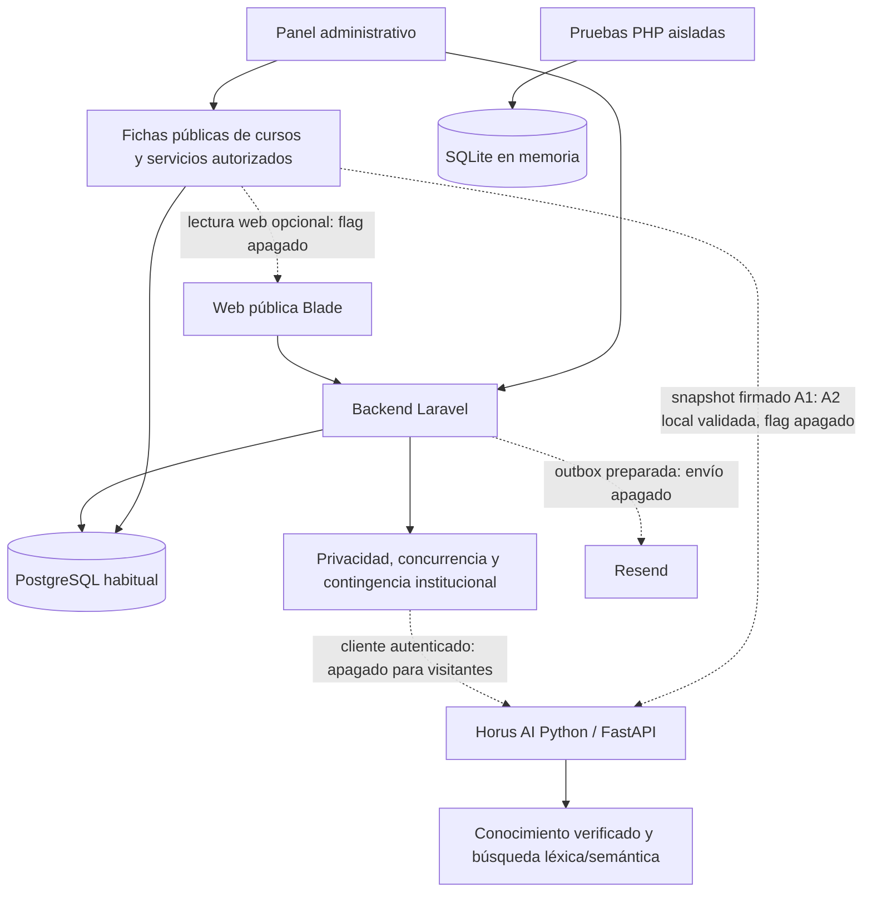

# Horus-System — Contexto técnico del proyecto

> **Estado vigente — 05/11/2026, 18:17 (America/Lima).** Informe único actualizado:
> [entrega técnica](docs/entrega-consolidacion.md). Rama anderson, HEAD
> e5dfe127deee74292beadff60349117f1b3fab41: **17 commits nuevos y 202 rutas consolidadas** desde
> 7914438d59b77b6a5e09a15d371e635cca2d894d; los 24 commits anteriores siguen preservados.
> Índice vacío al comenzar esta actualización y dos stashes intactos. Referencia local
> origin/anderson: 41 delante/0 detrás; no se volvió a consultar el servidor remoto. Sin push.
>
> **Comprobación local nueva:** status --probe --queue devolvió enabled=true, ready=true,
> errors=[], MiniLM y catálogo cargados, versión coincidente, autenticación correcta, worker vivo,
> cero pendientes y cero trabajos fallidos del catálogo. inspect confirmó **0 fichas exportables**
> y únicamente 000022 pendiente/suspendida. No se ejecutaron migraciones ni suites en esta actualización.
> 000033/000034 están aplicadas desde la ejecución autorizada anterior (batch 6; 31 registradas);
> 000023 preexistente se conservó sin ejecutar ni revertir. La consulta actual de pendientes no
> sustituye las comprobaciones físicas efectuadas durante aquella aplicación.
>
> Aplicación local: http://127.0.0.1:18080; FastAPI: 127.0.0.1:18081. Gestor propio con renovación
> cada 120 s, sin servicio de Windows ni arranque automático. Corrección del supervisor incorporada
> en add5779 (regresión anterior: 3 pruebas/11 aserciones). requirements.txt incorporado en e5dfe12:
> reutiliza 59 paquetes fijados con hashes, incluido PyTorch CPU; modelo MiniLM por separado.
> No se ha probado una instalación limpia en los equipos de los compañeros.
>
> **Pendientes de entrega:** commit de esta actualización documental si se autoriza, revisión del
> riesgo de credenciales históricas y autorización de push, publicación editorial real, aceptación
> independiente de privacidad, restauración ensayada en destino aislado y recepción de los compañeros.
> DB_PASSWORD vacío en el ejemplo vigente no elimina su historial ni demuestra rotación.
> No hay autorización de despliegue/VPS. No se declara suite PostgreSQL completa ni cierre total.
> Cambios concurrentes ajenos preservados; esta actualización toca solo contexto e informe y queda
> sin commit. Los apartados conservados debajo registran **etapas históricas**, con sus propios límites.

> **Fase E — 04/11/2026: preparación operativa implementada y probada aisladamente; sin producción ni activación pública.** Configuración opt-in, preflight CLI, supervisión del worker, renovación del catálogo y launcher con logs redactados. PHP: 3,401 aprobadas/una omitida; Python: 234; frontend: 52. Plantillas de despliegue/rollback preparadas, no instaladas ni ejecutadas. Guía: docs/horus-ai-operacion.md; cierre y limitaciones en el anexo E final.

> **D6 — 04/11/2026: APROBADA dentro del alcance local probado, sin activación pública.** Widget Blade/JS real en Edge → Laravel → HTTP real → FastAPI/MiniLM/RAG → referencias validadas → tarjetas de curso y servicio. 43 comprobaciones de navegador y 28 del arnés; caché, retirada y contingencias verificadas. Corpus público autorizado: 210 bloqueados sin HTTP adicional ni originales conservados. Regresión focalizada: 379 pruebas PHP y 52 frontend aprobadas. Servicios cerrados y SQLite temporal eliminada; únicamente se actualiza este contexto en el repositorio. Detalles y limitaciones en el anexo D6 final; los resultados aislados anteriores de D permanecen como antecedentes históricos.

> **C6 operativa — 04/11/2026: APROBADA dentro del alcance local probado.** Laravel/FastAPI independientes, HTTP real y MiniLM local: 230 comprobaciones; 210 mensajes privados del corpus público bloqueados sin HTTP. Servicios detenidos y SQLite temporal eliminada. Sin activación pública ni Fase D. Detalles y límites en el anexo C6 operativo final.


> **Fase C — 04/11/2026: implementada y probada localmente, sin activación pública.** Comprensión de consultas, selección desde el RAG existente, listados vigentes, recomendaciones con evidencia y derivación institucional. PHP 3.376 aprobadas/una omitida; Python 226 sin modelo y 23 con MiniLM real. Detalles y límites en el anexo C final. Las actas A2/B/B7 conservan su alcance histórico.


> **Fase B7 — 04/11/2026: APROBADA en el alcance local probado; Fase B operativamente cerrada en ese alcance.** Cola database SQLite, workers reales y FastAPI/MiniLM por HTTP local: publicación, modificación, retirada, confirmación diferida, duplicados, reintentos y recuperación comprobados. Servicios detenidos; sin activación pública ni Fase C. Resultados y límites en el cierre B7 al final. Las actas B anteriores conservan su alcance histórico.

> **Fase B — 04/11/2026: RAG local implementado, sin activación pública.** Se reutilizan A1/A2, búsqueda léxica y MiniLM para recuperar fragmentos firmados con procedencia, responder de forma extractiva y recomendar desde la consulta actual. No se añadieron dependencias ni se cambiaron filtros de privacidad. Resultados, rendimiento y límites al final del documento, en «Horus AI Advanced — Fase B». El cierre A2 siguiente corresponde al antecedente anterior al inicio de B.

> **Cierre funcional A2 — 04/11/2026: APROBADA en el alcance local de prueba.** Laravel y FastAPI se verificaron mediante HTTP real en `127.0.0.1`, SQLite temporal y MiniLM local. Publicación/modificación/retirada de curso y servicio, firmas/versiones, privacidad y recuperación pasaron; servicios detenidos y puertos libres al cierre. Se corrigió la procedencia de respuestas del catálogo sin cambiar los filtros de privacidad. Evidencia y límites en §12 y §16. Horus AI y la sincronización siguen apagados por defecto para visitantes; no se inició Fase B. Las actas históricas siguientes conservan sus límites propios.

> **Actualización PG-TEST-05B-2A, 30/10/2026 (tras la etapa 1): etapa 2 completada y aprobada.** La ejecución `stage2-ronda1` (autorizada; 16:16–16:18, hora local del equipo) corrió PHPUnit 11.5.57 sobre PostgreSQL 18.6 (`127.0.0.1:55433`, `horus_l2_test`, `horus_l2_test_runner`, clúster `horus_pgt_55433`, identificador `7702263743609677164`) con el filtro `AdminEstudianteTest|AdminCursoTest|CursoPublicacionTest` y terminó con `OK (48 tests, 410 assertions)`: **48 pruebas aprobadas (31 métodos, 3 clases), 410 aserciones, cero risky, cero errores, cero fallos y cero omitidas**, en 01:32,478 min y 66 MB. `migrate:fresh` (mediante `RefreshDatabase`) reconstruyó el esquema `public` de `horus_l2_test`, con autorización destructiva expresa del propietario (no incluye `horus_test_control` ni otras bases). Consentimiento retirado, perfil idéntico (`42372EC6…`), Job Object con `Active=0`, 18 evidencias históricas intactas y `probe` e identidad finales aprobados. **Acumulado de las etapas 1 y 2: 164 pruebas / 935 aserciones.** Detalle, hashes y límites: [etapa 2 ejecutada](docs/postgresql-testing-pg-test-04.md#etapa-2-ejecutada-stage2-ronda1-30102026). Plan de la etapa 3 (147 pruebas, preparado y **no ejecutado**): [plan técnico](docs/postgresql-testing-pg-test-04.md#plan-técnico-de-la-etapa-3-preparado-no-ejecutado). **PG-TEST-05B-2A no está finalizada:** siguen pendientes las etapas 3–7, la concurrencia, la suite completa y la restauración.
>
> **Actualización PG-TEST-05B-2A, 30/10/2026 (posterior a la consolidación): etapa 1 completada y aprobada.** La ejecución `stage1-ronda8` (autorizada; 14:11–14:14, hora local del equipo) corrió PHPUnit 11.5.57 sobre PostgreSQL 18.6 (`127.0.0.1:55433`, `horus_l2_test`, `horus_l2_test_runner`, clúster `horus_pgt_55433`, identificador `7702263743609677164`) y terminó con `OK (116 tests, 525 assertions)`: **116 pruebas aprobadas, 525 aserciones, cero risky, cero errores y cero fallos**, sin pruebas omitidas ni avisos. La prueba del snapshot Excel (`REPEATABLE READ, READ ONLY`) y las cinco restricciones de matrículas de PostgreSQL estaban en la selección y no se omitieron. Consentimiento retirado, perfil idéntico, ningún proceso de pruebas al cierre y `probe` e identidad finales aprobados. Auditoría posterior: los 56 hashes de `sha256.json` coinciden con los archivos. **Fue la primera etapa; PG-TEST-05B-2A no está finalizada (ver la actualización de la etapa 2, arriba).**
>
> | Fase | Estado |
> | --- | --- |
> | Etapa 0 | Completada |
> | Etapa 1 | Completada y aprobada (30/10/2026) |
> | Etapa 2 | Completada y aprobada (30/10/2026) |
> | Etapas 3–7 | Pendientes (etapa 3 preparada en plan, sin ejecutar) |
> | Pruebas de concurrencia | Pendientes |
> | Suite completa PostgreSQL | Pendiente |
> | Restauración y validaciones adicionales | Pendientes de autorización |
>
> Detalle, hashes y límites: [etapa 1 revalidada](docs/postgresql-testing-pg-test-04.md#etapa-1-revalidada-stage1-ronda8-30102026). La evidencia está fuera del repositorio; los comandos documentados no constituyen autorización para ejecutar otras etapas.
>
> **Actualización PostgreSQL, 30/10/2026 — consolidación PG-TEST-05:** rama actual `anderson`, HEAD `038895280000f57d39c698e40d3436fecc0d716f`, índice vacío y dos stashes preservados. La tabla siguiente conserva el corte histórico del 29/10; no describe los resultados posteriores.
>
> Comprobado de nuevo: SQLite **1.211 aprobadas, 1 omitida, 7.759 aserciones**, cero fallos/errores/risky; Larastan nivel 6 aprobado. Enumeración local: **116 nombres originales**, sin duplicados ni solapamiento con etapas 2–7. Identidad y probe PostgreSQL **solo lectura** aprobados en `127.0.0.1:55433`, `horus_l2_test`, `horus_l2_test_runner`, PostgreSQL 18.6, `horus_pgt_55433`, identificador `7702263743609677164`; consentimiento vacío y perfil intacto. Los diez PID históricos y los otros dos terminales pendientes ya no aparecen; el detector corregido admite la inspección actual.
>
> El resultado PostgreSQL funcional de **116 pruebas / 525 aserciones / 79 risky** era **histórico** al redactar esta consolidación y fue revalidado después (ver la actualización anterior: 116 / 525 / **0 risky**). La separación bootstrap/preflight se validó localmente y su revalidación funcional PostgreSQL se autorizó y ejecutó el 30/10 solo para la etapa 1. Al redactar la consolidación no se habían ejecutado etapa 1, concurrencia, migraciones PostgreSQL ni restauraciones; **siguen sin ejecutarse la concurrencia, las etapas 2–7, la suite completa y las restauraciones**. Pint detecta formato preexistente en dos pruebas funcionales preservadas; no se atribuye aprobación global de formato.
>
> Estado, pendientes y procedimiento actual: [consolidación PG-TEST-05](docs/postgresql-testing-pg-test-04.md#13-consolidación-del-30102026) y [detector y arnés](docs/postgresql-testing-detector-procesos.md). Los comandos históricos no constituyen autorización y las cápsulas anteriores no deben usarse con una huella Git obsoleta.

| Control de actualización | Estado examinado |
| --- | --- |
| Última actualización | 5 de noviembre de 2026, 18:17, Lima; informe consolidado vigente y comprobación local de estado, sin nuevas suites |
| Rama / HEAD de partida de la consolidaci?n | `anderson` / `306b168e8d8bbfec23301d7c050c7f7c9ae11d2f` (inspección PostgreSQL posterior a la publicación) |
| Último avance Horus AI documentado | Activación local autorizada, supervisor recuperado, regresión 3/11, dependencias incorporadas y readiness comprobada; sin despliegue público |
| Publicación web / catálogo del chatbot PHP / Advisor | Predeterminados separados conservados; Advisor habilitado únicamente en el entorno local autorizado. Cero fichas editoriales exportables; sin publicación automática |
| Resend / verificación de correo | Envío de matrícula apagado por defecto; verificación `false` y transporte `null` |
| PostgreSQL S7 / migraciones reales | S7 sigue Running/Manual en loopback 55432, aparcado y sin credenciales; la guarda de pruebas lo rechaza y solo acepta `127.0.0.1:55433` (PG-TEST-02a); clúster 55433 creado en PG-TEST-02b; las 26 migraciones aplicadas solo en `horus_l2_test` (PG-TEST-05B-1), sin pruebas con escrituras. Sin SQL, migraciones ni reparación de credenciales en S7 ni en bases reales el 29/10 |
| Última validación Horus AI documentada | E: 3401 PHP aprobadas/una omitida, 234 Python, 52 frontend; PHPStan/Ruff/Pint aprobados. Pruebas aisladas; infraestructura productiva no ejecutada |

**Naturaleza del documento:** contexto operativo sustentado en código, locks, pruebas, Git local e informes existentes. No es autorización para ejecutar procedimientos. [AGENTS.md](AGENTS.md) conserva la prioridad normativa; [CLAUDE.md](CLAUDE.md) contiene los contratos y comandos. Una implementación disponible no acredita activación, aplicación de migraciones ni despliegue.

La creación original de este contexto no inspeccionó servicios ni bases. La actualización PostgreSQL del 29/10 y su R1 autorizada comprobaron servicios, puertos, configuración aislada, identidad física y registros, e iniciaron exclusivamente Testing, sin SQL ni secretos: véase el [informe de inspección y R1](docs/postgresql-testing-validacion-final.md). Los restantes resultados históricos no se presentan como nuevas ejecuciones.

## Índice

1. [Identificación del proyecto](#identificacion)
2. [Stack tecnológico](#stack)
3. [Arquitectura general](#arquitectura)
4. [Estructura del repositorio](#estructura)
5. [Módulos del sistema](#modulos)
6. [Historial de sprints y fases](#historial)
7. [Estado de Git](#git)
8. [Estado de bases de datos](#bases)
9. [Migraciones importantes](#migraciones)
10. [Chatbot PHP](#chatbot-php)
11. [Horus AI Advisor](#advisor)
12. [Integración Laravel–FastAPI](#integracion)
13. [Publicación administrativa y web](#publicacion)
14. [Servicios y cotizaciones](#comercial)
15. [Seguridad y reglas innegociables](#seguridad)
16. [Calidad y pruebas](#calidad)
17. [Pendientes y roadmap](#roadmap)
18. [LEER ANTES DE COMENZAR CUALQUIER TAREA](#guia-agentes)

<a id="identificacion"></a>
## 1. Identificación del proyecto

**Horus-System**, para **Horus Group SRL**, reúne una web institucional y un sistema administrativo académico. Su propósito es gestionar estudiantes, cursos, matrículas y cupos, organizar operaciones internas y ofrecer orientación pública con información autorizada. El panel utiliza usuarios administrativos con roles; estudiantes y visitantes no reciben acceso al panel por registrarse.

Usuarios y fronteras: visitantes de la web, cuentas registradas/autenticadas y personal con roles `admin`, `coordinador` o `secretaria`. Los permisos efectivos controlan cada acción; pertenecer al personal no concede todos los permisos. No hay un portal estudiantil completo acreditado por la sola existencia del registro.

Principios: monolito Laravel con validación HTTP y autorización en servidor; transacciones para operaciones relacionadas; protección de cupos; separación entre datos administrativos y fichas públicas; IA opcional con respuestas locales y abstención; servicios externos desactivables; preservación del diseño y del trabajo concurrente. Docentes, Sesiones y Certificados están **excluidos como módulos del negocio**: no desarrollarlos ni reintroducirlos. Que existan textos institucionales sobre certificación no implica un módulo de certificados.

<a id="stack"></a>
## 2. Stack tecnológico

Las versiones de locks describen dependencias fijadas, no una certificación de producción. Solo PHP y Python se consultaron mediante `--version`; no se arrancó Laravel, Python ni PostgreSQL.

| Componente | Versión/fuente verificada | Responsabilidad |
| --- | --- | --- |
| Laravel / Blade | `12.70.1`, `composer.lock`; requisito `^12.0` | HTTP, ORM, validación, vistas y jobs |
| PHP | CLI local `8.4.26`; requisito del proyecto `^8.2` | Backend principal; no confundir mínimo admitido con versión local |
| PostgreSQL | `18.6` en el acta histórica de Fase A; sin consulta nueva | Base habitual y copia de ensayo |
| SQLite Testing | `:memory:` en `phpunit.xml`; versión del motor no medida aquí | Regresión aislada; no equivalencia plena con PostgreSQL |
| Alpine.js / Tailwind CSS | `3.17.5` / `3.4.19`, `package-lock.json` | Interacción y estilos; fuentes protegidas |
| Vite | `8.3.5`, `package-lock.json` | Compilación de recursos |
| PHPUnit / Larastan / Pint | `11.5.57` / `3.13.2` / `1.32.1`, `composer.lock` | Tests, análisis PHP nivel 6 y formato acotado |
| Spatie Permission | `6.25.0`, `composer.lock` | Roles y permisos |
| Python | CLI local `3.13.0`; proyecto admite `>=3.12,<3.14` | Servicio de IA independiente |
| FastAPI / Pydantic / Uvicorn | `0.162.0` / `2.14.1` / `0.54.0`, locks Python | API, esquemas estrictos y servidor ASGI |
| Sentence Transformers / PyTorch CPU | `5.7.0` / `2.15.0+cpu`, lock semántico | Inferencia semántica opcional |
| Modelo semántico | `sentence-transformers/paraphrase-multilingual-MiniLM-L12-v2` | Modelo preentrenado; no entrenamiento desde cero |

Dependencias adicionales: JWT con `firebase/php-jwt`, PDF con Dompdf, Excel con PhpSpreadsheet y transporte Resend. Consultar [composer.json](composer.json), [composer.lock](composer.lock), [package.json](package.json), [package-lock.json](package-lock.json), [pyproject.toml](chatbot-python/pyproject.toml), [lock básico](chatbot-python/requirements.lock) y [lock semántico](chatbot-python/requirements-semantic.lock). No instalar ni actualizar dependencias solo para alinear este documento.

<a id="arquitectura"></a>
## 3. Arquitectura general



Las líneas discontinuas representan caminos opcionales o pendientes; el diagrama no acredita procesos funcionando. La web usa sesión/CSRF. La API de autenticación utiliza JWT. El servicio Python no accede a la base administrativa; no administra matrículas, usuarios ni cotizaciones. El catálogo editorial es una proyección pública separada, no un volcado de `cursos`.

Entradas reales: [rutas web](routes/web.php), [rutas API](routes/api.php) y [bootstrap](bootstrap/app.php). No crear rutas equivalentes a las existentes antes de inspeccionarlas.

<a id="estructura"></a>
## 4. Estructura del repositorio

| Ubicación | Responsabilidad |
| --- | --- |
| `app/Http/Controllers/`, `app/Http/Requests/`, `app/Http/Middleware/` | Contratos HTTP, autorización y validación |
| `app/Models/`, `app/Services/`, `app/Support/` | Dominio, operaciones y utilidades; guardas de pruebas en `app/Support/Testing/` |
| `app/Console/`, `app/Jobs/`, `app/Observers/` | Comandos y captura/despacho de avisos de matrícula |
| `routes/`, `config/`, `bootstrap/` | Entradas, configuración y arranque; no leer/imprimir secretos del entorno |
| `database/migrations/`, `database/seeders/`, `database/factories/` | Esquema, permisos iniciales y datos ficticios de pruebas |
| `resources/views/`, `resources/css/`, `resources/js/` | Frontend Blade/Alpine/Tailwind protegido |
| `public/assets/` | Activos institucionales versionados; preservar identidad visual |
| `tests/Feature/`, `tests/Unit/`, `tests/PostgresIntegrity/` | Regresión funcional, unidades y perfil PostgreSQL explícito |
| `tests/frontend/`, `tests/browser/`, `tests/Support/` | Pruebas JavaScript `.mjs`, smokes y fixtures locales |
| `scripts/` | Herramientas acotadas; `pgsql-test.php` exige perfil aislado |
| `docs/` | Informes por sprint y evidencia histórica |
| `chatbot-python/` | Proyecto Python independiente, incorporado a Git; entornos, modelos y artefactos privados permanecen ignorados |
| `storage/`, `bootstrap/cache/`, `public/build/`, `public/hot` | Datos/artefactos locales; no incorporar logs, caches, sesiones ni compilados a Git |

El backend Laravel está en la raíz, no dentro de otro backend anidado. `vendor/`, `node_modules/`, entornos virtuales y modelos descargados son dependencias locales. El antiguo `legacy-html-node/` solo figura en el historial; no se debe reactivar como un segundo backend.

<a id="modulos"></a>
## 5. Módulos del sistema

«Implementado» significa que existen código, rutas y cobertura relacionada; no confirma disponibilidad contra la base real ni validación completa de todos los recorridos de negocio. El grupo `/admin` exige autenticación y rol de personal. Matriz autoritativa: [RolesAndPermissionsSeeder](database/seeders/RolesAndPermissionsSeeder.php); middleware por acción en cada controlador.

| Módulo / estado del código | Componentes y rutas relevantes | Permisos / cobertura / límites |
| --- | --- | --- |
| Autenticación y usuarios — implementado; verificación preparada y apagada | [Auth web](app/Http/Controllers/Admin/AuthController.php), [Auth API](app/Http/Controllers/Api/AuthController.php), [usuarios](app/Http/Controllers/Admin/UserController.php); `/login`, `/register`, recuperación, `/api/auth/register`, `/login`, `/me`, `/logout` bajo el prefijo `/api/auth`; `/admin/usuarios` | `usuarios.*`; roles no se aceptan del registro público. Pruebas `AdminAuthenticationTest`, `AuthHardeningTest`, `AuthEmailNormalizationTest`, `ApiJwtRoundTripTest`, Sprint 12–14. JWT revocable con `jwt_version`; sesiones de BD revocables; no inventar cierre global de sesiones `array` |
| Roles y permisos — implementado | [RoleController](app/Http/Controllers/Admin/RoleController.php), [AdminProtection](app/Services/AdminProtection.php); `/admin/roles` | `roles.*`, `usuarios.asignar-roles`; `AdminProtectionTest`, `AdminAuthorizationTest`. Protege último admin, rol admin y permisos críticos; nuevos permisos requieren migración, no solo seeder |
| Estudiantes — implementado | [Estudiante](app/Models/Estudiante.php), [controlador](app/Http/Controllers/Admin/EstudianteController.php); CRUD `/admin/estudiantes`, PATCH de restauración | `estudiantes.ver/crear/editar/eliminar/restaurar`; `AdminEstudianteTest`, pruebas de matrículas y filtros. Datos privados, borrado lógico; no exportarlos al conocimiento público |
| Cursos administrativos — implementado | [Curso](app/Models/Curso.php), [controlador](app/Http/Controllers/Admin/CursoController.php); CRUD `/admin/cursos`, PATCH de restauración | `cursos.ver/crear/editar/eliminar/restaurar`; `AdminCursoTest`. Estado activo no autoriza publicación ni demuestra cupos disponibles para inscripción pública |
| Matrículas — implementado, condicionado al esquema real | [MatriculaController](app/Http/Controllers/Admin/MatriculaController.php), [Matricula](app/Models/Matricula.php); CRUD `/admin/matriculas`, PATCH anular/restaurar, POST `/admin/matriculas/exportar/csv` | `matriculas.ver/crear/editar/anular/restaurar/exportar/eliminar`; `AdminMatriculaTest`, `MatriculaOperationsTest`, `MatriculaIntegrityConstraintsTest`, `MatriculaSensitivePermissionsTest`. No eliminar historial ni alterar excepciones de operaciones históricas |
| Cupos — implementado dentro de matrículas | Bloqueo y relectura en operaciones de matrícula; índice parcial y restricciones de `000013` | Mismos permisos de la operación, sin endpoint paralelo. Adquisiciones vigentes exigen estudiante/curso elegibles, no duplicado y cupo. `lockForUpdate` no se mide con SQLite; pruebas PostgreSQL pendientes |
| Publicación editorial — backend/editor/web preparados, consumo apagado | [CursoPublicacion](app/Models/CursoPublicacion.php), [controlador editorial](app/Http/Controllers/Admin/CursoPublicacionController.php), [catálogo](app/Services/CatalogoPublicoCursos.php); GET/PUT/DELETE `/admin/cursos/{curso}/publicacion`, GET `/educacion/cursos` | `cursos.publicar`; `CursoPublicacionTest`, `Sprint17PublicacionTest`, `EditorPublicacionPanelTest`, `CatalogoWebCursosTest`. Editor conectado al panel; fichas solo con autorización separada; depende de `000021` |
| Reportes — implementado | [ReportController](app/Http/Controllers/Admin/ReportController.php), [MatriculasExcelExport](app/Services/MatriculasExcelExport.php); GET `/admin/reportes`, POST `/admin/reportes/exportar/excel` y `/pdf` | `reportes.ver`, `reportes.exportar.excel/pdf`; `AdminReportConsistencyTest`, `ReportExcelExportTest`, `ReportExcelScalabilityTest`. Filtros coherentes, PDF por lote y temporales; XLSX no tiene memoria constante |
| Aprobaciones internas — implementado y estabilizado (Opción A) | [AprobacionInterna](app/Models/AprobacionInterna.php), [GestionAprobaciones](app/Services/GestionAprobaciones.php), [controlador](app/Http/Controllers/Admin/AprobacionController.php); CRUD `/admin/aprobaciones`, POST `aprobar`, `rechazar`, `reabrir` | `aprobaciones.ver` (index/update/destroy) y `aprobaciones.gestionar` (store/aprobar/rechazar/reabrir). Matriz: compra → admin, operativo → coordinador, legacy bloqueado (403), anti-autoaprobación. Opción A ratificada: solicitante edita/elimina propias pendientes; Gerencia propias y ajenas; resueltas inmutables (409); usuario común sin acceso (403). Atomicidad `lockForUpdate`, `AuditLog`, 29 tests en `AprobacionOperationsTest` |
| Respaldo — exportación administrativa implementada | [RespaldoController](app/Http/Controllers/Admin/RespaldoController.php); GET `/admin/respaldo`, POST `/admin/respaldo/exportar` | `respaldo.ver/exportar`; `SecretsAndExportsTest`, `AdminAuthorizationTest`, migración de permisos. ZIP de CSV seleccionados con minimización: **no** backup integral ni herramienta de restauración; backup recuperable requiere procedimiento PostgreSQL autorizado |
| Procesos / atención comercial — parcial, sin CRM acreditado | [ProcesoInterno](app/Models/ProcesoInterno.php), [ProcesoController](app/Http/Controllers/Admin/ProcesoController.php), notificaciones internas; `/admin/procesos`, `/admin/notificaciones`, PATCH de lectura | `procesos.ver/gestionar`; `AdminAuthorizationTest`, `AdminListFilterInputTest`, `AdminNotificacionTest`. Tareas internas con responsable/estado/prioridad; no enlazadas a un expediente comercial completo. Los permisos `seguimientos.*` se retiraron (ocultos, sin borrar filas; `docs/auditoria-panel-2026-11.md` §14): no había CRUD de seguimiento dedicado |
| Cotizaciones — backend y panel privados locales, Sprints 19/19.1 | SolicitudCotizacion, CotizacionHistorial, GestionCotizaciones y CotizacionController; ocho endpoints, listado HTML/editor exclusivo en /admin/cotizaciones | cotizaciones.ver/crear/editar/gestionar y rol admin obligatorio; recibida → en_revision autorizado, snapshot de servicio, seguimiento, revisión/idempotencia y conciliación manual; sin presupuesto formal o recepción pública; aceptación PostgreSQL pendiente |
| Chatbot PHP — implementado y conservado | [AsistenteVirtualService](app/Services/AsistenteVirtualService.php), [ChatWidgetController](app/Http/Controllers/ChatWidgetController.php); POST `/chat/mensaje`, GET `/admin/asistente`, POST `/admin/asistente/mensaje` | Público con sesión/CSRF/límites; panel `asistente.ver`. `AsistenteVirtualTest`, `ChatbotHybridTest`, pruebas frontend. El permiso `asistente.entrenar` se retiró (oculto): no había entrenamiento implementado |
| Horus AI Advisor — cliente y sincronización A1 implementados, apagados por defecto | [API Python](chatbot-python/app/api/routes.py), [cliente Laravel](app/Services/HorusAdvisorClient.php) | Token de servicio; A1 probada aisladamente y A2 validada localmente (§12); sin acceso a cotizaciones privadas |

Apoyos existentes: [auditoría](app/Http/Controllers/Admin/AuditoriaController.php), [configuración](app/Http/Controllers/Admin/ConfiguracionController.php), dashboard y búsqueda con permisos. Las notificaciones internas no son correos Resend. Las aprobaciones genéricas no permiten publicar un curso omitiendo `cursos.publicar`.

<a id="historial"></a>
## 6. Historial de sprints y fases

Resultados **históricos documentados**, no nuevas ejecuciones ni garantía acumulativa en producción. Algunas etapas se consolidaron después en Git; el orden de commits no equivale al de diseño. No hay informes independientes completos de Sprint 01 y 02: se enlaza la consolidación real, sin inventar documentos.

| Etapa | Resultado técnico y frontera conservada | Evidencia / resultado histórico |
| --- | --- | --- |
| 01 | Preselección de matrícula desde ficha de estudiante/curso; conserva autorizaciones | [Consolidación 01–07](docs/consolidacion-sprints-01-07.md), commit `4fda959`; sin cifra independiente atribuida |
| 02 | Coherencia de filtros, PDF por lote y alcance de exportación; agrupado con 03 | [Consolidación 01–07](docs/consolidacion-sprints-01-07.md), commit conjunto `f9ba081`; no separar cifras por suposición |
| 03 | Excel por lotes, celdas/temporales y reducción de memoria; corrige la idea de que `lazy()` basta | [Sprint 03](docs/sprint-03-backend-excel.md): 466 / 2316; memoria sigue dependiendo del libro |
| 04 | Chatbot híbrido local primero, FAQ y OpenAI selectivo; seguridad de enlaces/cliente | [Sprint 04](docs/sprint-04-chatbot-hibrido.md): 513 / 2499; 7 pruebas JS; sin llamadas reales acreditadas |
| 05 | Outbox transaccional para bienvenida de matrícula, cifrado, idempotencia y colas | [Sprint 05](docs/sprint-05-resend-matriculas.md): 537 / 2647; envío apagado |
| 06 | Robustez de operaciones, transacciones y regresiones | [Sprint 06](docs/sprint-06-robustez-backend.md): 557 / 2818 |
| 07 | Matriz de operaciones vigentes/históricas; corrige rechazo anticipado de cupos | [Sprint 07](docs/sprint-07-consistencia-matriculas.md): 617 / 3491 |
| 08 | Reglas completas de matrícula, elegibilidad, cupos y orden de bloqueo | [Sprint 08](docs/sprint-08-reglas-matriculas.md): 667 / 3925; concurrencia PostgreSQL pendiente |
| 09 | Ficha editorial separada, permiso, publicación/retiro, lectura pública autorizada | [Sprint 09](docs/sprint-09-publicacion-cursos.md): 702 / 4231; consumo dinámico apagado |
| 10 | Endurece captura/despacho Resend, recuperación de reservas y fallos | [Sprint 10](docs/sprint-10-preparacion-resend.md): 724 / 4445; sin activar transporte |
| 11 | Reduce consultas e hidratación innecesaria con mediciones | [Sprint 11](docs/sprint-11-rendimiento-backend.md): 729 / 4496; no extrapolar benchmarks |
| 12 | Recuperación de cuenta, seguridad y atomicidad de escrituras | [Sprint 12](docs/sprint-12-seguridad-robustez-backend.md): 756 / 4647; nivel 6 todavía pendiente entonces |
| 13 | Contratos de registro/normalización y tipos para Larastan 6 | [Sprint 13](docs/sprint-13-registro-larastan.md): 765 / 4761; registro no concede privilegios |
| 14 | Registro pendiente/verificación preparados, correcciones de sesión/recuperación | [Sprint 14](docs/sprint-14-verificacion-registro.md): 793 / 5024; flag y mailer apagados |
| 15 | Diagnóstico de integración real, esquema/permisos pendientes y plan supervisado | [Sprint 15](docs/sprint-15-preparacion-integracion.md); plan no equivale a autorización |
| 15-B | Retiene avisos anteriores a activación y agrega permisos faltantes con migración | [Sprint 15 §8](docs/sprint-15-preparacion-integracion.md): 809 / 5166; `held` no se libera al encender envío |
| Fase A PostgreSQL | Backup/restauración verificados y seis migraciones ensayadas sobre copia; habitual intacta | [Sprint 15 §10](docs/sprint-15-preparacion-integracion.md); no acredita Fase B ni concurrencia |
| PostgreSQL S1–S7 | Aprovisionamiento aislado; S3 reconciliado, S7 incompleto | [Procedimiento](docs/postgresql-l2.2-b-provisioning.md), [cierre S3](docs/postgresql-l2.2-b2-s3-cierre.md), [L2.3](docs/postgresql-l2.3-testing.md); detalle en §8 |
| Advisor fase 1 | FastAPI, conocimiento local, búsqueda y contratos; proyecto separado | [README Python](chatbot-python/README.md); no hay acta de fase 1 independiente en `docs/` |
| Advisor sprint/fase 2 | Léxico + semántico, contexto, recomendaciones explicables y evaluación sintética | [README Python](chatbot-python/README.md): reporta 144 básicas + 11 semánticas; no repetidas aquí |
| 16 | Cliente Laravel, exportador HMAC, minimización y fallback PHP | [Sprint 16](docs/sprint-16-horus-ai-advisor.md): 882 / 5531; Advisor apagado, ingestión activa pendiente |
| 17 | Endurece editor/retiros idempotentes, revisión opcional y contrato `paraWeb()` | [Sprint 17](docs/sprint-17-publicacion-cursos.md): 918 / 5765; catálogo web apagado |
| 17.1 | Acceso desde Panel → Cursos y formularios con revisión conservada frente a conflictos | [Sprint 17.1](docs/sprint-17-1-editor-panel.md): 931 / 5873; visual 390/768/1440 |
| 17.2 | Conecta ruta pública al controlador, fichas condicionales y fallos controlados sin rediseño | [Sprint 17.2](docs/sprint-17-2-catalogo-web.md): 951 / 6030; flag sigue apagado |

Complementos: [consolidación 10–14](docs/consolidacion-sprints-10-14.md), [restauración visual](docs/restauracion-web-publica.md). La restauración del diseño y las excepciones de 17.1/17.2 fueron autorizaciones acotadas; no autorizan nuevos cambios visuales.

<a id="git"></a>
## 7. Estado actual de Git

**Recomprobado el 04/11/2026 antes de esta edición:** rama `anderson`, HEAD `7914438d59b77b6a5e09a15d371e635cca2d894d` (`7914438`), 24 commits locales frente a la referencia upstream cacheada, sin `fetch`. Dos stashes: `52e2f296e243cacf777f48d8148b0a72e68fc93c` y `d69d6caa1c7b2a18c9c2aa962bc74a473bbdcc82`. Índice SHA-256 `E92BC6D7DD5822A17722273743F367619EE2F2873CF7EC48EC990820C7F22728`. Árbol con cambios locales preexistentes, incluidos este contexto y `.env.example`; no está limpio.

La actualización documental previa modificó únicamente `PROJECT_CONTEXT.md` y preservó índice, HEAD, stashes, `.env`, `.env.example` y demás archivos inventariados, sin commits, push, merges ni reset. Los informes A1 y SQLite (§12) registran respaldos externos verificados: A1, 12 archivos y manifiesto SHA-256; arnés, `run.py.before`. Es evidencia de aquellas ejecuciones, no una nueva verificación de respaldos en esta edición. Recalcular siempre la línea base antes de continuar.

**Cierre A2 posterior, 04/11/2026:** el inventario de la tarea de integración conserva la misma rama/HEAD, índice, 24 commits y dos stashes. Se modifican únicamente cliente, nuevo servicio de procedencia, nueva prueba y este documento (§12); `.env`, `.env.example` y archivos ajenos permanecen iguales. La afirmación anterior de edición exclusiva del contexto corresponde a la tarea documental previa.

**Corte histórico del 29/10/2026 (no describe el árbol actual):**

Inspección PostgreSQL del 29/10: rama `anderson`, HEAD arriba indicado; árbol e índice limpios al comenzar. Los sprints 16–17.2, Python, pruebas PostgreSQL y contexto ya están incorporados a los commits locales. La publicación anterior no autoriza nuevos commits o pushes en esta tarea.

- Dos stashes preservados: `stash@{0}` (`52e2f29`) y `stash@{1}` (`d69d6ca`). No se aplicaron ni modificaron.
- Esta inspección modifica únicamente este contexto y agrega `docs/postgresql-testing-validacion-final.md`; sin cambios funcionales o de infraestructura.
- No hubo `fetch` ni contacto con GitHub durante esta inspección; cualquier igualdad con el remoto debe verificarse de nuevo cuando corresponda.

<a id="bases"></a>
## 8. Estado de bases de datos

La inspección del 29/10 y R1 no abrieron sesiones SQL; comprobaron disponibilidad con `pg_isready`, servicios, archivos y control físico aislados. R1 inició únicamente el servicio Testing y lo dejó disponible. La existencia y estado interno de bases siguen sustentados en actas históricas. No deducir autorización SQL o de reparación de esta tabla.

| Entorno | Última evidencia documentada | Restricciones y pendientes |
| --- | --- | --- |
| Habitual `horus_group`, puerto 5432 | Fase A, 28/10: PostgreSQL 18.6, datos reales de desarrollo; origen preservado sin escrituras, 15 migraciones registradas | Las seis migraciones de la Fase A seguían sin aplicar al origen; `000022` suspendida. No usar para tests ni migraciones sin autorización específica. No se afirma que este estado siga idéntico hoy |
| Ensayo `horus_group_ensayo`, puerto 5432 | Fase A, 28/10: copia restaurada de backup y seis migraciones aplicadas; esquema/permisos y datos comparados, sin fichas ni avisos generados | Contiene datos reales copiados: **no es desechable ni base para pruebas destructivas**. Se conserva con el respaldo; no eliminar, truncar ni reutilizar sin permiso |
| Testing independiente, puerto 55433 | PG-TEST-02b/03, 29/10: clúster `7702263743609677164` en marcha (proceso de usuario, sin servicio), admin sellado; perfil local creado y `probe` de solo lectura aprobado para ambos runners; PG-TEST-05B-1: `horus_l2_test` migrada (26/26, lote 1), consentimiento retirado | Pruebas con escrituras y concurrencia requieren autorización expresa (PG-TEST-05B-2); `horus_l2_restore_test` sin usar; se detiene al cerrar sesión |
| Testing S7, puerto 55432 (ya no es destino del arnés) | R1 29/10: pasó de Stopped a Running/Manual; listener exclusivo 127.0.0.1:55432 del proceso hijo del servicio; clúster físico `7701505916098505688`, estado `in production`; perfil local ausente, aprovisionador activo, S7 incompleto | Se deja disponible por autorización expresa. Sin SQL ni prueba de contraseña actual. R2, perfil, HBA y pruebas con escrituras requieren alcance independiente; no repetir S1–S7 |
| SQLite `:memory:` | `phpunit.xml`; suite de Sprint 17.2 aprobada | Solo datos ficticios, sesión/caché `array`, cola `sync`, correo `array`; no prueba DDL, colación, locks ni concurrencia PostgreSQL |

### Fase A y migraciones en la copia

[Sprint 15 §10](docs/sprint-15-preparacion-integracion.md) acredita backup verificable, restauración con transacción, comparación de metadatos/huellas y aplicación individual de `000012`, `000013`, `000020`, `000021`, `000023`, `000024` en la copia. Ninguna produjo fichas ni envíos. `000022` quedó pendiente. La Fase B sobre la habitual no está acreditada como ejecutada. La ubicación privada del backup y sus contenidos no se reproducen aquí.

Riesgos operativos históricos: la cuenta de aplicación observada tenía privilegios excesivos y la instancia habitual escuchaba fuera de loopback; el backup contenía datos personales y no estaba cifrado, aunque tenía protección de permisos. Son hallazgos registrados, no mediciones nuevas ni autorización para cambiar cuentas, red o archivos.

### PostgreSQL Testing S1–S7

| Etapa | Propósito / evidencia disponible |
| --- | --- |
| S1 | Directorios y ACL; procedimiento registra incidentes y reconciliación. Completada según acta posterior |
| S2 | Servicio y cuenta dedicada, con ACL; completada según acta de cierre S3 |
| S3 | `initdb`; falso positivo de locale reconciliado. Cierre documental, sin presentar la lectura física como prueba SQL completa |
| S4 | Configuración de loopback, puerto 55432, SCRAM y HBA; L2.3 la inspeccionó posteriormente |
| S5 | Hubo arranque previo que permitió validación SQL de S6/S7; L2.3 encontró servicio detenido. R1 del 29/10 inició solo Testing tras verificar identidad y aislamiento, sin rehacer aprovisionamiento |
| S6 | Roles restringidos, bases `horus_l2_test` / `horus_l2_restore_test` y marcador independiente, recogidos por L2.3 |
| S7 | Validación administrativa correcta, fallo al autenticar runner, `S7Complete=false`; aprovisionador aún habilitado. No es una aceptación final |

El último informe atribuye el punto de parada a una credencial de runner que no coincide. Propone recuperación acotada, pero ninguna propuesta sustituye autorización. No repetir S1–S7 ni alterar DPAPI, HBA, ACL o evidencias para «arreglar» una suite.

La [inspección del 29/10 y R1](docs/postgresql-testing-validacion-final.md) confirma `failure.json` en `phase-P-runner-authentication`, sin cierre HBA ni sellado. El log histórico confirma ambos runners autenticados a las 20:12 del 27/10 y un rechazo de contraseña SCRAM del runner principal a las 23:02 bajo la regla HBA correcta. Causa probable: secreto introducido distinto del verificador; origen exacto y validez actual no demostrados. R1 completó un único arranque efectivo (29/10, 10:12:39 Lima), con recuperación automática y checkpoint tras cierre anterior no limpio. Configuración y `.env` conservan sus hashes; servicio cotidiano sin intervención. No hubo sesión SQL ni reparación de credenciales.

Las barreras pasan 96 pruebas/366 aserciones con dobles en la inspección anterior; no se repitieron en R1. Las suites existentes aplicarían `000022` mediante `RefreshDatabase`/`DatabaseTruncation`; su exclusión sigue siendo un requisito previo. `check` exige consentimiento y habilita escritura después de la sonda: no usarlo como preflight sin consentimiento. R2 propuesta: autenticación nativa de solo lectura con secreto conocido y reparación únicamente del rol que falle, si se autoriza expresamente; creación del perfil y cierre HBA por separado. No hay autorización de nuevas escrituras por dejar Testing disponible.

R2-A (29/10, alrededor de 10:21 Lima): identidad física `7701505916098505688`, servicio Running/Manual y listener único `127.0.0.1:55432` revalidados. El procedimiento anterior requiere contraseña interactiva `psql -W`, no capturada; sin credencial disponible en las fuentes seguras inspeccionadas y sin descifrar DPAPI. Ambos runners **no comprobados**, cero intentos y ninguna sesión SQL; versión SQL, privilegios y marcador siguen pendientes. Se solicita entrada local del propietario, nunca por chat. No hay evidencia nueva que justifique restablecer contraseñas ni ejecutar R2-B. Sin reparación, cambios de configuración/perfil, pruebas o reinicios. Véase la sección R2-A del informe.

R2-B preparación (29/10, alrededor de 10:25 Lima): propietario informa pérdida de contraseñas de ambos runners; no implica daño de roles. Identidad física/SCM/listener revalidados sin conectar. Se documenta renovación interactiva por rol mediante el aprovisionador y `\password`, pendiente de autorización nominal y disponibilidad de su contraseña conocida. HBA existente exige SCRAM; no hay acceso sin contraseña acreditado. Si también falta la del aprovisionador, detenerse y preparar otra intervención; no cambiar HBA ni probar alternativas. Ninguna contraseña cambiada, sesión SQL, reparación o prueba ejecutada. Procedimiento y texto de autorización propuestos en el informe; no completan S7.

R2-C planificación (29/10, alrededor de 10:30 Lima): propietario tampoco dispone de contraseña del aprovisionador. Identidad, cuenta/ACL Windows y SCM/listener revalidados sin SQL ni cambios de estado. Se compararon monousuario, HBA temporal y SSPI mediante documentación oficial. Ruta práctica propuesta: ventana HBA mínima bajo exclusividad local explícita, restitución binaria/ACL y SCRAM antes de renovar tres contraseñas con prompts psql; necesita autorización específica de stop/start, contingencia, backup y autenticación temporal. Trust en loopback no protege contra otros procesos locales. Alternativa monousuario evita esa ventana, pero requiere auxiliar de entrada oculta y cuenta/token verificados; no está lista para ejecutar. No se implementó ni ejecutó recuperación alguna. Informe contiene prerrequisitos, secuencia, restauración y límites; S7 sigue pendiente.

R2-C.1 preparación (29/10): propietario selecciona monousuario, sin trust ni cambios HBA. Identidad/SCM/listener revalidados; inspección de 1.615 elementos sin errores de ACL, con entrada FullControl del propietario y sin Deny/reparse observados. Token no elevado sin Administradores/Usuarios avanzados efectivos; candidato legítimo para backend offline, separado de la consola elevada de control SCM. Viabilidad estática favorable, ejecución no probada. Falta auxiliar revisado de secretos por stdin privado y política de logging: no se garantiza ausencia de exposición ni se presenta como listo. Se propone comprobar primero ese auxiliar con proceso simulado; posterior autorización independiente de parada limpia, backup, renovación transaccional nominal de tres roles y validación de lectura. No se implementó auxiliar, abrió SQL ni cambió estado/configuración/contraseñas. Testing continúa Running/Manual; S7 pendiente. Detalle y puntos de parada en la sección R2-C.1 del informe.

PG-TEST-01 (29/10, solo lectura): [clúster independiente](docs/postgresql-testing-cluster-independiente.md). Comprobado: una sola instalación PostgreSQL 18.6 (`initdb`, `pg_ctl`, `postgres`, `psql`, `pg_dump` 18.6), sin binarios en `PATH` ni variables `PG*`; cotidiano Running/Auto en `0.0.0.0`/`::`:5432 y S7 Running/Manual en `127.0.0.1:55432`, 20 procesos atribuidos por PID padre a ambos servicios; 55433 libre y fuera de exclusiones actuales, aunque dentro del rango dinámico; 259 GB libres en `C:`; token del operador no elevado; `%LOCALAPPDATA%\HorusPgTest55433` inexistente. **La guarda fija el puerto `55432` de forma literal**: un clúster en 55433 exige un cambio autorizado de `PostgresTestGuard` y fixtures. Propuesta (no ejecutada): clúster de usuario sin servicio, SCRAM, loopback, mismas bases/runners/marcador, propietario NOLOGIN, administrador sellado y reconstrucción en lugar de recuperación. Sin directorios, procesos, SQL, cambios de S7/HBA/credenciales ni de código.

PG-TEST-02a (29/10, autorizada, solo código de pruebas): la guarda admite **exclusivamente `127.0.0.1:55433`** (`PostgresTestGuard::HOST/PORT`) y rechaza expresamente 55432 de S7 en configuración, entorno e identidad del servidor; misma lista cerrada de bases/runners, consentimiento, marcador y privilegios mínimos. Fixtures, `ConcurrentTestSessionTest`, mensaje de `scripts/pgsql-test.php` y plantilla `.env.pgsql-testing.local.example` alineados. Validación con dobles/SQLite: guarda/seguridad/concurrencia **126/431**, suite completa **1096/7512**, Larastan 6, Pint acotado (finales LF) y diff aprobados; ninguna prueba PostgreSQL. **El clúster 55433 no existe y su creación (PG-TEST-02b) no está autorizada**; tampoco `.env.pgsql-testing.local`. Detalle en §13 del [informe](docs/postgresql-testing-cluster-independiente.md).

PG-TEST-02a.1 (29/10, cierre documental): `CLAUDE.md` §5 corregido a `127.0.0.1:55433` y referencias operativas de este contexto y de L2.3 actualizadas, sin alterar actas históricas. Política Git `core.autocrlf=true` sin `.gitattributes`, índice LF; solo `scripts/pgsql-test.php` y `PostgresTestGuardTest.php` normalizados de CRLF a LF. Pint aprobado en la copia de trabajo de los seis PHP; tres casos nuevos de inyección hacia 55432 (host, base, `PGPORT`) rechazados. Guarda/seguridad/concurrencia **129/434**, suite SQLite **1099/7515**, `git diff --check` aprobado. Clúster 55433 sigue sin crear ni autorizar. Detalle en §14 del informe.

PG-TEST-02b (29/10, autorizada y ejecutada): clúster independiente **`7702263743609677164`**, PostgreSQL 18.6, `postgres.exe` PID 11184 del usuario Windows actual sin servicio, datos en `%LOCALAPPDATA%\HorusPgTest55433\data`, escucha única `127.0.0.1:55433`, SCRAM, checksums, `log_statement=none`. Roles `horus_pgt_owner` (NOLOGIN), `horus_l2_test_runner` y `horus_l2_restore_test_runner` (sin atributos, NOINHERIT, SCRAM, 0 membresías); bases `horus_l2_test`/`horus_l2_restore_test` con marcador y permisos mínimos; `PUBLIC` sin `CONNECT` en `postgres`/plantillas. `horus_pgt_admin` sellado por HBA. Sonda de la guarda en psql correcta para ambos runners; HBA rechaza admin, accesos cruzados y usuarios ajenos; `::1` y las IPv4 de red no conectan. Un primer clúster con contraseña de admin no reproducible se destruyó con autorización expresa antes de recrearlo. S7 y el habitual sin cambios ni conexiones. **Sin `.env.pgsql-testing.local`, `check`, migraciones ni pruebas**: requieren autorización posterior. El servidor se detiene al cerrar sesión. Detalle en §15 del [informe](docs/postgresql-testing-cluster-independiente.md).

PG-TEST-03 (29/10, autorizada): `check` no podía usarse (exige consentimiento destructivo y habilita escritura tras la sonda). Se añadió el modo **`php scripts/pgsql-test.php probe`**, de solo lectura, sin consentimiento y con las demás guardas; se activa solo por indicador de contenedor del script, nunca ejecuta `SET default_transaction_read_only = off` y verifica `system_identifier` `7702263743609677164` y `cluster_name` `horus_pgt_55433`. `.env.pgsql-testing.local` creado (ignorado, ACL usuario+SYSTEM, consentimiento vacío, runner principal). `probe` aprobado para **ambos runners** en su base: puerto 55433, identificador correcto, `transaction_read_only=on`, `search_path=public`, `UTC`, marcador y privilegios mínimos. SQLite: 26 pruebas nuevas, selección **155/512**, suite **1125/7593**, Larastan 6, Pint y diff aprobados. Sin `check`, migraciones, pruebas destructivas ni escrituras. Detalle en §16 del informe.

PG-TEST-04 (29/10, endurecimiento y preparación, sin ejecución PostgreSQL): todas las rutas que pueden habilitar escrituras verifican ahora `system_identifier` `7702263743609677164` y `cluster_name` con la sesión en solo lectura, fallan cerrado si no pueden leerlo y no aceptan sustitución por entorno (11 pruebas nuevas). Auditoría de `000022`–`000028` documentada; **`000022` en `horus_l2_test` solo crea una tabla vacía: la verificación depende de `config('registro-verificacion.enabled') === true` (literal `false`) y ningún código consulta la tabla para activarse**. Bloqueo identificado para PG-TEST-05: `CotizacionTest`, `ServicioTecnologicoTest` y `CatalogoWebServiciosTest` exigen `sqlite` en `setUp()`. Matriz de diez etapas y procedimiento exacto en [PG-TEST-04](docs/postgresql-testing-pg-test-04.md); `horus_l2_restore_test` reservada para restauración. SQLite: selección **166/556**, suite **1136/7637**, Larastan 6, Pint y diff aprobados. Migraciones, consentimiento y pruebas con escrituras requieren autorización independiente.

PG-TEST-05A (29/10, autorizada, solo pruebas): `CotizacionTest`, `ServicioTecnologicoTest` y `CatalogoWebServiciosTest` ya no exigen `sqlite` además de `assertIsolatedTestDatabase()` (que conserva la exigencia de SQLite `:memory:` fuera del perfil). Las escrituras que deben fallar dentro de `RefreshDatabase` se aíslan con savepoint (`DB::transaction`), porque PostgreSQL aborta la transacción tras una violación. SQLite: clases 102/1161, suite **1136/7535** (exactamente 102 aserciones menos: la aserción redundante del driver), Larastan 6, Pint y diff aprobados. Sin consentimiento, migraciones ni conexiones con escritura. Procedimiento exacto de PG-TEST-05B en §10 de [PG-TEST-04](docs/postgresql-testing-pg-test-04.md).

PG-TEST-05B-1 (29/10, autorizada, solo migraciones): primera aplicación real en PostgreSQL 18.6 (`127.0.0.1:55433`, `horus_l2_test`, `horus_l2_test_runner`, identificador `7702263743609677164`). Diagnóstico previo en solo lectura sin consentimiento (`public` vacío, 26 pendientes); consentimiento activado solo en el perfil local, `check`, `migrate` (26/26, lote 1, sin errores, incluida `000022` únicamente en esta base) y consentimiento retirado de inmediato. Verificación en solo lectura: 31 tablas, 259 columnas, 75 índices válidos (54 únicos), 22 FK, 14 CHECK (10 propios + 4 de `enum`), 0 restricciones sin validar, sin triggers, funciones ni tipos propios; solo `migrations` (26) y `permissions` (15, guard `web`) tienen filas, sin roles ni concesiones, estudiantes, matrículas, servicios ni cotizaciones. Runner sin atributos elevados; esquema del marcador intacto. `probe` final aprobado. Sin pruebas funcionales, rollback, `migrate:fresh` ni seeders. Detalle en §11 de [PG-TEST-04](docs/postgresql-testing-pg-test-04.md); evidencia fuera del repositorio. PG-TEST-05B-2 (etapas 2-10) requiere autorización independiente.

PG-TEST-05B-2A (29/10, autorizada; **detenida en la etapa 1 de 7**): guardarraíles por etapa (identidad, consentimiento solo en el perfil, huella Git) correctos. Etapa 1: 61 pruebas, 229 aserciones, **1 fallo** y 24 «risky». Fallo: `AdminAuthorizationTest::test_exports_are_restricted_to_their_permissions` recibe 500 porque `MatriculasExcelExport` exige en PostgreSQL un snapshot `REPEATABLE READ` y `RefreshDatabase` envuelve la prueba en `READ COMMITTED`. Clasificado como interacción entre el arnés y una salvaguarda deliberada, no como defecto demostrado de la aplicación; la ruta real (nivel 0) sigue sin probarse en PostgreSQL. Las «risky» se atribuyen probablemente a `tests/bootstrap-pgsql.php` (manejadores globales retirados por Laravel). Consentimiento retirado, `probe` aprobado y Git sin cambios; etapas 2-7 no ejecutadas; sin cambios de código. Opciones de corrección y evidencia en el §12 de [PG-TEST-04](docs/postgresql-testing-pg-test-04.md).

Corrección del fallo de la etapa 1 (29/10, autorizada; solo pruebas, sin operaciones PostgreSQL): opción (a) con separación (c). `ReportExcelExportTest`, `ReportExcelScalabilityTest` y `AdminReportConsistencyTest` pasan de `RefreshDatabase` a `DatabaseMigrations` para que la exportación Excel abra su propio snapshot desde el nivel 0; `AdminAuthorizationTest` conserva solo los 403 y la descarga del coordinador se comprueba en `ReportExcelExportTest`, que añade una prueba del snapshot (`REPEATABLE READ, READ ONLY` solo verificable en PostgreSQL). `MatriculasExcelExport` y su salvaguarda no cambian. SQLite: suite completa 1138 pruebas / 7602 aserciones; Larastan y `git diff --check` limpios. Pendiente: reanudar la etapa 1 en `horus_l2_test` con nueva autorización (procedimiento en el §12).

PG-TEST-05B-2A, etapa 1, segunda ronda (29/10, autorizada): 137 pruebas, 666 aserciones; 136 aprobadas (99 con aviso «risky», sin suprimir) y **1 error**. Las exportaciones Excel pasan en PostgreSQL (descargas 200 y 403 según permiso, sin transacción envolvente); la prueba explícita del snapshot `REPEATABLE READ, READ ONLY` no entra en el filtro de la etapa y sigue sin ejecutarse. Error: `MatriculaIntegrityConstraintsTest::test_database_rejects_restoring_a_deleted_enrollment_over_an_active_one`. El índice sí rechaza la restauración, pero la consulta posterior falla con `25P02` (transacción abortada en PostgreSQL). Es una incompatibilidad de la prueba que se resolvería con un savepoint y no se ha corregido. Consentimiento vacío, `probe` OK, Git sin cambios durante la ejecución. Detalle en el §12 de [PG-TEST-04](docs/postgresql-testing-pg-test-04.md).

Correcciones posteriores (29/10, autorizadas; solo pruebas, herramientas y documentación; sin PostgreSQL):
- **Error de la segunda ronda:** savepoint en la prueba de `MatriculaIntegrityConstraintsTest`. Exige `23505` con `matriculas_vigente_unica` en `pgsql` y comprueba el estado final.
- **Prueba del snapshot:** ahora es exclusiva de PostgreSQL; SQLite la omite y deja de contar como evidencia. Una prueba separada comprueba en cualquier driver los niveles de transacción.
- **`--stop-on-error` en `scripts/pgsql-test.php`:** nueva clase `App\Support\Testing\PostgresTestArguments`. Pasa a PHPUnit 11.5.57 `--stop-on-error --stop-on-failure`, de modo que la ejecución se detiene en el primer error o fallo, no ante un «risky». Comprobado con casos simulados.
- **Validación en SQLite:** 1148 aprobadas y 1 omitida; Larastan, Pint y `git diff --check` OK.
- **PostgreSQL:** esas dos pruebas se ejecutaron después con autorización independiente; ver el párrafo siguiente.

PG-TEST-05B-2A, pruebas pendientes en PostgreSQL (29/10, autorizadas; dos ejecuciones aisladas en `horus_l2_test`, sin etapas 2-7, concurrencia ni suite completa):
- **`MatriculaIntegrityConstraintsTest::test_database_rejects_restoring_a_deleted_enrollment_over_an_active_one`:** aprobada, 7 aserciones (rama `pgsql`). El índice `matriculas_vigente_unica` rechaza la restauración con SQLSTATE `23505`. El savepoint se revierte sin cerrar la transacción de `RefreshDatabase`. Las consultas posteriores se ejecutan sin `25P02` y el estado final es correcto: 1 vigente y 2 en total.
- **`ReportExcelExportTest::test_excel_export_opens_its_own_snapshot_instead_of_joining_a_test_transaction`:** aprobada y ejecutada (no omitida), 15 aserciones. Se ejecuta `SET TRANSACTION ISOLATION LEVEL REPEATABLE READ, READ ONLY`. La lectura de matrículas ocurre en la transacción propia de la exportación (nivel 1, `repeatable read`, solo lectura). Al terminar, nivel 0 y valores de sesión por defecto restaurados. Hizo `migrate:fresh`/`migrate:rollback` solo en `horus_l2_test`.
- **Avisos:** 1 «risky» en cada prueba («removed error/exception handlers»), el mismo de las rondas anteriores. **No está resuelto ni suprimido.** 0 errores y 0 fallos.
- **Guardarraíles:** etapa 0 con consentimiento vacío y huella Git `A9D4127F9CDD0185` (HEAD `0388952`). Identidad `7702263743609677164` / `horus_pgt_55433` / 55433 / `horus_l2_test` comprobada antes y después de cada prueba. Consentimiento activo solo en el perfil local durante cada prueba y retirado después, con `probe` correcto. Huella Git y 2 stashes sin cambios; sin cambios de código.
- **Evidencia (fuera del repositorio):** `%LOCALAPPDATA%\HorusPgTest55433\evidencia\pgt05\b2a\pendiente1.txt` y `pendiente2.txt`.
- **Siguiente paso:** repetir la etapa 1 completa con la prueba de snapshot en el filtro. Requiere autorización independiente (procedimiento en el §12 de [PG-TEST-04](docs/postgresql-testing-pg-test-04.md)). **Cumplido el 30/10/2026** (`stage1-ronda8`, párrafo siguiente).

PG-TEST-05B-2A, etapa 1 revalidada (30/10, autorizada; **aprobada**; sin etapas 2-7, concurrencia ni suite completa): el lanzador protegido ejecutó las 116 entradas de la selección definitiva con `--stop-on-error --stop-on-failure` y PHPUnit informó `OK (116 tests, 525 assertions)`, en 02:40,650 min y 80 MB. Los resultados históricos del 29/10 eran 116 pruebas / 525 aserciones / 79 risky; ahora son 116 / 525 / **0 risky**, 0 errores, 0 fallos y 0 omitidas, coherente con la separación bootstrap/preflight (no se hizo un experimento aislado que demuestre la causa).
- **Snapshot Excel:** `ReportExcelExportTest::test_excel_export_opens_its_own_snapshot_instead_of_joining_a_test_transaction` estaba en la selección. En SQLite se omite, y la salida no registra ninguna omisión; ejecutó la rama `pgsql`. Sus aserciones exigen `SET TRANSACTION ISOLATION LEVEL REPEATABLE READ, READ ONLY`, nivel 1, `repeatable read`, solo lectura y nivel 0 con valores por defecto al terminar. El recuento de 15 aserciones es de la ejecución aislada del 29/10: no se midió por prueba en esta ejecución.
- **Integridad de matrículas:** 7 de `MatriculaIntegrityConstraintsTest` y 5 de `PostgresIntegrity\MatriculaConstraintsPostgresTest` (las cinco restricciones), todas aprobadas. La restauración sobre una vigente rechazada con `23505` usa savepoint y no deja la transacción abortada (`25P02`).
- **Migraciones:** seis entradas con `DatabaseMigrations` (4 de `AdminReportConsistencyTest` y 2 de `ReportExcelExportTest`) ejecutan `migrate:fresh` al empezar y `migrate:rollback` al terminar, solo en `horus_l2_test`; tres pruebas de migración de matrículas (aborta ante datos inválidos, informa violaciones, reversible) aprobadas. No se hicieron migraciones manuales. El esquema final de `horus_l2_test` no se inspeccionó después.
- **Guardarraíles:** identidad, consentimiento vacío y huella Git `15320FD18F8C064B31FDB6BE67F7CBB989F39453EE62F81876F0ABAC8A6795C1` (HEAD `0388952`) correctos antes y después; consentimiento activo solo en el perfil local durante la etapa y retirado después con el perfil idéntico (`42372EC6…`); raíz y descendientes cerrados con Job `Active=0`; `probe` e identidad finales aprobados.
- **Evidencia (fuera del repositorio):** `execution\stage1-ronda8` de la cápsula `pgt05-consolidacion-ready` y `%LOCALAPPDATA%\HorusPgTest55433\evidencia\pgt05\b2a\etapa1-pgt05-consolidacion-ronda8*`. Manifiesto `sha256.json` (56 entradas, todas coinciden), SHA-256 `1794C61092DD9E52C8F6187546A3571BB77D5A647B4B0768333A39BFAC7E4A55`. Hashes, límites y diferencias de registro en [PG-TEST-04](docs/postgresql-testing-pg-test-04.md#etapa-1-revalidada-stage1-ronda8-30102026).
- **Límites:** la salida de PHPUnit solo muestra puntos de progreso, sin nombres ni aserciones por prueba; la evidencia por prueba procede de la selección, del resultado `OK` sin omitidas/risky y del código de las pruebas. La línea final del envoltorio «(0 pass; 1 failure; 2 error)» es una leyenda fija de códigos de salida, no un recuento. Entonces seguían pendientes las etapas 2–7, la concurrencia, la suite completa y la restauración; la etapa 2 se ejecutó después (párrafo siguiente).

PG-TEST-05B-2A, etapa 2 ejecutada (30/10, autorizada; **aprobada**; sin etapas 3-7, concurrencia ni suite completa): el lanzador oficial de la cápsula `pgt05b2a-etapa2-capsule` ejecutó las 48 entradas (31 métodos): `AdminCursoTest` 7, `AdminEstudianteTest` 6 y `CursoPublicacionTest` 35 (21 de ellas, entradas de datasets), con `scripts/pgsql-test.php test --filter=… --stop-on-error` (el lanzador de pruebas lo expande a `--stop-on-error --stop-on-failure`) y PHPUnit informó `OK (48 tests, 410 assertions)`, en 01:32,478 min y 66 MB. La etapa 2 no había tenido ejecución PostgreSQL previa.
- **Migraciones y esquema:** las tres clases usan solo `RefreshDatabase`: `migrate:fresh` (`db:wipe` + las 26 migraciones) corrió una vez, al empezar, sobre el esquema `public` de `horus_l2_test`, con la autorización destructiva expresa del propietario. El único DDL explícito es `down()`/`up()` de `2026_10_28_000021` en `CursoPublicacionTest` (transaccional, revertido con la prueba). **No se registró cada migración ni se inspeccionó el esquema final:** la salida de PHPUnit no las lista y los procedimientos autorizados (`pg_isready`, identidad, `probe`) no consultan tablas.
- **Guardarraíles:** huella Git `FA02004B23F0B2EAC42C75A77098AF25218F4D8E8E8C083F0CF206E9655E31F0` (HEAD `0388952`) y consentimiento vacío antes y después; preflight del mismo día (`pg_isready`, identidad de nueve campos, `probe` y enumeración con `--bootstrap vendor/autoload.php`, que reprodujo los 48 nombres en el mismo orden); consentimiento activo solo en el perfil local durante la etapa y retirado con el perfil idéntico (`42372EC6…`); raíz y descendientes cerrados con Job `Active=0` en los tres hijos; `probe` e identidad finales aprobados; 18 evidencias históricas intactas.
- **Plazos añadidos antes de ejecutar:** guardianes 180 s, etapa 720 s (tope heredado de PHP: 900 s), código de salida 17 = TIMEOUT con prioridad de los códigos de limpieza 10-16; probado de extremo a extremo con repositorio, perfil y procesos ficticios (43 comprobaciones). No se agotó ningún plazo.
- **Evidencia (fuera del repositorio):** carpeta `execution-etapa2-ronda1` de la cápsula y `%LOCALAPPDATA%\HorusPgTest55433\evidencia\pgt05\b2a\etapa2-pgt05-estudiantes-cursos-ronda1*`. Manifiesto `sha256.json` (52 entradas, todas coinciden) SHA-256 `975759EA90595D42261E995188B353C1A0F40F004AF9ADACD608AC2B31479519`. Cápsula: manifiesto `B5235D0D7D0C2730EA8BE4B7B4563252B3A9A486EF31841A678AE078A4F01C4E` (24 archivos), lanzador `427BA953DC73D76A7DADDFDF608562FD687C2AC1B4A9324EC83AC1E2954E07FA`, release `CEBA0E9843D73F2648D63E7BE7115B1EB7C09BA5F9FD2A92E2993A13505B8B4E`. La cápsula está en una carpeta temporal de sesión: conviene copiarla, sin modificarla, a una ubicación durable. Hashes y límites en [PG-TEST-04](docs/postgresql-testing-pg-test-04.md#etapa-2-ejecutada-stage2-ronda1-30102026).
- **Límites:** no hay desglose de aserciones por clase; no se registró la ejecución individual de las 26 migraciones; no se inspeccionó el esquema final; `launcher-stage2.exit` quedó vacío por un defecto del auxiliar CMD (`echo %ERRORLEVEL%>`), aunque el código 0 consta en la salida del lanzador y en los 11 pasos nativos. La ejecución la lanzó `cmd.exe` iniciado por el agente (no una ventana abierta por el propietario). Es una única ejecución: no mide intermitencia. Como cualquier edición de archivos del repositorio cambia la huella Git, la línea base `FA02004B…` quedó **obsoleta** para la etapa 3 y debe recalcularse.

Guardarraíles: [PostgresTestGuard](app/Support/Testing/PostgresTestGuard.php), [configuración aislada](config/pgsql-testing-database.php), [runner](scripts/pgsql-test.php), [phpunit.pgsql.xml](phpunit.pgsql.xml), [L2.2-A](docs/postgresql-l2.2-a.md) y [L2.3](docs/postgresql-l2.3-testing.md). Exigen perfil explícito, consentimiento independiente, IP/puerto/base/runner de lista fija y sonda de identidad/privilegios/marcador antes de habilitar escrituras. Rechazan habitual, ensayo, conexiones alternativas y configuraciones inseguras. La preparación de esas guardas no acredita su ejecución destructiva contra PostgreSQL.

<a id="migraciones"></a>
## 9. Migraciones importantes

Estado operativo conocido: las seis filas distintas de `000022` se ensayaron en PostgreSQL **solo en la copia de Fase A**; en la habitual seguían pendientes según esa misma acta. Las suites SQLite posteriores no modifican esa situación. No se consultó `migrations` ahora.

| Migración real | Propósito y dependencias | Estado / precaución |
| --- | --- | --- |
| [000012](database/migrations/2026_10_27_000012_add_matriculas_exportar_eliminar_permissions.php) | Agrega `matriculas.exportar/eliminar`, solo admin; depende de Spatie/roles existentes | Aditiva; no resincroniza la matriz completa |
| [000013](database/migrations/2026_10_27_000013_add_matriculas_integrity_constraints.php) | Índice parcial único de matrícula vigente y tres CHECK de cupos/importes; requiere cursos/matrículas y datos compatibles | Preflight debe abortar ante inconsistencias; CHECK se agrega en PostgreSQL, no se simula su DDL con SQLite |
| [000020](database/migrations/2026_10_28_000020_create_matricula_notifications_table.php) | Outbox de avisos con FK a matrículas, unicidad de matrícula/clave de entrega | No genera avisos retroactivos; el observer necesita esta tabla incluso con envío apagado |
| [000021](database/migrations/2026_10_28_000021_create_curso_publicaciones_table.php) | Fichas, FK a cursos/usuarios, permiso `cursos.publicar` para admin | No crea/publica fichas automáticamente. `--pretend` presentó una limitación al necesitar el ID del permiso; no confundir con migración real fallida |
| [000022](database/migrations/2026_10_28_000022_create_registros_pendientes_table.php) | Registros pendientes y soporte de verificación | **Suspendida** en la habitual y excluida de Fase A. Solo aparece aplicada en esquemas SQLite de pruebas; cualquier uso en Testing real necesita autorización de ese perfil |
| [000023](database/migrations/2026_10_28_000023_hold_matricula_notifications_backlog.php) | Pasa avisos previos `pending` sin intentos a `held`; depende de **000020** | No libera avisos ni reenvía; `down()` no revierte la retención |
| [000024](database/migrations/2026_10_28_000024_add_aprobaciones_respaldo_permissions.php) | Cuatro permisos de Aprobaciones/Respaldo; depende de Spatie | Aditiva y conserva asignaciones. Ver/gestionar según rol; exportar respaldo solo admin |

**Actualización 10/11/2026:** `000022`, `000035` y `000036` están apartadas en `database/migraciones-suspendidas/` (`docs/auditoria-panel-2026-11.md` §15) y `migrate` ya no las arrastra. Histórico: no ejecutar `migrate` general: arrastraría `000022`. Un plan futuro debe revisar destinos y dependencias, backup, ventana y autorizaciones por separado. No se incluye aquí una receta ejecutable. Documentación: [preparación y ensayo](docs/sprint-15-preparacion-integracion.md), [integridad](docs/postgresql-l2.2-c-integridad.md).

Consecuencia funcional documentada cuando falta `000020`: el alta de matrícula puede fallar y revertirse al capturar el aviso, aunque el transporte esté apagado. Cuando faltan permisos de `000024`, Aprobaciones/Respaldo pueden responder 403. No resolverlo relajando permisos ni activando servicios; verificar el esquema solo cuando se autorice.

<a id="chatbot-php"></a>
## 10. Chatbot PHP existente

**Contrato vigente al cierre conocido de privacidad (04/11/2026):** Python Horus AI es el único motor conversacional principal. Laravel actúa como intermediario, filtro de privacidad, auditoría anonimizada, control de concurrencia/caché y contingencia institucional. `AsistenteVirtualService`, `FiltroPrivacidadChat` y `HorusAdvisorClient` conservan el contrato público `respuesta`, `intent`, `fuente`. El motor PHP anterior y el uso selectivo de OpenAI descritos en [Sprint 04](docs/sprint-04-chatbot-hibrido.md) son antecedentes históricos; no autorizan reintroducir ese motor como principal ni enviar mensajes a OpenAI.

La decisión de privacidad precede a caché y cliente HTTP. Las aclaraciones no repiten información personal; ChatLog conserva marcadores de contenido omitido y metadatos, no el texto original. POST `/chat/mensaje` mantiene sesión, CSRF, throttle y validación. No solicitar datos personales ni transmitir registros del chat al motor.

**Cierre comunicado:** 43 casos conocidos bloqueados, incluidos los 21 restringidos. Para estos 21, los agregados verifican 21/21 procesados y bloqueados, cero llamadas a `HorusAdvisorClient`, cero peticiones HTTP y cero originales en ChatLog, logs, caché y archivos de evidencia revisados; marcador de omisión confirmado. Reserva original preservada sin exportar contenidos. No incorporar aquí mensajes, nombres, datos personales ni etiquetas de la reserva. PHPUnit de ese cierre: 3.350 aprobadas y una omitida por requerir PostgreSQL; cifras A1 separadas en §16.

Fuentes agregadas externas: `%LOCALAPPDATA%/HorusAudits/cierre-21-correccion-20261104/resultado-agregado.json` y `php-completo-agregado.json`. Esta actualización solo revisó agregados, sin acceder a la reserva ni repetir pruebas. Horus AI permanece desactivado por defecto: el cierre de casos conocidos **no constituye garantía universal de privacidad** ni aprobación para activación pública.

Los catálogos heredados de chatbot y web tienen interruptores propios; no confundirlos con A1 ni activarlos para hacer pasar pruebas.

<a id="advisor"></a>
## 11. Horus AI Advisor

Proyecto independiente en [chatbot-python/README.md](chatbot-python/README.md), versión declarada `0.1.0`. API FastAPI local predeterminada `127.0.0.1:8001`, conocimiento JSON verificado, búsqueda léxica y búsqueda semántica opcional en CPU. Modelo multilingüe preentrenado: inferencia y embeddings, **sin entrenamiento desde cero**.

Capacidades implementadas: comprensión de preguntas en español, contexto reciente limitado, cambio de tema, recomendaciones con razones/evidencia/fuentes, aclaración y abstención; orientación académica, servicios y preparación informativa de una solicitud de cotización. No calcula ni consulta presupuestos privados, estudiantes, matrículas o inventarios reales.

### Endpoints y contratos

Fuente: [routes.py](chatbot-python/app/api/routes.py), [esquemas chat](chatbot-python/app/schemas/chat.py), [configuración](chatbot-python/app/core/config.py) y [seguridad](chatbot-python/app/core/security.py).

| Método y ruta | Acceso / significado |
| --- | --- |
| GET `/health` | Público, estado mínimo; no acredita preparación para responder |
| GET `/ready` | Público; estados de conocimiento, semántica, autenticación y catálogo. Revisar cuerpo, no solo HTTP 200 |
| GET `/api/v1/info` | Token; versión, capacidades, búsqueda y límites |
| POST `/api/v1/chat` | Token; `message`, historial y sesión opcionales según esquema; respuesta estructurada con fuentes/recomendaciones |
| POST `/api/v1/recommend` | Token; solicitud estructurada de orientación según Pydantic; no crea inscripción ni cotización |
| POST `/api/v1/catalog/validate` | Token; validación **en seco** de estructura/firma/privacidad; no carga ni persiste el catálogo |
| POST `/api/v1/catalog/sync` | Token; recibe snapshot firmado, valida y construye el índice candidato antes de activarlo atómicamente; A1 probada aisladamente; integración local A2 validada |

Las rutas privadas exigen `X-Horus-Service-Token`, secreto de al menos 32 caracteres configurado en servidor. No publicar valores ni moverlo al navegador. Los esquemas rechazan campos extra. Predeterminados: mensaje 2000 caracteres, historial máximo 10 elementos, cuerpo normal 32 KiB, validación de catálogo hasta 1 MiB, concurrencia 4 y timeout interno 5 s. Son configurables dentro de los límites de los esquemas; no equivalen al presupuesto más corto de Laravel.

Catálogo firmado: [schemas/catalog.py](chatbot-python/app/schemas/catalog.py) y [services/catalog.py](chatbot-python/app/services/catalog.py). Versión `1.0`, origen `horus-laravel`, ID de versión, generación/caducidad, hasta 500 ítems con identidad estable, estado y campos públicos; campos extra prohibidos. El contrato admite estados como `vigente`, `no_publicado` y `retirado`; no todos son recomendables. Revisa el enum completo antes de generar nuevos estados.

`catalog_path` permite cargar un catálogo firmado al arranque y conservar el snapshot aplicado. A1 añadió recarga activa por HTTP autenticado, sin suponer directorio compartido con Laravel. Python valida firma, versión, esquema y vigencia; construye conocimiento e índice semántico antes de sustituir los activos y serializa actualizaciones concurrentes. La caducidad se vuelve a comprobar en `/ready` y antes de responder. Durante una actualización, caducidad o fallo se evita presentar información obsoleta como vigente. Detalles y alcance de evidencia en §12.

### Evaluaciones y memoria

El README reporta 144 pruebas básicas y 11 semánticas, 195 consultas y 12 conversaciones **sintéticas**, comportamiento híbrido en test de 84,4 % y robustez de 160 solicitudes con ocho simultáneas. Son informes locales, no una repetición en esta tarea ni evaluación independiente con usuarios reales. El propio informe reconoce una corrección descubierta en test que hace optimista parte de esa cifra. La ausencia de invenciones reportada en ese corpus no garantiza ausencia en producción.

Memoria reportada: modo léxico alrededor de 50 MB de conjunto de trabajo; híbrido con pico aproximado de 1,0–1,1 GB y 1,85–1,9 GB privados. No confundir métricas ni reutilizar la estimación antigua de 228 MB. No se cargó el modelo ni se midió memoria aquí. El coste justifica timeout corto, fallback y activación gradual.

<a id="integracion"></a>
## 12. Integración Laravel–FastAPI

El [Sprint 16](docs/sprint-16-horus-ai-advisor.md) incorporó cliente, exportador y firma. **A1 (04/11/2026) amplió esa base: implementada y probada aisladamente, sin activación pública.** A2 demostró posteriormente el funcionamiento local entre procesos en el alcance del cierre siguiente.

### A1 — sincronización automática del catálogo público

- Laravel selecciona y publica exclusivamente información autorizada: fichas de cursos y servicios tecnológicos publicados, vigentes y con autorización editorial verificable. Reutiliza fuentes estructuradas existentes, sin derivar contenido público de datos administrativos.
- `PublicacionCatalogoAdvisorObserver` observa cambios editoriales/estados después del commit, invalida la versión esperada/caché y programa `SincronizarCatalogoAdvisor`. El job genera el snapshot firmado y lo transporta por POST local autenticado a `/api/v1/catalog/sync`.
- `ExportadorCatalogoAdvisor` y `FirmaCatalogoAdvisor` producen snapshots completos con identificadores estables, procedencia, contenido público y versión. Máximo 500 ítems/1 MiB; rechazo antes de exportar parcialmente un catálogo excesivo. Las retiradas y el snapshot vacío eliminan los registros administrados del conocimiento y del índice.
- Firma HMAC-SHA256: UTF-8, JSON compacto, claves de objetos ordenadas recursivamente, Unicode/barras sin escapes innecesarios y listas en orden. Campos firmados: `schema_version`, `catalog_version`, `source_system`, `generated_at`, `expires_at`, `items` y, cuando está presente, `managed_types`. `signature` queda fuera y usa prefijo `hmac-sha256:`. Clave externa mínima de 32 caracteres, nunca documentar su valor. El snapshot automático administra `curso` y `servicio`, usa versión de contenido y sello temporal para ordenar actualizaciones.
- Python valida firmas, versiones, esquema y fechas; rechaza contenido manipulado o antiguo. Construye conocimiento e índice semántico candidatos antes de activarlos, persiste mediante reemplazo atómico y serializa actualizaciones concurrentes. Ante fallo conserva la última versión válida, pero bloquea respuestas que pudieran presentar información retirada como vigente hasta recuperación.
- La caché Laravel se separa por versión esperada. La vigencia del snapshot es como máximo cinco minutos, acortada al límite editorial de una ficha; la caducidad se comprueba en `/ready` y antes de atender consultas. Conservar el archivo válido no permite servirlo indefinidamente.
- Readiness: acepta `catalog=none` con sincronización apagada; admite `catalog=loaded` con versión válida. Con sincronización habilitada exige coincidencia exacta de la versión activa y la esperada por Laravel. `stale`, `error`, discrepancia o servicio caído producen fallback institucional.
- El cliente solo admite HTTP en IP literal `127.0.0.1`, sin DNS, redirecciones ni destinos externos, con autenticación entre servidores. Para conversación filtra antes del cliente y envía el mensaje admitido con `history: []`, sin identificador de sesión; no mensajes bloqueados ni registros privados. Mantiene presupuestos de conexión/respuesta y validación estructural de salida.
- Interruptores independientes **apagados por defecto**: `horus-advisor.enabled` (`HORUS_ADVISOR_ENABLED`) y `horus-catalog.sync_enabled` (`HORUS_AI_CATALOG_SYNC_ENABLED`). No activarlos para visitantes ni modificar `.env` en esta fase documental.

**Exclusión actual:** convenios fuera del catálogo hasta disponer de una fuente editorial Laravel estructurada y autorizada. No extraerlos de Blade ni crear una fuente artificial. Python no consulta PostgreSQL directamente: recibe solo el catálogo público firmado.

Fuente externa: `%LOCALAPPDATA%/HorusAudits/fase-a1-catalog-sync-20261104/informe-implementacion-sincronizacion-catalogo.md`. Resultados en §16; HTTP simulado en PHP y ASGI `TestClient` no prueban comunicación entre procesos reales ni PostgreSQL.

### A2 — preparación histórica e integración real validada

**Primer intento (04/11/2026), detenido antes de iniciar servidores:** PHP terminó con código 0, pero falló la comprobación posterior de identidad SQLite. No se conservó la salida original. La reproducción posterior del mismo bootstrap demostró que las rutas Windows `C:/...` de `APP_*_CACHE` se interpretaban como relativas; Laravel les anteponía el repositorio y `PackageManifest` lanzaba una excepción antes de abrir SQLite. El manejador de excepciones Laravel imprimía el error sin exigir salida 1 en esa rama. Luego el arnés intentaba interpretar stdout como JSON, ocultaba la excepción de lectura y sustituía la identidad por un objeto vacío. No fue evidencia de un defecto A1 ni de una conexión PostgreSQL.

**Segundo intento: corrección del arnés y verificación SQLite (04/11/2026).** Se corrigió exclusivamente `C:/Users/PCT40T/AppData/Local/HorusAudits/fase-a2-integracion-20261104/run.py`, con respaldo previo `run.py.before`. El bootstrap temporal reconoce el prefijo absoluto Windows mediante la API de Laravel; se añadió diagnóstico persistente con etapa, esperado/obtenido, excepción, motivo y salida, conservación de stdout/stderr y rechazo explícito ante JSON inválido o timeout. No se modificaron A1 ni las salvaguardas del repositorio.

Sin migraciones ni servidores, las nueve comprobaciones del init corregido confirmaron conexión efectiva `sqlite`, `DB::connection()->getDriverName() = sqlite`, `PDO::ATTR_DRIVER_NAME = sqlite`, ruta física mediante `PRAGMA database_list` dentro del temporal esperado y una única conexión activa SQLite. **Cero conexiones PostgreSQL en los procesos comprobados**; no es medición de otros procesos del equipo. El probe adicional verificó también el directorio de caché. Se eliminaron los temporales propios y los puertos revisados quedaron libres. Evidencia externa: `%LOCALAPPDATA%/HorusAudits/a2-sqlite-preparacion-20261104/informe-correccion-arnes-sqlite.md`, `corrected-init.diagnostics.json` y `summary.json`; primer intento en `fase-a2-integracion-20261104/informe-integracion-real-a2.md`.

**Estado histórico tras reparar la preparación:** A2 aún no estaba aprobada y la integración real no se había ejecutado. Este estado queda sustituido por el cierre funcional documentado abajo. La autorización previa del propietario para iniciar temporalmente ambos servicios **sigue vigente** bajo las restricciones de loopback, credenciales exclusivas en procesos, SQLite temporal aislada y cierre obligatorio. La parada posterior a corregir el arnés se respetó; esta edición solo registra la autorización para una ejecución posterior. No habilitar visitantes ni comenzar Fase B.

Plan de ejecución A2 autorizado, posteriormente comprobado en el alcance del cierre siguiente:

1. Revalidar Git, puertos, procesos e identidad SQLite temporal antes de operar, con datos ficticios y variables de proceso, sin modificar `.env`.
2. Iniciar Laravel temporalmente en `127.0.0.1` y puerto libre; FastAPI en `127.0.0.1:8001` solo si está libre.
3. Comprobar comunicación HTTP autenticada, firma, readiness `catalog=loaded` y versión esperada.
4. Publicar un curso ficticio mediante el flujo editorial real; comprobar sincronización, índice y consulta conversacional.
5. Modificar el curso y comprobar actualización; retirarlo y verificar desaparición del índice y de las respuestas como disponible.
6. Repetir publicación, modificación y retirada con un servicio tecnológico.
7. Probar firma incorrecta, manipulación, versión antigua, catálogo vacío, token incorrecto, concurrencia, fallo de construcción del índice, caída y recuperación de FastAPI; conservar la versión válida sin responder con información obsoleta.
8. Comprobar solo campos públicos exportados, ausencia de mensajes personales transmitidos, cero conexiones PostgreSQL y cero llamadas OpenAI/externas. No inventar precios, fechas, cupos o características.
9. Detener todos los procesos propios, verificar puertos libres, eliminar solo temporales identificados y comparar Git, `.env` y evidencia antes/después. Ante fallo, registrar diagnóstico y detenerse antes de modificar componentes adicionales.

### Cierre funcional A2 — 04/11/2026

**APROBADA para integración local de prueba; no es activación pública ni aprobación universal de privacidad.** Se utilizó el arnés externo corregido `fase-a2-integracion-20261104/run.py`: Laravel real en `127.0.0.1:8765`, FastAPI real en `127.0.0.1:8001`, SQLite física temporal identificada por Laravel/PDO y `PRAGMA database_list`, token/clave exclusivos en variables de proceso y MiniLM local offline. Las migraciones y fixtures solo se ejecutaron en esa SQLite. No se abrió conexión PostgreSQL ni se llamó a OpenAI/servicios externos.

La ejecución final registró **47 comprobaciones nombradas del arnés (incluidas revalidaciones) y tres precondiciones de proceso, todas aprobadas**. Publicación, modificación y retirada de un curso y un servicio mediante controladores editoriales reales sincronizaron el catálogo y el índice; las consultas respondieron con texto nuevo y dejaron de ofrecer lo retirado. Los borradores y campos administrativos de prueba no se exportaron. Laravel registró 16 intentos POST de sincronización, ocho GET de readiness (incluida la caída comprobada) y siete POST conversacionales hacia Python; los ataques de firma/token se probaron además por HTTP directo a FastAPI.

Se comprobaron token incorrecto (401), firma inválida/manipulación (422), snapshot antiguo firmado (409), snapshots vacíos por retirada, dos actualizaciones simultáneas idempotentes (200/200), conservación del archivo válido ante rechazo, contingencia durante caída y recuperación tras reiniciar FastAPI. **El fallo de construcción del índice fue inyectado únicamente en el proceso temporal**, mediante una excepción controlada en `SemanticIndex.rebuilt`: HTTP real 503, archivo válido intacto y recuperación posterior; no representa un fallo físico real ni añade un hook al código de aplicación.

**Defecto de integración corregido:** Laravel rechazaba toda referencia `cat_*`, de modo que un curso correctamente sincronizado terminaba en fallback. Se añadió `FuentesCatalogoAdvisor` y una extensión acotada de procedencia en `HorusAdvisorClient`: solo acepta referencias y texto editorial exactos reconstruidos del snapshot público local firmado que coincide con la versión esperada. No se confía en el prefijo por sí solo; fuentes desconocidas, títulos/textos alterados, firma inválida y fuentes retiradas se rechazan. No se modificaron `FiltroPrivacidadChat` ni los léxicos. Prueba RED reproducida antes de la corrección y regresión posterior en `AdvisorFuentesCatalogoTest`.

El mensaje personal ficticio de esta integración produjo cero HTTP, ChatLog con marcador de omisión y ningún original en archivos temporales revisados, incluidos SQLite, logs y caché. No se accedió a la reserva restringida ni se repitió su evaluación. La identidad de operador editorial fue una cuenta admin ficticia inyectada por el router temporal protegido con cabecera local; se ejercitaron controladores y permisos, **no el login ni la protección CSRF de producción**. Las garantías se limitan a estos procesos y datos ficticios.

El arnés también necesitó correcciones locales para el canal interno `asyncio` de Windows, espera explícita de arranque en frío y cierre del árbol del lanzador Python. Un intento dejó un hijo vivo; se identificó y detuvo antes de continuar. La ejecución final comprobó cierre de los procesos propios, cero listeners en 8001/8765, eliminación del temporal identificado y ningún cambio de archivos durante el recorrido. Las protecciones impiden HTTP externo de Laravel y salidas Python ajenas al canal interno permitido; no es una captura global del tráfico de otros procesos del equipo.

**Regresión final afectada:** PHP 321 aprobadas, 2.228 aserciones, incluidas seis pruebas nuevas de procedencia; Pint acotado, PHPStan de servicios modificados y `git diff --check` aprobados. No se presenta una nueva suite global PHP/Python: las cifras A1 de §16 siguen históricas. Cambios de repositorio de esta tarea: `app/Services/HorusAdvisorClient.php`, nuevo `app/Services/FuentesCatalogoAdvisor.php`, nueva `tests/Feature/AdvisorFuentesCatalogoTest.php` y este contexto. Respaldos previos de cliente y contexto en `fase-a2-integracion-20261104/correccion-fuentes/`; el arnés tiene su copia externa previa. Índice, HEAD, 24 commits, dos stashes, `.env`, `.env.example`, filtros de privacidad y cambios ajenos preservados.

**Evidencia externa final:** `%LOCALAPPDATA%/HorusAudits/fase-a2-integracion-20261104/functional-20261104-072030/` (`results.json`, inventarios Git, transporte y logs saneados), `functional-final-summary.json` e `informe-integracion-real-a2-final.md`. Los intentos fallidos se conservaron separados. Servicios apagados al finalizar; sincronización y Advisor continúan desactivados por defecto para visitantes. Convenios siguen excluidos. **Fase B no iniciada; cualquier activación pública requiere autorización independiente.**

<a id="publicacion"></a>
## 13. Publicación administrativa y web

Secuencia de reutilización: Sprint 09 crea base editorial; 17 refuerza backend y lectura; 17.1 conecta el editor al panel; 17.2 conecta la página pública condicional. No crear un segundo editor ni copiar automáticamente datos administrativos.

Acceso Panel → Cursos: acción de publicación visible con `cursos.publicar`, comprobado también en servidor. Admin dispone de ese permiso por defecto; coordinador/secretaría necesitan concesión explícita y mantienen los requisitos del grupo administrativo. GET/DELETE admiten curso eliminado para consultar/retirar; PUT no publica cursos eliminados o inactivos.

El GET editorial entrega ETag fuerte. PUT/DELETE aceptan precondición `If-Match`; los formularios envían `_revision`. Revisión desactualizada: JSON/cabecera recibe 412; formulario recibe error de validación con borrador y revisión antigua conservados y acción explícita «Cargar versión actual». No se sobrescribe silenciosamente ni se actualiza el token para reenviar sin revisar. Formatos ambiguos/invalidos se rechazan. Clientes antiguos **sin** precondición siguen admitidos por compatibilidad: no afirmar protección obligatoria universal. Publicar/retirar repetidamente no duplica cambios ni auditoría cuando es la misma operación.

[CatalogoPublicoCursos::paraWeb()](app/Services/CatalogoPublicoCursos.php) devuelve `version`, `habilitado`, `total`, `cursos`. Proyecta siete campos: título, resumen, modalidad, horario, texto de inscripción y fechas de vigencia. Exige publicación explícita, autorización existente/no futura, autor actualmente autorizado, curso activo no eliminado y fechas vigentes inclusivas en Lima. Retiro/caducidad se releen por petición; no hay snapshot web retenido.

`catalogo-publico.enabled=false` conserva el contenido original y evita consultar esquema/catálogo. Encendido solo en pruebas aisladas: [controlador público](app/Http/Controllers/CursosPublicosController.php) y [vista](resources/views/pages/educacion/cursos.blade.php) añaden «CURSOS PUBLICADOS» después de las tarjetas de modalidades originales, con sus mismas clases. No son cursos estáticos duplicados. No inventa imágenes, precios, duración, cupos ni certificados. `inscripcion` es texto escapado, no enlace ni autorización de matrícula; la consulta usa `/contactos`.

Vacío: aviso sin cursos inventados. Esquema incompleto o `QueryException`: contenido estático y HTTP 200 controlado, con código técnico seguro en logs, sin SQL/credenciales/datos. Fichas heredadas inválidas se omiten. La presentación se limita a 50, con total/rango/orden visibles; el servicio aún obtiene todos los resultados válidos en una consulta, por lo que falta paginación SQL para gran volumen. Sin N+1 en la regresión medida. Respuesta `no-store, private`.

Requiere `000021` en el destino y revisión independiente del contenido antes de activar. No hay prueba de publicación real ni activación por detectar tablas. Referencias: [Sprint 09](docs/sprint-09-publicacion-cursos.md), [17](docs/sprint-17-publicacion-cursos.md), [17.1](docs/sprint-17-1-editor-panel.md), [17.2](docs/sprint-17-2-catalogo-web.md).

<a id="comercial"></a>
## 14. Servicios y cotizaciones

Servicios tecnológicos públicos reales: cableado estructurado, cámaras de seguridad, soporte y mantenimiento, en las rutas `/tecnologias/cableado-estructurado`, `/tecnologias/camaras-seguridad`, `/tecnologias/soporte-mantenimiento`. Son vistas fijas en [pages/tecnologias](resources/views/pages/tecnologias), con contenido/imágenes existentes. Asesoramiento y capacitaciones también son páginas públicas, no módulos editoriales completos.

**Inventario anterior al Sprint 18 (histórico):** No se encontró modelo/migración/CRUD editorial de servicios ni integración panel→web equivalente a cursos. Un Sprint 18 deberá acordar campos, estados, autorización, almacenamiento de imágenes y compatibilidad con el diseño antes de construirlo. No convertir las páginas fijas automáticamente en registros.

Atención actual: contacto público, orientación del chatbot, tareas internas (`ProcesoInterno`), aprobaciones y notificaciones genéricas. La presencia de permisos `seguimientos.*` no demuestra un centro de consultas/seguimiento implementado. El formulario visible de contacto tampoco acredita un backend de leads: las rutas actuales no exponen un POST dedicado de recepción comercial.

**Inventario previo al Sprint 19 (histórico):** No se encontró módulo específico de cotizaciones. Un Sprint 19 propuesto deberá separar solicitud pública, gestión privada, estados/aceptación, importes, permisos, auditoría e idempotencia; definir efectos secundarios y tratamiento de resultados inciertos antes de envíos/reintentos. No hay fechas aprobadas ni autorización de implementación en este documento.

Contenido público autorizado y datos privados comerciales tienen ciclos de vida diferentes. No publicar clientes, documentos, presupuestos internos o precios calculados en catálogos ni enviarlos a Python. Advisor puede orientar sobre cómo solicitar una cotización sin acceder al expediente.

**Sprint 18, backend local del 29/10/2026:** [gestión de servicios tecnológicos](docs/sprint-18-servicios-tecnologicos.md). Nuevos `ServicioTecnologico`/`ServicioPublicacion`, gestión JSON autenticada en `/admin/servicios`, permisos `servicios.ver|crear|editar|publicar` (solo admin por defecto), borrador/autorización/retiro y auditoría transaccional. Revisión monotónica con `If-Match` obligatorio (428 ausente, 412 obsoleto); editar contenido publicado exige retiro previo. Inactivar/archivar retira, reactivar no republica. UUID estable y código único inmutables en API; sin borrado HTTP ni registros importados. Migraciones nuevas `000025`/`000026` únicamente en código y SQLite de pruebas, **pendientes de aceptación PostgreSQL y autorización antes de ejecución real**.

`CatalogoPublicoServicios::pagina()` proyecta siete campos públicos con autor/permiso/rol y vigencia actuales; COUNT + LIMIT/OFFSET SQL, máximo 50. `catalogo-servicios.enabled=false` literal, independiente de cursos/chatbot/Advisor; sin ruta ni consumidor público, sin modificación del panel visual o las páginas fijas. Cotizaciones solo tienen contrato futuro documentado de identidad estable y snapshot histórico privado; no hay tablas comerciales nuevas. Frontend, cursos, chatbot PHP/Python y activaciones permanecen intactos. La reautorización no serializa revocaciones Spatie posteriores; SQLite no acredita contención/DDL/rendimiento PostgreSQL. El estado y pendientes de PostgreSQL Testing/S7 y `000022` se conservan sin intervención.

Validación Sprint 18: **30 pruebas específicas/407 aserciones; suite completa 981/6439** con SQLite `:memory:`; Larastan nivel 6 sin errores, Pint sobre los 14 PHP propios y `git diff --check` aprobados. No se ejecutaron frontend ni PostgreSQL/proveedores reales. Se preservaron los dos cambios documentales preexistentes y 377 archivos protegidos inventariados; sin commits/push ni cambios de stashes. Evidencia y contratos completos en el informe del sprint; aceptación PostgreSQL, migraciones reales, integración visual y activación controlada continúan pendientes.

**Sprint 18.1, panel local del 29/10/2026:** [integración administrativa de servicios](docs/sprint-18-1-panel-servicios.md), bajo autorización frontend específica. GET `/admin/servicios` negocia listado/editor HTML; los clientes JSON conservan estructura y enlaces originales. Navegación condicionada por `servicios.ver`, formularios según crear/editar/publicar, módulo JS/Vite exclusivo y dos vistas nuevas, sin cambios a páginas públicas, CSS global, cursos o chatbot. Reutiliza las escrituras del Sprint 18 con CSRF/If-Match; conflicto conserva texto/revisión, exige comparación y adopción explícita antes de guardar, sin reintentos automáticos. Respuestas inciertas bloquean reenvío; el borrador solo vive en memoria de la página. El listado avisa cuando sus filtros/recuentos requieren actualización tras una operación.

Validación 18.1: **35 pruebas PHP específicas/466 aserciones; suite completa 986/6498** en SQLite `:memory:`, **18 pruebas frontend**, build, Larastan 6 y Pint acotado aprobados. Smoke Edge con listado/editor a **390/768/1440 px**, teclado, creación/edición/publicación/retiro, conflicto y rechazo 403; fixture exclusiva `127.0.0.1:8773`, memoria reconstruida por petición, sin persistencia ni evidencia de concurrencia PostgreSQL. Catálogo de servicios apagado, sin registros reales, migraciones reales, intervención PostgreSQL/S7/000022 o proveedores. Continúan pendientes aceptación PostgreSQL, autorización operativa y conexión visual independiente a la web pública. Se conserva la documentación PostgreSQL previa; sin commits, push ni cambios de stashes.

**Sprint 18.2, conexión web local del 29/10/2026:** [catálogo de servicios en la web](docs/sprint-18-2-servicios-web.md). El GET/HEAD existente `/tecnologias/soporte-mantenimiento` (`tecnologias.soporte`) usa `ServiciosPublicosController` y añade una sección editorial independiente al final de la vista, conservando tarjetas, imágenes, navegación y estilos originales. Cableado y cámaras permanecen intactos; la categoría libre no se interpreta como una taxonomía para asignar fichas a páginas. El lector del Sprint 18 no cambia: COUNT + LIMIT/OFFSET SQL, 12 fichas por página web, orden estable y metadatos visibles. Solo título/resumen/descripción/categoría editoriales escapados; contacto existente, sin flujo de cotizaciones ni campos administrativos.

`catalogo-servicios.enabled=false` sigue intacto: sin sección, lectura o introspección del esquema nuevo cuando está apagado. Encendido solo en pruebas: excluye estados/autores no elegibles; vacío e infraestructura incompleta tienen respuesta pública controlada y logs de códigos sin datos/SQL. Captura únicamente excepciones SQL o de provisión conocidas; no oculta errores de programación. Respuesta `no-store, private`, sin escrituras públicas. Smoke Edge: **15 casos en 390/768/1440 px**, comparaciones de HTML/geometría originales, textos largos, enlaces, foco/Tab y cero excepciones JS/destinos externos; fixture exclusiva `127.0.0.1:8774`, SQLite en memoria reconstruida por petición. Selección PHP servicios/panel/cursos: **80 aprobadas, 866 aserciones**; 18 pruebas frontend, build, Larastan 6 y Pint acotado aprobados. Suite completa SQLite: **1011 aprobadas, 6741 aserciones**. No datos reales, migraciones reales, interacción PostgreSQL/S7/000022, proveedores, commits/push o cambios de stashes. Continúan pendientes aceptación PostgreSQL, autorización de migraciones concretas y activación operativa separada; Sprint 19 conserva el contrato de UUID estable/snapshot histórico privado, sin módulo comercial nuevo.

**Sprint 18.3, contenido administrable local del 02/11/2026:** [contenido de las páginas de servicios](docs/sprint-18-3-contenido-servicios.md). Amplía el módulo existente (sin módulo paralelo) para Cableado estructurado (`CABLEADO`), Sistema de videovigilancia (`VIDEOVIGILANCIA`) y Soporte y mantenimiento (`SOPORTE`), identificados por el `codigo` estable del servicio (`App\Support\PaginasServicios`). Migración aditiva `000033`: columnas `titulo_tarjetas`, `imagen_principal_ruta`, `imagen_principal_alt` en `servicio_publicaciones` y tabla `servicio_publicacion_elementos` (FK restrict, índice de visualización, CHECK/trigger de orden y encuadre). Rutas nuevas bajo `/admin/servicios/{servicio}`: `POST publicacion/imagen`, `POST elementos`, `POST|DELETE elementos/{elemento}`, todas con `servicios.editar`, CSRF, `If-Match`, bloqueo, revisión y auditoría (`servicio_elemento_*`, `servicio_imagen_principal_actualizada`); ficha publicada exige retiro previo. Sin permisos nuevos ni cambios al seeder de roles. Imágenes solo en Laravel Storage disco `public` (`ImagenesServicios`): JPG/PNG/WebP por contenido real, 3 MB, sin SVG, nombre UUID del servidor, rutas relativas, borrado posterior a la confirmación y solo sin referencias; las rutas `assets/images/...` del contenido inicial nunca se borran. `storage:link` **no ejecutado** (pendiente de autorización). `ServiciosTecnologicosContenidoSeeder` idempotente importa 6/10/3 tarjetas originales como borrador inactivo; **no ejecutado** sobre bases persistentes. Páginas: cableado y cámaras pasan a `PaginaTecnologicaController`; soporte conserva `ServiciosPublicosController`; `ContenidoPublicoServicios` solo devuelve contenido activo, publicado, autorizado y vigente con `catalogo-servicios.enabled=true` (sigue `false`); en otro caso se sirve el HTML estático original sin consultas. El catálogo genérico excluye las tres categorías. Validación: 104 pruebas de servicios/1279 aserciones; **suite completa SQLite 1901 aprobadas + 1 omitida/12811 aserciones**; 45 pruebas frontend; build; Larastan 6 y Pint acotado limpios; Edge 390/768/1440: páginas dinámicas idénticas al estático (texto, imágenes, geometría) y panel con formulario de tarjeta. Sin PostgreSQL, migraciones reales, commits ni cambios de stashes.

**Sprint 19, backend privado local del 29/10/2026:** [solicitudes de cotización](docs/sprint-19-cotizaciones.md), sobre `anderson` / `038895280000f57d39c698e40d3436fecc0d716f`. Se reutilizan sesión/rol/CSRF, permisos Spatie y auditoría; nuevos expediente e historial privados, API JSON sin frontend, contacto mínimo, necesidad, responsable y seguimiento. Servicio opcional con snapshot del nombre administrativo y UUID estable; asociación histórica no sustituible y FK RESTRICT, sin efectos por retiro/archivo. El propietario autorizó solo `recibida → en_revision`; no hay cotizada, aceptada, rechazada, cierres, precios o aprobaciones comerciales.

Permisos `cotizaciones.ver|crear|editar|gestionar`, solo admin por defecto, con constante y migración aditiva `000028`; esquema `000027` únicamente probado en SQLite. Escrituras transaccionales con reautorización, bloqueo, ETag/If-Match, historia y auditoría atómicas minimizadas. Claves UUID idempotentes por operador/operación en creación y seguimiento; reserva durante vida del expediente, huella HMAC, sin duplicar por contacto. Mutaciones devuelven recibo mínimo sin conceder lectura; GET no escribe. Retención personal, recepción/consentimiento/antispam públicos, UI, estados comerciales y operación real requieren decisiones posteriores. Catálogos/Resend/verificación/Advisor siguen apagados, sin cambios frontend/Python/cursos/servicios anteriores, PostgreSQL/S7/000022, índice, commits/push o stashes. Se preservan íntegros los documentos PostgreSQL preexistentes; SQLite no valida concurrencia/DDL PostgreSQL.

Validación Sprint 19: **46 pruebas específicas/540 aserciones; suite completa SQLite 1057/7283** (407,62 s); Larastan nivel 6 sin errores, Pint acotado a 11 PHP y diff aprobados. Sin pruebas frontend por ausencia de cambios visuales; evidencia y contratos en el informe. No acredita aceptación PostgreSQL ni uso con datos reales.

**Sprint 19.1, panel privado local del 29/10/2026:** [interfaz de solicitudes de cotización](docs/sprint-19-1-panel-cotizaciones.md), sobre `anderson` / `038895280000f57d39c698e40d3436fecc0d716f`, con autorización frontend específica. Listado HTML en el GET existente, detalle/editor integrado e historial paginado; JSON y ocho rutas previas conservados. Navegación con `cotizaciones.ver`, formularios por crear/editar/gestionar; filtros y asociaciones mediante IDs/UUID sin directorios adicionales. Solo `recibida → en_revision`, responsable y seguimiento privado; sin precios, presupuestos, cierres o recepción pública. Se reutilizan layout, tabla, paginador, sesión/CSRF y backend 19, sin cambiar servicios/cursos/chatbot/Python, migraciones o activaciones.

Cliente exclusivo en memoria, sin persistencia/analítica/logs de datos personales. ETag/If-Match, comparación separada y adopción confirmada conservando borradores; intención UUID con cuerpo/clave retenidos en creación/seguimiento inciertos y conciliación manual, sin reintentos automáticos. PUT/estado/responsable inciertos se revisan sin reenviar. Listado minimizado, detalle autorizado, texto escapado y respuestas sin caché. **7 pruebas PHP nuevas/78 aserciones; suite completa SQLite 1064/7361** (332,18 s), **36 frontend**, build, Larastan 6, Pint acotado y diff aprobados. Smoke Edge 390/768/1440: teclado, creación/edición/gestión, conflicto, lector/403 y red perdida simulada; cero excepciones JS/destinos externos. Fixture exclusiva `127.0.0.1:8775`, SQLite reconstruida por petición: no acredita persistencia ni concurrencia PostgreSQL. S7/000022 y documentos PostgreSQL previos preservados, sin SQL real, cambios del índice, commits/push o stashes. Continúan pendientes aceptación PostgreSQL, privacidad/retención y alcance público separado para 19.2.

**Política comercial inicial vigente (29/10/2026):** [restricción admin](docs/restriccion-acceso-comercial-admin.md). Cotizaciones exige simultáneamente rol `admin` y permiso específico en sus ocho endpoints; coordinador/secretaria quedan excluidos aunque conserven todos los permisos comerciales. Revalidación transaccional con usuario fresco, responsables nuevos admin con lectura, y navegación limitada a admin con `cotizaciones.ver`. No se eliminan concesiones ni asignaciones históricas. Esta decisión sustituye la apertura a personal con permisos descrita históricamente en 19/19.1; cualquier ampliación requiere autorización del propietario. Sin migraciones o cambios en otros módulos.

**Sprint 19.2, análisis documental del 29/10/2026:** [preparación de recepción pública](docs/sprint-19-2-preparacion-recepcion-publica.md), contrastada con código/Git sobre `anderson` / `038895280000f57d39c698e40d3436fecc0d716f`. Contacto abre `mailto:` sin POST comercial ni confirmación de envío; las fichas públicas enlazan al contacto general. La creación privada exige operador y admite servicios históricos: no es una entrada anónima reutilizable retirando middleware. Cursos carecen de UUID público en el modelo/proyección y su código es editable. Se documentan política pública con contenido pendiente de concretar, falta de retención/anonimización, IP en auditoría, riesgo de SQL/bindings en logs y de flash de entrada en errores HTML, distinguiendo mecanismos comprobados de incidencias no demostradas.

Propuesta revisable de entrada separada, flag propio apagado, selección por UUID editorial elegible, idempotencia con ámbito anónimo, confirmación mínima sin buscador público, defensa por capas y plan PostgreSQL con casos/criterios/evidencia; no implementada. Plazos de expediente/logs/backups/reservas son alternativas para aprobación, no políticas adoptadas. Antes de datos reales: decisiones de finalidad/base jurídica/aviso/derechos, retención, responsables y aceptación PostgreSQL independiente, con arnés que excluya `000022` sin debilitar guardas. Solo documentación; no se repiten pruebas funcionales y las cifras de 19.1 siguen históricas. Sin cambios funcionales, SQL, servicios, migraciones reales, proveedores, flags, índice, commits/push o stashes; documentación PostgreSQL previa preservada.

<a id="seguridad"></a>
## 15. Seguridad y reglas innegociables

Fuente normativa: [AGENTS.md](AGENTS.md), contratos de [CLAUDE.md](CLAUDE.md), [seguridad L1.1](docs/seguridad-l1.1.md). Este resumen no sustituye ni amplía sus reglas.

- Backend por defecto. Preservar frontend, diseño, página principal y contenido fijo; excepciones necesitan autorización específica y no son precedentes para otro sprint.
- No tocar bases reales, ensayo ni S7 por inferencia. No ejecutar migraciones generales, limpiezas de datos, aprovisionamiento ni recuperaciones automáticas.
- No modificar `.env`, credenciales, perfiles locales protegidos ni salvaguardas. No exponer secretos, conversaciones o datos personales en código, logs, documentación o navegador.
- No activar Resend, verificación de correo, catálogo dinámico o Advisor para resolver pruebas. No enviar correos ni llamadas reales a OpenAI sin autorización concreta.
- No reanudar S7 ni alterar sus puertos/nombres/ACL/HBA/marcador. Las propuestas de infraestructura son planes, no permisos.
- Preservar cambios sin commit, Python, índice, commits y stashes. No usar limpiezas masivas ni descartar trabajo ajeno.
- No commit, push, merge, rebase, tag o despliegue sin autorización específica. No modificar stashes.
- No reintroducir Docentes, Sesiones o Certificados. No ampliar permisos por conveniencia; permisos nuevos requieren constante del seeder y migración propia.
- Bloquear y releer dentro de transacción las operaciones de cupos/permisos sensibles. Conservar el orden cursos → estudiantes → matrícula y las excepciones históricas documentadas.

### Decisiones permanentes de Horus AI Advanced

PostgreSQL es la fuente institucional privada; Laravel selecciona y publica la información autorizada. Python nunca consulta PostgreSQL directamente y recibe exclusivamente el catálogo público firmado. No incorporar borradores, estudiantes, matrículas individuales, pagos, comprobantes, usuarios, contraseñas ni información administrativa privada. No inventar precios, fechas, cupos o características. Mantener filtros de privacidad, auditoría anonimizada y fallback institucional; no enviar mensajes a OpenAI ni activar el chatbot para visitantes sin autorización expresa. La autorización temporal A2 no autoriza publicación ni despliegue.

### Discrepancias documentales conocidas

`CLAUDE.md` todavía dice que el controlador público no está enrutado y que solo existe la lectura `vigentes()`; el código actual y Sprint 17.2 confirman ruta conectada y `paraWeb()`, con ambos catálogos apagados por separado. La prohibición general de enrutar/modificar contenido no se elimina: hubo una autorización concreta y limitada para 17.2. Esta tarea solo añade enlace al contexto en esa guía, sin reescribir sus reglas previas.

El comentario de `config/catalogo-publico.php` describe la preparación anterior, y el README Python aún presenta la integración Laravel como futura. A1 ya implementa cliente y sincronización de código, apagados por defecto; A2 verificó su integración HTTP local y cerró los procesos de prueba (§12). Las afirmaciones de caducidad en ese README deben contrastarse con la carga al arranque. Los encabezados antiguos de L2.2-A/B/S3 describen etapas anteriores; L2.3 aporta la observación posterior de S7. Señalar la discrepancia antes de una tarea cuyo alcance dependa de resolverla; no interpretar este contexto como autorización para sobrepasar las reglas.

<a id="calidad"></a>
## 16. Estado de calidad y pruebas

**Resultados al 04/11/2026:** privacidad y A1 son ejecuciones históricas contrastadas con informes/agregados; las filas de integración A2 y regresión afectada corresponden a la ejecución funcional posterior documentada en §12.

| Etapa / comprobación | Resultado y alcance |
| --- | --- |
| Cierre de privacidad conocida | 43 casos bloqueados, incluidos 21 restringidos; agregados y límites en §10 |
| PHPUnit del cierre de privacidad | 3.350 aprobadas, una omitida por requerir PostgreSQL |
| A1, PHP completo | 3.361 aprobadas, una omitida |
| A1, bloque focalizado ampliado | 315 pruebas y 2.218 aserciones |
| A1, Python | 164 aprobadas, 11 deseleccionadas |
| A1, sincronización específica Python | 10 aprobadas |
| A1, Ruff / Pint / PHPStan / git diff --check | Aprobados en el alcance del informe; Pint/PHPStan acotados a archivos de implementación |
| A2, preparación SQLite | Identidad Laravel/PDO/archivo temporal y cero conexiones PostgreSQL en los procesos comprobados; sin migraciones ni servidores en esa verificación |
| A2, integración real local (04/11) | APROBADA: 47 comprobaciones nombradas y tres precondiciones de proceso; MiniLM real, HTTP loopback y SQLite temporal. Límites y fallos inyectados en §12 |
| A2, regresión PHP afectada | 321 aprobadas, 2.228 aserciones; seis pruebas nuevas de procedencia; Pint/PHPStan acotados y diff aprobados |

Son ejecuciones distintas: no sumar cifras ni presentar métricas de desarrollo como evaluación independiente. A1 usó SQLite aislada, HTTP simulado en PHP y ASGI en Python; no acredita comunicación real entre procesos, PostgreSQL ni activación pública. Fuentes y secuencia en §10–12. La ejecución A2 añadió la regresión afectada indicada; no se repitieron las suites globales A1 ni la reserva restringida.

**Resultado funcional histórico del 29/10/2026: restricción comercial admin**, [informe](docs/restriccion-acceso-comercial-admin.md): **1066 pruebas PHP/7447 aserciones** en SQLite; selección cotizaciones/panel **55/704**, 36 frontend, build, Larastan 6, Pint acotado, diff y smoke Edge 390/768/1440 aprobados; sin PostgreSQL. **Resultado previo Sprint 19.1**, [informe](docs/sprint-19-1-panel-cotizaciones.md): 1064 PHP/7361 aserciones, 7 nuevas/78. **Resultado previo Sprint 19**, [informe](docs/sprint-19-cotizaciones.md): 1057 PHP/7283 aserciones, 46 específicas/540, sin frontend. **Resultado previo de Sprint 18.2**, detallado en §14 y en [su informe](docs/sprint-18-2-servicios-web.md): 1011 pruebas PHP/6741 aserciones en SQLite, 18 pruebas frontend, build, Larastan 6, Pint acotado y 15 casos Edge aprobados. La tabla siguiente corresponde al Sprint 17.2.

Actualización PostgreSQL 29/10: se ejecutó únicamente la selección de seguridad `TestDatabaseSafetyTest|ConcurrentTestSessionTest|PostgresTestGuardTest`: **96 aprobadas, 366 aserciones**, 15,49 segundos, con dobles y sin sockets PostgreSQL. No se repitieron suite funcional completa ni Larastan; la integración y concurrencia PostgreSQL continúan sin ejecutar por indisponibilidad y dependencia suspendida `000022`.

| Comprobación histórica | Resultado / límite |
| --- | --- |
| PHP completo, SQLite `:memory:` | 951 aprobadas, 6030 aserciones |
| Selección editorial/web/editor/exportador | 127 aprobadas, 923 aserciones |
| Larastan nivel 6 | Sin errores |
| Pint acotado / `git diff --check` | Aprobados; Pint global tiene formato preexistente ajeno |
| Vite build / pruebas frontend | Aprobado / siete aprobadas |
| Smoke visual de catálogo | 15 casos: cinco estados a 390/768/1440; sin solicitudes externas ni excepciones JS |
| Python | README reporta 144 básicas + 11 semánticas; no ejecutadas por este documento |
| PostgreSQL | Ensayo DDL en copia histórico; suite de concurrencia/perfil aislado pendiente de recuperación y autorización |

Comandos de referencia para tareas futuras autorizadas: `php artisan test --compact --filter=Clase`, suite `php artisan test --compact`, `php vendor/bin/phpstan analyse --no-progress`, Pint sobre archivos propios, `npm test`, `npm run build`, `git diff --check`. [phpunit.xml](phpunit.xml) fija aislamiento SQLite; no usar el perfil PostgreSQL de forma implícita. No ejecutar comandos de setup/dev que generen claves o migren.

Los smokes locales tienen destinos distintos: leer cabecera y fixture antes de ejecutarlos. [Editor](tests/browser/editor-panel-smoke.mjs) usa `127.0.0.1:8771`; [catálogo](tests/browser/catalogo-web-smoke.mjs), `127.0.0.1:8772`. Reconstruyen datos ficticios en SQLite por petición y no prueban persistencia/contención PostgreSQL. No dirigirlos a un servidor cotidiano con datos reales. No declarar validación visual solo por build ni éxito de proveedor por HTTP simulado.

Limitaciones: métricas sintéticas no garantizan experiencia real; SQLite no valida locks/DDL/colación PostgreSQL; HTTP falso no demuestra entrega de correo, disponibilidad de OpenAI/FastAPI ni despliegue. `accepted` en avisos no es confirmación de entrega al destinatario; estados inciertos no permiten reenviar indiscriminadamente.

<a id="roadmap"></a>
## 17. Pendientes y roadmap

Orden propuesto por el propietario para organizar futuras tareas; **no autoriza su ejecución ni asigna fechas**. Decisiones ya vigentes: preservar diseño y PHP, separar publicación/datos privados, mantener activaciones apagadas, `000022` y S7 suspendidos, no modificar módulos excluidos.

| Prioridad propuesta | Dependencia antes de ejecutar |
| --- | --- |
| 1. Consolidar contexto y continuidad | Este documento; mantener solo secciones afectadas cuando esté incluido en el alcance |
| 2. PostgreSQL Testing real | Guarda en 55433 (PG-TEST-02a) y clúster creado (PG-TEST-02b); perfil y `probe` validados (PG-TEST-03); identidad de clúster en todas las rutas y plan de diez etapas (PG-TEST-04); pruebas adaptadas (PG-TEST-05A); `horus_l2_test` migrada y verificada (PG-TEST-05B-1); PG-TEST-05B-2A detenida en la etapa 1 por la salvaguarda de snapshot de la exportación Excel frente a `RefreshDatabase` (corregida; la segunda ronda dejó 1 error de prueba incompatible con PostgreSQL en `MatriculaIntegrityConstraintsTest`, ya corregido con savepoint junto con la prueba de snapshot exclusiva de PostgreSQL y `--stop-on-error`, validados en SQLite; las dos pruebas PostgreSQL pendientes pasan, con 1 «risky» cada una; PG-TEST-05B-2A.2 auditó sin conexiones 116 entradas, cero de etapas 2–7, seis con DatabaseMigrations, las cinco de integridad y snapshot; cierre del envoltorio endurecido y huella Git de contenido; la etapa 1 se repitió el 30/10 (`stage1-ronda8`): 116 pruebas, 525 aserciones, cero risky/errores/fallos, aprobada; las etapas 2–7, la concurrencia, la suite completa y la restauración siguen pendientes de autorización). La recuperación de S7 queda aparcada |
| 3. Migraciones controladas | Autorizar base/ventana/backup/archivos específicos; no activar verificación ni aplicar `000022` a habitual |
| 4. Activación editorial en entorno autorizado | Revisar `000021`, permiso/autores, fichas reales, retiros/caducidad, logs y rollback operativo del flag |
| 5. Sprints 18–18.2, servicios implementados localmente | Backend, panel y conexión web preparados; pendientes aceptación PostgreSQL, migraciones autorizadas y activación controlada |
| 6. Sprints 19/19.1 implementados localmente; 19.2 documental | Backend y panel privados con estados mínimos; propuesta de recepción pública revisable, sin implementar. Pendientes decisiones de privacidad/retención, alcance y autorización de implementación/activación independientes, reglas comerciales adicionales y aceptación PostgreSQL antes de datos reales |
| 7. Catálogo A1 e integración local A2 validados | Recarga, firma/versiones, retirada, caché e índice validados en el alcance de §12; convenios excluidos. Operación pública no activada |
| 8. Privacidad y calidad residual | Casos conocidos cerrados (§10), sin garantía universal; preservar la reserva restringida y no crear/exportar nuevos corpus sin alcance autorizado |
| 9. A2 local completada | Curso/servicio, seguridad, privacidad y recuperación comprobados; servicios de prueba detenidos. No comenzar Fase B ni activar visitantes sin autorización posterior |
| 10. Despliegue y operación | Autorizaciones separadas, privilegios mínimos, backup recuperable, workers/scheduler y control de activaciones |

Deuda adicional acotada: paginación de lectura web para catálogos grandes, imágenes/campos editoriales enriquecidos si se aprueban, actualización de referencias históricas contradictorias y límites de memoria de Excel/semántica. No convertir esta lista en una reimplementación general.

<a id="guia-agentes"></a>
## 18. LEER ANTES DE COMENZAR CUALQUIER TAREA

1. Leer [AGENTS.md](AGENTS.md): alcance y prohibiciones vigentes. La instrucción concreta del propietario define qué trabajo está autorizado.
2. Leer [CLAUDE.md](CLAUDE.md) para contratos técnicos, comandos y validación; preservar sus restricciones aunque una descripción histórica esté desactualizada.
3. Leer este contexto, empezando por la fecha, rama, HEAD y activaciones. No asumir que su instantánea siga siendo exacta.
4. Consultar el informe específico del módulo y contrastarlo con rutas, controlador, request, servicios/modelos y pruebas. No utilizar memoria conversacional como única evidencia.
5. Revisar Git, índice y cambios existentes antes de editar. Inventariar qué pertenece a trabajos anteriores; no tocar stashes ni hacer limpieza.
6. Identificar alcance, entornos y restricciones. Ante discrepancias que cambien el alcance, informarlas y consultar; un plan documental no autoriza escrituras.
7. Reutilizar lo ya implementado. No crear otro editor, cliente, exportador, chatbot, ruta o módulo por no haberlo localizado.
8. Ejecutar solo las comprobaciones adecuadas a la tarea. Diferenciar evidencia histórica de nueva y SQLite/fixtures de PostgreSQL/proveedores reales.
9. Preservar trabajo previo y datos; informar archivos propios, resultados, límites y pendientes. No activar flags ni relajar guardas para conseguir un resultado verde.
10. Al cerrar un sprint, actualizar únicamente las secciones afectadas de este contexto **si está incluido en el alcance autorizado**, con fecha/HEAD, fuente y nivel de evidencia. No reescribirlo entero ni instalar automatizaciones, agentes residentes o procesos de mantenimiento.

Este archivo se mantiene como documentación del repositorio. Su creación no modifica la memoria externa de Codex ni autoriza guardar información fuera del alcance del proyecto.


### PG-TEST-05B-2A.2: preparación, no ejecución (29/10/2026)

[Auditoría, hashes y listado completo](docs/postgresql-testing-pg-test-04.md): selección definitiva de 116 entradas y seis DatabaseMigrations; Job Object desde arranque suspendido, resultado de taskkill comprobado, espera del padre y contador de descendientes a cero; retirada independiente de errores de proceso/logging y parada ante cierre inseguro. Huella Git ahora incluye contenido, índice y SHA de stashes: recalcular referencia antes de la siguiente autorización.

Catorce escenarios de cierre/control en fixtures (13 casos más cancelación real de canalización), diez casos de destino local y 135 pruebas de guardas/argumentos (446 aserciones), sin sockets PostgreSQL. Consentimiento real vacío; perfil, evidencias anteriores, índice y stashes preservados. No se ejecutaron etapa 0/probe/check ni etapa 1; servidor no revalidado en vivo. PG-TEST-05B-2A sigue pendiente. La cancelación probada no acredita terminación forzada del host ni pérdida de energía: requieren inspección manual. Los cuatro auxiliares externos y sus hashes están en el informe; no hay autorización para ejecutarlos contra PostgreSQL.


<a id="sprint-20-fase-2a"></a>
### Sprint 20 — Fase 2a: Auditoría de estudiantes (30/10/2026)

**Objetivo.** Registrar en `audit_logs` las cuatro operaciones del módulo de estudiantes (crear, actualizar, eliminar lógicamente, restaurar) y dejar lista la infraestructura común para cursos y matrículas (fases 2b y 2c, **no implementadas**). Sin migraciones, sin cambios de esquema, modelos, vistas, rutas, `AuditLog` ni `SensitiveData`.

**Arquitectura.**
- [AuditoriaAcademica](app/Support/AuditoriaAcademica.php) (`final`, tipos estrictos): listas permitidas por entidad (`estudiante`, `curso`, `matricula`; las dos últimas solo preparadas y sin uso hasta 2b/2c y pendientes de las decisiones del propietario sobre `precio`/`monto_pagado`), cálculo de diferencias con Eloquent (`getDirty()` antes de `save()`, excluye `updated_at`, `created_at` y `deleted_at`) y registro mediante `AuditLog::record()` con el actor recibido de forma explícita.
- [EstudianteController](app/Http/Controllers/Admin/EstudianteController.php): cada operación va en `DB::transaction` y la auditoría es la **última** escritura. `update`, `destroy` y `restaurar` releen la fila con `lockForUpdate()` (en SQLite se ignora). `destroy` y `restaurar` cambian de firma para recibir `Request` (actor); rutas, nombres, middleware, permisos, redirecciones y mensajes no cambian.
- Formato de `changes`: `{"esquema":1,"campos":[...],"antes":{...},"despues":{...}}` (actualización), `{"esquema":1,"campos":[...],"valores":{...}}` (creación) y `{"esquema":1,"operacion":"eliminacion_logica"|"restauracion"}` (eliminar/restaurar).

**Acciones registradas.** `estudiante_creado`, `estudiante_actualizado`, `estudiante_eliminado`, `estudiante_restaurado`; `model_type` = `App\Models\Estudiante`, `model_id` = id del estudiante, `user_id` = usuario autenticado.

**Privacidad (lista permitida, no solo `SensitiveData`).** Con valor anterior/nuevo: solo `estado`. Solo el nombre del campo: `dni`, `nombres`, `apellidos`, `email`, `telefono`, `fecha_nacimiento`, `direccion`. Cualquier otro campo se ignora (ni valor ni nombre). Nunca se guardan contraseñas, tokens ni datos personales. Pendiente conocido y ajeno a esta fase: `user_created`/`user_updated` guardan el correo en texto plano.

**Política transaccional (fail-closed).** Si falla la inserción en `audit_logs`, la operación se revierte y la respuesta es 500 (patrón `failAudit()` de `Sprint12AtomicityTest`). No hay colas ni auditoría previa a las escrituras. Una actualización sin diferencias reales, un restaurar sobre un estudiante no eliminado y un eliminar sobre un estudiante ya eliminado (404 por el enlace de ruta, o no-op bajo bloqueo) **no generan registro**. Una validación fallida o un 403 tampoco.

**Archivos.** Creados: `app/Support/AuditoriaAcademica.php`, `tests/Feature/AuditoriaEstudiantesTest.php`, `tests/Unit/AuditoriaAcademicaTest.php`. Modificados: `app/Http/Controllers/Admin/EstudianteController.php`, `PROJECT_CONTEXT.md`. No se tocaron `CursoController` ni `MatriculaController`.

**Comprobaciones realmente ejecutadas (SQLite `:memory:`, no prueban PostgreSQL ni concurrencia).**
- Pruebas nuevas: 22 aprobadas, 195 aserciones (17 funcionales + 5 unitarias). Marcadores únicos de DNI, nombres, apellidos, correo, teléfono y dirección: ninguno aparece en `changes`.
- Selección de regresión `AdminEstudianteTest|AdminAuthorizationTest|Sprint12AtomicityTest|AuditoriaEstudiantesTest|AuditoriaAcademicaTest`: 122 aprobadas, 525 aserciones.
- Larastan nivel 6: sin errores (tras corregir un aviso `arrayValues.list` en la primera ejecución).
- Pint `--test` sobre los archivos propios: aprobado para la clase auxiliar y las dos pruebas; para el controlador solo informa `line_ending` (la copia de trabajo está en CRLF por la configuración de Git en Windows, preexistente), y una copia normalizada a LF del controlador pasa.
- `git diff --check`: sin errores (solo las advertencias LF/CRLF conocidas).
- **No** se ejecutó la suite completa en esta fase; el último resultado completo documentado, anterior a ella, fue 1223 aprobadas y 1 omitida (7840 aserciones).

**Estado Git.** Rama `anderson`, HEAD `038895280000f57d39c698e40d3436fecc0d716f`, índice vacío, dos stashes preservados, nada confirmado. Entradas de `git status --short`: 69 antes y 73 después (1 modificada y 3 sin seguimiento añadidas, más este documento ya contabilizado como modificado de antemano).

**Hashes SHA-256 (30/10/2026).** AuditoriaAcademica `C8790A2C…8C3C`; EstudianteController `25BA2B81…72B8`; AuditoriaEstudiantesTest `F11C47E9…461A`; AuditoriaAcademicaTest `241DA706…A8B0`. Sin cambios: AuditLog `5D64D623…8836`, SensitiveData `A81CE7E7…BD0A18`, CursoController `E868C0B7…F2`, MatriculaController `9A9C1BB8…F1`, routes/web.php `24B3DE9E…58DD`.

**Limitaciones.** Los bloqueos y las carreras (doble restauración, doble eliminación) solo están probados lógicamente; la concurrencia real requiere el perfil PostgreSQL aislado y autorización. `audit_logs` carece de índices y el visor filtra con `LIKE`; la exportación de auditoría usa `get()` sin límite. Login y logout no se auditan.

**Siguiente fase.** Sprint 20, Fase 2b (auditoría de cursos), pendiente de autorización expresa.

<a id="sprint-20-fase-2b"></a>
### Sprint 20 — Fase 2b: Auditoría de cursos (30/10/2026)

**Objetivo.** Auditar las operaciones reales del módulo de cursos reutilizando [AuditoriaAcademica](app/Support/AuditoriaAcademica.php) de la fase 2a, con la misma privacidad, atomicidad y política fail-closed. Sin migraciones, índices, cambios de modelos, rutas, vistas, `AuditLog`, `SensitiveData`, `EstudianteController` ni `MatriculaController`. La fase 2c (matrículas) **no** está implementada.

**Operaciones reales encontradas.** Crear, actualizar, archivar (`destroy` = borrado lógico con `SoftDeletes`, mensaje «se archivó») y restaurar. No existe un endpoint independiente de cambio de estado ni de bloqueo: el estado (`activo|inactivo|archivado`) cambia dentro de la actualización y se audita como un campo más. No se crearon rutas ni funcionalidades.

**Arquitectura.**
- Lista permitida de `curso`: con valor anterior/nuevo solo `precio`, `cupos_maximos` y `cupos_disponibles`; solo nombre del campo: `codigo`, `nombre`, `descripcion`, `categoria`, `duracion_horas`, `modalidad`, `horario`, `estado`. La tabla no tiene una columna «cupos»: la autorización expresa de «cupos» se aplicó a las dos columnas de cupos. `cupos_disponibles` se recalcula en cada actualización, por lo que acompaña a `cupos_maximos` en el registro cuando este cambia.
- `AuditoriaAcademica::actorDe(Request)` (nuevo): identificador explícito del usuario autenticado, mismo contrato que el método privado de `EstudianteController` (que no se modificó; unificarlos queda como limpieza opcional).
- [CursoController](app/Http/Controllers/Admin/CursoController.php): `store`, `update`, `destroy` y `restaurar` van en `DB::transaction` con la auditoría como última escritura. `update` conserva el bloqueo, la comprobación de matrículas activas y el recálculo de cupos, y ahora usa `fill()` → diferencias → `save()`. `destroy` y `restaurar` bloquean la fila (`lockForUpdate()`, ignorado por SQLite) y cambian de firma para recibir `Request`; rutas, nombres, middleware, permisos, redirecciones y mensajes no cambian.

**Acciones registradas.** `curso_creado` (`valores` de precio y cupos), `curso_actualizado` (`campos`, `antes`, `despues`), `curso_archivado` (`{"esquema":1,"operacion":"archivado_logico"}`) y `curso_restaurado` (`{"esquema":1,"operacion":"restauracion"}`); `model_type` = `App\Models\Curso`, `model_id` = id del curso, `user_id` = usuario autenticado. No se audita: actualización sin diferencias reales (p. ej. precio 250 frente a «250.00»), validación fallida, 403, archivar un curso ya archivado (404 por el enlace de ruta o no-op bajo bloqueo), restaurar un curso no archivado ni un id inexistente. La publicación editorial (`curso_publicado`/`curso_despublicado`) es independiente y no se tocó.

**Privacidad.** Ningún valor de los campos «solo nombre» se guarda (probado con marcadores únicos en código, nombre, descripción, horario y duración, y con los valores nuevos de categoría, modalidad y estado). No se guardan snapshots, relaciones, estudiantes ni matrículas.

**Atomicidad.** Si falla `audit_logs` (patrón `failAudit()`), crear, actualizar, archivar y restaurar se revierten con 500.

**Comprobaciones realmente ejecutadas (SQLite `:memory:`; no prueban PostgreSQL ni concurrencia).**
- Pruebas nuevas: 18 funcionales ([AuditoriaCursosTest](tests/Feature/AuditoriaCursosTest.php)) y 1 unitaria añadida; con el resto de la clase unitaria, 24 aprobadas, 203 aserciones.
- Regresión (`AdminCursoTest|AdminAuthorizationTest|Sprint12AtomicityTest|AuditoriaEstudiantesTest|AuditoriaCursosTest|AuditoriaAcademicaTest|BackendRobustnessTest|OldInputRenderingTest|Sprint17PublicacionTest|CursoPublicacion`): 275 aprobadas, 1820 aserciones.
- Larastan nivel 6: sin errores. Pint `--test`: aprobado en clase auxiliar y pruebas; el controlador solo falla por `line_ending` de la copia CRLF de Windows (preexistente) y una copia LF pasa. `git diff --check`: sin errores.
- No se ejecutó la suite completa en esta fase.

**Estado Git.** Rama `anderson`, HEAD `038895280000f57d39c698e40d3436fecc0d716f`, índice vacío, dos stashes preservados, nada confirmado. `git status --short`: 73 → 75 entradas (CursoController modificado y AuditoriaCursosTest nuevo).

**Hashes SHA-256.** AuditoriaAcademica `27016366…62D0`; CursoController `AFD22130…A4AF4`; AuditoriaCursosTest `BD15A0C7…82B7`; AuditoriaAcademicaTest `04A2C954…62D8`. Sin cambios: EstudianteController `25BA2B81…72B8`, MatriculaController `9A9C1BB8…F1`, AuditLog `5D64D623…8836`, SensitiveData `A81CE7E7…BD0A18`, Curso `03A89AF2…F6F9`, routes/web.php `24B3DE9E…58DD`.

**Limitaciones.** Bloqueos y carreras solo probados lógicamente. Archivar un curso con matrículas activas sigue permitido (comportamiento previo, no modificado). `audit_logs` sin índices; la exportación de auditoría carga todas las filas. Login y logout no se auditan.

**Siguiente fase.** Sprint 20, Fase 2c (auditoría de matrículas), pendiente de autorización expresa.

<a id="auditoria-global-panel"></a>
## AUDITORÍA GLOBAL DEL PANEL ADMINISTRATIVO (30/10/2026)

Auditoría **solo de lectura** (código, migraciones, rutas con `php artisan route:list`, vistas, pruebas y artefactos compilados). No se modificó código, pruebas, configuración, migraciones ni datos; no se ejecutó la suite, PostgreSQL ni el perfil aislado. Evidencia: **C** = comprobado leyendo código/artefacto; **H** = hipótesis pendiente de reproducir. Ningún hallazgo fue reproducido en ejecución. HEAD `038895280000f57d39c698e40d3436fecc0d716f`, rama `anderson`, índice vacío, dos stashes intactos.

**Alcance revisado.** Controladores `Admin/*` (Estudiante, Curso, CursoPublicacion*, Matricula, Proceso, Aprobacion, Cotizacion, ServicioTecnologico, User, Role, Report, Auditoria, Notificacion, Busqueda, Configuracion, Respaldo, Asistente, Dashboard, Auth), `AdminProtection`, `AuditoriaAcademica`, modelos clave, Form Requests de estudiantes/cursos/matrículas, el seeder de roles, `bootstrap/app.php`, 122 rutas, 27 migraciones (índices/FK/CHECK), vistas admin (CSRF, rutas, `{!!`, confirmaciones, Tailwind) y 71 archivos de prueba (inventario). *(*) Solo por inventario/rutas: CursoPublicacion, GestionCotizaciones, GestionServiciosTecnologicos.*

**No inspeccionado a fondo (no declarar libre de errores):** `GestionCotizaciones`/`GestionServiciosTecnologicos` internos, `AsistenteVirtualService`, `HorusAdvisorClient`, `JwtTokenService`/`AuthenticateJwt`, cola/scheduler de Resend, vistas Blade línea a línea, JavaScript de `resources/js/app.js`, accesibilidad, responsive en navegador, Python/FastAPI, comportamiento en PostgreSQL real.

**Módulos.** Dashboard, Estudiantes, Cursos (+ publicación), Matrículas, Procesos, Aprobaciones, Cotizaciones, Servicios tecnológicos, Usuarios, Roles/permisos, Reportes, Auditoría, Notificaciones, Búsqueda, Configuración, Respaldo (exportación administrativa), Asistente. No existen módulos de docentes, certificados, sesiones ni horarios (excluidos).

**Verificado sin hallazgo (INFORMATIVO).** De 122 rutas, las únicas de `/admin` sin permiso ni `role:admin` propios son Dashboard, Búsqueda y las dos de Notificaciones (la Búsqueda filtra por permiso en código; Notificaciones comprueba propietario). Los 90 nombres de ruta usados en vistas existen. Los formularios POST de las vistas admin tienen `@csrf`. Solo hay 3 `{!! !!}` (correo de texto plano con saltos de línea eliminados; JSON-LD estático). No hay SQL crudo con entrada de usuario (`orderByRaw`/`selectRaw` estáticos o con binding).

**Hallazgos (C salvo indicación).**
- ALTO · A-01 `audit_logs.user_id` es `nullOnDelete` y no hay snapshot del actor: al eliminar un usuario, su historial pasa a «Sistema» (vista y exportación). Archivos: migración `000007`, `UserController::destroy`, `AuditoriaController`.
- ALTO (latente) · A-02 `usuarios.editar` sin `usuarios.asignar-roles` permite cambiar correo y contraseña de **cualquier** usuario, incluido un administrador (toma de cuenta); solo `admin` tiene hoy ese permiso, pero un rol personalizado lo reabre. La prueba existente cubre solo un objetivo `secretaria`. (H de explotación, C de la ausencia de regla.)
- MEDIO · M-01 Dashboard sin control por permiso: ingresos del mes, conteo de usuarios y roles y pendientes visibles para los tres roles.
- MEDIO · M-02 Gráfico del dashboard: las clases `h-28`, `h-20` (y `h-1`) se arman en PHP y Tailwind no escanea `app/`; en el CSS compilado local `h-28`/`h-20` no existen (`h-36`/`h-12` existen por usos literales). No verificado en navegador.
- MEDIO · M-03 Aprobaciones sin separación de funciones ni historial: cualquier titular de `aprobaciones.gestionar` (coordinador) cambia estado, solicitante y aprobador, incluso de su propia solicitud, y revierte estados.
- MEDIO · M-04 Procesos, aprobaciones, login/logout y fallos de acceso no se auditan; procesos y aprobaciones se eliminan físicamente.
- MEDIO · M-05 Los selectores y `exists:users,id` de procesos/aprobaciones admiten cualquier cuenta, incluidas las del registro público sin verificación de correo (`VerificacionRegistroService` apagado).
- MEDIO · M-06 Notificaciones: `user_id` es `nullOnDelete` y `NULL` significa difusión; al eliminar un usuario, sus avisos personales pasan a verse por todo el personal, y cualquiera puede marcarlos leídos para todos.
- MEDIO · M-07 `MatriculaController::exportarCsv` audita `filters.busqueda` en texto libre (puede ser DNI o nombre) y audita antes de transmitir.
- MEDIO · M-08 Configuración: los valores guardados no los consume ningún código ni vista (solo la propia pantalla); `moneda`, nombre y contacto no tienen efecto. La auditoría guarda todos los enviados sin diferencia y con `model_type` no FQCN.
- MEDIO · M-09 Actualizaciones «la última gana» en estudiantes, cursos, matrículas, procesos, aprobaciones y configuración (sin revisión/ETag; solo cotizaciones y publicaciones la tienen). H sobre impacto real.
- MEDIO · M-10 Reglas de monto: una matrícula `pagada` puede no tener monto, una `pendiente` puede tenerlo y el monto puede superar el precio; ingresos solo suman `pagada` con monto. Requiere decisión del propietario.
- MEDIO · M-11 Se puede archivar/eliminar un curso o un estudiante con matrículas activas (cupos siguen ocupados); conviven `estado=archivado` y borrado lógico.
- MEDIO · M-12 Memoria: exportación de auditoría con `get()` sin límite; el respaldo arma cada CSV y el ZIP en memoria; listas sin límite en formularios y filtros (estudiantes, cursos, usuarios, `Curso::withTrashed()->get()` en reportes/matrículas).
- MEDIO · M-13 Índices (esquema C, impacto H): `audit_logs` sin índices (fecha, acción, `model_type`+`model_id`, `user_id`); en PostgreSQL las FK no crean índice (`audit_logs.user_id`, `procesos_internos.responsable_id/created_by`, `aprobaciones_internas`, `notificaciones_internas.user_id`); `matriculas.curso_id` no encabeza ningún índice.
- BAJO · B-01 Auditoría y exportación ordenan por `created_at` sin desempate por `id` (paginación inestable). B-02 `model_type` mezcla FQCN y cadenas. B-03 `logout` incrementa `jwt_version` (revoca JWT en todos los dispositivos). B-04 Comodines `%`/`_` sin escapar y diferencias SQLite/PostgreSQL de `LIKE`/`ILIKE` (mayúsculas/acentos no ASCII). B-05 La unicidad se valida fuera del bloqueo (carrera → 500, no 422; la restricción protege los datos, H). B-06 Eliminaciones con `confirm()` nativo aunque existe un modal propio. B-07 ZIP temporal en el directorio temporal del sistema con datos personales. B-08 Permisos sin uso (`seguimientos.*`, `asistente.entrenar`: retirados, ver auditoría §14) e inconsistencia `servicios` (solo permiso) frente a `cotizaciones` (`role:admin` + permiso). B-09 `EstudianteController::actorId` duplica `AuditoriaAcademica::actorDe`. B-10 «Usuarios activos» cuenta todas las cuentas y «matrículas del mes» incluye anuladas.
- INFORMATIVO · `SESSION_ENCRYPT=false` y `SESSION_SECURE_COOKIE` sin definir en `.env.example`: fijar en despliegue. No se hallaron problemas CRÍTICOS con evidencia.

**Pruebas (inventario).** Sin pruebas dedicadas a procesos ni aprobaciones (solo autorización y `OldInput`); una sola prueba de dashboard (sin permisos ni gráfico); 4 de notificaciones (sin borrado de usuario); 3 de concurrencia y 11 de integridad en PostgreSQL, ninguna para estudiantes, cursos, restaurar ni auditoría; sin pruebas de navegador para CRUD de estudiantes/cursos/matrículas. SQLite ignora `lockForUpdate()` y los CHECK de PostgreSQL.

**Sprint 20.** 2a y 2b: correctas en privacidad (lista permitida, marcadores), atomicidad (`failAudit`) y sin duplicados; límites: bloqueos solo lógicos, `audit_logs` sin índices. **Diseño 2c (no implementado), con las decisiones aprobadas:** valores de `estado` y `monto_pagado`; solo nombres de `estudiante_id`, `curso_id`, `fecha_matricula`, `observaciones`; `efecto_cupo` (`ocupa`, `libera`, `traslada`, `ninguno`); acciones `matricula_creada`, `matricula_actualizada`, `matricula_anulada`, `matricula_eliminada`, `matricula_restaurada`; `PUT` que anula emite **solo** `matricula_anulada` (con sus diferencias); anular repetido y restaurar no eliminada no auditan; auditoría como última escritura de las transacciones existentes (sin nuevos bloqueos); `anular`, `destroy` y `restaurar` recibirán `Request`; `update` pasa a `fill()` → diferencias → `save()`. Archivos: `MatriculaController`, `AuditoriaAcademica` (lista de matrícula y datos extra), nuevo `AuditoriaMatriculasTest`, ajuste de `MatriculaOperationsTest`, este contexto. Riesgo: sin ids, un traslado de curso no deja el destino en la auditoría. Las pruebas de matrículas revisadas no cuentan filas de `audit_logs`.

**Recomendaciones y próximos pasos (sin autorización de ejecución).** (1) Fase 2c. (2) Gobernanza: auditar procesos, aprobaciones y acceso; quitar texto libre de `filters` del CSV; regla para editar cuentas administradoras; separación de funciones en aprobaciones. (3) Frontend (requiere autorización expresa por ser área protegida): control por permiso en el dashboard y alturas del gráfico. (4) Migraciones con revisión previa: snapshot del actor en auditoría e índices (`audit_logs`, FK, `matriculas.curso_id`). (5) Pruebas de concurrencia reales en el perfil PostgreSQL aislado y pruebas dedicadas de procesos/aprobaciones/notificaciones/dashboard. (6) Decisiones del propietario: reglas de monto, archivar con matrículas activas, uso real de Configuración.

**Limitaciones.** Auditoría estática; ninguna hipótesis reproducida; sin PostgreSQL; sin navegador; módulos listados como no inspeccionados a fondo.

<a id="auditoria-global-panel-complementaria"></a>
### AUDITORÍA COMPLEMENTARIA DEL PANEL ADMINISTRATIVO (30/10/2026)

Segunda fase de la auditoría global, **solo de lectura** (código, configuración, vistas, artefactos compilados y cálculo de contraste; sin ejecutar suites, PostgreSQL, Python ni navegador). Evidencia: **C** = comprobado en código/artefacto; **H** = hipótesis pendiente de reproducir; ningún hallazgo fue reproducido en ejecución. Los identificadores A-/M-/B-/I- de la primera fase se conservan; los nuevos usan **N-**. HEAD `038895280000f57d39c698e40d3436fecc0d716f`, índice vacío, dos stashes intactos.

**Inspeccionado en esta fase.** `GestionCotizaciones`, `GestionServiciosTecnologicos`, `CotizacionController`, `ServicioTecnologicoController`, `GuardarServicioRequest`, modelos de cotización/servicio; `JwtTokenService`, `AuthenticateJwt`, `Api\AuthController`, `config/jwt.php`, limitadores; `AsistenteVirtualService`, `HorusAdvisorClient`, `ChatWidgetController`, `config/chatbot.php` y `config/horus-advisor.php`; chatbot Python (`main.py`, `api/routes.py`, `core/security.py`, `core/config.py`, README §12, inventario de archivos y pruebas); scheduler, comando, job, `MatriculaNotificationService`, observer, reset de contraseña; `resources/js/{app.js,chat-client.js,admin-cotizaciones.mjs,admin-servicios.mjs}`, layout/partials Alpine y métricas estáticas de accesibilidad de 31 vistas admin.

**Verificado sin hallazgo (INFORMATIVO).** Cotizaciones y servicios: bloqueo de fila + ETag fuerte (`If-Match`, 412/428) + `Idempotency-Key` UUID con huella HMAC y reconciliación de carrera por restricción única, historial inmutable con `unique(solicitud_id, revision)`, auditoría sin texto libre, estados limitados; el panel (JS) envía CSRF, `If-Match`, clave e interpreta 401/403/412/428/409/422 de forma coherente con el backend. JWT: HS256 fijado, `exp`/`nbf`/`iss`/`aud` validados, secreto ≥ 32 bytes, revocación por `jwt_version` en logout, cambio de contraseña y recuperación, hash ficticio contra enumeración temporal, límite por IP y por correo. Bandeja de correo: sin HTTP dentro de transacción, `Idempotency-Key`, `lease`, reintentos acotados (4) y ventana de 23 h. JS del panel: `textContent` (sin XSS), `AbortController` 12 s, `redirect: 'error'`, conservación de borradores. Python: token de servicio con `hmac.compare_digest`, falla cerrada sin token, loopback obligatorio, `TrustedHost`, límite de cuerpo, semáforo de concurrencia, sin registrar texto del visitante.

**Hallazgos nuevos y actualizaciones.**
- MEDIO · N-06 (C) `JWT_SECRET` cae a `APP_KEY`, que además cifra sesiones, firma huellas de idempotencia y deriva la clave de sesión del chat: un secreto, cuatro usos, rotación acoplada.
- MEDIO · N-07 (C ausencia / H impacto) No hay `trustProxies` ni `trustHosts`: detrás de un proxy inverso `request()->ip()` sería el del proxy, compartiendo los límites de `login`, registro y chat entre todos los usuarios e inutilizando `audit_logs.ip_address`.
- MEDIO · N-12 (C) Asistente del panel y chatbot público comparten servicio, tabla `chat_logs` (sin columna de ámbito), presupuesto global de OpenAI y bloqueo: las pruebas del panel consumen presupuesto público y la pantalla del asistente mezcla orígenes; el Advisor solo se admite con ámbito `public:`, por lo que el panel no puede probarlo.
- MEDIO · N-28 (C cálculo / H visual) Contraste insuficiente frente a WCAG AA (4,5:1): `text-gold` 2,25:1, `text-gold-dark` 2,78:1 y `text-stone-400` 2,52:1 sobre blanco; unas 33 líneas de `text-gold*` sin fondo oscuro en la misma línea y 6 de `text-stone-400` (pueden ser iconos o texto grande; requiere navegador).
- BAJO · N-01 (C) La idempotencia del seguimiento solo opera si el reintento lleva el `If-Match` vigente; con el original se responde 412 antes de consultar la clave. El panel lo mitiga (comparar → adoptar → conciliar); otros clientes no.
- BAJO · N-02 (C) Los servicios auditan solo revisión y estados, no los campos cambiados (las cotizaciones sí listan nombres de campo). N-03 (C) `cotizaciones.responsable` no revalida que el responsable siga siendo administrador.
- INFORMATIVO · N-04 (C) El flujo de cotización solo admite `recibida → en_revision` (irreversible): sin cierre ni resultado; funcionalidad incompleta, no defecto.
- BAJO · N-08 (C) `jti` se emite pero no se almacena ni verifica; revocación solo por usuario; sin refresh ni rotación (TTL 900 s); `iss` = `aud`. N-09 (C) El registro por API entrega JWT inmediato sin verificación cuando el flag está apagado (amplía M-05); JWT solo protege `/me` y `/logout`. N-10 (C) Login API responde 422 en lugar de 401 y los fallos de token no se registran.
- INFORMATIVO · N-11 (C) `.env.example`: `APP_DEBUG=true`, `APP_ENV=local`, `MAIL_MAILER=log` (con ese transporte el enlace de recuperación queda en el registro), `SESSION_ENCRYPT=false`: incluir en la lista de despliegue.
- BAJO · N-13 (C/H) El tope de OpenAI por sesión usa un `session_id` elegido por el cliente; queda el tope global (10/min) y `throttle:30,1`. N-14 (C) Cada mensaje consulta intenciones, serializa y calcula SHA-256 del conocimiento, y con Advisor activo hace dos llamadas HTTP (ready + chat) sin *circuit breaker* (recomendado en README §12). N-15 (C) El filtro de privacidad solo detecta `@` y secuencias de 7+ dígitos.
- INFORMATIVO · N-16 (C) El cliente Advisor envía consultas fijas por tema, así que Python devuelve siempre la misma orientación; el motor léxico/semántico no se aprovecha (decisión de privacidad). `enabled => false` está escrito en `config/horus-advisor.php`, no en `.env`. Una respuesta con teléfono (7+ dígitos) se descarta. N-17 (C) FastAPI expone `/docs` y `/openapi.json` sin autenticación (solo loopback); el modelo semántico (≈ 470 MB) está fuera de Git; 9 archivos de pruebas Python no ejecutados aquí; el cliente exige `catalog = none`, incompatible hoy con el catálogo firmado.
- BAJO · N-18 (C) `horus:matriculas-notificar` programado cada minuto sin `withoutOverlapping()`/`onOneServer()` (el despacho es seguro por reservas condicionales) y con envío apagado termina en FAILURE cada minuto. N-19 (C) Los registros de correo solo llevan `outcome`, sin identificador del aviso, y no hay pantalla ni alerta de `uncertain`/`failed`. N-20 (C) Worker y scheduler no tienen definición versionada de despliegue (solo documentación Windows). N-21 (C/H) La recuperación de contraseña se envía de forma síncrona por el *mailer* de Laravel (no por la bandeja); una excepción no-Transport solo ocurre si la cuenta existe (posible enumeración, H). Amplía M-03: la notificación de cambio de aprobación va a `solicitante ?? aprobador`, que puede ser el propio actor.
- MEDIO (amplía M-02) Tailwind `content` no incluye `app/` ni `*.mjs`: las clases usadas por el gráfico (PHP) faltan y las de los módulos `.mjs` solo existen porque aparecen también en Blade (comprobado en el CSS compilado); hay además un segundo CSS huérfano en `public/build` fuera del manifiesto.
- BAJO · N-23 (C) El formulario de contacto público es `mailto:` sin backend y `asunto.options[selectedIndex]` falla si no hay selección (H). N-24 (C) `carousel` crea un `setInterval` sin limpieza. N-25 (C) Los módulos `admin-*.mjs` asumen todos sus nodos (`q('[data-comparacion]')`, `fieldset`); un cambio de Blade deja el panel inerte sin mensaje (H).
- BAJO (amplía B-06) 4 vistas usan `confirm()` nativo y el resto el modal propio, que no atrapa ni devuelve el foco. N-29 (C/H) Sin enlace «saltar al contenido» ni `id` en `<main>`; el botón del menú móvil no declara `aria-expanded`/`aria-controls`; la barra lateral cerrada solo se oculta con `-translate-x-full` (sin `inert`), por lo que podría seguir siendo alcanzable por teclado (navegador). N-30 (C) 12 de 15 tablas del panel sin `scope` en `<th>` ni `<caption>`.
- Actualizaciones: **B-03** también ocurre con el logout API (revoca todos los JWT del usuario); **B-08** `servicios` valida permiso + rol de personal y `cotizaciones` además `role:admin`; **M-09** cotizaciones y servicios sí tienen revisión por ETag; **A-01** contraste: `cotizacion_historial` conserva `actor_ambito` (el panel muestra «eliminado» pero el identificador permanece), a diferencia de `audit_logs`.
- Positivo estático: `lang="es"`, `viewport`, etiquetas ≥ campos en todos los formularios, tablas con desplazamiento horizontal, `role=status/alert` en avisos, `role=dialog`+`aria-modal`+Esc en el modal, iconos `aria-hidden`, `prefers-reduced-motion` en el carrusel. La salida de PowerShell mostró acentos corruptos en algunos archivos: es un artefacto de la consola, no un defecto comprobado.

**Integración documentada (no implementada).** Navegador (widget Blade `chatClient`, sin cambios) → `POST /chat/mensaje` en Laravel (sesión, CSRF, validación, `throttle`, privacidad, caché y registro de metadatos) → `AsistenteVirtualService` (local primero) → cliente Advisor servidor a servidor con `X-Horus-Service-Token` → FastAPI en `127.0.0.1` (recuperación/recomendación sobre conocimiento verificado, sin PII, sin BD, sin escritura) → misma forma de respuesta `{respuesta, intent, fuente}`; con `fuente = advisor` el widget no cambia. Antes de activar: flag por `.env`; pruebas de contrato con `Http::fake()` (éxito, timeout, 401, 422, 503); *circuit breaker* en caché; decisión del propietario sobre enviar o no texto libre sanitizado; separar presupuesto y registro por ámbito (público/panel); Laravel y Python en el mismo equipo, servicio supervisado para uvicorn, rotación con dos tokens, `/docs` desactivado y modelo provisionado fuera de Git; catálogo firmado apagado hasta resolver la invalidación.

**Limitaciones.** Auditoría estática; sin navegador, sin PostgreSQL, sin ejecución de pruebas PHP/JS/Python. **No inspeccionado a fondo:** `VerificacionRegistroService`, `ChatKnowledge`/`ChatIntentMatcher`/`ChatCursosPublicos`, `CatalogoPublico{Cursos,Servicios}`, `ExportadorCatalogoAdvisor`/`FirmaCatalogoAdvisor`, motor Python (`chat_engine`, `recommendations`, `catalog`, `semantic_search`), scripts inline de páginas públicas (galería, quiénes somos), accesibilidad dinámica, responsive real y rendimiento bajo carga. La auditoría global **no se declara completa**.

**Próximos pasos propuestos (sin autorización de ejecución).** Fase 2c; fijar `trustProxies` y secreto JWT propio en la configuración de despliegue; separar ámbito del asistente; revisar contraste y foco con navegador; pruebas de contrato Advisor; definición de despliegue de worker/scheduler; completar la inspección de las áreas listadas.

<a id="auditoria-complementaria-final"></a>
## AUDITORÍA COMPLEMENTARIA FINAL DEL SISTEMA (30/10/2026)

Tercera ronda de la auditoría global, **solo de lectura** (código PHP/Python/JS, configuración, vistas y estructura; sin ejecutar pruebas, Python, PostgreSQL ni cargas, sin navegador). Evidencia: **C** = comprobado en código/artefacto; **H** = hipótesis pendiente de reproducir. Ningún hallazgo fue reproducido en ejecución. HEAD `038895280000f57d39c698e40d3436fecc0d716f`, índice vacío, dos stashes intactos. Complementa [la auditoría global](#auditoria-global-panel) y [la complementaria](#auditoria-global-panel-complementaria); no las reemplaza.

**Coherencia de identificadores.** Se conservan A-01..A-02, M-01..M-13, B-01..B-10 y N-01..N-30. Correcciones documentales: (1) el identificador **N-17 designaba dos problemas**; se mantiene para «el cliente PHP exige `catalog = none` frente al catálogo firmado» y se crean **N-31** (FastAPI expone `/docs` y `/openapi.json` sin autenticación, solo loopback) y **N-32** (modelo semántico de ≈ 470 MB fuera de Git y 9 archivos de pruebas Python sin ejecutar: provisión y validación pendientes). (2) N-05, N-22, N-26 y N-27 no se asignaron nunca; quedan **reservados, sin hallazgo**. (3) La mención «MEDIO (amplía M-02)» de la ronda anterior es una ampliación de M-02, no un hallazgo nuevo. (4) Los hallazgos de esta ronda continúan en **N-33..N-55**. Referencias cruzadas: N-33 ↔ M-05/N-09; N-34 ↔ M-13/N-46; N-36 ↔ N-16; N-40 ↔ N-17; N-45 ↔ M-12/M-13; N-47 ↔ N-14/N-17; N-48 ↔ B-04/M-13.

**Inspeccionado en esta ronda.** `VerificacionRegistroService` y su controlador, requests, middleware y correo; `ChatKnowledge`, `ChatIntentMatcher`, `ChatCursosPublicos`; `CatalogoPublicoCursos`, `CatalogoPublicoServicios` y sus controladores; `ExportadorCatalogoAdvisor`, `FirmaCatalogoAdvisor`; Python `chat_engine.py` (completo), `catalog.py` (completo), `semantic_search.py` (completo), `recommendations.py` (primeras 260 líneas), `schemas/chat.py` y `schemas/catalog.py` (campos clave); JS público en `public/assets/js` (inventario completo, lectura parcial de `libro-reclamaciones.js` y `galeria.js`); comprobación de afirmaciones del chatbot contra las páginas públicas.

**Verificado sin hallazgo.** Verificación de registro: código de 256 bits, solo se guarda su SHA-256, correo con HMAC, caducidad de 30 min, un solo uso con actualización condicional, enfriamiento de 60 s por correo, respuestas genéricas, coste de hash constante, y reclamación de cuentas anteriores sin verificar con cambio de contraseña, `jwt_version` y cierre de sesiones. Catálogos: solo fichas publicadas, vigentes y con curso/servicio activo y no eliminado; no exponen precio, cupos, matrículas ni estudiantes; los archivados quedan fuera. Firma: HMAC-SHA256 sobre JSON canónico con `hash_equals`/`compare_digest`, exportación en memoria y todo-o-nada, límite de 500 fichas y 1 MiB. Chatbot: respuestas locales; las afirmaciones de pagos, comprobantes, horarios y dirección coinciden con las páginas públicas; widget con `x-text` (sin XSS). Python: validación pydantic (mensaje ≤ 2000, historial ≤ 10, sesión con patrón), límites de cuerpo, semáforo, errores sin eco, sin registrar el texto. Vistas sin recursos de CDN externos.

**Hallazgos nuevos y actualizaciones.**
- ALTO · N-50 (C; cumplimiento H) El Libro de Reclamaciones no registra nada: `data-endpoint=""` activa un envío simulado con número `SIM-…` generado en el navegador; el aviso «modo de prueba» aparece solo después de enviar y el formulario recoge nombre, documento, correo, teléfono y dirección que se descartan. El requisito legal no lo evalúa esta auditoría técnica.
- MEDIO · N-33 (C) El flujo de verificación no tiene interfaz: solo hay `POST` JSON (reenviar y confirmar), ninguna vista ni ruta `GET`, el correo entrega un código de 64 caracteres hexadecimales y el registro web descarta nombre y contraseña que se vuelven a pedir en la confirmación: con el flag encendido el registro web no puede completarse.
- MEDIO · N-36 (C/H) Tres fuentes de verdad para el mismo contenido (`ChatKnowledge.php`, `chatbot-python/data/knowledge.json`, páginas Blade) y el teléfono/correo literales repetidos en 11 archivos PHP/Python/Blade: riesgo de deriva.
- MEDIO · N-40 (C) `CatalogoPublicoCursos::vigentes()` (usado por el chatbot) no exige que el autorizador conserve `cursos.publicar`; `paraWeb()` y el exportador sí. Una ficha cuyo autor perdió el permiso sigue visible para el chatbot cuando el catálogo está activo; contradice la regla «ficha autorizada» de CLAUDE.md.
- MEDIO · N-45 (C config; H carga) La ruta caliente pública usa la base de datos para sesión, caché, bloqueos y cola (`.env.example`): cada mensaje del chat implica sesión, 2–3 escrituras de caché, bloqueo, inserción en `chat_logs` y lectura de intenciones.
- Actualización **N-17** (C) Causas del bloqueo, por orden: (a) no existe productor del archivo que Python lee al arrancar (`HORUS_AI_CATALOG_PATH`), ni recarga en caliente, ni endpoint de carga: el exportador solo construye en memoria y Laravel solo valida en seco; (b) la caducidad `expires_at` (≤ 5 min con el exportador; el contrato admite hasta 90 días) y la ventana `valid_*` se evalúan **solo al cargar**, de modo que un catálogo cargado nunca vuelve a caducar en el proceso; (c) el cliente PHP exige `catalog = none` y además exige `url_path` en cada fuente, pero el exportador no envía `url_path` (queda nulo). La negativa del cliente es una defensa correcta, no un defecto: catálogo firmado y chat Advisor son hoy excluyentes. No hay protección contra reinstalar un catálogo firmado antiguo no caducado ni `kid` para rotar la clave; `catalog_allow_unsigned` es falso por defecto; el vector de firma fijo existe solo en pruebas PHP (la paridad PHP↔Python de la canonicalización no tiene vector compartido, H).
- BAJO · N-34 (C) `registros_pendientes` sin purga: conserva el correo en claro y su HMAC indefinidamente. N-35 (C/H) El enfriamiento es por correo y el límite por IP, sin tope diario ni CAPTCHA: un tercero puede enviar un correo por minuto a una víctima.
- BAJO · N-37 (C) `bloqueado()` descarta palabras legítimas (`estudiantes`, `panel`, `administrador`, `historia`, `notas`…) con una respuesta genérica; `prioridad` no interviene en la resolución PHP. N-38 (C) «virtual»/«online» activan `consulta_modalidades` incluso en «asistente virtual». N-41 (C) Los catálogos web no se cachean (`no-store`) y cada visita ejecuta introspección de esquema (`Schema::hasTable`), comprobación de permisos y consulta; sin coste con los flags apagados. N-42 (C) La exportación Advisor rechaza todo el catálogo si una ficha contiene `estudiantes`, `clientes`, teléfonos o `@`, y solo exporta cursos. N-44 (C) `hibrido` se exporta como `modalities: []` más un texto, de modo que el catálogo consumido difiere del exportado. N-46 (C) `chat_logs` sin purga ni índice por fecha (la pantalla ordena por `created_at`). N-47 (C) En Python, `wait_for(run_in_threadpool)` no cancela el hilo: el semáforo se libera al expirar mientras el cálculo continúa, y `_focus` re-ejecuta el motor hasta 3 veces por mensaje (latente: Laravel envía historial vacío). N-48 (C) Búsqueda global con `LIKE '%…%'` y `id::text` sin índices trigram. N-49 (C) Dashboard con unas 14 consultas por visita sin caché. N-51 (C) `galeria.js` inserta comentarios con `innerHTML` sin escapar (auto-XSS, sin persistencia) y simula likes/comentarios/compartir en el cliente. N-52 (C) Scripts huérfanos (`animations`, `carousel`, `navigation`, `pantalla-inicio`, `convenios-carousel`, `contactos2`) sin referencia en vistas; `contactos2.js` y el valor por defecto de `libro-reclamaciones.js` apuntan a `http://localhost:3000` (API NestJS descartada). N-53 (C) Tres scripts de políticas duplicados con listeners `scroll` sin `passive`/throttle (H). N-54 (C) El formulario del libro de reclamaciones no usa `aria-live`, `aria-invalid`, `aria-describedby` ni `role="alert"`.
- INFORMATIVO · N-39 El asistente del panel y el público comparten reglas (ver N-12). N-43 (C) CLAUDE.md dice que `CursosPublicosController` no está enrutado; hoy `/educacion/cursos` y `/tecnologias/soporte-mantenimiento` están enrutados a controladores con flags apagados. N-55 Dependencias Python con rangos amplios pero con `requirements.lock`; no se auditaron CVE.

**Rendimiento (evaluación estática, sin cargas).** Cuellos probables: sesión/caché/bloqueos/cola en BD (N-45); `audit_logs`, `chat_logs`, `registros_pendientes` sin purga ni índices (M-13, N-34, N-46); búsquedas `LIKE` (N-48, B-04); listas sin límite y exportaciones en memoria (M-12); Python limitado a CPU con modelo en memoria (N-47). **Plan futuro de pruebas de carga (no ejecutado ni autorizado):** entorno desechable y el clúster PostgreSQL aislado 55433, sin correos reales (`Http::fake`/sandbox) y con límites por IP desactivados solo en la base de pruebas; S1 páginas públicas (línea base); S2 `POST /chat/mensaje` con mezcla local/caché/OpenAI simulado/Advisor simulado y rampa; S3 lecturas del panel con 10 000 y 100 000 registros (dashboard, listados, búsqueda); S4 escrituras concurrentes (matrículas contra un curso con un cupo, restaurar/eliminar, curso contra matrícula) comprobando ausencia de sobreventa y bloqueos; S5 exportaciones (Excel, auditoría, respaldo) con pico de memoria; S6 bandeja de correos con 10 000 avisos y proveedor simulado; S7 Python `/api/v1/chat` con 4/8/16 concurrentes, con y sin semántica, y timeouts. Métricas: p50/p95/p99, errores, conexiones, esperas de bloqueo, `pg_stat_statements`, CPU/memoria y crecimiento de tablas; los umbrales de aceptación los fija el propietario.

**Integración Laravel/Python.** Mantener lo documentado en la ronda anterior; añadir como precondiciones específicas del catálogo: productor que escriba el archivo firmado, recarga o endpoint, evaluación de caducidad y ventana por petición (o recarga programada más corta que `expires_at`), `url_path` en los ítems, resolución de `hibrido`, `kid` para rotar la clave y vector de firma compartido PHP↔Python.

**Accesibilidad.** Panel: ver N-28..N-30. Público: tabla de etiquetas y `lang` correctos en el layout admin; el libro de reclamaciones sin anuncios de error (N-54); contraste y foco públicos no medidos; sin navegador.

**Limitaciones y áreas todavía sin inspección completa.** `recommendations.py` (líneas 261 en adelante), `knowledge.py`, `lexical_search.py`, `understanding.py`, `core/text.py`, esquemas de conocimiento, `scripts/`, datos de evaluación y pruebas Python; `animations.js`, `carousel.js`, `navigation.js`, `pantalla-inicio.js`, `convenios-carousel.js`, `contactos2.js` y los scripts de políticas (solo patrones), `libro-reclamaciones.js` y `galeria.js` (parcial); vistas públicas Blade y su CSS (contraste, foco y responsive reales); plantillas de correo; comportamiento en navegador, PostgreSQL y bajo carga. La auditoría global **no se declara completa**.

**Plan de corrección propuesto (sin autorización de ejecución).** (1) Fase 2c. (2) Decisión del propietario sobre N-50 (libro de reclamaciones operativo o retirada del formulario hasta que lo sea). (3) Configuración de despliegue: `trustProxies`, secreto JWT propio, sesión/caché/cola fuera de la base de datos, `APP_DEBUG` y `MAIL_MAILER` (N-06, N-07, N-11, N-45). (4) Gobernanza del panel (A-01, A-02, M-03, M-04, M-07). (5) Unificar criterios de publicación (N-40) y fuente de verdad del contenido (N-36). (6) Antes de activar la verificación de registro: interfaz y purga (N-33, N-34). (7) Antes de activar el Advisor: pruebas de contrato, *circuit breaker*, ámbito del asistente y, para el catálogo, la lista de precondiciones de N-17. (8) Frontend protegido, con autorización: contraste, foco, `scope`, gráfico (M-02, N-28..N-30, N-54). (9) Migraciones revisadas: índices y purgas (M-13, N-34, N-46, N-48). (10) Limpieza de scripts huérfanos (N-52) y documentación obsoleta (N-43). (11) Ejecutar el plan de carga y completar las inspecciones pendientes.

---

## SPRINT 20 — LIBRO DE RECLAMACIONES: FASE 1, DISEÑO TÉCNICO

**Fecha:** 2026-10-30. **Naturaleza:** auditoría y diseño. No se modificó código, pruebas, rutas, vistas, permisos, configuración ni migraciones; no se ejecutó Artisan, PHPUnit ni PostgreSQL; no se envió ningún correo. Solo se actualizó este archivo. Evidencia: **C** = comprobado en código; **O** = comprobado en fuente oficial; **S** = solo fuente secundaria (por verificar); **P** = propuesta de diseño.

### 1. Hallazgo N-50 y decisión del propietario
- **N-50 (ALTO):** el Libro de Reclamaciones público era un envío simulado (`data-endpoint=""` → número `SIM-…` generado en el navegador; los datos personales se descartaban).
- **Decisión del propietario: alternativa A** = implementar un Libro de Reclamaciones funcional con el stack actual (Laravel, Blade, Alpine, Tailwind, Eloquent, PostgreSQL). React/NestJS/MySQL descartados.

### 2. Diagnóstico del código existente (C)
- Ruta `GET /libro-reclamaciones` es `Route::view` (`legales.reclamaciones`). No existe ruta `POST`, controlador, FormRequest, modelo ni tabla de reclamaciones.
- Vista `pages/legales/libro-reclamaciones.blade.php`: asistente de 3 pasos; el `<form>` no tiene `action`, `method` ni `@csrf`; usa `x-on:submit.prevent`. Promete «15 días hábiles» y un «correo de confirmación con el número de seguimiento» que hoy no existen.
- `public/assets/js/libro-reclamaciones.js`: validación de cliente, resumen escapado, envío JSON a `data-endpoint`; con endpoint vacío simula; sin atributo apunta a `http://localhost:3000/api/reclamaciones` (API NestJS descartada).
- **Campos que el formulario NO recoge y la norma exige (O):** pedido concreto del consumidor, monto del bien o servicio, datos del representante si el consumidor es menor, identificación del proveedor (razón social, RUC, dirección) en la hoja.
- Reutilizable: `AuditLog::record` + `SensitiveData`; patrón de `AuditoriaAcademica` (listas permitidas, auditoría como última escritura, falla cerrada); patrón de cotizaciones (UUID público, `codigo` único, `revision`/ETag, tabla de historial con `revision` única, `lockForUpdate`, clave de idempotencia con huella HMAC, migración de permisos separada, middleware de habilitación por flag); patrón de bandeja transaccional de correo (`matricula_notifications`: carga cifrada, `delivery_key`, lease, reintentos, ventana de primer intento); limitadores nombrados en `AppServiceProvider`; layout admin y sidebar con `@can`.
- **No reutilizable tal cual:** `matricula_notifications` (FK única a `matriculas`, flujo acoplado a Resend y a matrículas); `SolicitudCotizacionPublicaController` (marcador de posición del sprint 19.2 suspendido); `GestionCotizaciones` (acoplado a servicios y a admin).
- Política de privacidad (C): declara finalidades comerciales/publicidad y conservación «hasta que usted decida eliminarlo»; **no menciona reclamaciones**. Choca con la conservación obligatoria y con el principio de finalidad (ver §8).
- No inspeccionado en esta fase: tabla/modelo de notificaciones del panel (`admin/notificaciones`), plantillas de correo existentes en detalle, CSS del libro, contraste/foco reales (requiere navegador).

### 3. Requisitos legales (separar niveles)
**Verificados en fuente oficial (O)** — Indecopi, «Preguntas y respuestas — Obligatoriedad y formato del Libro de Reclamaciones», versión 12.11.2025 (consumidor.gob.pe), que remite al DS 011-2011-PCM:
- Todo establecimiento comercial abierto al público, físico **o virtual (páginas web)**, debe contar con Libro de Reclamaciones. El virtual no obliga a tener físico, pero **debe existir un libro físico de respaldo** para cuando no sea posible usar el virtual.
- Contenido mínimo (Anexo I): numeración correlativa; identificación del proveedor (razón social, RUC, dirección); fecha; identificación del consumidor (nombre, DNI, teléfono, correo; si es menor, datos del padre o representante); descripción y monto del bien o servicio; detalle del reclamo o queja; **pedido concreto del consumidor**; espacio para acciones/observaciones del proveedor; firma solo en el libro físico.
- Libro virtual: accesible en el mismo medio donde se ofrecen los servicios y **debe permitir imprimir o enviar copia al correo del consumidor**. Debe exhibirse el Aviso del Libro de Reclamaciones (Anexo II). No requiere legalización notarial ni registro/certificación ante Indecopi. Un código de identificación por establecimiento, de libre elección.
- Respuesta: plazo máximo de **15 días hábiles, improrrogables**; incumplirlo es infracción administrativa denunciable ante Indecopi. La respuesta es **escrita** (carta o correo indicado por el consumidor), informa las acciones adoptadas y, si no se acepta el pedido, fundamenta la posición. El proveedor debe **conservar el correo enviado y/o la constancia de entrega o lectura** como evidencia.
- Proveedores con ingresos anuales ≥ 3000 UIT deben reportar los reclamos al SIREC de Indecopi.
- Indecopi no responde las hojas presentadas al proveedor; solo supervisa.

**Solo fuente secundaria / pendiente de verificar en texto oficial (S):** DS 101-2022-PCM (16/08/2022) como origen del plazo de 15 días hábiles y del art. 6-B para quejas; suspensión del cómputo hasta 5 días hábiles mientras se espera al consumidor (las fuentes difieren); conservación de las hojas por **2 años** desde el registro; versión vigente de la definición de «queja». El intento de leer el DS 101-2022-PCM en El Peruano no devolvió el texto (visor PDF); la URL probada correspondía a otra norma de 2017. **No usar estas cifras como obligación hasta contrastarlas con el texto consolidado.**

**No verificado en esta fase:** obligaciones de la Ley 29733 (protección de datos personales) y su reglamento; régimen de sanciones/multas; definición de «día hábil» aplicable y feriados; si Horus supera el umbral de 3000 UIT; datos de proveedor (razón social/RUC/dirección) — los debe aportar el propietario.

### 4. Arquitectura propuesta (P)
- **Controlador público** `ReclamacionPublicaController` (`store`) con `StoreReclamacionRequest`; `GET` sigue sirviendo la vista (con `@csrf`, `action`, reposición de entrada con `OldInput`).
- **Servicio** `GestionReclamaciones` (crear, cambiar estado, asignar, nota, responder), transaccional, con auditoría como última escritura.
- **Panel** `Admin\ReclamacionController` con `HasMiddleware` por permiso, ruta con UUID (`reclamaciones/{reclamacion:identificador}`) siguiendo el patrón de cotizaciones.
- **Correo** mediante bandeja propia `reclamacion_notificaciones` (patrón de matrículas), HTTP fuera de transacción, job que lleva solo el ID, deshabilitado por flag; mailer elegido por decisión pendiente (D-6).
- **Modelo** `Reclamacion`, `ReclamacionHistorial`, `ReclamacionNotificacion`; sin `SoftDeletes` ni eliminación desde el panel (conservación legal).
- Flag de habilitación `reclamaciones.enabled` (apagado por defecto durante el desarrollo; **al activarse reemplaza al formulario simulado**, no coexiste con él).

### 5. Diseño de base de datos (P, PostgreSQL con equivalente SQLite)
**`reclamaciones`**: `id` bigserial; `identificador` uuid unique (único dato público/ruta); `numero` varchar(20) unique (`LR-AAAA-NNNNNN`); `tipo` varchar(10) CHECK in (reclamo, queja); `estado` varchar(20) CHECK in (recibido, en_atencion, respondido, cerrado), default recibido; `recibida_at` timestamptz; `fecha_limite` date (cálculo por días hábiles, ver D-4); consumidor: `nombres` varchar(120), `apellidos` varchar(120), `tipo_documento` varchar(12) CHECK, `numero_documento` varchar(15), `email` varchar(254), `telefono` varchar(30), `domicilio` varchar(255) null, `es_menor` boolean, `representante_nombres`/`representante_documento` null (obligatorios por CHECK si `es_menor`); bien/servicio: `area` varchar(30), `descripcion_bien` text, `monto_bien` numeric(12,2) null CHECK ≥ 0, `fecha_incidente` date CHECK ≤ recibida; hechos: `detalle` text (≤ 3000), `pedido` text (≤ 1500, obligatorio); consentimientos: `politica_aceptada_at` timestamptz not null, `acepta_comunicaciones` boolean; respuesta: `respuesta` text null, `respondida_at` timestamptz null, `respondida_por` fk users nullOnDelete, `respuesta_canal` varchar(10) null; gestión: `responsable_id` fk users nullOnDelete; `revision` int ≥ 1; idempotencia: `envio_clave_hash` varchar(64) unique, `envio_huella` varchar(64); `timestampsTz`. CHECK de coherencia: `respuesta` y `respondida_at` ambos nulos o ambos presentes; estado respondido/cerrado exige respuesta.
- Índices: unique(`numero`), unique(`identificador`), (`estado`,`id`), (`fecha_limite`,`id`) parcial para estados abiertos en PostgreSQL, (`responsable_id`,`id`), (`recibida_at`,`id`), (`numero_documento`) para búsqueda exacta. Búsqueda por número exacto o prefijo; sin `LIKE '%…%'` sobre datos personales.
- Se evita deliberadamente: columna «importe reclamado» separada del «monto del bien» (la norma pide monto del bien o servicio), IP almacenada en la fila (queda en `audit_logs`), datos de proveedor por reclamo (viven en configuración).

**`reclamacion_contadores`**: `anio` smallint PK, `ultimo` int. Se incrementa con `lockForUpdate` dentro de la misma transacción que inserta la reclamación → numeración **correlativa sin huecos** (si la transacción revierte, el número no se consume). Se descarta `SEQUENCE` (deja huecos al revertir) y `MAX()+1` (carrera). Equivalente en SQLite (el bloqueo lo da la transacción; la concurrencia real solo se prueba en PostgreSQL).

**`reclamacion_historial`** (patrón `cotizacion_historial`): `id`; `reclamacion_id` fk RESTRICT; `revision` int; `evento` CHECK (registrada, estado_modificado, responsable_asignado, nota_interna, respuesta_registrada, correo_confirmacion_enviado, correo_respuesta_enviado, correo_fallido); `actor_id` fk users nullOnDelete **más `actor_nombre` snapshot** (evita la pérdida de autoría de A-01); `metadatos` json (solo claves y estados, sin datos personales); `nota` text null; `created_at` timestamptz; unique(`reclamacion_id`,`revision`). Solo inserción (sin UPDATE/DELETE desde la aplicación).

**`reclamacion_notificaciones`**: `id`; `reclamacion_id` fk RESTRICT; `tipo` CHECK (confirmacion, aviso_interno, respuesta); `delivery_key` uuid unique; `status`, `attempts`, `uncertain`, `payload` cifrado, `available_at`, `dispatched_until`, `lease`, `provider_id`, `last_error` varchar(40), timestamps; unique(`reclamacion_id`,`tipo`). Dos tablas principales + historial se justifican: el historial es append-only y la bandeja tiene ciclo de vida propio.

**Concurrencia:** numeración con fila de contador bloqueada; creación idempotente por `envio_clave_hash` (nonce de formulario guardado en sesión) con reconciliación ante `UniqueConstraintViolation` como en cotizaciones; cambios de gestión con `lockForUpdate` + `If-Match`/`revision`. **Reversibilidad:** `down()` con `dropIfExists` en orden inverso de dependencias; la migración de permisos conserva asignaciones (como `000028`). Sin migraciones creadas en esta fase.

### 6. Endpoints (P)
Públicos: `GET /libro-reclamaciones` (existente); `POST /libro-reclamaciones` (`reclamaciones.store`, flag, `throttle:reclamaciones`). Respuesta `201` JSON `{numero, tipo, recibida_at, fecha_limite}` o redirección con mensaje; sin consulta pública por número (evita IDOR/enumeración; ver D-7).
Panel (`/admin`, rol staff + permiso): `GET reclamaciones` (lista/búsqueda/filtros), `GET reclamaciones/{uuid}`, `PATCH …/estado`, `PATCH …/responsable`, `POST …/notas`, `POST …/respuesta`, `GET …/historial`.

### 7. Matriz de permisos (P, mínimo privilegio; no se modificó ningún permiso)
Permisos nuevos (constante en el seeder **y** migración que los crea y concede solo a `admin`, sin resincronizar): `reclamaciones.ver`, `reclamaciones.gestionar` (estado, responsable, notas), `reclamaciones.responder`.
| Rol | ver | gestionar | responder |
|---|---|---|---|
| admin | sí | sí | sí |
| coordinador | no (D-3) | no | no |
| secretaria | no | no | no |
Ampliar a otros roles queda como decisión del propietario (D-3), asignable después desde Roles. El responsable debe ser un usuario con `reclamaciones.ver` (no la comprobación por nombre de rol usada en cotizaciones).

### 8. Seguridad y privacidad (P salvo indicación)
- **Servidor:** FormRequest con límites de longitud, listas cerradas (tipo, área, tipo de documento), validación de documento por tipo (DNI 8 dígitos, etc.), fecha de incidente ≤ hoy, `es_menor` ⇒ representante obligatorio, `pedido` obligatorio, aceptación de política obligatoria. Rechazar HTML/URLs en campos cortos.
- **CSRF:** el formulario real debe llevar `@csrf` (hoy no lo tiene, C). **Throttle:** limitador nombrado `reclamaciones` (por IP y por correo normalizado; p. ej. 3/10 min y 10/día por IP, 3/día por correo — cifras a validar). **Spam:** campo trampa (honeypot) + marca de tiempo firmada con tiempo mínimo; CAPTCHA de terceros solo con aprobación (D-8). Recordar N-07: sin `trustProxies` el límite por IP puede ser inexacto tras un proxy.
- **IDOR:** panel con binding por UUID y permiso por acción; el `id` numérico nunca sale del servidor; no hay consulta pública.
- **XSS:** salida Blade escapada; correos en texto plano o HTML escapado; el resumen JS ya escapa. **SQLi:** solo Eloquent/bindings; la búsqueda no concatena SQL.
- **Logs:** no registrar el cuerpo de la petición ni la hoja; auditoría con listas permitidas (solo **nombres** de campos y estados, nunca valores personales ni texto libre), como `AuditoriaAcademica`. `SensitiveData::redact` enmascara solo por nombre de clave: no basta.
- **Auditoría de accesos:** registrar `reclamacion_consultada` al abrir el detalle (decisión D-9 sobre frecuencia), y escrituras `reclamacion_registrada`, `…_estado`, `…_responsable`, `…_nota`, `…_respondida`, con actor explícito (público: `user_id` nulo). Fallo de auditoría revierte la operación.
- **Correo:** destinatario solo el indicado por el consumidor; aviso interno sin datos personales; el copy de la hoja al consumidor es obligatorio (O) y se envía solo a su propio correo; cabeceras sin inyección (rechazar CR/LF).
- **Retención:** conservar las hojas el plazo legal (2 años según fuente secundaria, D-5); sin eliminación desde el panel; purga posterior solo por proceso aprobado. Derechos ARCO por el canal de contacto existente.
- **Privacidad:** la política actual no cubre este tratamiento (finalidad comercial, retención indefinida). Requiere texto específico: finalidad = atención del reclamo, base legal y plazo; separar `acepta_comunicaciones` de cualquier uso comercial. Modificar la política es contenido público protegido: necesita autorización expresa (D-2).
- **Mínimo de datos:** sin IP en la fila, sin dirección obligatoria, documento de identidad solo el exigido por la norma.

### 9. Panel administrativo (P)
Lista paginada (patrón `cotizaciones/index`): búsqueda por número exacto, filtros por estado, tipo y rango de fechas, columna «vence» con semáforo (vencida / ≤ 3 días hábiles / en plazo — umbral a definir), responsable. Detalle con datos del consumidor, bien, hechos, pedido, historial cronológico, formulario de nota interna, asignación y respuesta (texto + confirmación explícita de envío). Estados y transiciones: `recibido → en_atencion → respondido → cerrado`; responder exige respuesta no vacía; `cerrado` solo desde `respondido`; no se retrocede (correcciones como nota). `fecha_limite` visible; la alerta de vencimiento en la UI es informativa. Entrada en sidebar con `@can('reclamaciones.ver')`.

### 10. Correo y notificaciones (P)
1. **Confirmación al consumidor** (obligatoria por la copia de la hoja): número, tipo, fecha, contenido de la hoja, plazo informado, datos del proveedor. Se encola en la misma transacción de creación (bandeja), nunca bloquea el registro.
2. **Aviso interno:** «nueva reclamación LR-… (reclamo/queja)», sin datos personales, a una dirección configurada.
3. **Respuesta:** se registra primero en BD; el correo sale por bandeja con `delivery_key`; se conserva `provider_id`/estado como constancia (O exige conservar el correo/constancia).
4. **Reintentos:** hasta 4, con retroceso, lease y ventana de primer intento (patrón matrículas). Fallo no revierte el registro; `correo_fallido` queda en historial y la UI muestra «correo pendiente/fallido» para que el responsable use otro canal. Sin duplicados por unique(`reclamacion_id`,`tipo`) y `Idempotency-Key`. Si el correo está deshabilitado, las filas quedan retenidas (`held`) como en Sprint 15-B. **No se envió ningún correo.**

### 11. Plan de pruebas (P, no ejecutado)
**SQLite en memoria (suite habitual):** presentación válida (201, persistencia, número `LR-AAAA-NNNNNN`, historial, auditoría, bandeja con correo falso); validaciones (cada regla, menor sin representante, pedido ausente, tipo inválido, fecha futura, longitudes); CSRF; throttle; honeypot/tiempo mínimo; idempotencia por nonce; atomicidad (fallo de auditoría o de bandeja revierte todo; `failAudit()`); permisos por ruta y acción (admin sí; coordinador/secretaria 403; invitado redirige); IDOR (UUID ajeno/inexistente 404; sin fuga del `id`); transiciones de estado válidas e inválidas; revisión/ETag obsoleto 412/409; respuesta (requiere permiso, texto, bandeja, historial); fallos de correo (reintentos, duplicados, deshabilitado ⇒ retenido); privacidad (auditoría y logs sin valores personales, correo interno sin datos, `SensitiveData`); XSS (cargas `<script>` escapadas en panel y correo); `Http::fake` bloqueando HTTP real; migraciones (instalación nueva y base ya sembrada; `down()`); semilla de permisos sin resincronizar.
**Solo PostgreSQL (perfil aislado 55433, con autorización):** generación **concurrente** de números (N hilos ⇒ N números distintos, correlativos, sin huecos); CHECK/índices parciales reales; `lockForUpdate` entre responder y cambiar estado; reconciliación de `UniqueConstraintViolation` bajo carrera; rendimiento de lista con 100 000 filas.
**Navegador (requiere autorización de frontend):** flujo de 3 pasos, accesibilidad (aria-live, foco, errores), contraste, móvil.

### 12. Archivos que se tocarían en la implementación (P)
Nuevos: 2 migraciones, `Reclamacion`, `ReclamacionHistorial`, `ReclamacionNotificacion`, `ReclamacionPublicaController`, `Admin\ReclamacionController`, `StoreReclamacionRequest`, `GestionarReclamacionRequest`, `GestionReclamaciones`, `AuditoriaReclamaciones` (o ampliación de `AuditoriaAcademica`), `ReclamacionNotificationService`, job y mailables, `config/reclamaciones.php`, vistas `admin/reclamaciones/*`, pruebas. Modificados: `routes/web.php`, `AppServiceProvider` (limitador), `RolesAndPermissionsSeeder` (constante), sidebar, `.env.example`, `AGENTS.md`/`CLAUDE.md` si procede, `PROJECT_CONTEXT.md`. **Con autorización específica de frontend/contenido público:** `libro-reclamaciones.blade.php`, `libro-reclamaciones.js`, `libro-reclamaciones.css`, política de privacidad, aviso Anexo II.

### 13. Migraciones previstas (no creadas)
`2026_10_30_000030_create_reclamaciones_tables` (reclamaciones, contadores, historial, notificaciones) y `2026_10_30_000031_add_reclamaciones_permissions`. Los números 000030/000031 estaban reservados al Sprint 19.2 suspendido (no existen en disco); se pueden renumerar sin costo porque ninguna está aplicada. Mientras `000022` siga pendiente, no ejecutar `migrate` sin `--path`. Revisar con revisión previa antes de PostgreSQL real.

### 14. Riesgos
Incumplir el plazo de 15 días hábiles (infracción) si el panel es solo admin y nadie vigila; formulario público actual induce a error mientras siga simulado (hasta el despliegue de la implementación); política de privacidad incoherente con este tratamiento; falta de datos del proveedor en la hoja; dependencia del correo para cumplir la «copia» y la respuesta escrita; spam/mail-bombing vía confirmaciones (N-35); límite por IP impreciso sin `trustProxies` (N-07); modificación de frontend protegido; cifras legales aún no contrastadas con texto oficial.

### 15. Decisiones pendientes del propietario
D-1 Datos del proveedor para la hoja (razón social, RUC, dirección, código de libro) y si supera 3000 UIT (SIREC). D-2 Autorización para tocar la vista/JS/CSS públicos y la política de privacidad. D-3 Qué roles tendrán `reclamaciones.ver/gestionar/responder`. D-4 Calendario de feriados y cálculo de días hábiles. D-5 Plazo de conservación (confirmar texto oficial) y política de purga. D-6 Proveedor de correo (Resend como matrículas u otro) y direcciones remitente/aviso interno. D-7 Si el consumidor podrá consultar el estado (recomendado: no, solo por correo). D-8 CAPTCHA o solo honeypot/throttle. D-9 Frecuencia de auditoría de lecturas. D-10 Libro físico de respaldo y Aviso Anexo II (responsabilidad del negocio). D-11 Revisión legal profesional del texto final.

### 16. Próxima fase
Fase 2 (solo con aprobación): migraciones, modelos y servicio con pruebas en SQLite, sin tocar frontend. Orden sugerido: 2 datos/servicio/auditoría → 3 endpoint público tras flag → 4 panel → 5 correo → 6 frontend (autorización) → 7 pruebas PostgreSQL (autorización). La Fase 2c (auditoría de matrículas) sigue pendiente y no autorizada.


---

## SPRINT 20 — LIBRO DE RECLAMACIONES: FASE 1.1, DISEÑO CORREGIDO

**Fecha:** 2026-10-30. **Naturaleza:** revisión de diseño. No se modificó código, vistas, rutas, migraciones, permisos, seeders ni configuración; no se ejecutó Artisan, PHPUnit ni PostgreSQL; no se envió ningún correo. Solo se actualizó este archivo. **Esta sección corrige y prevalece sobre la «Fase 1, diseño técnico» anterior** donde difieran (la sección anterior se conserva íntegra como historial).
Niveles de evidencia: **O** = texto oficial leído en esta fase; **S** = fuente secundaria; **P** = propuesta de diseño; **C** = comprobado en el código; **NV** = no verificado.

### 1. Fuentes oficiales efectivamente leídas
- **DS 011-2011-PCM** en su texto concordado (cdn.www.gob.pe, Decreto_Supremo_N_011-2011-PCM.pdf), que incorpora las notas de modificación de **DS 006-2014-PCM** (23/01/2014) y **DS 058-2017-PCM** (29/05/2017).
- **DS 101-2022-PCM**: texto de los artículos modificados transcritos en el sumario de normas legales de El Peruano del 16/08/2022 (repositorio SBN, NORMA_LEGAL_3258). **El Anexo I modificado no viene transcrito**: su formato exacto queda NV.
- **Ley 31435** (Congreso, texto consolidado; publicada 22/03/2022): art. 24.1 y art. 152 del Código.
- **Ley 32495** (texto reproducido por Actualidad Civil citando El Peruano 2457203-1; publicada 11/11/2025): art. 150 y 151 del Código.
- **RM 244-2026-PCM** (busquedas.elperuano.pe, publicada 18/07/2026) y nota de El Peruano del 18/07/2026.
- **DS 016-2024-JUS** (Reglamento de la Ley 29733; PDF de gob.pe/ANPD; publicado 30/11/2024; vigente a partir de los 120 días calendario).
- Indecopi, «Preguntas y respuestas — Obligatoriedad y formato del Libro de Reclamaciones», 12/11/2025.
- **NV (no leídos):** texto de la Ley 29733 y su art. 14 (excepciones al consentimiento); Anexos I, II y III vigentes; texto del proyecto de decreto que acompaña la RM 244-2026-PCM; definición de «día hábil» aplicable y feriados; Directiva SIREC.

### 2. Matriz legal corregida (12 puntos)
| # | Tema | Resultado verificado | Nivel |
|---|---|---|---|
| 1 | Conservación | Mínimo **2 años** desde la presentación (art. 12 modificado por DS 006-2014): (i) hojas físicas o virtuales; (ii) información del SIREC cuando corresponda; (iii) **constancia de la respuesta** (la «ampliación del plazo» quedó sin objeto desde la Ley 31435). Es un mínimo; el DS no fija máximo. | O |
| 2 | Suspensión | Solo en el supuesto de **solución ofrecida de manera no presencial** (art. 6-A.2.b, DS 058-2017 mod. DS 101-2022): el envío del ofrecimiento suspende el cómputo por **máximo 5 días hábiles** (antes 10 días calendario). Si el consumidor no acepta expresamente en ese plazo, la propuesta se tiene por rechazada y subsiste la obligación de respuesta formal. La aceptación debe ser expresa («ACUERDO ACEPTADO PARA SOLUCIONAR EL RECLAMO» u otra frase equivalente) por correo u otro medio con constancia documental. Aplica a **reclamos**. | O |
| 3 | Reclamo vs queja | Reclamo (art. 3.3): disconformidad con bienes o servicios. Queja (art. 3.4, texto DS 101-2022): disconformidad no relacionada con el bien o servicio, o malestar con la atención al público; no inicia procedimiento sancionador. Si el detalle evidencia un reclamo aunque se marcó «queja» (o nada), **se tramita como reclamo** (art. 6). Ambos con respuesta en 15 días hábiles (art. 6 y 6-B). | O |
| 4 | Datos del consumidor y del menor | Mínimo (art. 5): nombre, **domicilio**, documento de identidad, teléfono y correo. Menor de edad: nombre, **domicilio, teléfono y correo** de uno de los padres o representantes. Si no se consigna al menos nombre, DNI, domicilio o correo, fecha y detalle, **se consideran no presentados**. | O |
| 5 | Domicilio | Obligatorio (art. 5). **El diseño anterior lo proponía opcional: se corrige a obligatorio.** | O |
| 6 | Monto | «Monto del producto o servicio contratado objeto del reclamo» (art. 5), además de la «identificación del producto o servicio contratado». Para una queja sin bien o servicio asociado el Anexo no se leyó: ver D-5. | O / NV |
| 7 | Pedido concreto | «Pedido concreto del consumidor respecto al hecho que motiva el reclamo o queja» (art. 5). El formulario actual no lo recoge. | O |
| 8 | Copia de la hoja virtual | Art. 4 (DS 006-2014): imprimir gratuitamente la hoja; art. 4-B (proveedores virtuales): al concluir el registro se debe **permitir imprimir y enviar automáticamente** la hoja al correo indicado. **Se corrige:** el envío es automático, no solo «si se solicita». | O |
| 9 | Libro físico de respaldo | Art. 4-A: quien tiene libro virtual debe tener **en sus establecimientos comerciales** un «Libro de Reclamaciones de Respaldo» físico, rotulado así, para cuando no sea posible usar el virtual; su contenido (incl. número de hoja) debe ingresarse al virtual en **1 día calendario** desde que este se habilite. Indecopi (12/11/2025): el virtual no obliga a tener físico propio como sustituto, pero sí el de respaldo. | O |
| 10 | Aviso y enlace | Art. 9 (DS 006-2014): los proveedores virtuales deben colocar **como mínimo un aviso fácilmente identificable en la página de inicio** del portal, con vínculo al libro virtual, usando el formato del **Anexo III** (no leído, NV). Art. 4-B: el libro virtual debe estar **alojado en la página de inicio**. Ley 32495 (art. 151): plataformas digitales de comercio electrónico exhiben **permanentemente** el enlace en lugar visible y accesible. C: hoy existe un enlace «Libro de Reclamaciones» en el pie de página (`components/footer.blade.php`); la página de inicio no se auditó para el aviso del Anexo III. | O / C / NV |
| 11 | Plazo | **15 días hábiles improrrogables** (Ley 31435, art. 24.1 y art. 152; DS 101-2022 arts. 6 y 6-B), por **comunicación escrita** (carta y/o correo según solicitó el consumidor). Ya no existe ampliación. La atención no puede condicionarse a un pago (art. 6). | O |
| 12 | Evidencia de respuesta | Conservar la constancia de la respuesta (art. 12 iii); Indecopi: conservar el correo enviado y/o la constancia de entrega o lectura. «y/o»: el correo enviado basta; la constancia de entrega/lectura es adicional. | O |
Otros hechos verificados: la respuesta informa las acciones adoptadas y fundamenta si no se acepta el pedido (Indecopi); reclamos de proveedores con ingresos ≥ 3000 UIT se reportan al SIREC (Indecopi); Indecopi puede pedir copias de las hojas (Ley 31435 art. 152; DS 011 art. 11); acuerdo aceptado = concluye el reclamo y libera de la respuesta formal (art. 6-A.3, DS 058-2017); pérdida o extravío de hojas: denuncia policial en 48 h (art. 12). Sanciones: art. 6-A.4 remite a los arts. 106.b y 110 del Código; **cuantías NV**.
**Recomendaciones técnicas (no son obligación legal):** número correlativo continuo sin huecos; historial inmutable; auditoría de accesos; plazo de purga posterior a los 2 años; aviso interno en el panel; límites de velocidad y honeypot.

### 3. Actualización normativa 2025-2026
- **Ley 32495 (vigente, publicada 11/11/2025):** el art. 150 del Código obliga a establecimientos comerciales **y a toda plataforma digital de comercio electrónico** a contar con libro de reclamaciones (físico o virtual); art. 151: aviso en establecimientos y **enlace permanente** en plataformas. Disposición final: el Ejecutivo adecuará el reglamento en 30 días calendario (plazo vencido sin reglamento definitivo localizado).
- **RM 244-2026-PCM (18/07/2026):** solo **dispone la publicación de un proyecto** de decreto supremo para recibir comentarios durante 15 días calendario. **No es norma vigente.** Según fuentes secundarias (Gestión, Cuatrecasas, El Peruano) el proyecto propone: definición de plataforma digital, enlace visible y permanente sin exigir registro/autenticación/compra, formulario enviado automáticamente al correo como constancia, estándares mínimos de formulario (móvil/tablet/PC) y posibilidad de adjuntar archivos. **No se encontró norma definitiva posterior** (búsqueda hasta 2026-10-30); debe revisarse de nuevo antes de la implementación y antes de activar el módulo. El diseño debe ser compatible con esas propuestas sin depender de ellas (p. ej. acceso sin login: ya previsto; adjuntos: no se implementan, ver D-9).
- **Ámbito de Horus Group SRL (NV, decisión del propietario):** el DS 011 alcanza a proveedores con RUC que desarrollan venta de bienes o prestación de servicios a consumidores en un establecimiento abierto al público o **a través de un medio virtual** (arts. 1, 3.2, 3.6, 4). Horus tiene RUC (a confirmar), ofrece servicios y cursos y mantiene dirección en Cajamarca; el sitio ofrece información, registro de usuarios, asistente virtual y (suspendida) recepción de cotizaciones, y el asistente indica pagos por transferencia/comprobantes. **Hipótesis razonable: está comprendido** (como mínimo por su establecimiento y por usar el sitio para relacionarse con consumidores). Si no hay venta en línea, la categoría «plataforma digital de comercio electrónico» de la Ley 32495 podría no aplicar, pero el DS 011 sigue vigente. No se asume exención. Requiere confirmación del propietario y, preferiblemente, asesoría legal (D-1).

### 4. Flujo administrativo corregido (P)
Se eliminan `en_atencion` y `cerrado`. Un caso tiene solo **tres estados persistidos**:
- `abierto`: registrado y pendiente de respuesta formal (incluye «en atención» y «con propuesta enviada»; esos matices salen del responsable, de las columnas de plazo y de los eventos del historial).
- `respondido`: se envió la **respuesta formal** escrita (art. 6 / 6-B). Terminal.
- `concluido_por_acuerdo`: el consumidor aceptó expresamente una propuesta de solución (art. 6-A.3). Terminal; **distinto** de `respondido`: no existe respuesta formal ordinaria y las dos cosas nunca se confunden ni se registran con el mismo evento.
Eventos del historial (no son estados): `registrada`, `responsable_asignado`, `tipo_reclasificado` (queja marcada que es reclamo), `nota_interna`, `propuesta_enviada` (solo reclamos; inicia suspensión), `propuesta_aceptada` (el personal registra la constancia del correo del consumidor y su fecha de recepción), `propuesta_rechazada`, `propuesta_vencida` (pasaron 5 días hábiles sin aceptación expresa), `respuesta_formal_registrada`, `correo_enviado`, `correo_fallido`, `hoja_respaldo_registrada`.
Plazos (columnas en `reclamaciones`): `fecha_limite` (recibida + 15 días hábiles), `suspension_desde` y `suspension_hasta` (nulas salvo con propuesta pendiente; `hasta` = envío + 5 días hábiles). Al aceptar → `concluido_por_acuerdo`, sin reanudación. Al rechazar o vencer → se reanuda y `fecha_limite` se desplaza por los días hábiles efectivamente suspendidos (máx. 5). El vencimiento se evalúa de forma perezosa al leer o escribir el caso (más un comando programado opcional, D-8); no hay procesamiento de correo entrante: el personal pega/registra la constancia de aceptación (recomendado: no portal ni lectura de buzón). Transiciones permitidas: `abierto → respondido`, `abierto → concluido_por_acuerdo` (solo con propuesta registrada y aceptada), nada después. Una propuesta a la vez; solo reclamos. El cálculo de días hábiles usa una lista de feriados en configuración; **NV** la definición legal de «día hábil» y los feriados (D-4).
Registrar una respuesta formal exige texto, permiso `reclamaciones.responder` y crea el envío; si el correo falla, el caso **sigue `abierto`**: el estado pasa a `respondido` solo cuando el envío figura `enviado` (la evidencia legal es el correo enviado) y la UI avisa del plazo mientras esté pendiente (D-6 si se prefiere otro criterio).

### 5. Modelo de datos simplificado (P; no se crean tablas ni migraciones)
Se mantienen **cuatro tablas**, con columnas recortadas. Ninguna duplica infraestructura existente (ver §7).
1. **`reclamaciones`** (entidad principal): `id`; `identificador` uuid único (ruta del panel); `numero` único; `canal` (`web` | `respaldo_fisico`) y `numero_hoja_fisica` (solo respaldo, art. 4-A); `tipo` (reclamo/queja); `estado` (3 valores); `recibida_at`; `fecha_limite`; `suspension_desde/hasta`; consumidor: `nombres`, `apellidos`, `tipo_documento`, `numero_documento`, `domicilio` (**obligatorio**), `telefono`, `email`; menor: `es_menor` + `representante_nombre`, `representante_domicilio`, `representante_telefono`, `representante_email` (obligatorios por CHECK si es menor); bien: `bien_identificacion` (obligatorio), `monto_bien` numeric(12,2) (nulo solo con motivo permitido, D-5), `fecha_incidente`; `detalle`; `pedido` (obligatorio); `respuesta`, `respondida_at`; `responsable_id` (users, nullOnDelete); `privacidad_version` y `informado_at`; `token_envio` único (nonce del formulario, idempotencia); `timestampsTz`. **Se eliminan frente al diseño anterior:** `revision`/ETag, `envio_clave_hash/huella`, `respuesta_canal`, `respondida_por` (el actor queda en el historial), `acepta_comunicaciones`, `politica_aceptada_at` como consentimiento comercial, `area` separada (va dentro de `bien_identificacion` o una lista cerrada, a definir), `en_atencion` y `cerrado`. CHECK: tipo, estado, documento por tipo, menor⇒representante completo, `respuesta` nula salvo estado `respondido`, `suspension_hasta ≥ suspension_desde`.
2. **`reclamacion_contadores`**: una sola fila (clave fija), `ultimo` int; se bloquea e incrementa en la misma transacción del alta → numeración correlativa **continua sin huecos** (`LR-000001`; sin reinicio anual, más simple y sin ambigüedad). Alternativas descartadas: `SEQUENCE` (huecos al revertir), `MAX()+1` (carrera), `pg_advisory_lock` (solo PostgreSQL, no probable en SQLite). Se justifica porque la norma exige numeración correlativa.
3. **`reclamacion_historial`**: solo inserción; `reclamacion_id` (RESTRICT), `evento`, `actor_id` (nullOnDelete) + `actor_nombre` (copia, evita A-01), `metadatos` json (solo claves/estados/fechas, sin datos personales), `nota` text, `created_at`. Se justifica: la auditoría general (`audit_logs`) borra el actor al eliminar la cuenta, no admite texto libre ni datos personales y no es la evidencia de caso que exige el art. 12(iii). Se elimina `revision` única: el orden es el `id`; la concurrencia se resuelve con `lockForUpdate` y relectura de estado.
4. **`reclamacion_envios`** (sustituye a `reclamacion_notificaciones`, mucho más simple): `reclamacion_id`, `tipo` (`copia_hoja`, `propuesta`, `respuesta`), `clave` uuid único, `estado` (`pendiente`/`enviado`/`fallido`), `intentos`, `asunto`, `cuerpo` (texto exacto enviado: es la constancia del art. 12), `enviado_at`, `proveedor_id`, `error_codigo` varchar(40), timestamps; única `(reclamacion_id, tipo)` salvo `propuesta` (varias permitidas solo una vigente). Se justifica por ser a la vez bandeja de salida y **evidencia conservable 2 años**; no se puede guardar en el historial (que es inmutable) ni en `matricula_notifications` (ver §7).
**Tablas que NO se crean:** estados de propuesta, adjuntos, feriados (config), tokens de consulta pública, auditoría propia.
**Índices:** únicos en `identificador`, `numero`, `token_envio`; `(estado, fecha_limite)`; `responsable_id`; `recibida_at`; `numero_documento` (búsqueda exacta). Sin `LIKE '%…%'` sobre datos personales. **Reversibilidad:** `down()` con `dropIfExists` en orden inverso.

### 6. Permisos (P; no se modificó ningún permiso ni seeder)
Permisos nuevos (constante en el seeder **y** migración que los crea sin resincronizar): `reclamaciones.ver`, `reclamaciones.gestionar`, `reclamaciones.responder`.
| Operación | Permiso |
|---|---|
| Listar, buscar, ver detalle e historial, imprimir la hoja | `ver` |
| Asignar responsable, reclasificar tipo, notas, registrar hoja de respaldo físico, enviar propuesta, registrar aceptación/rechazo | `gestionar` |
| Registrar y enviar la **respuesta formal**; concluir por acuerdo | `responder` |
| Editar o borrar datos del consumidor, borrar casos, purgar | **nadie** desde el panel (correcciones como nota; purga solo por proceso aprobado) |
| Roles | admin | coordinador | secretaria |
|---|---|---|---|
| **Valor técnico por defecto de la migración (hasta decisión)** | ver, gestionar, responder | ninguno | ninguno |
| **Recomendación** | ver, gestionar, responder | ver, gestionar, responder (continuidad: el plazo de 15 días hábiles es improrrogable y una sola persona es un punto de fallo) | ver únicamente, y solo si atiende el libro físico de respaldo (de lo contrario ninguno): acceso reducido por contener datos personales |
Todo cambio de privilegios es **decisión del propietario** (D-2); la migración concedería solo a `admin`. El responsable asignable debe tener `reclamaciones.ver` (no se reutiliza la comprobación por nombre de rol de cotizaciones). Revisión semestral de privilegios sobre este módulo (DS 016-2024-JUS art. 46).

### 7. Notificaciones: infraestructura existente y arquitectura
Inspección (C): `matricula_notifications` + `MatriculaNotificationService` + `DispatchMatriculaNotifications` + `SendMatriculaWelcome` + `config/matricula-mail.php`: **atados a `matricula_id` único**, con política de retención/ventana de 23-24 h y cliente HTTP de Resend; no son genéricos y están protegidos por pruebas. `NotificacionInterna` (`notificaciones_internas`: `user_id`, `titulo`, `mensaje`, `tipo`, `leida`, `vinculo`) sí es reutilizable para el aviso interno. No existe bandeja genérica de salida ni webhooks de entrega.
Decisión (P): **no clonar** el servicio de matrículas ni generalizarlo (riesgo sobre un flujo ya probado).
- **Aviso interno:** una `NotificacionInterna` por cada usuario con `reclamaciones.ver`, con título «Nueva reclamación LR-…» y enlace; sin datos personales; sin correo interno.
- **Correos al consumidor** (copia de la hoja — obligatoria y automática —, propuesta, respuesta): cada uno es una fila de `reclamacion_envios` creada **en la misma transacción** que el hecho; después de confirmar se despacha un job de la cola de base de datos que lleva solo el ID. El job reserva la fila con `UPDATE … WHERE estado='pendiente'` atómico, envía con el mailer de Laravel (transporte Resend ya instalado), guarda `enviado_at`, `proveedor_id` y el texto enviado, y reintenta con retroceso (máx. 4). Un fallo no revierte el caso; se registra `correo_fallido` y la UI muestra «correo pendiente». Sin duplicados por unicidad `(reclamacion_id, tipo)`; si el proceso muere tras enviar y antes de guardar, podría duplicarse un correo (aceptable: no hay efecto legal adverso; se documenta).
- **Evidencia de entrega:** basta el correo enviado más su texto y el identificador del proveedor (Indecopi: «y/o»). Constancia de entrega/lectura mediante webhook del proveedor: **no** se implementa en la primera versión (D-6).
- **Activación:** flag propio `reclamaciones.enabled`, apagado por defecto; **no puede activarse** mientras el correo no esté configurado de verdad (mailer distinto de `log`/`array`, remitente válido), porque sin la copia automática el libro virtual incumpliría el art. 4-B; en su lugar quedaría el libro físico. Sin envío real durante pruebas (`Http::fake`/`Mail::fake`).
- **Privacidad del proveedor de correo:** Resend es un tercero (encargado, posiblemente fuera del país): ver §8.

### 8. Privacidad (Ley 29733 y DS 016-2024-JUS)
**Verificado (O) en el Reglamento:** el consentimiento debe pedirse antes de la recopilación (art. 4) y ser expreso e inequívoco (art. 5); **publicar una política de privacidad no exonera del consentimiento** (art. 7) salvo que aplique una excepción de la Ley; la carga de la prueba del consentimiento recae en el responsable (art. 9); el titular puede negar o revocar el consentimiento para **finalidades adicionales** sin afectar la relación que originó el tratamiento (art. 10.2); transferencias y flujo transfronterizo exigen consentimiento/garantías y deben informarse (arts. 13, 18); quien cree, modifique o cancele bancos de datos debe **inscribirlos** en el Registro Nacional (art. 42.1; trámite gratuito, art. 43.3); seguridad en medios digitales: control de accesos, revisión de privilegios al menos **semestral**, y registros de interacción lógica conservados **mínimo 2 años** (art. 46); la supresión no procede cuando los datos deban conservarse por obligación legal o contractual, y debe anonimizarse/disociarse cuando sea posible (arts. 84-85).
**Aplicación al libro (P):**
- **Finalidad:** exclusivamente registrar, atender, responder y conservar el reclamo/queja y cumplir el DS 011-2011-PCM (requerimientos de Indecopi). Nada de marketing.
- **Base jurídica:** el DS 011 obliga a recoger y conservar los datos del Anexo I; la excepción de la Ley 29733 aplicable (art. 14) **NV**: no se leyó la Ley. Hasta contar con opinión legal, el formulario mostrará un aviso informativo específico (finalidad, responsable, plazo, derechos, encargados) y **una casilla de aceptación del tratamiento para esta finalidad solo si el asesor lo exige** (D-3). **Nunca** habrá una casilla de comunicaciones comerciales en este formulario ni será requisito para presentar el reclamo (se retira `acepta_comunicaciones`). Cualquier suscripción comercial sería un flujo separado y opcional.
- **Corrección a la política actual (C):** la política de privacidad vigente declara fines comerciales y conservación «hasta que decida eliminarlo»: es incompatible con este tratamiento. Hace falta una sección específica o una política propia del libro (contenido público protegido: requiere autorización, D-7).
- **Datos estrictamente necesarios:** solo los del Anexo I; sin IP en la fila, sin adjuntos, sin datos sensibles; el campo libre «detalle» se limita en longitud y se advierte al usuario de no incluir datos sensibles.
- **Conservación:** mínimo 2 años desde la presentación (O); el máximo y la purga/anonimización posterior los define el propietario (D-4); entre tanto no hay borrado desde el panel. La conservación indeterminada es contraria al principio de calidad (art. 31.2 prohíbe la indeterminada por regla general para encargados; aplicar el criterio por analogía requiere confirmación legal).
- **Derechos del titular:** canal existente de ARCO (correo de contacto); la solicitud de supresión durante el plazo legal se deniega motivadamente (art. 84).
- **Acceso restringido:** permisos mínimos (§6), auditoría de lecturas y escrituras con listas permitidas de nombres de campo (nunca valores personales), revisión semestral de privilegios, registros de acceso conservados 2 años.
- **Registro de bancos de datos:** verificar si Horus ya inscribió el banco de clientes/usuarios y si el libro de reclamaciones debe inscribirse o actualizar el existente **antes del lanzamiento** (D-3). Estado actual: NV.
- **Encargados y transferencia:** el proveedor de correo recibirá datos personales (la copia de la hoja). Si es extranjero, aplican arts. 13 y 18 (nivel adecuado o garantías), contrato de encargo e información al titular. Alternativa: SMTP propio (D-6).

### 9. Seguridad (mantiene lo ya diseñado, con ajustes)
FormRequest con límites y listas cerradas; `@csrf`; limitador nombrado `reclamaciones` (IP y correo normalizado; cifras a validar; recordar N-07 `trustProxies`); honeypot y marca de tiempo firmada; CAPTCHA de terceros solo con aprobación; idempotencia con `token_envio`; panel con UUID y permiso por acción (sin IDOR); salida escapada; solo Eloquent; sin registrar cuerpos de petición; sin consulta pública del estado (decisión recomendada); respuesta de error genérica ante fallo de correo. Acceso al formulario **sin login, sin registro y sin exigir compra** (art. 6 y proyecto de la RM 244). La hoja impresa y el correo contienen la copia completa solo para el propio consumidor.

### 10. Migraciones y repositorio (comprobado)
- En disco hay 27 archivos en `database/migrations`; el último es `2026_10_29_000029_add_origen_to_solicitudes_cotizacion.php`. Los archivos `000027`, `000028` y `000029` del **Sprint 19.2 suspendido están sin seguimiento (`??`) en Git** y **no se tocan**. No existen `000030` ni `000031`.
- Previstas (no creadas): `2026_10_30_000030_create_reclamaciones_tables` (4 tablas, CHECK/triggers equivalentes en SQLite como en `000027`) y `2026_10_30_000031_add_reclamaciones_permissions` (solo `admin`, sin resincronizar). Dos migraciones bastan; no se prevén más. Si el Sprint 19.2 se reanudara y necesitara esos números, se renumerarían las de reclamaciones antes de aplicarlas (ninguna está aplicada). Mientras `000022` siga pendiente, no ejecutar `migrate` sin `--path`; revisión previa antes de PostgreSQL real.

### 11. Pruebas previstas (resumen; sin ejecutar)
SQLite: registro válido (domicilio, monto, pedido, menor/representante), validaciones, tratamiento de queja mal marcada, numeración correlativa, idempotencia, atomicidad con `failAudit()`, permisos por ruta/rol, IDOR, transiciones (abierto→respondido; abierto→concluido_por_acuerdo solo tras propuesta aceptada; propuesta solo para reclamos), suspensión y reanudación (5 días hábiles, rechazo, vencimiento, feriados), respuesta formal solo si hay envío `enviado`, correo (reintentos, fallo, duplicados, flag y mailer inválido), aviso interno sin datos personales, ausencia de datos personales en auditoría/logs/correo interno, XSS. Solo PostgreSQL (puerto 55433, con autorización): números concurrentes sin huecos ni repetidos, carrera de aceptación vs vencimiento, bloqueos entre responder y proponer. Navegador: flujo de 3 pasos, impresión de la hoja y accesibilidad (con autorización de frontend).

### 12. Riesgos
Ámbito de aplicación no confirmado (D-1); Anexos I-III y Ley 29733 art. 14 no leídos; proyecto de reglamento (RM 244) puede cambiar requisitos antes de la implementación; incumplir 15 días hábiles (improrrogables) por falta de personal con permiso; dependencia de correo para la copia automática (si no hay correo real, el libro virtual no debe activarse); transferencia de datos al proveedor de correo; lectura perezosa de vencimientos puede mostrar estado desactualizado sin comando programado; feriados mal configurados alteran plazos; formulario público actual (simulado) sigue engañando hasta la implementación; política de privacidad incompatible; libro físico de respaldo y aviso Anexo III dependen del negocio.

### 13. Decisiones pendientes del propietario
D-1 Confirmar RUC, razón social, dirección, código del libro, si Horus tiene establecimiento abierto al público, si vende en línea y si supera 3000 UIT (SIREC); asesoría legal sobre ámbito. D-2 Roles con `ver/gestionar/responder` (propuesta en §6; por defecto solo admin). D-3 Base jurídica y casilla de aceptación (asesor), inscripción/actualización del banco de datos en el Registro Nacional, designación del responsable del tratamiento. D-4 Feriados y definición de días hábiles; plazo máximo de conservación y purga/anonimización tras 2 años. D-5 Cómo tratar el «monto» en quejas sin bien o servicio. D-6 Proveedor de correo (Resend con contrato/transferencia vs SMTP propio), remitente, y si se exige constancia de entrega por webhook. D-7 Autorización para tocar vista, JS, CSS, aviso Anexo III en la página de inicio y política de privacidad (contenido público protegido). D-8 Comando programado para vencimientos y aviso por vencer. D-9 Adjuntos (no recomendados en v1). D-10 Libro físico de respaldo y su procedimiento (art. 4-A, 1 día). D-11 Revisión legal profesional del texto final. D-12 Repetir la búsqueda de norma definitiva antes de la implementación.

### 14. Próxima fase
Con aprobación expresa: Fase 2 = migraciones, modelos y servicio con pruebas en SQLite, sin tocar frontend. Orden: 2 datos/servicio/auditoría → 3 endpoint público tras flag → 4 panel → 5 correo → 6 frontend y contenido público (autorización) → 7 pruebas PostgreSQL (autorización). La Fase 2c (auditoría de matrículas) sigue pendiente y no autorizada.


---

## SPRINT 20 — LIBRO DE RECLAMACIONES: FASE 1.2, CIERRE DE DISEÑO

**Fecha:** 2026-10-30. **Naturaleza:** cierre de diseño. No se modificó código, vistas, rutas, migraciones, permisos, seeders ni configuración; no se ejecutó Artisan, PHPUnit ni PostgreSQL; no se envió ningún correo. Solo se actualizó este archivo. **Esta sección corrige y prevalece sobre las fases 1 y 1.1** donde difieran (se conservan íntegras como historial).
Niveles: **O** = texto oficial leído; **S** = secundaria; **C** = comprobado en código; **P** = propuesta; **NV** = no verificado.

### 1. Omisión corregida: Decreto Legislativo 1729
Las fases 1 y 1.1 no lo incluyeron. **Corrección registrada.** Texto leído (O): El Peruano, 12/02/2026, normas legales pp. 9-11 (copia LPDerecho del PDF oficial; el sumario cita 2486266-3).
- **Qué es:** DL 1729, «que modifica la Ley 29571 para fortalecer la atención de reclamos y prevenir y sancionar prácticas comerciales coercitivas en el ámbito del comercio electrónico», dictado al amparo de la Ley 32527.
- **Art. 24.4 (nuevo):** los proveedores que ofrezcan bienes o servicios **a través de plataformas, aplicaciones u otros canales digitales de comercio electrónico** deben contar con mecanismos **accesibles, eficaces y permanentemente operativos** para atender reclamos y resolver controversias derivadas de **dichas transacciones**, que permitan reclamar **de manera directa y sin costos o cargas innecesarios**.
- **Art. 24.5 (nuevo):** proveedores **no domiciliados** en el país que ofrezcan por esos canales dirigidos al mercado peruano y no tengan mecanismos de atención: mantener operativa al menos una dirección de correo electrónico para preguntas, reclamos, sugerencias, cambios o devoluciones. **No aplica a Horus** (domiciliada en Cajamarca).
- **Art. 56.1.h (nuevo):** es método comercial coercitivo emplear prácticas, **particularmente en canales digitales de comercio electrónico**, que mediante el diseño, configuración o funcionamiento de interfaces limiten, distorsionen o manipulen la autonomía o la libertad de elección del consumidor, induciéndolo u obligándolo a decisiones de consumo no deseadas que le generen perjuicio.
- **Segunda disposición complementaria final:** el Ejecutivo aprueba disposiciones reglamentarias complementarias en **180 días calendario**. Cálculo propio (NV exacto): desde la publicación (12/02/2026) vence en torno al 11-12/08/2026. La primera disposición encarga la supervisión a Indecopi. El extracto leído no contiene cláusula de vigencia: rige la regla general de entrada en vigor al día siguiente de la publicación (S/NV, no leída de fuente en esta fase). Multas máximas citadas por EY: hasta 450 UIT (S, no verificado).
- **Reglamentación posterior:** en búsquedas hasta 2026-10-30 **no se encontró reglamento definitivo del DL 1729** ni decreto definitivo que adecúe el Reglamento del Libro de Reclamaciones a la Ley 32495; solo existe el **proyecto** publicado por la RM 244-2026-PCM (18/07/2026; 15 días calendario de comentarios, hasta ~02/08/2026). No es norma vigente. Plazo vencido sin reglamento localizado ≠ reglamento existente.
**Fuentes oficiales consultadas en esta fase:** DL 1729 (El Peruano 12/02/2026); DS 011-2011-PCM concordado (gob.pe/SPIJ) con DS 006-2014-PCM (El Peruano 23/01/2014, incluye Anexos I-IV) y DS 058-2017-PCM; DS 101-2022-PCM (sumario de normas legales de El Peruano 16/08/2022); Ley 31435 (Congreso); Ley 32495 (texto citando El Peruano 2457203-1); RM 244-2026-PCM (El Peruano 18/07/2026); DS 016-2024-JUS (gob.pe/ANPD); Indecopi, preguntas y respuestas 12/11/2025. **No se pudo leer:** el Anexo I tal como quedó tras el DS 101-2022-PCM (el sumario no lo transcribe; se usa el Anexo I del DS 006-2014-PCM más las modificaciones textuales de 2022); la Ley 29733; el proyecto de decreto adjunto a la RM 244.

### 2. Impacto en Horus Group SRL según sus canales reales
Canales comprobados en el repositorio (C): sitio institucional informativo; páginas de cursos y servicios estáticas; **sin carrito, pasarela de pago ni checkout**; registro de usuarios sin rol y sin compra; matrícula, cobro y emisión de comprobantes ocurren fuera del sitio y en el panel; contacto por WhatsApp (pie de página +51 927 582 305) y correo; sede en Cajamarca; el asistente y las preguntas frecuentes mencionan pago por transferencia, Yape, Plin, tarjeta y efectivo «en la sede»; la recepción pública de cotizaciones está suspendida. Observaciones: el texto de `politicas-devolucion` describe un «carrito de compras» que el sitio no tiene; las preguntas frecuentes enlazan un WhatsApp distinto (+51 909 999 999) del del pie de página: inconsistencias de contenido, no afectan este diseño.
Análisis:
- **DL 1729, art. 24.4:** exige mecanismos digitales de atención para quien *ofrece bienes o servicios mediante canales digitales de comercio electrónico*. Una página institucional **no equivale automáticamente** a plataforma de comercio electrónico y no se asume. Con el sitio actual no hay transacción en línea (hipótesis sustentada en C). **Pregunta abierta para asesoría:** si cerrar ventas o matrículas por WhatsApp o correo constituye «otros canales digitales de comercio electrónico».
- **Art. 24.5:** no aplica (proveedor domiciliado).
- **Art. 56.1.h:** su ámbito es el comercio electrónico; hoy no aplicaría, pero se adopta como **criterio de diseño** (coste nulo): sin casillas premarcadas, sin obstáculos ni pasos artificiales, sin textos que presionen, lenguaje neutro, la elección reclamo/queja no condiciona ni confunde, cancelar y corregir siempre posibles.
- **Obligación independiente del comercio electrónico:** el DS 011-2011-PCM (art. 4, 4-A, 9) obliga a los establecimientos comerciales abiertos al público y, si además se usan medios virtuales para las relaciones de consumo, al libro virtual alojado en la página de inicio. Con sede abierta al público en Cajamarca (C: referencias a la «sede»), **la hipótesis es que Horus sí debe tener libro** (no se asume exención). Mantener el libro virtual es consistente con 24.4 en cualquier escenario y con la Ley 32495 (enlace permanente).
- Consecuencia de diseño: el libro virtual es **permanentemente operativo** (si el correo falla se registra igual y la hoja se puede imprimir), sin login, sin compra previa, sin costo; enlace permanente en pie de página y aviso en la página de inicio.

### 3. Formulario cerrado (campos del Anexo I)
Base: Anexo I del DS 006-2014-PCM (secciones: encabezado, 1 consumidor, 2 bien contratado, 3 detalle y pedido, 4 observaciones del proveedor) + art. 5 + modificaciones del DS 101-2022-PCM. Correcciones respecto a la fase 1.1 marcadas con ★.
| Bloque | Campo | Regla | Base |
|---|---|---|---|
| Encabezado (impreso por defecto; **no lo escribe el consumidor**) | razón social, RUC, dirección del establecimiento, código de identificación del libro | Configuración (`config/reclamaciones.php` desde entorno); aparecen en pantalla, hoja y correo. Datos de Horus: **no inventados**, los aporta el propietario (D-A1). No se duplican por fila: el correo guardado en `reclamacion_envios.cuerpo` los congela. | art. 5, art. 8, Anexo I |
| Encabezado | número correlativo; fecha | Los asigna el servidor (§5, §7). ★ Formato del Anexo I: `NNNNNNNNN-AAAA` (9 dígitos + año). | Anexo I |
| 1 Consumidor | nombres y apellidos | Obligatorios | art. 5 |
| | tipo y número de documento | Obligatorios (DNI, CE, pasaporte, RUC; validación por tipo) | art. 5 («nombre, DNI…») |
| | **domicilio** | Obligatorio. ★ Si falta nombre, DNI, domicilio o correo, fecha o detalle, la reclamación **se considera no presentada**: el servidor la rechaza con error. | art. 5 |
| | correo electrónico | Obligatorio (copia automática y respuesta) | art. 4-B, 5 |
| | teléfono | Obligatorio por prudencia (art. 5 lo lista; el Anexo dice «teléfono/e-mail»). Si fuera opcional se relaja sin cambiar tablas. NV (D-E3). | art. 5 / Anexo I |
| Menor de edad | casilla «el reclamante es menor de edad» | Opcional (no premarcada) | art. 5 |
| | representante: nombre, domicilio, teléfono, correo | Obligatorios solo si es menor (CHECK + FormRequest). Documento del representante: **no se pide** (no lo exige el art. 5). | art. 5 |
| 2 Bien contratado | ★ tipo: producto / servicio | Obligatorio en **reclamo**; vacío permitido en queja sin bien | Anexo I |
| | descripción del producto o servicio | Obligatoria si hay tipo de bien | Anexo I, art. 5 |
| | ★ **monto** | **Reclamo:** obligatorio, salvo que el consumidor marque «no aplica / sin monto» (p. ej. servicio gratuito o aún sin precio) y entonces se guarda **NULL, nunca 0 ni un valor inventado**. **Queja sin bien o servicio:** el bloque 2 se oculta y el monto queda NULL. **Queja con bien:** monto opcional. El Anexo I lee «monto reclamado»; el art. 5 «monto del producto o servicio contratado objeto del reclamo»: el campo se rotula con la fórmula del art. 5. Que NULL declarado sea aceptado por Indecopi: **NV, asesoría (D-E2)**. | art. 5, Anexo I |
| 3 Detalle | tipo reclamo / queja | Obligatorio; el personal puede reclasificar (art. 6: reclamo marcado como queja se tramita como reclamo) | arts. 3.3, 3.4, 6 |
| | detalle | Obligatorio (máx. 3000 car.) | art. 5 |
| | pedido concreto | Obligatorio (máx. 1500 car.) | art. 5 |
| Preferencia | ★ canal de respuesta: correo (por defecto) o carta | Art. 6: la respuesta es escrita «vía carta y/o correo electrónico, **según haya sido solicitado por el consumidor**»: se le pregunta. Carta exige el domicilio, ya obligatorio. | art. 6 |
| 4 Observaciones | acciones del proveedor; fecha de comunicación de la respuesta | Las completa el panel (respuesta, `respondida_at`) | Anexo I |
| Información | aviso de tratamiento (§8) | Texto informativo, **no** casilla comercial; casilla de aceptación solo si el asesor la exige | DS 016-2024-JUS art. 6 |
Se **eliminan** frente a la fase 1.1: `fecha_incidente` (no figura en el Anexo I ni en el art. 5; el consumidor puede incluirla en el detalle; minimiza datos) y `area` (la identificación del bien la cubre `bien_tipo` + `bien_descripcion`). Se **añaden**: `bien_tipo`, `canal_respuesta`. La firma no se pide (solo libro físico); la sustituye el envío del formulario por el propio consumidor.

### 4. Flujo de atención cerrado
Validación: **tres estados bastan** (`abierto`, `respondido`, `concluido_por_acuerdo`); cualquier matiz restante (en atención, con propuesta, suspendido, vencido por plazo, correo pendiente) es **derivado** de columnas y eventos, no un estado.
**Reconstrucción por eventos** (todos en `reclamacion_historial`; cada fila guarda `created_at` de registro y, en `metadatos`, la **fecha efectiva** del hecho, porque el personal puede registrar un hecho después de ocurrido):
| Hecho a reconstruir | Evento | Metadatos mínimos |
|---|---|---|
| Registro y plazo inicial | `registrada` | `fecha_limite`, `canal` (web/respaldo) |
| Propuesta de solución | `propuesta_enviada` | `envio_id`, `suspension_desde`, `suspension_hasta` (= envío + 5 días hábiles) |
| Suspensión del plazo | implícita en el evento anterior + columnas `suspension_*` | — |
| Aceptación expresa | `propuesta_aceptada` | `fecha_recepcion`, `medio` (correo/otro), constancia pegada en `nota` ⇒ estado `concluido_por_acuerdo` |
| Rechazo | `propuesta_rechazada` | `fecha_recepcion`, `dias_suspendidos`, `fecha_limite_nueva` (reanudación) |
| Vencimiento de los 5 días hábiles | `propuesta_vencida` | `dias_suspendidos` (≤5), `fecha_limite_nueva` (reanudación) |
| Reanudación del plazo | contenida en rechazo o vencimiento (no es un evento aparte) | `fecha_limite_nueva` |
| Respuesta formal | `respuesta_formal_registrada` | `envio_id`, `canal`; ⇒ estado `respondido` solo cuando el envío figura `enviado` |
| Envío y evidencia | `correo_enviado` / `carta_registrada` / `correo_fallido` | `envio_id`, `tipo`, `proveedor_id` o `constancia` |
| Gestión | `responsable_asignado`, `tipo_reclasificado`, `nota_interna`, `hoja_respaldo_registrada` | ids y valores no personales |
La aceptación de una propuesta **nunca** se registra como `respuesta_formal_registrada` ni deja el caso en `respondido`: `concluido_por_acuerdo` es un estado y un evento distintos (art. 6-A.3: el acuerdo concluye el reclamo y libera de la respuesta formal).
**Dos canales de respuesta (carta y correo) y falla de correo:** la respuesta formal se registra como una o varias filas de `reclamacion_envios` (`canal` = `correo` | `carta`). Si el correo falla tras los reintentos, el personal con `reclamaciones.responder` registra el envío por **carta** (texto imprimible de la respuesta; constancia = fecha, medio y cargo/guía) y el caso pasa a `respondido` cuando **cualquier** envío de tipo respuesta figura `enviado`. Así una caída del proveedor de correo no impide cumplir. Lo que **no** está verificado (D-E4): si responder únicamente por carta cuando el consumidor pidió correo (o viceversa) satisface «carta y/o correo según solicitó el consumidor»; el diseño soporta ambos y recomienda, mientras no haya opinión legal, enviar por el canal solicitado y, ante falla, usar el otro **además de** reintentar el primero.
Reglas: propuestas solo para reclamos; una propuesta pendiente a la vez; sin retroceso de estado; vencimiento evaluado perezosamente al leer/escribir y, opcionalmente, con un comando diario (D-B3); el cómputo usa días hábiles con la lista de feriados en configuración (definición legal de «día hábil»: NV, D-E5).

### 5. Modelo de datos definitivo (4 tablas; no se crean tablas ni columnas por anticipado)
Criterio: cada columna cumple un requisito legal, de seguridad o de operación indicado; si no, no está.
**`reclamaciones`** — entidad del caso.
- Identidad: `id` PK; `identificador` uuid UNIQUE (ruta del panel, evita IDOR); `numero` varchar(14) UNIQUE (`NNNNNNNNN-AAAA`, Anexo I); `token_envio` char(64) UNIQUE (nonce del formulario guardado en sesión: idempotencia del envío público); `canal` (`web`|`respaldo`) y `numero_hoja_respaldo` varchar(20) NULL (art. 4-A, **solo si Horus tiene establecimiento abierto**: condicional a D-A2).
- Plazos y estado: `estado` (3 valores, CHECK); `recibida_at` timestamptz; `fecha_limite` date; `suspension_desde`, `suspension_hasta` date NULL (CHECK `hasta ≥ desde`, ambas nulas o ambas presentes).
- Consumidor: `nombres`, `apellidos`, `tipo_documento` (CHECK), `numero_documento`, `domicilio`, `telefono`, `email`; `canal_respuesta` (`correo`|`carta`).
- Menor: `es_menor` bool; `representante_nombre`, `representante_domicilio`, `representante_telefono`, `representante_email` NULL (CHECK: todos presentes si `es_menor`).
- Bien: `tipo` (reclamo/queja); `bien_tipo` NULL (producto/servicio); `bien_descripcion` NULL; `monto_bien` numeric(12,2) NULL (CHECK ≥ 0). CHECK: si `tipo='reclamo'` ⇒ `bien_tipo` y `bien_descripcion` no nulos. El «no aplica» del monto en reclamos es una regla del FormRequest (NULL), no una columna.
- Hechos: `detalle` text, `pedido` text (NOT NULL).
- Respuesta: `respuesta` text NULL, `respondida_at` timestamptz NULL (CHECK: ambas nulas salvo estado `respondido`).
- Gestión: `responsable_id` FK users **nullOnDelete** (se conserva el caso si se borra la cuenta; el historial guarda la copia del nombre).
- Información: `privacidad_version` varchar(20), `informado_at` timestamptz (prueba del deber de información; no es consentimiento comercial).
- `created_at/updated_at` timestamptz.
- Índices: UNIQUE `identificador`, `numero`, `token_envio`; `(estado, fecha_limite)` (bandeja y vencimientos); `responsable_id`; `recibida_at`; `numero_documento` (búsqueda exacta). Sin `LIKE '%…%'` sobre datos personales. Sin índice por correo/nombre (no se busca por ellos).
- No se incluyen: `revision`/ETag, claves de idempotencia dobles, `respondida_por`, `acepta_comunicaciones`, `fecha_incidente`, `area`, IP.
**`reclamacion_contadores`** — `anio` smallint PK, `ultimo` int NOT NULL. ★ Corrección: **numeración por año** para ajustarse al formato `NNNNNNNNN-AAAA` del Anexo I (la fase 1.1 proponía contador único continuo). Alta: dentro de la misma transacción, `INSERT … ON CONFLICT DO NOTHING` de la fila del año y `UPDATE … SET ultimo = ultimo + 1 … RETURNING` (PostgreSQL) o equivalente bloqueado (SQLite); el bloqueo de fila serializa solo los altas del mismo año hasta el commit (el volumen de un libro de reclamaciones lo hace irrelevante). Si la transacción revierte el número no se consume ⇒ **sin huecos**. UNIQUE de `numero` como segunda salvaguarda. Descartados: `SEQUENCE` (huecos), `MAX()+1` (carrera), bloqueo consultivo (solo PostgreSQL, no probable en SQLite). Necesaria porque la norma exige numeración correlativa.
**`reclamacion_historial`** — solo inserción. `id` PK; `reclamacion_id` FK **RESTRICT** (la evidencia no se borra en cascada); `evento` (CHECK con los eventos de §4); `actor_id` FK users nullOnDelete + `actor_nombre` varchar(120) (copia: evita el problema A-01); `metadatos` json (solo ids, fechas y estados, **sin datos personales**); `nota` text NULL (constancias y observaciones: es dato personal del caso, se conserva con él); `created_at` timestamptz; índice `(reclamacion_id, id)` (línea de tiempo). Se elimina `revision` única: el orden lo da `id`; la consistencia, `lockForUpdate` + relectura del estado. Necesaria porque `audit_logs` pierde el actor, no admite texto libre ni datos personales y no es la evidencia del art. 12.iii.
**`reclamacion_envios`** — bandeja de salida **y** evidencia de entrega/constancia (art. 12.iii). `id` PK; `reclamacion_id` FK RESTRICT; `tipo` (`copia_hoja`|`propuesta`|`respuesta`); `canal` (`correo`|`carta`); `clave` uuid UNIQUE (clave de idempotencia por envío); `estado` (`pendiente`|`enviado`|`fallido`); `intentos` smallint; `asunto` varchar(200); `cuerpo` text (texto exacto enviado o imprimible: es la prueba); `enviado_at` timestamptz NULL; `proveedor_id` varchar(100) NULL (id devuelto por el proveedor de correo); `constancia` varchar(255) NULL (carta: fecha, medio y cargo/guía; correo: nota de entrega si existe); `error_codigo` varchar(40) NULL (nunca el mensaje crudo); timestamps. Único `(reclamacion_id, tipo, canal)` para `copia_hoja` y `respuesta` (índice parcial; `propuesta` queda fuera para permitir propuestas sucesivas); índice `(estado, id)` para reintentos. Sin columna de destinatario: se usa el correo/domicilio del caso (evita copiar datos personales).
**Envíos repetidos e idempotencia:** envío público ⇒ `token_envio` (reenvío del mismo formulario devuelve el mismo número); correo ⇒ reserva atómica `UPDATE … SET estado='pendiente→procesando' WHERE estado='pendiente'` (si la reserva afecta 0 filas, otro worker lo tiene) y unicidad por tipo/canal; reintento manual de un `fallido` reutiliza la misma fila. Si el proceso muere tras enviar y antes de guardar, puede duplicarse un correo: aceptado y documentado (la copia/respuesta duplicada no perjudica; el proveedor no aporta idempotencia con el transporte estándar de Laravel).
**Conservación de documentos:** los tres registros del art. 12 (hoja = `reclamaciones` + `cuerpo` de `copia_hoja`; constancia de respuesta = `reclamacion_envios` + historial) se guardan ≥ 2 años desde `recibida_at`; FKs RESTRICT y ausencia de eliminación desde el panel; purga posterior solo por un comando aprobado (D-B2). Respaldo de la base: parte de la infraestructura general (no es respaldo documental del módulo).
**Tablas descartadas:** estados de propuesta, adjuntos, feriados (van en configuración), tokens de consulta pública, auditoría propia, destinatarios.

### 6. Permisos (sin cambios sobre 1.1; ningún permiso ni seeder modificado)
Permisos nuevos: `reclamaciones.ver`, `reclamaciones.gestionar`, `reclamaciones.responder`, creados por migración sin resincronizar y concedidos por defecto **solo a `admin`**.
| Operación | Permiso |
|---|---|
| Listar, buscar, ver detalle e historial, imprimir la hoja | `ver` |
| Asignar responsable, reclasificar tipo, notas, registrar hoja de respaldo, enviar propuesta, registrar aceptación/rechazo, reintentar un correo fallido | `gestionar` |
| Registrar y enviar (o registrar la carta de) la **respuesta formal**; cerrar por acuerdo | `responder` |
| Editar/borrar datos del consumidor, borrar casos, purgar | nadie desde el panel |
Recomendación al propietario (no aplicada): admin y coordinador con los tres permisos (continuidad ante un plazo improrrogable); secretaria solo `ver`, y solo si atiende el libro físico de respaldo. El responsable asignable debe poseer `reclamaciones.ver`. Revisión semestral de privilegios (DS 016-2024-JUS art. 46).

### 7. Seguridad (ajustes sobre 1.1)
Mantiene CSRF, FormRequest, honeypot + marca de tiempo firmada, limitadores por IP y por correo (revisar N-07 `trustProxies`), UUID en rutas, salida escapada, Eloquent, sin cuerpos en logs. Añade: rechazo de reclamaciones sin los datos mínimos del art. 5; **disponibilidad permanente** (el registro no depende del correo; el flag de apagado es la única forma de deshabilitar el módulo y exige alternativa física); sin login, sin compra previa, sin costo; sin consulta pública del estado (recomendado); auditoría con listas de nombres de campo (nunca valores personales) y registro de lecturas del detalle; los registros de acceso a datos personales se conservan al menos 2 años (DS 016-2024-JUS art. 46).

### 8. Protección de datos (qué resuelve el diseño y qué requiere asesoría)
Verificado (O) en el DS 016-2024-JUS (vigente desde 120 días tras el 30/11/2024): **art. 6.1** — información clara, previa a la recopilación, con 10 contenidos mínimos: identidad y domicilio del responsable; finalidades; destinatarios; banco de datos; carácter obligatorio o facultativo de las respuestas; consecuencias de dar o negar los datos; transferencia nacional e internacional; decisiones automatizadas; **plazo de conservación**; mecanismos de derechos. **Art. 7** — publicar la política de privacidad cumple el deber de información pero **no exonera del consentimiento**. Art. 4-5 consentimiento previo, expreso e inequívoco; art. 9 carga de la prueba en el responsable; art. 10.2 se pueden negar finalidades adicionales sin afectar la relación; arts. 13 y 18 transferencia y flujo transfronterizo (consentimiento salvo excepciones de la Ley; nivel adecuado o garantías); art. 31.2 encargados: conservación máxima 2 años tras el último encargo, salvo norma que obligue; art. 42-43 inscripción de bancos de datos (gratuita); art. 46 seguridad digital; arts. 84-85 improcedencia de supresión por obligación legal/contractual y disociación.
| Aspecto | Lo resuelve el diseño técnico | Necesita asesoría legal / decisión |
|---|---|---|
| Base jurídica | Registra solo el Anexo I; separa finalidad; `informado_at` + `privacidad_version`; sin casilla comercial | Cuál excepción del art. 14 de la Ley 29733 ampara el tratamiento por obligación del DS 011 (la Ley no se leyó) y si se requiere además casilla de aceptación (D-E1) |
| Deber de información | Aviso en el formulario con los 10 contenidos del art. 6.1, texto de la hoja y del correo | Redacción final del aviso y de la política del libro (hoy la política declara fines comerciales y retención «hasta que decida eliminarlo»: incompatible; contenido público protegido, D-B1) |
| Banco de datos | Documenta el banco «reclamaciones» (campos, finalidades, destinatarios, plazo) | Inscribirlo o modificar el existente en el Registro Nacional **antes del lanzamiento**; saber si ya hay inscripción (D-A3, D-E1) |
| Responsable del tratamiento | Datos del encabezado de la hoja y del aviso | Identidad/domicilio de Horus y designación del oficial o responsable (D-A1) |
| Encargado | Lista de encargados: proveedor de correo, hosting de la base | Contratos de encargo (art. 31) |
| Transferencia internacional (si Resend) | Minimizar el contenido saliente (solo lo necesario); posibilidad de transporte SMTP propio o proveedor local; `error_codigo` sin datos | **Decisión de infraestructura (D-D1)** y análisis legal: Resend procesaría datos personales (copia de la hoja, respuesta) fuera del país; arts. 13 y 18 exigen garantías/consentimiento e información (D-E1) |
| Conservación y eliminación | ≥2 años (O), FKs RESTRICT, sin borrado en panel, comando de purga/anonimización | Plazo máximo posterior (D-B2) y criterio de anonimización |
| Auditoría de accesos | `audit_logs` de lecturas y escrituras (solo nombres de campo), historial inmutable, retención ≥2 años de registros de acceso | — |
| Revisión semestral de privilegios | Informe de usuarios con `reclamaciones.*` disponible en el panel de Roles/Auditoría (sin código nuevo) y calendario | Responsable de ejecutarla (D-C2) |

### 9. Infraestructura de correo
Inspección (C): no hay bandeja genérica; `matricula_notifications`/servicio/job/`config/matricula-mail.php` están atados a `matricula_id`, con política de retención de 23-24 h y cliente HTTP propio de Resend, y protegidos por pruebas ⇒ **no se reutilizan ni se generalizan**. Sí se reutilizan: la cola de base de datos, el transporte Resend instalado y `NotificacionInterna` (aviso interno a usuarios con `reclamaciones.ver`, solo número y enlace).
Arquitectura: el hecho y su fila `reclamacion_envios` se crean en la misma transacción; tras confirmar, un job (solo el ID, `tries` 4, retroceso) reserva la fila, envía con el mailer de Laravel y guarda `enviado_at`, `proveedor_id` y el texto; el fallo deja `fallido` + historial y no revierte el caso; la UI ofrece «reintentar» y «registrar carta». Evidencia suficiente según Indecopi («correo enviado y/o constancia de entrega o lectura»); webhooks de entrega **no** en v1 (D-D2). El módulo **no se activa** sin mailer real (no `log`/`array`) y remitente válido, porque la copia automática es obligatoria (art. 4-B); mientras tanto rige el libro físico. Sin correos en pruebas (`Mail::fake`/`Http::fake`).

### 10. Decisiones del propietario (lista final, sin duplicados)
**A. Información empresarial (no se inventa nada)**
- A1 Razón social, RUC, domicilio del establecimiento, código de identificación del libro, correo y teléfono oficiales de atención de reclamos.
- A2 Si existe establecimiento abierto al público (sede de Cajamarca) y cómo se atiende allí; si hay venta o cierre de matrícula/servicio por medios digitales y cuáles (sitio, WhatsApp, correo).
- A3 Si ya existe banco de datos inscrito en el Registro Nacional y quién es responsable del tratamiento.
- A4 Ingresos anuales estimados frente a 3000 UIT (reporte al SIREC).
**B. Decisiones operativas**
- B1 Autorizar tocar la vista, JS, CSS, el aviso del Anexo III en la página de inicio y la política de privacidad (contenido público protegido).
- B2 Plazo de conservación máximo y política de purga/anonimización tras los 2 años.
- B3 Comando diario de vencimientos y aviso de plazos por vencer.
- B4 Procedimiento del libro físico de respaldo y del ingreso de hojas en 1 día calendario (art. 4-A).
- B5 Calendario de feriados a cargar en configuración.
**C. Permisos**
- C1 Roles con `ver/gestionar/responder` (propuesta en §6; por defecto solo admin).
- C2 Responsable de la revisión semestral de privilegios.
**D. Infraestructura y correo**
- D1 Proveedor de correo: Resend (con contrato de encargo y análisis de transferencia internacional) o SMTP propio/local; remitente y dirección de aviso.
- D2 Constancia de entrega por webhook (no recomendada en v1).
- D3 Activar o no CAPTCHA de terceros (recomendado: honeypot + límites).
**E. Decisiones legales que requieren asesoría profesional**
- E1 Base jurídica (art. 14 Ley 29733), necesidad de casilla de aceptación, redacción del aviso y política, inscripción del banco, encargo y transferencia internacional.
- E2 Aceptación del «no aplica» del monto (quejas sin bien y reclamos sin monto) y contenido exacto del Anexo I vigente tras el DS 101-2022.
- E3 Si el teléfono puede ser opcional.
- E4 Validez de responder solo por carta cuando se pidió correo, y viceversa.
- E5 Definición de «día hábil» y cómputo de la suspensión; ámbito de aplicación del DL 1729 art. 24.4 a ventas por WhatsApp/correo.
- E6 Reglamentación pendiente (DL 1729; adecuación del reglamento a la Ley 32495): repetir la búsqueda de norma definitiva antes de implementar y antes de activar.

### 11. Estado definitivo del diseño
**Diseño cerrado para implementar** sujeto a: A1, A2, B1 y E1 (bloquean el lanzamiento, no el desarrollo de backend), y a la revisión normativa E6. Cambios finales respecto a 1.1: formato de número del Anexo I por año; `canal_respuesta`; `bien_tipo`; sin `fecha_incidente` ni `area`; monto NULL en lugar de importe inventado; `reclamacion_envios` con `canal` (carta) y `constancia`; tres estados validados con reconstrucción por eventos. No se prevén más tablas. Las migraciones previstas siguen siendo dos: `2026_10_30_000030_create_reclamaciones_tables` y `2026_10_30_000031_add_reclamaciones_permissions`; la numeración 000030-000031 está libre en disco (últimos archivos: 000027-000029 del Sprint 19.2 suspendido, sin seguimiento en Git, no tocados).

### 12. Riesgos
Ámbito legal no confirmado (A2/E5); reglamentos pendientes (DL 1729, Ley 32495) que pueden cambiar el formulario; Anexo I posterior a 2022 no leído; falta de datos del proveedor; transferencia internacional si se usa Resend; incumplir los 15 días hábiles improrrogables si pocos usuarios tienen permiso; evidencia basada en el correo enviado (no en la entrega); política de privacidad incompatible hasta corregirla; formulario público actual simulado hasta el despliegue; inconsistencias de contenido (WhatsApp, «carrito») detectadas.

### 13. Próxima fase
Con autorización expresa: **Fase 2 — backend sin frontend** (2 migraciones, modelos, servicio de gestión, auditoría y pruebas en SQLite, flag apagado). Orden: 2 datos/servicio/auditoría → 3 endpoint público tras flag → 4 panel → 5 correo y carta → 6 frontend/contenido público → 7 pruebas PostgreSQL de concurrencia. La Fase 2c (auditoría de matrículas) sigue pendiente y no autorizada.

---

## SPRINT 20 — LIBRO DE RECLAMACIONES: FASE 2, BACKEND

**Fecha:** 2026-10-31. **Naturaleza:** implementación backend según la Fase 1.2. Sin vistas, JS, CSS, página pública, política de privacidad, chatbot, matrículas ni rutas nuevas. Sin commits, staging ni push. Solo SQLite en memoria; no se tocó PostgreSQL ni ninguna base real; no se envió ningún correo.

### 1. Arquitectura implementada
- **Datos:** 4 tablas (`reclamaciones`, `reclamacion_contadores`, `reclamacion_historial`, `reclamacion_envios`) en `2026_10_30_000030`; permisos en `2026_10_30_000031`. CHECK en PostgreSQL y triggers equivalentes en SQLite (patrón de 000027). Historial de solo inserción por trigger (única excepción: `actor_id` pasa a NULL por `ON DELETE SET NULL`; `actor_nombre` conserva la autoría). Índice parcial único `(reclamacion_id, tipo, canal) WHERE tipo <> 'propuesta'`.
- **Servicio `GestionReclamaciones`:** alta pública (idempotente por `token_envio`, guardado como SHA-256), alta de hoja de respaldo, consulta (audita la lectura), responsable, reclasificación, notas, propuesta (suspende 5 días hábiles), rechazo, aceptación (`concluido_por_acuerdo`), vencimiento perezoso, respuesta formal por correo o carta, reintento manual. Transaccional, `lockForUpdate` y relectura de estado; permiso releído de la base en cada operación (más rol de panel); auditoría como última escritura.
- **Numeración:** `NumeradorReclamaciones`, `NNNNNNNNN-AAAA` por año Lima, bloqueo de la fila del contador dentro de la transacción del alta; el rollback no consume número.
- **Correo:** `EnvioReclamaciones` + job `EnviarReclamacionCorreo` (solo el ID; `tries` 4; retroceso 60/300/900 s). Reserva atómica `pendiente → procesando` con `intentos + 1` (UPDATE condicional), reserva caducable a los 10 min, envío fuera de transacción, `cuerpo` guardado = texto exacto remitido (constancia), códigos de error cortos (`transporte`, `error_envio`) sin mensajes de excepción. Agotados los intentos: `fallido` + `correo_fallido`, sin revertir el caso. `ReclamacionMail` sin vistas Blade (HTML escapado + parte de texto idéntica al cuerpo).
- **Soporte:** `Reclamaciones` (activación), `DiasHabiles`, `AntispamReclamaciones` (marca firmada HMAC), `AuditoriaReclamaciones` (lista cerrada de claves, valores cortos y seguros; lanza excepción ante cualquier otro; sin IP en altas públicas), `HojaReclamacion`.
- **HTTP (sin rutas):** `StoreReclamacionRequest` (honeypot, marca firmada, token UUID, validación por tipo de documento, monto NULL con «no aplica», campos de servidor `prohibited`), `GestionarReclamacionRequest`, middleware `RecepcionReclamacionesHabilitada`, limitador nombrado `reclamaciones` (IP 3/10 min, IP 10/día, correo normalizado en hash 3/día).

### 2. Archivos
**Creados (27):** migraciones 000030 y 000031; `config/reclamaciones.php`; modelos `Reclamacion`, `ReclamacionHistorial`, `ReclamacionEnvio`; servicios `GestionReclamaciones`, `EnvioReclamaciones`, `NumeradorReclamaciones`; soporte `Reclamaciones`, `DiasHabiles`, `AntispamReclamaciones`, `AuditoriaReclamaciones`, `HojaReclamacion`; `EnviarReclamacionCorreo`; `ReclamacionMail`; `RecepcionReclamacionesHabilitada`; `StoreReclamacionRequest`, `GestionarReclamacionRequest`; pruebas `ReclamacionesMigracionTest`, `GestionReclamacionesTest`, `EnvioReclamacionesTest`, `ReclamacionRequestsTest`, `DiasHabilesTest` y el trait `tests/Support/PreparaReclamaciones.php`.
**Modificados (además de este archivo):** `RolesAndPermissionsSeeder` (constante `RECLAMACIONES_PERMISSIONS` y su inclusión en `PERMISSIONS`, es decir solo admin; el archivo ya tenía cambios ajenos de cotizaciones) y `AppServiceProvider` (limitador `reclamaciones`).
**Intactos:** migraciones 000027–000029 (mtime anterior a esta sesión; SHA-256 en §8), `AuditLog`, `SensitiveData`, vistas, JS/CSS, `public/`, `routes/web.php`.

### 3. Relaciones
`Reclamacion` hasMany `ReclamacionHistorial` y `ReclamacionEnvio` (FK RESTRICT); belongsTo `User` como responsable (nullOnDelete). `ReclamacionHistorial` belongsTo `User` actor (nullOnDelete). La reclamación no se elimina (el modelo lanza excepción) y solo admite cambios en `estado, tipo, fecha_limite, suspension_*, responsable_id, respuesta, respondida_at`; el historial no admite UPDATE/DELETE.

### 4. Permisos
`reclamaciones.ver` (listar, detalle, historial), `reclamaciones.gestionar` (responsable, tipo, notas, hoja de respaldo, propuesta, rechazo, reintento), `reclamaciones.responder` (respuesta formal, aceptación/cierre por acuerdo). Concedidos solo a `admin` por la migración 000031, sin resincronizar otros roles. El responsable asignable debe ser usuario de panel con `ver`. Ampliar a otros roles sigue siendo decisión del propietario (C1).

### 5. Seguridad
Flag `reclamaciones.enabled=false` y `correo.enabled=false` (literales en `config/`, sin `env()`); `Reclamaciones::habilitado()` exige además mailer real (no `log/array/null`) y remitente válido que no sea `@example.com`. Apagado: 404 y cero escrituras. CSRF y ruta pública: Fase 3. Honeypot, marca firmada con mínimo/máximo, UUID de ruta (`identificador`), token de envío hasheado y oculto, throttle, datos del consumidor inmutables, sin edición ni borrado, auditoría sin valores personales (el texto libre vive solo en el historial), logs técnicos solo con ID y código de resultado.

### 6. Pruebas reales (SQLite en memoria)
- Dirigidas: 126 pruebas, 667 aserciones, OK (migración/rollback/reaplicación, CHECK, triggers, unicidad, permisos y migración idempotente, numeración y rollback sin huecos, idempotencia, atomicidad por fallo de auditoría, permisos por acción, flujo propuesta/rechazo/vencimiento/aceptación, respuesta por correo y carta, auditoría sin PII, envíos: éxito, reintentos, fallo, agotamiento, reserva vigente/abandonada, duplicados, flag; validaciones y limitador). Usan `Mail::fake()`; los fallos y reintentos simulan el transporte con Mockery. Sin HTTP real.
- Suite completa `php artisan test --compact`: **1397 pasadas, 1 omitida, 8943 aserciones, exit 0**.
- Larastan nivel 6 (`vendor/bin/phpstan analyse`): **sin errores** (todo el proyecto).
- Pint `--test` sobre los 25 archivos PHP propios: **passed** (se aplicó `pint` solo a ellos; seeder y provider no se reformatearon).
- **No medido:** concurrencia real (SQLite ignora `lockForUpdate`), DDL/CHECK/trigger/función PL/pgSQL en PostgreSQL, envío real por Resend/SMTP, cola `database` real.

### 7. Estado Git
Rama `anderson`, sin commits ni staging de esta fase. Todo es cambio sin seguimiento o modificado en el árbol de trabajo, junto al trabajo previo ajeno (cotizaciones, PostgreSQL testing, etc.), conservado.

### 8. SHA-256 (al cierre de la fase, antes de editar este documento)
| Archivo | SHA-256 |
|---|---|
| `database/migrations/2026_10_30_000030_create_reclamaciones_tables.php` | `edf4b47e8d2638cd7001f8254ea9b3d26e38eeaa37bd2092f46f065f482e4ac8` |
| `database/migrations/2026_10_30_000031_add_reclamaciones_permissions.php` | `bfa51f431563b5ab3e57f075f3f651ccfa25bb1558831ea684f1031ab334ebc0` |
| `config/reclamaciones.php` | `aadca0915ee2b93817a6ed4ea3335df0a99dbcde6913e9c43089124d0133be66` |
| `app/Models/Reclamacion.php` | `e2e9a1367c528cd0098f7a52e3dd1816dde75dc692c81e75038ebac66d2a2224` |
| `app/Models/ReclamacionHistorial.php` | `9f8af37a3c18f1974381b9e6f94e73eb7b9cfcc83a587529466e85a6c4af1a7d` |
| `app/Models/ReclamacionEnvio.php` | `b94a1f2931c11f4060258de2d4813230a719a47f3167d8629d0c011b4f0f8b72` |
| `app/Services/GestionReclamaciones.php` | `8f4b8cd4833c69f40bb2ebdb01e85f6e05aafe26fc447384f76127cbf389ced5` |
| `app/Services/EnvioReclamaciones.php` | `a3e6a1aee2cd1e0c9cb23dbcdc34afc192ecd4243a98a168f368e6d726a3647d` |
| `app/Services/NumeradorReclamaciones.php` | `8f25880627d85cd857b944b800ea7a83311e0e11794cc3fc6a89f7432f66bed2` |
| `app/Support/Reclamaciones.php` | `2e6bb06a6e4be453a1ca71ec9e9f9bd3281bde680d2c098f9acaa702065b2181` |
| `app/Support/DiasHabiles.php` | `3c93a6b1938dbf28b61416d28d72fc037fcd12864d0810b0382f314a994a33e8` |
| `app/Support/AntispamReclamaciones.php` | `525ea68dbbe85c5eb0ab46a555218ffc7cb808f386091f925ed16b6c045dcf69` |
| `app/Support/AuditoriaReclamaciones.php` | `83729f27dd8a351f751dc7439284ab5d2cf37f8163469ff30d94d1ba286a2c92` |
| `app/Support/HojaReclamacion.php` | `b9c4e5fc285b59e65701ac626d626edc322d61021c7882471daca94fb0848934` |
| `app/Jobs/EnviarReclamacionCorreo.php` | `8345e3887da2e02d4180e6eca1c1344a58cb882585f038698ddbbce4cebd4dcf` |
| `app/Mail/ReclamacionMail.php` | `6f8b619f6f9a66ca53c4e9675e21e1bd2906278dd5bde2832b085a7b76c2f903` |
| `app/Http/Middleware/RecepcionReclamacionesHabilitada.php` | `34b370add64ad18fa55cb713c0170e489036f5786398f1ec21c066fce441f5d0` |
| `app/Http/Requests/StoreReclamacionRequest.php` | `c07983390f069ef6e6c2cb1af7177562eb6b285f6a0d0fbe1b7d6e602cb7378d` |
| `app/Http/Requests/GestionarReclamacionRequest.php` | `ee52c05b57cc2c3a4f998ccf304bc2b1f3737659213f7f08bae748dae3ce1e93` |
| `database/seeders/RolesAndPermissionsSeeder.php` | `a7c8d52321f27800503b595f23080ba903b474860117c008ef3cdbd025283906` |
| `app/Providers/AppServiceProvider.php` | `5bffcf3b3f7a9182ada532c0e664c409fcd6662032c19aecc39c5ab5fd7b25f3` |
| `tests/Support/PreparaReclamaciones.php` | `cd1049fd6e5cf990277289d8ba84a54059a1478033235ef811666814aab2d78d` |
| `tests/Feature/ReclamacionesMigracionTest.php` | `baf6391dc8728c17e6d8c4cb1f546695e4ccd49faee4a8cd159c03bb7b6af122` |
| `tests/Feature/GestionReclamacionesTest.php` | `a0b3dd14768eafb04b9a58e3971693121b84e045180dd8bf205cfea8694487df` |
| `tests/Feature/EnvioReclamacionesTest.php` | `88d01ae14787847d5037884e4e419b5a653c869b82564636d225535bd3e54231` |
| `tests/Feature/ReclamacionRequestsTest.php` | `daf81ed094d615c91cd7005cd4726b53572edf8b908b293398bcb129ec2fdc6b` |
| `tests/Unit/DiasHabilesTest.php` | `3cc23fcafe60cdcc934b10dfd3c8fe39ec54497098914031eae851e027aa88ce` |
| `database/migrations/2026_10_29_000027_create_solicitudes_cotizacion_tables.php` | `c3e8c961abc7f0b4b06f90f3e97b2052a99250a8554af5c0a1307bee730e0255` |
| `database/migrations/2026_10_29_000028_add_cotizaciones_permissions.php` | `e341315ab98a28a7bea2e08cc929fa7a2cffd9ca2eb181bef9fe89205c55b0d7` |
| `database/migrations/2026_10_29_000029_add_origen_to_solicitudes_cotizacion.php` | `193bdca1c178adeea826323723630c0e004b057308dd8eaf324689f166619aa1` |

### 9. Riesgos pendientes
- DDL de PostgreSQL (incluida la función del trigger de inmutabilidad) no ejecutado: revisión previa y prueba en el perfil aislado antes de cualquier base real. Mientras `000022` siga pendiente, no ejecutar `migrate` sin `--path`.
- Se añadió el estado `procesando` en `reclamacion_envios` (el diseño lo mencionaba en el texto pero no en la enumeración) para la reserva anti-duplicados.
- La suspensión por propuesta empieza al **registrar** la propuesta, no al confirmarse su envío (el diseño dice «envío + 5 días hábiles»); decidir si debe moverse al éxito del correo.
- Si el plazo ya se reanudó por vencimiento perezoso, una aceptación o rechazo posterior con fecha dentro de la ventana devuelve 409 (limitación documentada).
- Si el proceso muere tras enviar y antes de guardar, un correo puede duplicarse tras caducar la reserva (aceptado).
- Sin comando programado de reintento de envíos pendientes ni de vencimientos (decisión B3); un envío cuyo despacho falla queda `pendiente` hasta reintento manual.
- Aceptación exige `responder` y rechazo `gestionar` (interpretación de §6; confirmar con el propietario). «Día hábil», feriados (lista vacía), datos del proveedor (A1), base jurídica, política de privacidad y E1–E6 siguen sin resolver. Teléfono obligatorio y «no aplica» del monto: pendientes de asesoría (E2, E3).

### 10. Todavía deshabilitado / no implementado
Recepción pública (sin ruta `POST`, formulario real, vista, JS, CSS, aviso Anexo III ni política de privacidad: el formulario simulado actual sigue igual); panel `/admin/reclamaciones` (controlador, rutas, vistas, sidebar); envío real de correo; comando de vencimientos; purga/anonimización; pruebas PostgreSQL de concurrencia.

> **Estado posterior (01/11/2026):** esta lista es histórica. La recepción pública (E1), el formulario conectado (E2) y la consulta administrativa con impresión (E3) ya están implementados en el árbol de trabajo, con el módulo apagado; el comando de vencimientos existe desde el Sprint 22. Ver la sección final «LIBRO DE RECLAMACIONES — ETAPAS E1, E2 Y E3».

### 11. Siguiente paso recomendado
Fase 3 con autorización expresa: endpoint público tras el flag (`POST` con CSRF, `throttle:reclamaciones`, `RecepcionReclamacionesHabilitada`, token en sesión). Antes, y con autorización, revisar en el perfil PostgreSQL aislado la migración 000030 y la concurrencia de la numeración.

---

## SPRINT 20 — FASE 2.1: PREPARACIÓN DE VALIDACIÓN POSTGRESQL

**Fecha:** 2026-10-31. **Naturaleza:** auditoría estática y preparación de procedimiento, **exclusivamente offline**. No hubo conexión a PostgreSQL, `pg_isready`, `probe`, `check`, Artisan, migraciones ni PHPUnit; no se activó el consentimiento ni se abrió el perfil local; no se modificó ninguna migración, modelo, servicio, configuración, prueba ni frontend; no se enviaron correos; sin staging, commits ni push. **PostgreSQL NO ha sido validado.** Detalle completo, tablas y comandos: `docs/sprint-20-fase-2-1-validacion-postgresql.md` (SHA-256 `e71cbd044a635b86f2d3a4b7688735f8850a6b0016d8c11666e5151d8d1f3d40`).

### 1. Alcance y archivos inspeccionados
Migraciones 000030/000031, modelos, `GestionReclamaciones`, `EnvioReclamaciones`, `NumeradorReclamaciones`, `Reclamaciones`, `AuditoriaReclamaciones`, las cinco clases de prueba nuevas; `phpunit.pgsql.xml`, `scripts/pgsql-test.php`, `config/pgsql-testing-database.php`, plantilla del perfil, `PostgresTestGuard`, `GuardedPostgresConnector`, `PostgresTestPreflight`, `ConcurrentTestSession`, `ConcurrencyPostgresTest`, `RequiresIsolatedPostgres`, `docs/postgresql-testing-*.md`, SQL de aprovisionamiento del clúster y el código instalado de `PostgresBuilder`/`PostgresGrammar`. Niveles: C comprobado en código, R razonado, NV no verificable offline.

### 2. Compatibilidad encontrada
**Veredicto: CONDICIONADO.** Sintaxis de triggers, función PL/pgSQL, 11 CHECK, índice parcial único, `uuid`, FK (`RESTRICT`/`SET NULL`), transacciones y `FOR UPDATE` son compatibles con PostgreSQL 18 (R). La numeración anual es correcta bajo `READ COMMITTED` (el rol del perfil lo fija y el guard lo exige): sin duplicados, sin huecos tras rollback, años distintos sin contención mutua, sin espera circular (R). El `SET NULL` de la FK dispara el trigger de inmutabilidad y la condición lo admite (R).

### 3. Riesgos
- **B1 (ALTA, bloqueante, C):** `000030` usa `CREATE FUNCTION` sin `OR REPLACE`. `migrate:fresh`/`db:wipe` solo eliminan tablas (`PostgresBuilder::dropAllTables`), no funciones; la segunda reconstrucción fallaría con `42723`. Afectaría a todas las etapas del PG-TEST-05B-2A (3-10) que usan `RefreshDatabase`/`DatabaseMigrations`. Corrección propuesta, no aplicada: `CREATE OR REPLACE FUNCTION`.
- **B2 (ALTA, C):** pruebas nuevas no portables (`sqlite_master`, texto `UNIQUE`, varios fallos en una transacción PostgreSQL abortada, `rollBack()` de la transacción de la prueba); la suite «isolated» las incluye en la etapa 10.
- **B3 (MEDIA, R):** `uuid` rechaza cadenas no UUID (`22P02`) donde SQLite devuelve 0 filas; validar con `whereUuid` o `Str::isUuid`.
- **B4 (MEDIA, R):** sin `lock_timeout` en producción, el contador retiene su bloqueo durante toda la transacción del alta.
- **B5 (MEDIA, R):** bajo `REPEATABLE READ`/`SERIALIZABLE` el alta fallaría con `40001` (sin duplicados).
- **B6 (BAJA, R):** el trigger no cubre `TRUNCATE`, ni al propietario ni a un superusuario.
- **B7 (BAJA, C):** `es_menor`/`monto_no_aplica` como cadena (`"false"`) mal interpretado; convertir con `boolean()` en la Fase 3.
- **B8/B9 (INFO):** `000031::down()` es un no-op deliberado; `migrate:rollback` revierte el lote completo; nombres ≤ 63 caracteres.
- Las cápsulas y líneas base Git anteriores están obsoletas por los cambios de la Fase 2; hay que recalcular la huella y crear una cápsula nueva.

### 4. Diseño de las pruebas de concurrencia
Dos sesiones con `ConcurrentTestSession` y `DatabaseTruncation` (no `RefreshDatabase`), protocolo determinista del repositorio: B retiene el bloqueo, A queda bloqueada (`55P03` por `lock_timeout`), B confirma o revierte y A repite. Escenarios C1–C13: mismo año con fila existente e inexistente, años distintos, rollback propio y ajeno, excepción tras asignar (sin bloqueo huérfano), 20 altas alternadas sin duplicados ni huecos, mismo token (bloqueo y carrera tardía `23505`), reserva de envío entre dos trabajadores, orden de bloqueo envío→reclamación sin `40P01`, FK + trigger al borrar el actor y aislamiento `read committed`. DDL D1–D11: catálogo, cada CHECK (`23514`), unicidades, historial inmutable (`P0001`), `SET NULL`, `RESTRICT`, `uuid` inválido, `down()`/`up()`, **dos `migrate:fresh` seguidos**, idempotencia de 000031, `TRUNCATE`. Son diseño: no se escribieron ni ejecutaron.

### 5. Procedimiento preparado
Etapas R0 (energía conectada, Git, perfil por hash, consentimiento vacío, procesos con el detector de la cápsula) → R1 (`pg_isready` y `probe`, nueve campos: versión 18.6, `system_identifier 7702263743609677164`, `horus_pgt_55433`, `127.0.0.1:55433`, `horus_l2_test`, `horus_l2_test_runner`, solo lectura, además `UTC`, `public`, `read committed`) → R2 (diagnóstico de esquema de solo lectura) → R3 (consentimiento, `check`, `migrate`, `migrate:rollback`, `migrate`, dos `migrate:fresh`, retirada en `finally`) → R4 (`--filter` de las dos clases nuevas) → R5 (`probe` final, consentimiento vacío, hash del perfil, procesos, Git, SHA-256 de evidencias). Lectura [L], conexión de solo lectura [C] y escritura [E] están separadas en el documento. Ningún comando muestra contraseñas.

### 6. Comandos que requieren autorización
Todo `pg_isready`/`probe`/diagnóstico (lectura de conexión); arranque del servidor; activar `HORUS_PG_TEST_CONFIRM`, `check`, `artisan migrate|migrate:rollback|migrate:fresh` y `test` (destructivo, por etapa). Corregir B1 y escribir las pruebas de §4 también exige autorización de código.

### 7. Estado Git
Rama `anderson`, HEAD `038895280000f57d39c698e40d3436fecc0d716f`, índice vacío (0 entradas), 2 stashes intactos, 102 entradas en `git status --short` (101 de antes más este documento). Todo el trabajo pendiente anterior se conserva.

### 8. SHA-256
`docs/sprint-20-fase-2-1-validacion-postgresql.md`: `e71cbd044a635b86f2d3a4b7688735f8850a6b0016d8c11666e5151d8d1f3d40`. El de `PROJECT_CONTEXT.md` actualizado se informa en el informe final de la fase (un archivo no puede contener su propio hash).

### 9. Siguiente paso
Revisión del propietario. Autorizaciones separadas, en orden: (a) corrección de B1 y de las pruebas no portables, y escritura de las clases PostgreSQL; (b) cápsula nueva y línea base Git; (c) preflight de solo lectura; (d) ejecución destructiva por etapas. Hasta entonces el Libro de Reclamaciones permanece deshabilitado y PostgreSQL sin validar.

---

## SPRINT 20 — FASE 2.1: CORRECCIÓN Y PREPARACIÓN POSTGRESQL

**Fecha:** 2026-10-31. **Naturaleza:** corrección offline de los hallazgos de la auditoría de la Fase 2.1, pruebas PostgreSQL preparadas y cápsula nueva. **Ejecutado:** cambios de código y pruebas, PHPUnit en SQLite en memoria, Larastan, Pint, `git diff --check`, enumeración `--list-tests` sin arrancar Laravel y validaciones offline de la cápsula. **No ejecutado:** conexión PostgreSQL de ningún tipo (`pg_isready`, `probe`, `check`), migraciones reales, pruebas del perfil PostgreSQL, cambio del consentimiento, envío de correos. **PostgreSQL NO ha sido validado.** El Libro de Reclamaciones sigue deshabilitado; no hay endpoint público, vistas, JS ni CSS nuevos. Detalle técnico completo: `docs/sprint-20-fase-2-1-validacion-postgresql.md` §12.

### 1. Problemas originales, causas raíz y correcciones
- **B1 (ALTA):** `CREATE FUNCTION` en 000030. Causa raíz comprobada en el Laravel instalado: `PostgresBuilder::dropAllTables()` solo emite `drop table … cascade`, por lo que `migrate:fresh`/`db:wipe` dejan la función en `public`. **Corrección:** `CREATE OR REPLACE FUNCTION`; `down()` mantiene el orden trigger → tablas → función y sin `CASCADE`.
- **B2 (ALTA):** pruebas comunes no portables. **Corrección:** savepoint por cada violación esperada, `UniqueConstraintViolationException` en lugar del texto `UNIQUE`, SQLSTATE exigido en PostgreSQL, catálogo de objetos según el motor; la prueba que revertía la transacción de `RefreshDatabase` pasa a `tests/Unit/NumeradorReclamacionesTest` (sin base de datos). Sin pérdida de cobertura.
- **B3 (MEDIA):** `22P02` en columnas `uuid`. **Corrección mínima:** `GestionReclamaciones::bloquear()` responde «no encontrada» antes de consultar si la cadena no es UUID y normaliza a minúsculas.
- **B4/B5 (MEDIA):** retención del bloqueo del contador y dependencia de `READ COMMITTED`. **Sin cambio de producción** (no se altera el aislamiento ni se añaden bloqueos o `lock_timeout` de aplicación: decisión del propietario). `NumeradorReclamaciones::siguiente()` acepta una conexión opcional para que la segunda sesión de prueba ejecute el código real.
- **B7 (BAJA):** `"false"` interpretado como verdadero. **Corrección:** el servicio interpreta `es_menor` con `FILTER_VALIDATE_BOOLEAN` y rechaza valores ambiguos; `StoreReclamacionRequest::datosReclamacion()` entrega `boolean()` real. Regla para la Fase 3: el controlador usará `datosReclamacion()`.
- **000031:** `down()` no-op **conservado** por decisión justificada (no revocar en silencio concesiones posteriores del propietario ni permisos que el seeder vuelve a definir); `up()` idempotente y probado.

### 2. Archivos
**Modificados:** `database/migrations/2026_10_30_000030_create_reclamaciones_tables.php`, `app/Services/NumeradorReclamaciones.php`, `app/Services/GestionReclamaciones.php`, `app/Http/Requests/StoreReclamacionRequest.php`, `tests/Feature/ReclamacionesMigracionTest.php`, `tests/Feature/GestionReclamacionesTest.php`, `tests/Feature/ReclamacionRequestsTest.php`, `docs/sprint-20-fase-2-1-validacion-postgresql.md`, este archivo. **Creados:** `tests/Unit/NumeradorReclamacionesTest.php`, `tests/PostgresIntegrity/ReclamacionesDdlPostgresTest.php`, `tests/PostgresIntegrity/ReclamacionesConcurrenciaPostgresTest.php`, `tests/PostgresIntegrity/Concerns/ReclamacionesPostgres.php`. **Sin cambios:** 000031 y 000027–000029, modelos, configuración, `AuditLog`, `SensitiveData`, frontend y demás módulos.

### 3. Migraciones
000030: única modificación, `CREATE OR REPLACE FUNCTION` y comentarios. 000031: sin cambios. Ninguna migración se ejecutó fuera de SQLite en memoria.

### 4. Pruebas nuevas
`ReclamacionesDdlPostgresTest` (D1-D11, 24 entradas, `RefreshDatabase`) y `ReclamacionesConcurrenciaPostgresTest` (C1-C13, 16 entradas, `DatabaseTruncation`, dos sesiones con `ConcurrentTestSession`), ambas en `tests/PostgresIntegrity` (fuera de `phpunit.xml`; se omiten antes de arrancar Laravel fuera del perfil aislado). Comunes nuevas: UUID inexistente/malformado/mayúsculas, booleanos textuales, `000031::down()` conservador, objetos residuales tras `down()`.

### 5. Resultados medidos (solo SQLite en memoria)
Reclamaciones con `--filter`: 135 pasadas, 730 aserciones. Suite completa: **1406 pasadas, 1 omitida (preexistente), 9011 aserciones, exit 0**. Larastan nivel 6: sin errores. PHPStan nivel 5 adicional sobre las pruebas nuevas (configuración de scratch): sin errores. Pint `--test` en los 11 archivos PHP tocados: passed. `git diff --check`: sin errores. Enumeración offline de la selección: 175 entradas, 115 métodos, 8 clases. `phpunit.xml` fuerza SQLite `:memory:` y no había variables `DB_*`/`HORUS_PG*` en el proceso.

### 6. Resultados no medidos y compatibilidad PostgreSQL pendiente
Ningún comportamiento en PostgreSQL: DDL, función/trigger, CHECK y nombres de restricciones, SQLSTATE, `uuid`, bloqueos `FOR UPDATE`, `ON CONFLICT`, aislamiento, interbloqueos, `TRUNCATE`. Las 40 entradas PostgreSQL y la ejecución de las 135 comunes en PostgreSQL están **preparadas, no probadas**.

### 7. Diseño de concurrencia
Dos backends reales en el mismo proceso PHP (sin `pcntl` ni procesos adicionales en Windows), protocolo determinista del repositorio: la sesión B retiene el bloqueo con el código real; la principal espera con `lock_timeout` corto **de sesión** (restaurado al valor previo) hasta `55P03`; B confirma o revierte; la principal repite. Cubre contador existente/inexistente, años distintos, rollback del primer y del segundo trabajador, excepción tras asignar, recuperación del bloqueo, 20 altas sin duplicados ni huecos, mismo token (bloqueo y carrera tardía `23505`), reserva de envíos, orden envío → reclamación sin `40P01`, FK + trigger y `READ COMMITTED`. No se cambia ninguna configuración del servidor.

### 8. Cápsula nueva y línea base
`%LOCALAPPDATA%\HorusPgTest55433\capsulas\pgt05b2a-etapa8-reclamaciones-capsule` (durable, fuera del repositorio), derivada de `pgt05b2a-etapa6-capsule-r3` sin modificarla. Conserva identidad de nueve campos, detector de procesos, Job Object, plazos 180/720/900 s, consentimiento explícito con retirada en `finally` e inventario de 150 evidencias históricas; fija con SHA-256 herramientas, migraciones 000030/000031, servicios y las 8 clases + 2 traits de prueba. Validaciones offline: `verify-static` 54/54, `verify-ast` sin errores, detector 12/12, partes del envoltorio 8/8, plazos 43/43. `validate-offline` pasó todo lo previo al detector y **se detuvo correctamente** por un terminal integrado de VS Code abierto; el resto (Git, índice, stashes, variables, huella) se verificó con una réplica de solo lectura. **La línea base Git definitiva, el hash del manifiesto y el del lanzador se calculan después de congelar este documento** (cualquier edición del repositorio los cambia); constan en `release.json` y `preparation/validation-summary.json` de la cápsula y en el informe de entrega.

### 9. SHA-256 completos (repositorio, al congelar el código)
| Archivo | SHA-256 |
|---|---|
| `database/migrations/2026_10_30_000030_create_reclamaciones_tables.php` | `F776EB5E5515BD8F11E738063A3499E88E58B1F42F15A7C702E92F382261DD9D` |
| `database/migrations/2026_10_30_000031_add_reclamaciones_permissions.php` | `BFA51F431563B5AB3E57F075F3F651CCFA25BB1558831EA684F1031AB334EBC0` |
| `app/Services/NumeradorReclamaciones.php` | `FCDA91868A96E44BB75B9E86E10ACE8551B523C84D1CDECBF72FCD09E6676DCF` |
| `app/Services/GestionReclamaciones.php` | `2E0105B2F185C6502FCF7989AFD0F5629167EDFA8A333CEBFAAD25E99635677D` |
| `app/Http/Requests/StoreReclamacionRequest.php` | `FA289D89CD2720E800B39A96F9F70337F054BFCF7D3AEF09F62440EC116ABFC3` |
| `tests/Feature/ReclamacionesMigracionTest.php` | `F3C61757719524D3E17F53612956E9FB0A3AA87364EB2ABA371DF61A16B1472B` |
| `tests/Feature/GestionReclamacionesTest.php` | `33EA07C956C1DD4A480569455185FF6DB02732FC1A28FE226830234166C7223D` |
| `tests/Feature/ReclamacionRequestsTest.php` | `2C86EFF9197D72894D733EB2C1714EB3CBD5CEFC6C23355CB50A25B2121A46EF` |
| `tests/Unit/NumeradorReclamacionesTest.php` | `9DD54DB21557BD565F46303650DD402F90D8AFF4FD438C40B23406C1AE4A314A` |
| `tests/PostgresIntegrity/ReclamacionesDdlPostgresTest.php` | `9C9A99EC4545A0FD4365176A11E16B6B23F6BD325E72FC5BD4781AF9BC272F27` |
| `tests/PostgresIntegrity/ReclamacionesConcurrenciaPostgresTest.php` | `85BA8156B39FAA3FB9A1C91220501702D4F2EAE29B4E462B95F4CF4011B92ED3` |
| `tests/PostgresIntegrity/Concerns/ReclamacionesPostgres.php` | `7F7E2082F6E12509CE1073D32241B645B61F68C54B60C23FD01D6D080560E165` |
| `tests/Support/PreparaReclamaciones.php` | `CD1049FD6E5CF990277289D8BA84A54059A1478033235EF811666814AAB2D78D` |
| `database/migrations/2026_10_29_000027_create_solicitudes_cotizacion_tables.php` | `C3E8C961ABC7F0B4B06F90F3E97B2052A99250A8554AF5C0A1307BEE730E0255` |
| `database/migrations/2026_10_29_000028_add_cotizaciones_permissions.php` | `E341315AB98A28A7BEA2E08CC929FA7A2CFFD9CA2EB181BEF9FE89205C55B0D7` |
| `database/migrations/2026_10_29_000029_add_origen_to_solicitudes_cotizacion.php` | `193BDCA1C178ADEEA826323723630C0E004B057308DD8EAF324689F166619AA1` |

### 10. Estado Git
Rama `anderson`, HEAD `038895280000f57d39c698e40d3436fecc0d716f`, índice vacío, 2 stashes intactos, sin commits, staging ni push. `git status --short`: 106 entradas (102 anteriores + 4 archivos de prueba nuevos); todo el trabajo previo se conserva.

### 11. Riesgos pendientes
PostgreSQL sin validar; B4/B5 sin mitigación de producción (decisión del propietario); ventana de correo duplicado entre envío y registro; `TRUNCATE` y propietario fuera del alcance del trigger; la cápsula exige cerrar los terminales de VS Code y una huella Git sin cambios; endpoint público (Fase 3) pendiente y con la regla de `datosReclamacion()`.

### 12. Próximo paso
Con autorización exclusiva del propietario: cerrar los terminales de VS Code, repetir `validate-offline.ps1` de la cápsula hasta `OFFLINE READY: stage 8`, y lanzar desde una ventana `cmd.exe` independiente, con energía conectada:
`powershell -NoProfile -ExecutionPolicy Bypass -File "%LOCALAPPDATA%\HorusPgTest55433\capsulas\pgt05b2a-etapa8-reclamaciones-capsule\run-authorized-stage8.ps1" -ExecuteAuthorizedStage8 -Baseline <baseline de release.json>`.
No iniciar la Fase 3.

---

## APLICACIÓN DE MIGRACIONES EN LA POSTGRESQL DE DESARROLLO (`horus_group`)

**Fecha:** 2026-10-31. **Autorización:** expresa del propietario para esta operación concreta («aplicar las migraciones pendientes directamente en la base PostgreSQL que usa Laravel»). Levanta, **solo para esta aplicación**, la prohibición de `AGENTS.md` §4 de migrar `horus_group`. El resto de las restricciones siguen vigentes: S7/55432 suspendido, sin seeders, `migrate:fresh`, `db:wipe` ni `rollback`.

### 1. Base de datos utilizada
Conexión normal del proyecto (`.env`, sin modificar): `pgsql`, `127.0.0.1:5432`, base `horus_group`, usuario `postgres`, PostgreSQL 18.6. **No** se usó el clúster aislado `55433`/`horus_l2_test`, `phpunit.pgsql.xml` ni el puerto `55432`. No se imprimieron credenciales.

### 2. Estado previo y respaldo
- 15 migraciones aplicadas (lotes 1–3, hasta `000011`), 24 tablas.
- Datos: 3 usuarios, 10 estudiantes, 8 cursos, 15 matrículas, 39 permisos.
- 14 migraciones pendientes.
- Respaldo previo con `pg_dump -Fc`: `%LOCALAPPDATA%\HorusBackups\horus_group-pre-migrate-20261031-113430.dump`, 65 373 bytes, SHA-256 `A5798722D782E9F2B479A38248355C79361614317D75C8DFD9F61D81001DB3D8`. Está fuera del repositorio.

### 3. Revisión previa
- Los `up()` solo añaden tablas, columnas, índices, CHECK, trigger, función y permisos (`insertOrIgnore`, sin resincronizar).
- Todo `drop`/`delete` está en los `down()`, que no se ejecutaron.
- `000023` solo actualiza `matricula_notifications`, que estaba vacía: sin efecto.
- `000013` valida antes los datos existentes. No encontró incompatibilidades.

### 4. Migraciones aplicadas (lote 4, un solo comando con `--path` explícitos, exit 0)
`000012`, `000013`, `000020`, `000021`, `000023`, `000024`, `000025`, `000026`, `000027`, `000028`, `000029`, `000030`, `000031`: 13 en total. Después se ejecutó `php artisan permission:cache-reset`.

**`000022` (`registros_pendientes`) se dejó `Pending` a propósito.** La verificación de correo sigue suspendida por decisión del propietario (`docs/sprint-15-preparacion-integracion.md` §3, §5 y §9), y ninguna otra migración depende de ella. Por eso **sigue sin poder ejecutarse `php artisan migrate` sin `--path`**: aplicaría `000022`. Si se reactiva la verificación, basta con `php artisan migrate --path=database/migrations/2026_10_28_000022_create_registros_pendientes_table.php`.

### 5. Verificación posterior (solo lectura)
- `migrate:status`: 28 `Ran` y solo `000022` `Pending`.
- **Tablas nuevas (0 filas):**
  - `matricula_notifications`, `curso_publicaciones`;
  - `servicios_tecnologicos`, `servicio_publicaciones`;
  - `solicitudes_cotizacion` (con la columna `origen`), `cotizacion_historial`;
  - `reclamaciones`, `reclamacion_contadores`, `reclamacion_historial`, `reclamacion_envios`.
  - `registros_pendientes` no existe.
- **Restricciones:**
  - `matriculas_vigente_unica`: índice parcial `WHERE deleted_at IS NULL AND estado <> 'anulada'`.
  - CHECK `cursos_cupos_rango`, `cursos_precio_no_negativo` y `matriculas_monto_no_negativo`.
  - CHECK de servicios y cotizaciones.
  - Los 7 CHECK propios de `reclamaciones`, los 4 de `reclamacion_envios` y los CHECK de enum (36 CHECK en total).
  - Índice parcial `reclamacion_envio_tipo_canal_unico`.
  - Trigger `reclamacion_historial_inmutable`, habilitado (`O`), y su función.
- **FK:**
  - `cascade`: `matricula_notifications` → `matriculas`.
  - `restrict`: `curso_publicaciones` → `cursos`, `servicio_publicaciones` → `servicios_tecnologicos`, `solicitudes_cotizacion` → `servicios_tecnologicos`, `cotizacion_historial` → `solicitudes_cotizacion`, y `reclamacion_historial` / `reclamacion_envios` → `reclamaciones`.
  - `set null` hacia `users`.
- **Permisos:** 57 en total (39 + 18). Por rol: admin 57, coordinador 21, secretaria 9. Incluye `reclamaciones.ver`, `reclamaciones.gestionar` y `reclamaciones.responder`, solo para admin.
- **Módulos existentes intactos:** mismas filas en usuarios, estudiantes, cursos, matrículas, chat, roles y sesiones.
- **Conexión:** Laravel conecta correctamente (`db:show`, consultas de verificación).

### 6. Estado
- **Libro de Reclamaciones:** tablas creadas y vacías, **deshabilitado** (`reclamaciones.enabled=false`), sin ruta pública ni panel. Resend, `matricula-mail` y la verificación siguen desactivados y el catálogo del chatbot apagado. No se envió ningún correo.
- **Etapa 8 PostgreSQL (perfil aislado 55433):** sigue **pendiente y no validada**. La auditoría offline encontró:
  - `23503` → `23001` en `ReclamacionesMigracionTest:218` y en D6;
  - el rediseño de D9 por la desconexión de `db:wipe`;
  - la necesidad de una cápsula nueva.

  Nada de eso se aplicó en esta tarea. Que las migraciones se apliquen sin errores en `horus_group` **no** sustituye las pruebas de concurrencia ni de DDL.
- **Frontend, chatbots, `.env`, migraciones y código:** sin cambios. Solo se modificó este archivo.

### 7. Estado Git
Rama `anderson`, HEAD `038895280000f57d39c698e40d3436fecc0d716f`, índice vacío, 2 stashes intactos, sin staging, commits ni push. `git status --short`: 106 entradas antes de editar este archivo, que ya figuraba como modificado.

### 8. Advertencias
- La aplicación local contra `horus_group` ya tiene `matricula_notifications`, así que el alta de matrículas desde el panel vuelve a funcionar (S15-02 resuelto). Aprobaciones y Respaldo tienen sus permisos.
- Ante un fallo posterior, se prefiere restaurar el respaldo a usar `migrate:rollback`. Los `down()` de 000012/000021 borran permisos asignados a mano, y los de 000020/000021/000030 eliminan tablas.

---

<a id="auditoria-global-ronda-4"></a>
## AUDITORÍA GLOBAL — RONDA 4 (31/10/2026, tras aplicar 13 migraciones en `horus_group`)

Auditoría y planificación **solo de lectura**. No se modificó código, migraciones, `.env`, vistas, chatbots ni datos; no se ejecutaron migraciones, pruebas, PostgreSQL ni correos; el Libro de Reclamaciones sigue apagado. Evidencia: **C** = comprobado leyendo código/rutas/migraciones en esta ronda; **H** = hipótesis pendiente de reproducir. Ningún hallazgo fue reproducido en ejecución. Rama `anderson`, HEAD `038895280000f57d39c698e40d3436fecc0d716f`, índice vacío, 2 stashes intactos, 106 entradas en `git status`.

**Método.** Se leyeron `AGENTS.md`, el contexto de las tres rondas previas, `routes/web.php`, `bootstrap/app.php`, `DashboardController`, `UserController`, `MatriculaController` (auditoría), `GestionReclamaciones`, `NumeradorReclamaciones`, `Reclamaciones`, `Reclamacion`, `StoreReclamacionRequest`, migración `000030`, `routes/console.php`, `config/reclamaciones.php`, `.env.example` y la página pública del libro. **No se repitió** la revisión completa de las rondas 1–3 (A-/M-/B-/N-): se comprobó qué sigue vigente. No se leyeron línea a línea las vistas Blade ni se usó navegador.

### 1. Estado global
- **Backend académico y comercial:** sólido en transacciones, bloqueo y permisos (confirmado por las rondas previas). Brecha principal: **sin auditoría en matrículas, procesos, aprobaciones ni acceso** (R-01, M-04).
- **PostgreSQL de desarrollo:** 28 migraciones aplicadas, 000022 pendiente a propósito. **No ejecutar `php artisan migrate` sin `--path` (histórico; desde el 10/11/2026 000022 está apartada, ver auditoría §15).** Respaldo previo fuera del repo (SHA-256 en la sección de aplicación).
- **Libro de Reclamaciones:** backend completo, apagado (`enabled=false`), sin ruta, sin panel, sin job programado. La página pública sigue simulando el envío (`data-endpoint=""`, número `SIM-…`): **N-50 vigente (C)**.
- **Riesgo de proceso:** el trabajo de los sprints 19–20 (cotizaciones, reclamaciones, ~70 archivos sin seguimiento, 30 modificados) **no está en ningún commit**; solo existe en el árbol de trabajo (R-10).

### 2. Hallazgos nuevos o reconfirmados en esta ronda
- **ALTO · R-01 (C)** Las altas, ediciones, anulaciones, eliminaciones y restauraciones de matrículas no se auditan; solo `matriculas_csv_exported`. Archivo: `MatriculaController.php` (único `AuditLog::record`, línea ~309). Consecuencia: cambios de estado, monto y cupo sin responsable ni rastro. Solución: Fase 2c ya diseñada (`AuditoriaAcademica`, acciones `matricula_*`, última escritura de la transacción). Complejidad media. Sin migración. Pruebas: `MatriculaOperationsTest` ampliada, atomicidad (un fallo de auditoría revierte), sin datos personales en la auditoría.
- **ALTO (latente) · R-05 (C)** `GestionReclamaciones::resolverVencimiento()` no tiene ningún llamador y `routes/console.php` solo programa `horus:matriculas-notificar`. El vencimiento solo se evalúa cuando alguien abre o gestiona el caso: un reclamo olvidado nunca pasa a vencido ni avisa. Latente porque el módulo está apagado. Solución: comando programado de vencimientos (con `withoutOverlapping()`) y aviso interno previo al plazo. Sin migración. Pruebas: reloj simulado y feriados.
- **ALTO · N-50 (C, vigente)** Formulario público simulado. La Fase 3 debe sustituir `data-endpoint` por la ruta real y quitar el modo simulado a la vez; requiere decisión del propietario y autorización de frontend.
- **MEDIO · R-03 (C/H)** `reclamaciones` guarda documento, correo y domicilio en claro, con índice sobre `numero_documento`. La conservación es obligatoria, así que no hay purga; falta decidir cifrado a nivel de aplicación o de disco, quién ve el documento completo y si `admin/respaldo` debe excluir la tabla (no se verificó el comportamiento del respaldo con ella). Requiere asesoría de protección de datos (Ley 29733).
- **MEDIO · R-04 (C)** `consultar()` (lectura) abre transacción, bloquea la fila, puede mutar estado por vencimiento y escribe una auditoría por cada vista: dos usuarios que abren el mismo caso se serializan y la auditoría crece con cada consulta. Aceptable como rastro de acceso; revisar al conectar el panel.
- **MEDIO · M-01 (C, vigente)** `DashboardController` muestra ingresos del mes, total de usuarios y de roles a los tres roles; solo la actividad de auditoría se limita por permiso. La corrección de datos es backend; la vista requiere autorización.
- **MEDIO · A-02 (C, vigente)** `UserController::update` valida `roles` con `usuarios.asignar-roles`, pero cambia correo y contraseña de cualquier usuario con solo `usuarios.editar`, incluido un administrador. Solución: regla en `AdminProtection` (solo `admin` edita cuentas con rol `admin`).
- **MEDIO · N-07 (C, vigente)** Sin `trustProxies`/`trustHosts` en `bootstrap/app.php`. Tras un proxy, los límites (`login`, `reclamaciones` por IP, chat) se comparten y la IP de auditoría es la del proxy; el antispam del libro depende de `request()->ip()`.
- **MEDIO · N-45 / `.env.example` (C)** Sesión, caché, cola y bloqueos en base de datos; `APP_DEBUG=true`, `MAIL_MAILER=log`, `SESSION_ENCRYPT=false`. Lista de despliegue obligatoria.
- **MEDIO · R-10 (C)** Trabajo sin commit: 30 archivos modificados y ~70 nuevos (cotizaciones, reclamaciones, pruebas, documentación) solo en el árbol de trabajo. Riesgo de pérdida por limpieza o fallo de disco. Se registra sin actuar (commits prohibidos sin autorización).
- **BAJO · R-06 (C)** `avisarInternamente` crea una notificación por usuario en un bucle; aceptable con pocos usuarios.
- **Verificado sin hallazgo (C):** rutas `/admin` con `auth` + rol y permisos por acción; el libro no tiene ruta pública (sin exposición); modelo `Reclamacion` inmutable (`updating`/`deleting` bloqueados, `fillable` vacío); numerador transaccional con `insertOrIgnore` + `lockForUpdate`; alta idempotente por `token_envio` hasheado; validación estricta con campos del servidor prohibidos, honeypot y marca temporal; no hay subida de archivos en `app/` ni en las vistas.

### 3. Resumen por módulo
| Módulo | Estado | Hallazgos abiertos |
| --- | --- | --- |
| Dashboard | Funciona | M-01, M-02, N-28 |
| Estudiantes / Cursos | Auditados (2a/2b) | M-11, M-12 |
| Matrículas | Reglas sólidas | R-01, M-07, M-10 |
| Reportes | Exportación segura | M-12 |
| Procesos / Aprobaciones | Sin auditoría ni separación | M-03, M-04, M-05 |
| Usuarios / Roles | Protegidos por `AdminProtection` | A-01, A-02 |
| Auditoría | Sin índices | M-13, B-01 |
| Notificaciones | Funciona | M-06 |
| Búsqueda | Filtra por permiso | B-04 |
| Configuración | Sin efecto real | M-08 |
| Respaldo | Exportación, no respaldo | M-12, B-07 |
| Cotizaciones / Servicios | ETag e historial | N-01..N-04 |
| Libro de Reclamaciones | Backend apagado | N-50, R-03, R-04, R-05 |
| Middleware / Auth | CSRF y JWT correctos | N-06..N-10, A-02 |

### 4. Riesgos PostgreSQL
Las tablas de reclamaciones existen en `horus_group`, pero **la etapa 8 del perfil aislado sigue sin ejecutarse**: no están medidos el trigger de historial inmutable, los CHECK, el índice parcial de envíos ni la concurrencia del numerador. Pendientes anotados: `23503`→`23001` en `ReclamacionesMigracionTest:218` y D6, rediseño de D9 por la desconexión de `db:wipe`, cápsula nueva. FK sin índice en PostgreSQL (M-13), `audit_logs` y `chat_logs` sin índices ni purga. Sesión/caché/cola en base de datos amplifican la contención. Diferencias SQLite/PostgreSQL: `LIKE`/`ILIKE`, `lockForUpdate`, CHECK y `TO_CHAR`/`strftime` (el dashboard ya ramifica por driver).

### 5. Arquitectura futura (solo evaluada, no implementada)
- **Supabase Storage.** Laravel sigue siendo la única autoridad: el panel sube archivos al servidor, que valida MIME real, tamaño y dimensiones y los entrega a un bucket **privado** con la clave de servicio (solo en servidor, nunca en el navegador). Tabla `medios` (bucket, ruta, hash, mime, tamaño, estado `borrador|autorizado|retirado`, autor) vinculada a `curso_publicaciones`/`servicio_publicaciones`. La web pública sirve solo medios `autorizado` de fichas vigentes (URL firmada corta o bucket público de imágenes editoriales). Requiere migración, permiso nuevo con su migración, política de borrado diferido, topes de tamaño y pruebas con `Storage::fake`. Hoy no existe ninguna subida de archivos (C), así que no hay deuda previa.
- **Chatbot Python/FastAPI.** Ya hay cliente (`HorusAdvisorClient`), contrato y servicio, apagados. Antes de activarlo: *circuit breaker*, pruebas de contrato (`Http::fake`), ámbito público/panel separado (N-12) y resolver N-17 (productor del catálogo firmado, caducidad en caliente, `url_path`, `kid`). El retiro del chatbot PHP solo tras aprobación, conservando widget Blade y robot; `POST /chat/mensaje` queda como fachada con la misma forma `{respuesta, intent, fuente}` para no tocar el frontend.
- **Segundo asistente del panel.** Servicio independiente con tabla/ámbito y token de servicio propios, contexto por rol construido en servidor con datos que ese rol puede ver, sin escrituras. Las herramientas tipo MCP, de solo lectura por defecto; toda escritura pasa por los mismos controladores y permisos (nunca acceso directo a la base).
- **Automatización.** Toda tarea programada (vencimientos, purgas, avisos) como comando de Laravel con `withoutOverlapping()`, no como proceso externo con acceso a la BD.

### 6. Mejoras de frontend (requieren autorización; no se tocó nada)
Contraste de `text-gold*`/`text-stone-400` (N-28); alturas del gráfico y `content` de Tailwind (M-02); `scope`/`caption` en tablas (N-30); salto al contenido, `aria-expanded` e `inert` en el menú móvil (N-29); modal propio en lugar de `confirm()` (B-06); anuncio de errores en el libro (N-54); estados vacíos y mensajes consistentes; dashboard por permiso (M-01).

### 7. Plan de sprints propuesto (esperando autorización)
| Sprint | Contenido | Migración | Frontend |
| --- | --- | --- | --- |
| 21 | Fase 2c: auditoría de matrículas (R-01); quitar texto libre del CSV (M-07); regla A-02; auditar procesos, aprobaciones y acceso (M-04) | No | No |
| 22 | Despliegue: `trustProxies`, `JWT_SECRET` propio, sesión/caché/cola, lista `.env` (N-06, N-07, N-11, N-45); comando de vencimientos (R-05); separación de funciones en aprobaciones (M-03) | No | No |
| 23 | Migración revisada: índices (`audit_logs`, FK, `matriculas.curso_id`), snapshot del actor (A-01), purgas (N-34, N-46) | **Sí** | No |
| 24 | Validación PostgreSQL etapa 8 (autorizada aparte): reclamaciones, concurrencia, DDL | No | No |
| 25 | Libro de Reclamaciones Fase 3: ruta pública, panel, correo real; decisiones del propietario sobre N-50 y R-03 | Posible | **Sí (autorizar)** |
| 26 | Pulido de frontend y accesibilidad (sección 6) | No | **Sí (autorizar)** |
| 27 | Supabase Storage (diseño de la sección 5) | **Sí** | Sí |
| 28 | Advisor/FastAPI y asistente del panel | Posible | Mínimo |

Antes de cualquier sprint: consolidar el trabajo sin commit (R-10) cuando el propietario autorice commits.

### 8. Archivos que requerirían cambios
Sprint 21: `MatriculaController`, `AuditoriaAcademica`, `ProcesoController`, `AprobacionController`, `AuthController`, `UserController`, `AdminProtection` y pruebas. Sprint 22: `bootstrap/app.php`, `config/jwt.php`, `routes/console.php`, un comando nuevo, `GestionReclamaciones`, `.env.example` (con autorización). Sprint 23: migraciones nuevas (no editar las aplicadas). Sprint 25: `routes/web.php`, controladores y vistas del libro, `public/assets/js/libro-reclamaciones.js`, `resources/views/pages/legales/libro-reclamaciones.blade.php`.

### 9. Limitaciones y estado
Auditoría estática; sin pruebas ejecutadas en esta ronda (la última validación documentada es la de rondas anteriores); sin navegador ni PostgreSQL de pruebas. No recorridos en esta ronda: vistas Blade, `ReportController`, `RespaldoController` y el interior de `ProcesoController`/`AprobacionController` (se apoya en las rondas 1–3). **La auditoría global no se declara completa.** Siguiente paso: esperar la autorización del propietario para el Sprint 21. Solo se modificó este archivo.

---

<a id="sprint-21-fase-0"></a>
## SPRINT 21 — FASE 0: AUDITORÍA PREVIA Y DISEÑO DE TRAZABILIDAD (31/10/2026)

**Naturaleza:** análisis y diseño. **No se implementó nada**: no se modificó código, pruebas, migraciones, `.env`, vistas ni chatbots; no se ejecutaron migraciones, pruebas ni escrituras en base de datos; no hay staging, commits ni push. Solo se añade esta sección. Evidencia: **C** = comprobado en el código actual (no se asumieron los informes previos); **H** = hipótesis. Rama `anderson`, HEAD `038895280000f57d39c698e40d3436fecc0d716f`, 2 stashes. La línea base de pruebas **no se re-ejecutó** en esta fase.

**Inspeccionado (completo):** `MatriculaController`, `ProcesoController`, `AprobacionController`, `UserController`, `RoleController`, `Admin\AuthController`, `Api\AuthController` (inicio), `AdminProtection`, `AuditLog`, `AuditoriaAcademica`, `SensitiveData`, modelos `Matricula`, `ProcesoInterno`, `AprobacionInterna`, requests de matrícula, `RolesAndPermissionsSeeder` (matrices por rol), migración `audit_logs`, `DescartarSesionSinVerificar`, limitador `login`, e inventario de pruebas.

### 1. Diagnóstico por módulo

**Matrículas (C).** Cinco operaciones de escritura (`store`, `update`, `anular`, `destroy`, `restaurar`) con bloqueo en orden cursos→estudiantes→matrícula y transacción, **sin ninguna auditoría**; la única llamada es `matriculas_csv_exported` (CSV), que guarda `filters.busqueda` en texto libre (M-07, puede ser un DNI). `AuditoriaAcademica::MATRICULA` ya existe con lista permitida (`valores`: `estudiante_id`, `curso_id`, `fecha_matricula`, `estado`, `monto_pagado`; `nombres`: `observaciones`) pero ningún controlador la usa. `anular`, `destroy` y `restaurar` no reciben `Request` (hay que añadirlo para el actor). `update` usa `$matricula->update($datos)` (sin `fill()` previo, por lo que no hay diferencias que auditar). `Matricula::create` dispara el observer de la bandeja de correo; la auditoría no interfiere. `anular` repetido ya es no-operación (no devuelve cupo dos veces). `restaurar` de una no eliminada responde 404. Permisos: `ver/crear/editar/anular/eliminar/restaurar/exportar`; coordinador tiene `ver, crear, editar, restaurar` (no `anular` ni `eliminar`); secretaria `ver, crear`; admin todos.

**Procesos (C).** `store`, `update`, `destroy` sin transacción, sin bloqueo y sin auditoría; `destroy` es **borrado físico**. Campos: `titulo`, `descripcion`, `responsable_id`, `estado`, `prioridad`, `fecha_vencimiento`, `created_by`, `observaciones` (texto libre: puede contener datos personales). `exists:users,id` admite cualquier cuenta (M-05). Permisos: `procesos.ver` (admin y coordinador; secretaria no) y `procesos.gestionar` (solo admin hoy).

**Aprobaciones (C).** `store` y `update` envueltas en `DB::transaction` pero **sin bloqueo de fila** (dos decisiones simultáneas se pisan, la última gana); `destroy` sin transacción y físico. El modelo crea notificaciones en `created`/`updated` (dentro de la transacción de `store`/`update`). Se puede cambiar `estado`, `solicitante_id` y `aprobador_id` libremente y revertir estados (M-03, fuera del Sprint 21). Permisos: `aprobaciones.ver` (los tres) y `aprobaciones.gestionar` (admin y coordinador).

**Accesos y usuarios (C).** Login (`Auth::attemptWhen`), logout (incrementa `jwt_version`), registro web/API, recuperación de contraseña, emisión de JWT y las denegaciones 403 **no se auditan**. `UserController` audita `user_created/updated/deleted` y `RoleController` `role_*`, con tres defectos: (a) `user_created`, `user_deleted` y `role_*` usan el actor por defecto `auth()->id()` (solo `user_updated` pasa el actor explícito); (b) un cambio de contraseña **no es visible** en `user_updated` (solo nombre, correo y roles) ni la revocación de sesiones; (c) los eventos guardan nombre y correo en claro (criterio distinto del de Sprint 20, que guarda solo nombres de campos). `AuditLog::record` redacta por nombre de clave y `ip_address` depende de `request()->ip()` (N-07).

**A-02 (C, ampliado).** `UserController::update` exige `usuarios.editar` y solo condiciona `roles` a `usuarios.asignar-roles`; **cualquier titular de `usuarios.editar` cambia nombre, correo y contraseña de cualquier cuenta, incluida la de un administrador** (con el correo cambiado y «olvidé mi contraseña» se completa la toma de cuenta; con la contraseña directa, también). Hallazgos hermanos comprobados en la misma lectura: **A-03** quien tenga `usuarios.asignar-roles` (sin ser admin) puede asignar el rol `admin` a cualquier cuenta o a sí mismo (`assertRoleChangeKeepsAdministration` solo protege la *retirada*); **A-04** quien tenga `usuarios.eliminar` sin ser admin puede eliminar a un administrador que no sea el último (`assertUserCanBeDeleted` solo protege al último y a uno mismo). La prueba `test_assigning_roles_requires_the_assign_roles_permission` solo cubre un objetivo `secretaria`.

**Análisis de los tres roles (C, seeder).** Los permisos `usuarios.*`, `roles.*`, `auditoria.*`, `matriculas.anular` y `matriculas.eliminar` pertenecen **solo a `admin`**; `coordinador` y `secretaria` no tienen ningún `usuarios.*`. Por tanto A-02/A-03/A-04 **no son explotables hoy** con los roles base: solo con un rol personalizado o un permiso concedido a mano. La corrección no cambia el comportamiento de ningún rol base y **no requiere modificar permisos**.

**Pruebas existentes (inventario).** Matrículas: `AdminMatriculaTest` (13), `MatriculaOperationsTest` (42), `MatriculaSensitivePermissionsTest`, `MatriculaIntegrityConstraintsTest`, `AdminMatriculaContextTest`; auditoría: `AuditoriaEstudiantesTest`, `AuditoriaCursosTest`, `AuditoriaAcademicaTest` (unidad), `Sprint12AtomicityTest` (atomicidad de `user_*`/`role_*` con `AuditLog::creating` que lanza); usuarios/roles: `AdminProtectionTest`, `AdminAuthorizationTest`; acceso: `AdminAuthenticationTest`, `AuthHardeningTest`, `Sprint12AuthSecurityTest`. **No hay pruebas de auditoría para procesos, aprobaciones, matrículas ni accesos.** El patrón de atomicidad reutilizable es `AuditLog::creating(fn () => throw …)`.

### 2. Operaciones que necesitan auditoría
| # | Módulo | Operación | Evento (`action`) | Condición |
| --- | --- | --- | --- | --- |
| 1 | Matrícula | crear | `matricula_creada` | siempre |
| 2 | Matrícula | editar (sin pasar a anulada) | `matricula_actualizada` | solo si hay diferencias |
| 3 | Matrícula | `PUT` que anula | `matricula_anulada` (con diferencias) | única fila; no emite `actualizada` |
| 4 | Matrícula | `PATCH anular` | `matricula_anulada` | solo si estaba vigente |
| 5 | Matrícula | eliminar (lógico) | `matricula_eliminada` | solo si existía |
| 6 | Matrícula | restaurar | `matricula_restaurada` | solo si estaba eliminada |
| 7 | Matrícula | exportar CSV | `matriculas_csv_exported` (existente) | sin texto libre (M-07) |
| 8 | Proceso | crear / editar / eliminar | `proceso_creado` / `proceso_actualizado` / `proceso_eliminado` | editar solo con diferencias |
| 9 | Aprobación | crear / editar / eliminar | `aprobacion_creada` / `aprobacion_actualizada` / `aprobacion_eliminada` | editar solo con diferencias |
| 10 | Aprobación | cambio de `estado` | `aprobacion_estado_cambiado` (reemplaza a `actualizada` en esa operación) | solo si cambia |
| 11 | Usuario | crear / editar / eliminar | `user_created` / `user_updated` / `user_deleted` (existentes, endurecidos) | actor explícito, marcador de contraseña |
| 12 | Usuario | rol asignado o retirado | dentro de `user_updated` (`roles` antes/después) | ya existe |
| 13 | Rol | crear / editar / eliminar | `role_*` (existentes) | actor explícito |
| 14 | Acceso | inicio de sesión correcto / fallido | `acceso_login_exitoso` / `acceso_login_fallido` | ver §3 |
| 15 | Acceso | cierre de sesión | `acceso_logout` | siempre |
| 16 | Acceso | contraseña restablecida / recuperación solicitada | `acceso_password_restablecida` / `acceso_recuperacion_solicitada` | solo si la cuenta existe |
| 17 | Acceso | registro público | `acceso_registro` | siempre |
| 18 | Autorización | 403 en `/admin` | `acceso_denegado` | deduplicado (§3) |
| 19 | Autorización | bloqueo por la protección A-02 | `acceso_denegado` con `motivo=proteccion_admin` | siempre |

Fuera del sprint (decisión del propietario si se quiere): autenticación JWT de la API (`/api/auth/*`) y las acciones de Reclamaciones, que ya tienen su propia auditoría.

### 3. Diseño de eventos y campos
**Sin cambio de esquema:** `audit_logs(user_id, action, model_type, model_id, changes JSON, ip_address, created_at)`. Todo el detalle va en `changes` con la forma ya usada en Sprint 20: `{esquema, campos[], antes{}, despues{}}` para actualizaciones; `{esquema, campos[], valores{}}` para creaciones; `{esquema, operacion}` para operaciones mínimas.

- **Convenciones:** `model_type` = FQCN (corrige B-02 en lo nuevo); `model_id` = id de la entidad; actor **siempre explícito** y leído con `AuditoriaAcademica::actorDe($request)`; la auditoría es la **última escritura** de la transacción de la operación (un fallo la revierte).
- **Matrícula:** reutiliza `AuditoriaAcademica::MATRICULA`. Se añade `efecto_cupo` ∈ `ocupa | libera | traslada | ninguno` (decisión ya aprobada en la ronda anterior) mediante un parámetro de detalle con lista cerrada. Cálculo: crear vigente → `ocupa`; crear anulada → `ninguno`; anular o eliminar una vigente → `libera`; restaurar una vigente → `ocupa`; editar con cambio de curso estando vigente → `traslada`; reactivar anulada→vigente → `ocupa`; resto → `ninguno`.
- **Proceso** (nueva lista): `valores` = `estado`, `prioridad`, `responsable_id`, `fecha_vencimiento`; `nombres` = `titulo`, `descripcion`, `observaciones`. En `proceso_eliminado` se guarda `operacion=eliminacion_fisica` y el `estado` final (no el título).
- **Aprobación** (nueva lista): `valores` = `estado`, `tipo`, `solicitante_id`, `aprobador_id`; `nombres` = `titulo`, `descripcion`, `comentario`, `referencia`. `aprobacion_estado_cambiado` añade `autoaprobacion` (booleano: actor = solicitante), información que habilita la separación de funciones futura (M-03) sin implementarla ahora.
- **Usuario / rol:** `user_updated` guarda `campos` y, para contraseña, solo el **marcador** `password_cambiada=true` y `sesiones_revocadas`; nunca el valor ni el hash. Roles y permisos de rol sí con valores (son nombres de configuración, no personales).
- **Acceso:** `changes` = `{esquema, categoria: autenticacion|autorizacion|administracion, …}`. Login correcto: `user_id` = cuenta. Login fallido: `user_id` = cuenta si existe; si no, `null` y `email_dominio` (solo el dominio) — **nunca contraseña, token, identificador de sesión ni correo completo**. 403: `ruta` (nombre), `metodo`, `permiso_requerido` o `motivo`; sin parámetros ni cuerpo de la petición.
- **Duplicados:** (1) llamadas explícitas en controlador/servicio, **no observers de modelo** (no conocen al actor, se disparan en cargas masivas y duplicarían los eventos que ya existen); (2) operaciones sin efecto (actualización sin diferencias, anular dos veces, restaurar una no eliminada, eliminar una ya eliminada) no auditan; (3) eventos de acceso fallidos: una fila por (IP, cuenta) por minuto con `Cache::add`, para que un ataque no multiplique las filas; el bloqueo por *throttle* se registra una sola vez por ventana.
- **Política de fallo:** operaciones administrativas = **fail-closed** (si la auditoría falla, la operación se revierte); eventos de autenticación = **fail-open** (un fallo de auditoría no impide iniciar sesión; se registra en el log de aplicación sin datos sensibles). Requiere decisión del propietario (D-3).
- **403 dentro de transacciones:** una excepción 403 lanzada dentro de `runExclusively` revierte la transacción y con ella la fila de auditoría; el registro de denegaciones va, por tanto, en el manejador de excepciones (`withExceptions`, fuera de la transacción revertida).

### 4. Política de privacidad de lo registrado
1. **Lista permitida por entidad**; lo no listado no se guarda ni por nombre. `SensitiveData::redact` queda como segunda barrera, no como la principal.
2. **Valores** solo de campos de estado/identificadores/importes; **solo nombres** de campos de texto libre o personales (`observaciones`, `descripcion`, `comentario`, `titulo`, `referencia`).
3. Identificadores de estudiante o curso (`estudiante_id`, `curso_id`) sí, porque no revelan identidad fuera del sistema; **DNI, nombres, apellidos, correo, teléfono y dirección de estudiantes: nunca**.
4. **Nunca:** contraseñas, hashes, tokens (JWT, reset, verificación), `jwt_version`, identificador de sesión, claves de API, cuerpo completo de la petición, texto libre del usuario en `filters`.
5. Cuentas del personal: se propone **no repetir nombre y correo** en `user_*` nuevos (solo `campos`); los registros históricos ya contienen esos datos y no se modifican.
6. IP: se conserva (`ip_address`), con la salvedad N-07 (detrás de proxy sería la del proxy). Es un dato personal bajo la Ley 29733; la política de conservación del registro de auditoría queda pendiente (Sprint 23, junto con índices y purga).
7. Verificación en pruebas: recorrer `changes` y fallar si aparece cualquier clave o valor prohibido (DNI, correo, texto de `observaciones`, contraseña usada en la prueba).

### 5. Diseño de la protección A-02 (y A-03/A-04)
Centralizada en `AdminProtection` (ya serializa con `runExclusively` y bloquea la fila del rol `admin`), evaluada **bajo ese bloqueo** con el objetivo releído:
- **R1 (A-02):** modificar nombre, correo, contraseña o roles de una cuenta con rol `admin` exige que el actor sea `admin`. Excepción: un administrador sí puede editar a otro administrador y a sí mismo; se mantienen intactas las reglas de último administrador y de no retirarse el rol a uno mismo.
- **R2 (A-03):** asignar el rol `admin` (en `store` y `update`) exige que el actor sea `admin`, además de `usuarios.asignar-roles`.
- **R3 (A-04):** eliminar una cuenta con rol `admin` exige actor `admin`.
- **Respuesta:** 403 (consistente con el rechazo actual de `asignar-roles`), con auditoría `acceso_denegado` / `motivo=proteccion_admin` escrita por el manejador de excepciones.
- **No cambia permisos ni la matriz de roles** (ver análisis de los tres roles). **No exige reautenticación** (requeriría formularios/vistas: frontend protegido). Opcional y solo backend (D-5): avisar al administrador afectado con una `NotificacionInterna` cuando otro administrador cambie su correo o contraseña.
- **Fuera de alcance, anotado:** `roles.editar` permite a un rol personalizado añadirse permisos a sí mismo (escalada indirecta) y editar los del rol `admin` salvo los críticos; requiere decisión aparte (D-6).

### 6. Migraciones
- **Obligatorias: ninguna.** Todos los eventos caben en `audit_logs` actual (`action` string, `changes` JSON, `user_id` nullable); no hay permisos nuevos (`auditoria.ver/exportar` ya existen); A-02 es lógica de servicio.
- **Recomendada, opcional (D-4):** una migración nueva de **índices** de `audit_logs` (`created_at`, `action`+`created_at`, `model_type`+`model_id`, `user_id`). Justificación: el sprint multiplica las filas (login, 403) y la tabla no tiene ningún índice (M-13); en PostgreSQL las FK no crean índice. Es aditiva, sin pérdida de datos, reversible; se aplicaría con `--path` explícito y respaldo previo, según la política vigente. Se puede diferir al Sprint 23 sin bloquear nada, aceptando consultas más lentas de la pantalla de auditoría.
- **Diferida:** snapshot del actor (A-01) y purga/retención: Sprint 23. Consecuencia mientras tanto: al eliminar un usuario, sus eventos pasan a «Sistema».

### 7. Matriz de pruebas
Todas en SQLite en memoria (`phpunit.xml`), aisladas de `horus_group`; reutilizan el patrón `AuditLog::creating` y los helpers de `AuditoriaEstudiantesTest`.
| Área | Funcionales | Autorización | Atomicidad | Privacidad | Regresión |
| --- | --- | --- | --- | --- | --- |
| Matrículas | 5 eventos + `efecto_cupo` en cada caso (crear vigente/anulada, editar, trasladar, reactivar, anular por `PUT` = un solo evento) | permisos existentes sin cambios (secretaria no anula, coordinador no elimina) | fallo de auditoría revierte matrícula **y** contador de cupo en cada operación | sin DNI/nombres/observaciones; `filters` del CSV sin texto libre | `MatriculaOperationsTest`, `AdminMatriculaTest`, `MatriculaSensitivePermissionsTest`, `MatriculaNotificationTest` |
| Procesos | crear/editar/eliminar, sin diferencias no audita, eliminar repetido | `procesos.gestionar` obligatorio | revierte proceso si falla la auditoría | sin título ni observaciones | `AdminAuthorizationTest` |
| Aprobaciones | crear/editar/eliminar, `estado_cambiado` exclusivo, `autoaprobacion` | `aprobaciones.gestionar` | revierte, incluida la notificación | sin comentario ni descripción | notificaciones del modelo |
| Usuarios/roles | actor explícito, marcador `password_cambiada` | R1–R3 con rol personalizado, admin→admin permitido, secretaria/coordinador sin cambios | revierte usuario y roles | ni contraseña ni hash en ninguna fila | `AdminProtectionTest`, `Sprint12AtomicityTest`, `AdminAuthorizationTest`, `ConcurrencyPostgresTest` (solo preparado) |
| Accesos | login ok/fallido/logout/registro/recuperación; 403 deduplicado | 403 genera `acceso_denegado` | login no falla si falla la auditoría (fail-open) | sin contraseña, token, sesión ni correo completo | `AdminAuthenticationTest`, `AuthHardeningTest`, `Sprint12AuthSecurityTest` |
| Transversal | Larastan nivel 6, Pint solo sobre archivos propios, `git diff --check`, suite completa PHP + `npm test` sin cambios | | | | |
**Alcance de la evidencia:** SQLite no mide `lockForUpdate`, CHECK ni concurrencia; para eso hay que autorizar aparte el perfil PostgreSQL aislado.

### 8. División en fases pequeñas
| Fase | Contenido | Archivos principales | Migración | Orden/dependencia |
| --- | --- | --- | --- | --- |
| 21.1 | Protección A-02/A-03/A-04 | `AdminProtection`, `UserController`, pruebas | No | Primero: es seguridad y no depende de nada |
| 21.2 | Auditoría de matrículas (R-01) + CSV sin texto libre (M-07) | `MatriculaController`, `AuditoriaAcademica`, pruebas | No | Usa lista ya preparada |
| 21.3 | Procesos (transacción, bloqueo, auditoría) | `ProcesoController`, nueva clase de auditoría administrativa | No | Tras 21.2 (reutiliza el patrón) |
| 21.4 | Aprobaciones (bloqueo de fila, auditoría, `estado_cambiado`) | `AprobacionController`, auditoría administrativa | No | Tras 21.3 |
| 21.5 | Endurecer `user_*`/`role_*` | `UserController`, `RoleController` | No | Tras 21.1 |
| 21.6 | Eventos de acceso y denegaciones | listeners de autenticación, `AuthController`, `bootstrap/app.php` (manejador), `AppServiceProvider` | No | Tras 21.1 (necesita el 403 de A-02) |
| 21.7 | (Opcional) índices de `audit_logs` | migración nueva | **Sí** | Antes de 21.6 si se quiere el índice cuando haya volumen |
| 21.8 | Cierre: regresión completa, Larastan 6, Pint, `git diff --check`, actualización final del contexto | — | No | Último |
Cada fase termina con su sección en `PROJECT_CONTEXT.md` (archivos, decisiones, pruebas, resultados, hashes SHA-256, estado Git, pendientes).

### 9. Riesgos y dependencias
1. **Volumen de `audit_logs`** sin índices ni purga al añadir eventos de acceso (mitigación: deduplicación por minuto, opción 21.7, Sprint 23).
2. **Atomicidad vs. 403 en transacción** (el registro se pierde por el rollback): se resuelve con el manejador de excepciones; debe probarse.
3. **Bloqueos en PostgreSQL** no medidos por SQLite; añadir `lockForUpdate` en procesos/aprobaciones cambia el patrón de concurrencia (bajo riesgo, sin FK entre ellos).
4. **Compatibilidad hacia atrás:** los nombres `user_*`/`role_*` y los registros históricos con correo en claro se conservan; la pantalla/exportación de auditoría debe seguir leyendo `changes` antiguos y nuevos (`redactedChanges()`).
5. **N-07 (`trustProxies`)**: sin él, la IP de los nuevos eventos de acceso puede ser la del proxy; es de despliegue (Sprint 22), no bloquea.
6. **A-01** (actor al eliminar usuario) deja eventos como «Sistema» hasta el Sprint 23.
7. **Frontend protegido:** ningún cambio requiere vistas; los mensajes de 403 y de error de validación usan los existentes.
8. **Árbol de trabajo sin commit (R-10):** 106 entradas sin versionar; cualquier fase se sumaría a ese riesgo. `MatriculaController`, `UserController`, `AdminProtection`, `AuditoriaAcademica` y `bootstrap/app.php` no figuran hoy como modificados salvo `AppServiceProvider`, `routes/web.php`, `CursoController`, `EstudianteController` y el seeder: no hay colisión de archivos con las fases propuestas, pero `bootstrap/app.php` y `AppServiceProvider` deberán editarse con cuidado.
9. **Dependencia PostgreSQL:** si se aprueba 21.7, se aplica con `--path`, respaldo previo y verificación; nunca `migrate` sin `--path` (000022 sigue pendiente).

### 10. Decisiones que requieren autorización del propietario
- **D-1** Aprobar el diseño de eventos y la política de privacidad (§3–§4), incluida la regla «solo nombres» para texto libre.
- **D-2** Alcance de A-02: ¿solo R1, o R1+R2+R3 (recomendado)?
- **D-3** Política de fallo: operaciones administrativas fail-closed (recomendado) y autenticación fail-open (recomendado), u otra.
- **D-4** Migración de índices de `audit_logs`: ¿dentro del Sprint 21 (recomendado, 21.7) o diferida al Sprint 23?
- **D-5** Aviso interno al administrador afectado cuando otro cambie su correo/contraseña: ¿sí o no?
- **D-6** ¿Abordar en este sprint la escalada vía `roles.editar`, o dejarla registrada para otro?
- **D-7** Eventos de acceso: ¿incluir la API JWT (`/api/auth/*`)? y, en login fallido de cuenta inexistente, ¿guardar solo el dominio (recomendado) o nada?
- **D-8** Orden de fases (21.1 primero, recomendado) y si cada fase requiere autorización separada.
- **D-9** Si se desea una clase nueva `AuditoriaAdministrativa` (recomendado, separada de la «académica») o ampliar `AuditoriaAcademica`.

### 11. Plan de actualización de `PROJECT_CONTEXT.md`
Una sección nueva al final por fase (21.1 … 21.8), nunca editando las anteriores, con: objetivo; archivos modificados y creados con SHA-256; decisiones del propietario aplicadas; eventos/campos finales; pruebas añadidas y resultados medidos (con el alcance: SQLite en memoria); Larastan/Pint/`git diff --check`; estado Git (rama, HEAD, conteo de `git status`, stashes); migraciones (si las hay) con respaldo y verificación; pendientes. El cierre (21.8) añade una tabla consolidada de eventos y la actualización de los hallazgos R-01, M-04, M-07, A-02, N-03 resueltos o pendientes.

**Estado al cierre de esta fase:** solo se modificó `PROJECT_CONTEXT.md`. Esperando autorización expresa; no se implementa nada hasta recibirla.

---

<a id="sprint-21-1-diseno"></a>
## SPRINT 21.1 — PROTECCIÓN DE ADMINISTRADORES Y PREVENCIÓN DE ESCALADA: DECISIONES Y DISEÑO (31/10/2026)

**Naturaleza:** análisis y diseño. **No se implementó nada**: ni código, ni pruebas, ni migraciones, ni vistas; no se ejecutó ninguna prueba ni escritura en base de datos; sin staging, commits ni push. Solo se añade esta sección. Evidencia: **C** = comprobado en el código actual o en `vendor/` en esta fase; **H** = hipótesis. Rama `anderson`, HEAD `038895280000f57d39c698e40d3436fecc0d716f`, 106 entradas en `git status` (las mismas que antes de la fase), 2 stashes.

### 1. Decisiones confirmadas por el propietario (Sprint 21)
D-1 diseño de auditoría y privacidad aprobados (campos personales y texto libre solo por nombre). D-2 proteger administradores en edición, asignación de roles y eliminación (R1, R2, R3). D-3 operaciones administrativas atómicas con su auditoría; un fallo de auditoría no impide un login legítimo. D-4 índices de `audit_logs` diferidos al Sprint 23. D-5 notificaciones internas diferidas. D-6 incluir la prevención de escalada por `roles.editar` (R4). D-7 la API JWT se incluirá después en los eventos de acceso (no en 21.1). D-8 trabajo por fases con autorización independiente. D-9 clase independiente `AuditoriaAdministrativa`, sin mezclarla con `AuditoriaAcademica`.

### 2. Hallazgos de la inspección actual (C)
- **Ubicación real de `AdminProtection`:** `app/Services/AdminProtection.php` (no `app/Support/`), coherente con `CLAUDE.md`. Se propone **no moverla** (rompería referencias y pruebas) y crear `AuditoriaAdministrativa` en `app/Support/`.
- **Spatie Permission 6.25.0 con configuración por defecto** (no existe `config/permission.php`): sin *teams*, sin comodines, `events_enabled=false`, caché de 24 h en el almacén de caché (base de datos). No hay `Gate::before`/`Gate::after` en `app/`: `admin` **no** es superusuario por Gate, solo tiene todos los permisos asignados. Las excepciones de `PermissionMiddleware`/`RoleMiddleware` son `UnauthorizedException` (HTTP 403).
- **Rutas de asignación de roles y permisos (exhaustivo, `grep` de `app/`, `routes/`, `database/seeders/`):** `UserController::store` (`syncRoles`, línea 106), `UserController::update` (`syncRoles`, línea 187), `RoleController::store` y `update` (`syncPermissions`), `RolesAndPermissionsSeeder` (sincroniza los tres roles base), y dos comandos de consola (`horus:crear-usuario` → `assignRole`, `horus:promover-admin` → `assignRole('admin')`, solo local). No hay `givePermissionTo` ni permisos directos en la aplicación (solo en pruebas); los comandos son de operador y quedan fuera de la protección HTTP.
- **Solo `UserController` y `RoleController`** gestionan cuentas y roles por HTTP; la API (`/api/auth/*`) no tiene gestión de usuarios.
- **Caché de permisos (C, `vendor/`):** `assignRole`/`removeRole`/`syncRoles` llaman a `forgetCachedPermissions()` **dentro de la transacción**, igual que `syncPermissions`. `RoleController` ya difiere la invalidación a *después del commit* (`forgetPermissionCacheAfterCommit`), pero `UserController` **no**: otra petición puede rellenar la caché con los roles anteriores entre el borrado y el commit y mantenerlos hasta 24 h (H de explotación, C de la ausencia). Es relevante porque la caché alimenta `permission:` en los middlewares.
- **Otra vía hacia una cuenta administradora (C, fuera del alcance de 21.1):** `VerificacionRegistroService::confirmar` establece la contraseña de una cuenta existente (incluida una con roles) a quien demuestra controlar el buzón; hoy apagado por `VERIFICACION` y comparable a «olvidé mi contraseña». Se registra, no se modifica.
- **Transacciones:** `UserController::store` y `RoleController::store` usan `DB::transaction` simple; **no** pasan por `AdminProtection::runExclusively()`. `update`/`destroy` de ambos sí.

### 3. Diagnóstico
**R1 — editar (C, vigente).** `UserController::update` solo exige `usuarios.editar`. Cualquier titular cambia nombre, correo y contraseña de una cuenta `admin` (correo + «olvidé mi contraseña», o contraseña directa). Efecto indirecto adicional comprobado por lectura: **no solo los administradores**; un titular de `usuarios.editar` toma también cualquier cuenta cuyos permisos efectivos superen los suyos (p. ej. un rol personalizado de bajo privilegio sobre una cuenta `coordinador`). Esa extensión se trata como **R1+** (§5, decisión D-10).

**R2 — asignar `admin` (C).** `assertRoleChangeKeepsAdministration` solo protege la *retirada* del rol. Un titular de `usuarios.asignar-roles` puede asignar `admin` a cualquier cuenta, **incluida la propia**, tanto en `update` como en `store` (con `usuarios.crear`). Además puede asignar cualquier rol personalizado con más permisos que los suyos (combinación rol + permisos efectivos).

**R3 — eliminar (C).** `assertUserCanBeDeleted` solo protege al propio actor y al último administrador. Un titular de `usuarios.eliminar` que no es `admin` elimina a cualquier otro administrador mientras quede uno.

**R4 — `roles.editar` (C).** `RoleController::update` valida nombre único y existencia de permisos, y para el rol `admin` impide el renombrado y la pérdida de `CRITICAL_PERMISSIONS`. No impide: (a) que el actor edite un rol que él mismo posee y se añada `usuarios.asignar-roles`, `usuarios.editar` o cualquier permiso que no tiene; (b) añadir a cualquier rol permisos que el actor no posee; (c) **quitar permisos no críticos al rol `admin`** (p. ej. `auditoria.ver`, `auditoria.exportar`, `matriculas.*`), lo que permite sabotear al administrador o ocultar evidencia; (d) `roles.crear` con permisos arbitrarios, que luego se asignan con `asignar-roles`; (e) `roles.eliminar` sobre un rol que el propio actor posee. Cadena de escalada mínima: `roles.editar` → editar el rol propio → añadir `usuarios.asignar-roles` → asignar `admin` (R2).

**Conservación de los roles base (C, seeder).** `usuarios.*`, `roles.*`, `auditoria.*`, `matriculas.anular` y `matriculas.eliminar` son solo de `admin`; `coordinador` y `secretaria` no tienen ningún `usuarios.*` ni `roles.*`. Las reglas siguientes **no alteran** el comportamiento de los tres roles base: el administrador conserva todo, y los otros dos no llegan a esos controladores.

### 4. Principios de diseño
1. **Verdad en la base de datos, no en la caché ni en el nombre del rol.** Los permisos efectivos del actor y del objetivo se calculan con consultas directas a `model_has_roles`, `role_has_permissions` y `model_has_permissions` (unión de permisos por roles y directos, guard `web`), **no** con `getAllPermissions()` / `hasRole()` / relaciones cargadas, que pueden estar obsoletas dentro de la ventana de la caché.
2. **«Administrador» = rol `admin` real** (consulta, no relación cargada). Solo se usa para (i) proteger cuentas `admin` y el rol `admin` y (ii) eximir del techo de permisos (un administrador puede re-concederse cualquier permiso de todos modos). Para todo lo demás rige el **techo de permisos**: *nadie concede lo que no posee*.
3. **Todo bajo el mismo bloqueo.** Cada operación de usuarios y roles (incluidas `store`) entra en `AdminProtection::runExclusively()`, que bloquea la fila del rol `admin`; dentro se releen actor, objetivo y roles afectados `lockForUpdate` y se evalúan las reglas sobre ese estado.
4. **Revalidar al actor bajo bloqueo (TOCTOU).** El middleware `permission:` se evaluó antes (con caché); bajo el bloqueo se comprueba de nuevo que el actor sigue existiendo y conserva el permiso exigido por la acción, para que un administrador que acaba de degradarlo no sea esquivado por una petición ya en curso.
5. **Denegar con 403 genérico** («No tienes autorización para realizar esta acción.»), sin decir si el objetivo es administrador ni qué permiso falta. El detalle va solo al registro de auditoría. Las reglas existentes de 422 (último administrador, no eliminarse a uno mismo, no retirarse el rol) se conservan y se evalúan **después** de las de autorización.
6. **Fail-closed:** ante un estado imprevisto (actor sin identificador, rol inexistente, guard distinto) se deniega.

### 5. Reglas de autorización propuestas
Notación: `E(x)` = permisos efectivos de `x` leídos de la base; `P(r)` = permisos del rol `r`; `esAdmin(x)` = tiene el rol `admin` (guard `web`). «Actor no administrador» = `!esAdmin(actor)`.

| Regla | Operación | Condición de denegación (403) |
| --- | --- | --- |
| **R1** | `usuarios.update` | `esAdmin(objetivo)` y actor no administrador |
| **R1+** (D-10) | `usuarios.update` / `destroy` | actor no administrador y `objetivo ≠ actor` y `E(objetivo) ⊄ E(actor)` (no se gestionan cuentas con más poder que el propio) |
| **R2a** | `usuarios.store` / `update` | el conjunto de roles **añadidos** contiene `admin` y el actor no es administrador (incluye la autoasignación) |
| **R2b** | `usuarios.store` / `update` | actor no administrador y algún rol añadido `r` con `P(r) ⊄ E(actor)` (techo de permisos) |
| **R2c** | `usuarios.update` | actor no administrador y `objetivo = actor` y cambian sus roles (nadie modifica sus propios roles sin ser administrador) |
| **R2d** | `usuarios.update` | `roles` presente y el actor no tiene `usuarios.asignar-roles` (ya existente; ahora auditada) |
| **R3** | `usuarios.destroy` | `esAdmin(objetivo)` y actor no administrador (además de R1+) |
| **R4a** | `roles.update` / `destroy` | rol `admin` y actor no administrador (impide quitarle permisos y borrarlo; los 422 existentes se mantienen) |
| **R4b** | `roles.update` / `destroy` | actor no administrador y el actor **posee** el rol |
| **R4c** | `roles.store` / `update` | actor no administrador y algún permiso **añadido** `p ∉ E(actor)` (se compara contra los permisos *añadidos*, no contra los ya presentes, para no impedir editar un rol que contiene permisos que el actor no tiene) |
| **R4d** | `roles.update` | renombrar a `admin` o desde `admin` (ya existente) |

*Los cambios de delta se calculan con la lista final solicitada frente al estado releído bajo bloqueo*, no con la mera presencia del campo (el formulario reenvía todas las casillas aunque no haya cambios).

**Invariantes que las reglas garantizan (a probar):** (I1) una operación de un actor no administrador nunca aumenta los permisos efectivos de ninguna cuenta más allá de `E(actor)`; (I2) nunca aumenta los propios; (I3) nunca altera una cuenta `admin` ni el rol `admin`; (I4) la combinación «rol editado + rol asignado» no supera `E(actor)` porque ambas operaciones están acotadas por la misma `E(actor)` (la **delegación** dentro del techo es intencionada: un rol con `roles.editar` y `asignar-roles` puede repartir lo que tiene); (I5) la cantidad mínima de administradores no baja de uno.

**Decisiones del diseño que necesitan confirmación (D-10…D-13):**
- **D-10** Extender R1 a cuentas **no administradoras** con más poder (R1+). *Recomendado: sí.* Sin ella, A-02 sigue abierto para tomas de cuenta laterales.
- **D-11** Un actor no administrador **sí puede** editar su propio nombre, correo y contraseña (no son privilegios; cambiarlos ya es posible con «olvidé mi contraseña»), pero no sus roles (R2c). *Recomendado: sí.*
- **D-12** Delegación dentro del techo permitida (I4) frente a prohibir que un no administrador asigne roles que él no posee (que ya es lo que hace R2b) o conceda permisos. *Recomendado: permitir dentro del techo.*
- **D-13** Corregir en esta fase la invalidación de caché de permisos tras `syncRoles` (diferirla al commit, como ya hace `RoleController`). *Recomendado: sí*, porque sin ella la lectura «efectiva» del middleware puede quedar obsoleta hasta 24 h.

### 6. Diseño de `AdminProtection` (servicio existente, ampliado)
Archivo: `app/Services/AdminProtection.php`. Métodos nuevos (todos reciben `User $actor`; el actor se obtiene con `AuditoriaAcademica::actorDe($request)` o su equivalente en el controlador, nunca con `auth()` implícito):
- `effectivePermissionNames(User|int $usuario): list<string>` — consulta directa; unión roles + directos; guard `web`.
- `rolePermissionNames(Role $rol): list<string>`; `roleNamesOf(User): list<string>` (consulta, sin caché).
- `isAdminFresh(User): bool` — reutiliza `isAdmin()` (ya consulta `roles()`), expuesto con nombre explícito.
- `assertActorStillAuthorized(User $actor, string $permiso): void` — revalida bajo bloqueo; 403 si ya no lo tiene.
- `assertCanModifyUser(User $actor, User $objetivo): void` (R1, R1+).
- `assertCanAssignRoles(User $actor, ?User $objetivo, list<string> $rolesFinales): void` (R2a–R2c; con `$objetivo = null` en `store`).
- `assertCanDeleteUser(User $actor, User $objetivo): void` (R3 + R1+), previo a `assertUserCanBeDeleted` existente.
- `assertCanStoreRole(User $actor, list<string> $permisos): void` (R4c).
- `assertCanUpdateRole(User $actor, Role $rol, string $nombre, list<string> $permisos): void` (R4a–R4c).
- `assertCanDeleteRole(User $actor, Role $rol): void` (R4a, R4b).
- `deny(string $regla, string $motivo, array $contexto): never` — lanza `AccionAdministrativaDenegada`.
Excepción nueva `App\Exceptions\AccionAdministrativaDenegada extends HttpException(403)` con `regla`, `motivo`, `modelType`, `modelId`, `contexto` (lista cerrada, sin datos personales). Registra la denegación en su método `render()` (se ejecuta **después** de que la excepción haya salido de `DB::transaction` y el rollback la haya deshecho) y devuelve `null` para que Laravel dé la respuesta 403 normal; la escritura de la denegación se protege con `try/catch` (si falla se registra en el log sin datos sensibles y el 403 se mantiene). *Alternativa descartada por ahora:* `withExceptions` en `bootstrap/app.php` (archivo de arranque protegido): el `render()` del propio tipo evita tocarlo. Las comprobaciones de **R2d** y la revalidación del actor, que hoy ocurren antes de la transacción, usan el mismo tipo.
Cambios en controladores (sin tocar vistas ni rutas ni permisos): `UserController` (`store`, `update`, `destroy` dentro de `runExclusively`, llamadas a las reglas, `forgetPermissionCacheAfterCommit()` tras `syncRoles`), `RoleController` (`store` en `runExclusively`, reglas en `update`/`destroy`). Los mensajes y redirecciones existentes no cambian.

### 7. Diseño de `AuditoriaAdministrativa`
Archivo nuevo: `app/Support/AuditoriaAdministrativa.php` (`declare(strict_types=1)`, `final`, sin abrir transacciones), independiente de `AuditoriaAcademica`; reutiliza `AuditLog::record` y `SensitiveData` como segunda barrera. Actor siempre explícito.
- `denegacion(?int $actorId, string $regla, string $motivo, string $modelType, ?int $modelId, array $contexto): AuditLog`. Acción: **`acceso_denegado`**. `changes`: `{esquema:1, categoria:'autorizacion', regla:'R1'|…, motivo:<código>, operacion:'usuarios.update'|…, contexto:{…}}`.
- Códigos de `motivo` (lista cerrada): `admin_protegido_edicion`, `admin_protegido_eliminacion`, `rol_admin_reservado`, `rol_fuera_de_alcance`, `autoasignacion_roles`, `cuenta_fuera_de_alcance`, `sin_permiso_asignar_roles`, `actor_sin_permiso_vigente`, `rol_admin_protegido`, `rol_propio_no_editable`, `permisos_fuera_de_alcance`.
- **Contexto permitido** (lista cerrada): `roles_solicitados` y `permisos_excedidos` (nombres de rol/permiso, que no son datos personales), `objetivo_es_admin` (bool), `objetivo_es_actor` (bool). **Prohibido:** nombre, correo, DNI, contraseñas, hashes, tokens, cookies, identificador de sesión, cuerpo de la petición.
- `model_type` = FQCN (`User::class` o `Role::class`), `model_id` = objetivo. La IP la añade `AuditLog::record`.
- **Operaciones exitosas:** los eventos `user_*` y `role_*` existentes se **conservan** (siguen dentro de la transacción y con el actor explícito en los que hoy usan el implícito). Su endurecimiento (marcador de contraseña, «solo nombres») es la fase 21.5; en 21.1 solo se asegura el actor explícito y que ningún valor sensible aparezca.
- **Sin deduplicación en 21.1:** una denegación por petición; el volumen lo limita que solo personal con permiso de la sección llega a estas rutas.

### 8. Riesgos de concurrencia
1. **Serialización global:** `runExclusively` bloquea una sola fila (`roles.admin`); todas las altas/ediciones/bajas de usuarios y roles se serializan. Aceptable por frecuencia; añadir `store` amplía ligeramente la contención.
2. **Actor degradado en paralelo:** resuelto por la revalidación bajo bloqueo (§4.4). Los cambios de permisos propios del actor solo pueden ocurrir dentro del mismo bloqueo, así que la lectura es consistente.
3. **Dos peticiones cruzadas** (A edita el rol X mientras B asigna X): el bloqueo único las ordena; la segunda evalúa el estado ya confirmado.
4. **Caché de Spatie** (§2): tras `syncRoles` y `syncPermissions` la invalidación debe ser *afterCommit*; en `rollback` no debe ejecutarse (comportamiento ya probado para roles).
5. **SQLite no mide nada de esto** (ignora `lockForUpdate`): la concurrencia solo se puede medir en el perfil PostgreSQL aislado (`ConcurrencyPostgresTest` ya cubre dos casos de roles/administradores), que requiere autorización expresa aparte; hasta entonces es **evidencia no medida**.
6. **Orden de bloqueo propuesto:** fila del rol `admin` → actor → objetivo → roles afectados (por `id` ascendente). No hay otra ruta HTTP que bloquee `users`/`roles` en otro orden.

### 9. Posibles incompatibilidades con Spatie Permission
- `getAllPermissions()`, `hasRole()`, `hasPermissionTo()` y las relaciones cargadas usan la caché/objeto en memoria: **no usarlos** para decidir bajo bloqueo (§4.1). Las consultas directas a las tablas de pivote (`config('permission.table_names')`) evitan el problema; hay que leer los nombres de tabla de la configuración por defecto.
- `syncRoles`/`syncPermissions` aceptan nombres y fallan con `RoleDoesNotExist`/`PermissionDoesNotExist` si no existen; ya se validan con `exists:` antes, pero bajo bloqueo la existencia puede cambiar: se convierte en 403/422 controlado, no en 500.
- `forgetCachedPermissions()` se invoca dentro de las operaciones de Spatie y no se puede desactivar: se complementa con la invalidación `afterCommit` ya existente (la dentro-de-transacción se ejecuta igual).
- Roles y permisos tienen `guard_name`; todas las consultas filtran `web`.
- Sin *teams* ni comodines: las consultas no necesitan columna de equipo. Si algún día se activan, las consultas directas deberían revisarse.
- `syncRoles` con un conjunto vacío elimina todos los roles; ya está contemplado por la lógica de «último administrador».
- Los permisos nuevos de futuras migraciones llegan al rol `admin` por migración; el techo de permisos no requiere mantener listas manuales (se calcula sobre lo asignado).

### 10. Migraciones
**No se necesitan.** Todo cabe en `audit_logs` (`action` string, `changes` JSON, `user_id` nullable); no hay permisos nuevos ni cambios en la matriz de los tres roles; las reglas son lógica de servicio. Los índices de `audit_logs` quedan para el Sprint 23 (D-4). No se ejecutará ninguna migración.

### 11. Archivos que habría que modificar o crear (sin tocar vistas, rutas, permisos, matrículas, procesos ni aprobaciones)
- Modificar: `app/Services/AdminProtection.php`, `app/Http/Controllers/Admin/UserController.php`, `app/Http/Controllers/Admin/RoleController.php`.
- Crear: `app/Support/AuditoriaAdministrativa.php`, `app/Exceptions/AccionAdministrativaDenegada.php`.
- Pruebas nuevas: `tests/Unit/AuditoriaAdministrativaTest.php`, `tests/Feature/ProteccionAdministradoresTest.php`, `tests/Feature/EscaladaPrivilegiosRolesTest.php`. Pruebas existentes que podrían necesitar ajustes mínimos: `AdminProtectionTest`, `AdminAuthorizationTest`, `Sprint12AtomicityTest` (solo si cambian sus supuestos; **no** se debilitará ninguna).
- No se modifican: `bootstrap/app.php`, `routes/web.php`, vistas, `RolesAndPermissionsSeeder`, migraciones, chatbots, matrículas, procesos ni aprobaciones.

### 12. Matriz de pruebas (SQLite en memoria, aisladas de `horus_group`)
| # | Escenario | Resultado esperado | Tipo |
| --- | --- | --- | --- |
| 1 | `admin` edita a otro `admin` (nombre, correo, contraseña) | 302 correcto; auditoría `user_updated` | funcional |
| 2 | Rol personalizado con `usuarios.editar` edita a un `admin` | 403; sin cambios; `acceso_denegado` R1 | negativa |
| 3 | Usuario con `usuarios.editar` cambia su **propio** correo/contraseña | permitido (D-11); sesiones revocadas; no puede cambiar sus roles (403 R2c) | funcional/negativa |
| 4 | Se autoasigna `admin` (con `asignar-roles`) | 403 R2a; sin rol | negativa |
| 5 | Asigna `admin` a otra cuenta (update y store) | 403; cuenta intacta / no creada | negativa |
| 6 | Rol personalizado elimina a un `admin` con otros admins | 403; el admin sigue | negativa |
| 7 | Último administrador: eliminar/retirar rol | 422 existente, sin cambio | regresión |
| 8 | `roles.editar`: se añade a su propio rol `usuarios.asignar-roles` | 403 R4b; permisos sin cambio | negativa |
| 9 | Añade a otro rol permisos que no posee | 403 R4c; con permisos que sí posee: permitido | negativa/funcional |
| 10 | Edita un rol que tiene asignado (renombrar/permisos) | 403 R4b | negativa |
| 11 | Combinaciones: edita rol Y (permitido) y luego se asigna Y; Y con permiso fuera de su techo | primera sí; segunda 403 R2b | negativa |
| 12 | Quita permisos no críticos al rol `admin` siendo no administrador | 403 R4a; `admin` administrador: se mantiene el comportamiento actual | negativa/regresión |
| 13 | Cuenta lateral: rol de bajo privilegio edita a un `coordinador` | 403 R1+ | negativa |
| 14 | Actor degradado entre middleware y bloqueo (simulado quitando el permiso antes de `runExclusively`) | 403 `actor_sin_permiso_vigente` | negativa |
| 15 | Fallo de auditoría (`AuditLog::creating` lanza) en `user_*`/`role_*` exitosos | rollback completo (usuario, roles, permisos, caché no invalidada) | atomicidad |
| 16 | Denegación **persiste** aunque la transacción se revierta; si falla su escritura, sigue el 403 | fila `acceso_denegado` presente / 403 intacto | atomicidad |
| 17 | Mensaje 403 genérico: no incluye correo, nombre, rol ni permiso del objetivo | cuerpo sin esos textos | privacidad |
| 18 | `changes` de las denegaciones y de `user_*`/`role_*` sin contraseña, hash, token, cookie, sesión, DNI, correo ni nombre | recorrido recursivo del JSON | privacidad |
| 19 | Roles base: `admin` conserva todo; `coordinador`/`secretaria` 403 por permiso (sin llegar a las reglas) y su matriz de permisos no cambia | idéntica al seeder | regresión |
| 20 | Caché de permisos: tras `syncRoles` se invalida solo tras el commit; en rollback no se invalida y el error no se oculta | como en roles | regresión |
| 21 | Estado del actor en cambio de roles simultáneo (PostgreSQL aislado) | **no medido en SQLite**; requiere autorización | concurrencia (pendiente) |
Regresión obligatoria: `AdminProtectionTest`, `AdminAuthorizationTest`, `AdminAuthenticationTest`, `Sprint12AtomicityTest`, `AuthHardeningTest`, `SecretsAndExportsTest` y la suite completa con Larastan nivel 6, Pint solo sobre los archivos propios y `git diff --check`.

### 13. Plan de implementación por cambios pequeños (cada paso verde antes del siguiente)
1. `AuditoriaAdministrativa` + `AccionAdministrativaDenegada` + pruebas unitarias (sin tocar controladores).
2. Consultas de permisos efectivos y revalidación del actor en `AdminProtection` + pruebas unitarias de las funciones puras contra la base en memoria.
3. R3 y R1 (`destroy`/`update` de usuarios) + pruebas 1, 2, 6, 7.
4. R2 (`store`/`update` de usuarios, techo de permisos, autoasignación) + pruebas 3, 4, 5, 11.
5. R1+ (alcance lateral) + prueba 13 (si se aprueba D-10).
6. R4 (`RoleController`: `store`, `update`, `destroy`) + pruebas 8, 9, 10, 12.
7. Mover `store` de usuarios y roles a `runExclusively`, invalidación `afterCommit` tras `syncRoles` (D-13) + pruebas 14, 20.
8. Atomicidad y privacidad (15–18, 19) y regresión completa; actualización de `PROJECT_CONTEXT.md` (archivos, SHA-256, resultados medidos, estado Git).

### 14. Estrategia de regresión
Ejecutar tras cada paso la prueba acotada (`--filter=` de la clase tocada), y al terminar la suite completa (`php artisan test --compact`), `npm test`, `vendor/bin/phpstan analyse`, Pint sobre los archivos propios y `git diff --check`. Línea base a comparar: la última documentada (1.211 aprobadas, 1 omitida, 7.759 aserciones en SQLite en memoria; **no re-ejecutada** en esta fase de análisis) más las pruebas nuevas. Ninguna prueba existente se modificará para que pase: si una cambia de supuesto, se documenta el motivo. La evidencia siempre se declarará como «SQLite en memoria»; no demuestra el comportamiento de bloqueos en PostgreSQL.

### 15. Estado y siguiente paso
Solo se modificó este archivo. Esperando autorización expresa para implementar 21.1, junto con las decisiones **D-10, D-11, D-12 y D-13** (§5).


---

## SPRINT 21.1 — Protección de administradores y prevención de escalada de privilegios

> Fecha: 31/10/2026 · Rama `anderson` · HEAD `038895280000f57d39c698e40d3436fecc0d716f` (sin commits nuevos) · Fase **implementada** tras la autorización expresa del propietario. Anclaje: `sprint-21-1-implementacion`. La sección «SPRINT 21.1 — decisiones y diseño» anterior sigue siendo el análisis; esta registra lo construido y las diferencias.

### 1. Decisiones (D-1 a D-13)

| ID | Decisión | Estado |
| --- | --- | --- |
| D-1 | Diseño de auditoría y política de privacidad: datos personales y texto libre solo por nombre/código | Aplicada (lista cerrada, sin correos/nombres/DNI/claves/tokens/cookies/sesión) |
| D-2 | Proteger administradores en edición, asignación y eliminación | Aplicada (R1, R2, R3) |
| D-3 | Operaciones administrativas atómicas con su auditoría; un fallo de auditoría no bloquea un acceso legítimo | Aplicada a las operaciones de usuarios/roles. El caso «login» corresponde a 21.6 |
| D-4 | Índices de auditoría diferidos a Sprint 23 | Sin cambios |
| D-5 | Notificaciones internas diferidas | Sin cambios |
| D-6 | Prevenir la escalada por `roles.editar` | Aplicada (R4) |
| D-7 | Accesos JWT/API en una fase posterior | Pendiente (21.6) |
| D-8 | Trabajo por fases con autorización propia | Respetada: no se tocó 21.2+ |
| D-9 | Clase `AuditoriaAdministrativa` independiente de `AuditoriaAcademica` | Aplicada |
| D-10 | Proteger también cuentas no administradoras con más privilegios que el actor | Aplicada (R1+, también en eliminación) |
| D-11 | Cada usuario puede editar su nombre, correo y contraseña, nunca sus roles | Aplicada (R2c) |
| D-12 | Delegación dentro del techo de permisos efectivos del actor | Aplicada (R2b, R4c) |
| D-13 | Invalidar la caché de Spatie tras el commit | Aplicada con una precisión (ver §6) |

### 2. Arquitectura implementada

- **`App\Services\AdminProtection`** (se queda en `app/Services/`). Se conservan `runExclusively()`, las reglas 422 y `CRITICAL_PERMISSIONS`. Nuevo:
  - `runAdministrative(Closure)`: `runExclusively()` + captura `AccionAdministrativaDenegada`, la registra **después del rollback** y la relanza (403).
  - Autoridad efectiva **desde la base de datos**, sin `can()`, `hasRole()` ni `getAllPermissions()`: `effectivePermissionNames(User)`, `roleNamesOf(User)`, `rolePermissionNames(list<string>)` (consultas a las tablas pivote con los nombres de tabla de `config('permission')`).
  - `actorVigente(actor, requeridos, operacion, modelType, modelId)`: relee al actor **dentro de la transacción y con `lockForUpdate`**, recalcula sus permisos y exige los requeridos; devuelve `{actor, permisos, admin}`. Si el actor fue borrado o degradado → denegación `actor_sin_permiso_vigente`.
  - Reglas: `assertCanModifyUser`, `assertCanDeleteUser`, `assertMayRequestRoles`, `assertCanAssignRoles`, `assertCanCreateRole`, `assertCanUpdateRole`, `assertCanDeleteRoleAuthorized`.
- **`App\Exceptions\AccionAdministrativaDenegada`** (nueva, `final`, extiende `HttpException` 403). Mensaje genérico «No tienes permiso para realizar esta acción.». Método `registrar()` idempotente que escribe la fila de auditoría y **traga cualquier fallo de la auditoría** (deja un `Log::warning` con regla/motivo/clase de error, sin datos del usuario): la respuesta sigue siendo 403.
  - Diferencia con el diseño: el registro **no** está en `render()`, sino en `runAdministrative()`. Así funciona también con `withoutExceptionHandling()` y no depende del pipeline de excepciones. `bootstrap/app.php` sigue intacto.
- **`App\Support\AuditoriaAdministrativa`** (nueva, `final`, `declare(strict_types=1)`): `denegacion(actorId, regla, motivo, operacion, modelType, modelId, contexto)`. Listas cerradas de reglas y motivos (código desconocido → `InvalidArgumentException`); el contexto admite solo `roles_solicitados`, `permisos_excedidos`, `objetivo_es_admin`, `objetivo_es_actor` (listas ≤ 50 elementos, cadenas ≤ 100 caracteres sin caracteres de control).
- **Controladores:** `UserController::{store,update,destroy}` y `RoleController::{store,update,destroy}` pasan por `runAdministrative()`. `store` de ambos ya no queda fuera de la sección exclusiva. Orden bajo bloqueo: fila del rol `admin` → actor (releído y bloqueado) → objetivo (releído y bloqueado) → reglas de autorización (403) → reglas de integridad (422) → cambio → auditoría como última escritura. Las reglas 422 existentes (último administrador, no quitarse el propio `admin`, no eliminarse a uno mismo, `admin` no renombrable/eliminable, permisos críticos) se mantienen y se evalúan **después** de las de autorización.

### 3. Reglas de seguridad (E(x) = permisos efectivos leídos de la BD; «admin» = tiene el rol `admin` en la BD)

| Regla | Efecto (actor no administrador salvo indicación) | Motivo auditado |
| --- | --- | --- |
| ACTOR | El actor debe conservar el permiso del endpoint al tomar el bloqueo | `actor_sin_permiso_vigente` |
| R1 | No modifica una cuenta con rol `admin` | `admin_protegido_edicion` |
| R1+ (D-10) | No modifica/elimina una cuenta cuyo E no está contenido en el suyo | `cuenta_fuera_de_alcance` |
| R2a | No concede el rol `admin` | `rol_admin_reservado` |
| R2b | Solo añade roles cuyos permisos ⊆ E(actor) (techo de delegación) | `rol_fuera_de_alcance` |
| R2c (D-11) | No cambia sus propios roles | `autoasignacion_roles` |
| R2d | Enviar `roles` sin `usuarios.asignar-roles` vigente se deniega (antes era un `abort` sin rastro) | `sin_permiso_asignar_roles` |
| R3 | No elimina un administrador | `admin_protegido_eliminacion` |
| R4a | No edita ni elimina el rol `admin` (incluye quitarle permisos no críticos como `auditoria.*`) | `rol_admin_protegido` |
| R4b | No edita ni elimina un rol que él mismo tiene | `rol_propio_no_editable` |
| R4c | Los permisos que **añade** a un rol (delta) o concede en un rol nuevo ⊆ E(actor) | `permisos_fuera_de_alcance` |
| R4e (ampliación) | No edita ni elimina un rol con permisos fuera de E(actor), ni siquiera para quitárselos | `rol_fuera_de_alcance` |

- Combinaciones de roles: como el objetivo ya está dentro del alcance (R1+) y cada rol añadido ⊆ E(actor), la unión resultante no puede superar al actor; un rol inocuo no «completa» una cuenta que ya excede al actor (R1+ lo bloquea).
- Autoedición de perfil (D-11): un no administrador que edita su propia cuenta **sin** enviar `roles` conserva sus roles (la ausencia del campo no equivale a «quitar todos» en ese caso); si envía roles distintos → 403 R2c.
- Un administrador conserva todas sus capacidades; solo se le aplican las reglas 422 de integridad.
- **R4e es una ampliación mínima** del diseño aprobado, dentro de D-12 («controles contra escaladas indirectas»): impide que un rol menor altere roles de mayor poder. No afecta a los tres roles base.
- Los 403 son genéricos: no revelan si el objetivo es administrador ni qué faltaba. El motivo vive solo en la auditoría.

### 4. Eventos de auditoría

- **Nuevo:** `acceso_denegado` — `user_id` = actor explícito; `model_type` `App\Models\User` o `Spatie\Permission\Models\Role`; `model_id` del objetivo (nulo al crear); `changes = {esquema:1, categoria:'autorizacion', regla, motivo, operacion, contexto}`. Operaciones: `usuario.crear|actualizar|eliminar`, `rol.crear|actualizar|eliminar`. Persiste tras el rollback.
- **Existentes** (`user_created|updated|deleted`, `role_created|updated|deleted`): mismo contenido que antes; **solo se añade el actor explícito** (`user_id`). El endurecimiento de su contenido (p. ej. correos/nombres, cambio de contraseña) queda para 21.5.
- Las denegaciones del middleware `permission:` / `role:` (antes de entrar al controlador) **no** se auditan en esta fase.

### 5. Archivos

**Modificados:** `app/Services/AdminProtection.php`, `app/Http/Controllers/Admin/UserController.php`, `app/Http/Controllers/Admin/RoleController.php`, `tests/Feature/AdminProtectionTest.php`, `PROJECT_CONTEXT.md` (solo anexo).
**Creados:** `app/Support/AuditoriaAdministrativa.php`, `app/Exceptions/AccionAdministrativaDenegada.php` (directorio `app/Exceptions/` nuevo), `tests/Unit/AuditoriaAdministrativaTest.php`, `tests/Feature/ProteccionAdministradoresTest.php`, `tests/Feature/EscaladaPrivilegiosRolesTest.php`.
**No tocados:** migraciones (ninguna creada), vistas/CSS/JS/`public`, `routes/*`, `bootstrap/app.php`, seeder, matrículas, procesos, aprobaciones, chatbots, docentes/sesiones/certificados.

**Cambio en pruebas existentes (justificado).** Cuatro pruebas de `AdminProtectionTest` usaban un `coordinador` con `usuarios.*` para gestionar a administradores, que es exactamente el hueco que cierra este sprint. Se conservó su intención: (a) `the last admin cannot be deleted` y `the last admin cannot lose the admin role` ahora verifican el 403 del no administrador y mantienen la regla 422 llamando a `assertUserCanBeDeleted` / `assertRoleChangeKeepsAdministration` (segunda barrera); (b) `an admin can be deleted when another one remains` y `crossed demotions never leave the system without admins` pasaron a usar actores administradores. No se relajó ningún control. Las 20 restantes de ese archivo y las de `AdminAuthorizationTest` no cambiaron.

### 6. Caché de Spatie (D-13) — precisión

Al revisar `vendor/spatie/laravel-permission` se comprobó que **`assignRole`/`syncRoles` sobre un `User` no vacían la caché** (solo lo hacen si el modelo es un `Permission`); la caché guarda permisos y sus roles, no las asignaciones de usuario. Esto corrige la afirmación del análisis previo. Se aplicó igualmente `forgetPermissionCacheAfterCommit()` tras `syncRoles` en `UserController` (store/update) y se mantuvo en `RoleController`: es inocuo, deja el contrato coherente con los roles y se descarta con el rollback. Las decisiones de autorización no dependen de esa caché (consultas directas a la BD).

### 7. Pruebas ejecutadas (SQLite `:memory:`; nada contra `horus_group`)

| Comprobación | Resultado |
| --- | --- |
| Nuevas: `AuditoriaAdministrativaTest` (7) + `ProteccionAdministradoresTest` (22) + `EscaladaPrivilegiosRolesTest` (13) | **42 passed, 225 aserciones** |
| Regresión dirigida (`AdminProtectionTest`, `AdminAuthorizationTest`, `Sprint12AtomicityTest`, `AuthHardeningTest`) | **129 passed, 476 aserciones** |
| Suite completa `php artisan test --compact` | **1.448 passed, 1 skipped, 9.236 aserciones, 0 fallos** (164 s) |
| `npm test` | 36 pass, 0 fail (no se tocó frontend) |
| Larastan nivel 6 `vendor/bin/phpstan analyse` | **No errors** |
| Pint (solo archivos propios) | Contenido sin diferencias de estilo. Tres archivos (`AdminProtection.php`, `UserController.php`, `AdminProtectionTest.php`) solo reportan `line_ending` porque la copia de trabajo está en CRLF (preexistente; HEAD en LF); normalizados a LF en una copia temporal pasan sin cambios |
| `git diff --check` | Limpio (solo avisos LF/CRLF conocidos) |
| Prueba de mutación manual | Con R1/R1+ y R4a desactivados temporalmente, fallaron 10 pruebas nuevas; archivo restaurado (hash verificado) |

Cobertura de los 21 puntos exigidos: 1 admin→admin; 2 no-admin→admin; 3 cuentas con más privilegios; 4 perfil propio; 5 roles propios; 6 asignar `admin` (update, store, a uno mismo); 7 roles superiores; 8 último administrador; 9 eliminación de administradores; 10 escalada vía `roles.editar`; 11 permisos no poseídos; 12 rol propio; 13 eliminar roles asignados; 14 combinaciones; 15 actor degradado dentro de la sección exclusiva (usuarios y roles; simulado con el evento `retrieved` de la fila `admin` bajo transacción); 16 persistencia de la denegación tras rollback; 17 atomicidad con auditoría fallida (user/role create/update/delete) y denegación que sigue siendo 403 aunque falle la auditoría; 18 caché tras el commit; 19 rollback y denegación sin invalidación; 20 permisos de los tres roles base intactos y flujo legítimo de admin; 21 privacidad (filas sin correo, nombre, clave, hash, token, cookie ni DNI; claves de `changes` cerradas). Extras: rol inexistente (fail-closed), actor borrado, `usuarios.editar` sin `asignar-roles`, `admin` sigue sin poder eliminar el rol `admin`, 422 posteriores a 403.

**Límite de la evidencia:** SQLite ignora `lockForUpdate`. Se demostró el orden de operaciones, las reglas y la atomicidad, **no** la serialización real ni la carrera «actor degradado en paralelo» entre conexiones de PostgreSQL (la prueba 15 simula la degradación dentro de la sección exclusiva). Requiere el perfil aislado (127.0.0.1:55433) con autorización explícita.

### 8. Hashes SHA-256

| Archivo | SHA-256 |
| --- | --- |
| `app/Services/AdminProtection.php` | `e0084ddc6f1f2623a07e5c4edddb539001724ba126f4e9c624552ac877f34523` |
| `app/Support/AuditoriaAdministrativa.php` | `f91264187fe753d9fdfcb11e3ee095b6936ae9cdfa5aa8cde5950ab4360eec21` |
| `app/Exceptions/AccionAdministrativaDenegada.php` | `6047901d398d49086f6940dc46445a987bd64f80355a513184e41040734d648e` |
| `app/Http/Controllers/Admin/UserController.php` | `00b220f9c9413d65f6ce5bc806419cc4918219dcad835ca58857e8795574240a` |
| `app/Http/Controllers/Admin/RoleController.php` | `e10370d145ef59f362b2176e64eddc8eea7ae962aa872bd2e6f0a0aa9f0020bb` |
| `tests/Unit/AuditoriaAdministrativaTest.php` | `d0a0cbd4e5d52299881a0e28bda010095abde56b4c5140c756ddb15e0114e353` |
| `tests/Feature/ProteccionAdministradoresTest.php` | `b1c393a9a3afb35af944192f8660d70d397e9d87c32c44f46d42a57bd9318d9a` |
| `tests/Feature/EscaladaPrivilegiosRolesTest.php` | `8e99af17fac9118cee2777970fd60361d0e3e6531d23b4dd0f78a1e55966d807` |
| `tests/Feature/AdminProtectionTest.php` | `3c2a126be71e823629262863db09a9b055917ff7270303a49ff930ced13f354a` |

Hashes previos (antes de la fase): `AdminProtection.php` `89c82bef…300c`, `UserController.php` `8217031a…f51e`, `RoleController.php` `46c3df61…881cece`.

### 9. Estado Git

Rama `anderson`, HEAD `038895280000f57d39c698e40d3436fecc0d716f`, **2 stashes intactos** (`stash@{0}` «before removing oversized Laravel asset copies», `stash@{1}` «before removing oversized image blobs»), índice vacío (0 archivos en stage), sin commits, sin push. `git status --short`: 106 → 115 entradas; la diferencia son exactamente los 9 elementos de esta fase (3 controlador/servicio modificados, 1 prueba modificada, `app/Exceptions/` y 4 archivos nuevos); `PROJECT_CONTEXT.md` ya figuraba modificado. Ninguna de las 106 entradas previas cambió. No se ejecutaron migraciones, seeders ni comandos contra `horus_group`.

### 10. Riesgos residuales

1. **Concurrencia no medida** en PostgreSQL (§7). Pendiente de autorización independiente.
2. **Interfaz sin adaptar** (fuera de alcance: vistas protegidas). Un no administrador con `usuarios.*` seguirá viendo botones de editar/eliminar sobre administradores y recibirá un 403. Ocultarlos es un cambio de vistas pendiente de aprobación.
3. **Denegaciones del middleware** (`permission:`/`role:`) no se auditan; solo las del controlador.
4. **`user_*`/`role_*` conservan nombre y correo** y no registran el cambio de contraseña (21.5, D-1).
5. **Vías ajenas no cubiertas:** `VerificacionRegistroService::confirmar` (hoy desactivado) puede fijar la contraseña de una cuenta existente, incluida una con rol; `horus:promover-admin` / `horus:crear-usuario` (CLI de confianza). Registrado, no modificado.
6. **Un administrador es de plena confianza:** puede degradar a otros administradores (con las protecciones del último administrador) y quitar permisos no críticos al rol `admin`. Es la política aprobada.
7. La auditoría de denegación se escribe tras el rollback fuera de la transacción: un fallo del proceso entre ambos pasos la perdería (aceptado; la respuesta sigue siendo 403).
8. Eliminar un rol asignado a otros usuarios (por un administrador) los deja sin ese rol, como antes.
9. Sprint 19–20 sin commit (R-10) y las 106 entradas previas de Git siguen sin resolver.

### 11. Pendientes para Sprint 21.2

- Requiere autorización propia: auditoría de **matrículas** (crear, actualizar, anular, restaurar, eliminar) con `AuditoriaAcademica` (lista MATRICULA ya preparada), y retirar el texto libre de los filtros del CSV (M-07).
- Después, por fases y con autorización: 21.3 procesos, 21.4 aprobaciones, 21.5 endurecimiento de `user_*`/`role_*`, 21.6 accesos (incl. JWT), 21.8 cierre. Sprint 23: índices de `audit_logs`, snapshot del actor (A-01) y retención.
- Decisión del propietario pendiente: ocultar en la interfaz las acciones que el servidor ya deniega (vistas).
- Recomendado: ejecutar la prueba de concurrencia en el perfil PostgreSQL aislado cuando se autorice.


---

## PLAN DE CONSOLIDACIÓN GIT — SPRINTS 19 A 21.1

> Fecha: 31/10/2026 · Auditoría **de solo lectura**. No se ejecutó `git add/commit/push/reset/restore/clean/stash/checkout`, no se cambió de rama, no se tocó el índice ni se modificó código. Único archivo escrito: este anexo. Anclaje: `plan-consolidacion-git`. Pendiente de autorización del propietario para la consolidación real.

### 1. Estado actual del repositorio

| Elemento | Valor |
| --- | --- |
| Rama / HEAD | `anderson` / `038895280000f57d39c698e40d3436fecc0d716f` (`feat(web): conectar catalogo publico de servicios desactivado`) |
| Índice | Vacío (0 archivos en stage) |
| Stashes | 2 intactos: `stash@{0}` «On main: before removing oversized Laravel asset copies», `stash@{1}` «On main: before removing oversized image blobs» |
| Entradas de `git status --short` | 115 (agrupadas); **120 archivos** con `-uall` |
| Modificados (tracked) | **34** (+2.674 / −160 líneas; 1.454 de ellas en `PROJECT_CONTEXT.md`) |
| Sin seguimiento | **86** archivos (en las 115 entradas aparecen varios como carpetas, p. ej. `app/Exceptions/`) |
| Eliminados / renombrados / en conflicto | 0 |
| Migraciones | 5 nuevas sin seguimiento (`000027`–`000031`); la `000022` sigue pendiente a propósito |
| `app/Models/AuditLog.php` | **No está modificado** (a diferencia de lo supuesto en el encargo) |
| Avisos | `core.autocrlf=true`: la copia de trabajo mezcla CRLF/LF y Git avisa «LF will be replaced by CRLF»; no son fallos |

### 2. Hallazgo principal: el trabajo pendiente NO es solo Sprint 19–21.1

Además de los seis grupos pedidos hay un séptimo bloque grande y anterior: **infraestructura y validación de PostgreSQL Testing** (PG-TEST-02a … 05B-2A, 29–30/10/2026): 42 archivos (21 modificados, 21 nuevos). Sin él, las pruebas del Libro de Reclamaciones en PostgreSQL (`tests/PostgresIntegrity/Reclamaciones*`) y varias pruebas de regresión ajustadas no se pueden construir. Además hay material documental sin sprint propio (auditorías globales, Ronda 4, aplicación de migraciones en `horus_group`, Sprint 21 Fase 0) que vive solo dentro de `PROJECT_CONTEXT.md`.

### 3. Clasificación (conteo exacto; manifiesto con hashes en §11)

| Grupo | Archivos | M | ?? | Contenido |
| --- | --- | --- | --- | --- |
| **PG** PostgreSQL Testing | 42 | 21 | 21 | `app/Support/Testing/*` (3 M + 2 nuevos), `scripts/pgsql-test*.php`, `scripts/testing/NativeCapture.*`, `tests/Unit/Postgres*`, `tests/Fixtures/**`, `tests/Windows/**`, `tests/bootstrap-pgsql.php`, 5 docs `postgresql-testing-*` + `postgresql-l2.3-testing.md`, `CLAUDE.md`, `.env.pgsql-testing.local.example` y ajustes de regresión (`AdminAuthorizationTest`, `AdminReportConsistencyTest`, `BackendRobustnessTest`, `MatriculaIntegrityConstraintsTest`, `MatriculaNotificationTest`, `ReportExcelExportTest`, `ReportExcelScalabilityTest`, `ServicioTecnologicoTest`) |
| **S19** Cotizaciones (backend privado) | 8 | 0 | 8 | 2 modelos, `GestionCotizaciones`, migraciones `000027`/`000028`, `CotizacionTest`, 2 docs (`sprint-19-cotizaciones`, `restriccion-acceso-comercial-admin`) |
| **S19.1** Panel de cotizaciones | 13 | 2 | 11 | `CotizacionController`, 2 requests, vistas `admin/cotizaciones/*`, `admin-cotizaciones.mjs`, `sidebar.blade.php` (M), `vite.config.js` (M), `PanelCotizacionesTest`, humo de navegador, prueba frontend, router de pruebas, doc |
| **S19.2** Recepción pública (**suspendido**) | 7 | 0 | 7 | `SolicitudCotizacionPublicaController`, middleware `RecepcionCotizacionesHabilitada`, `config/recepcion-cotizaciones.php` (`enabled=false`), migración `000029` (columna `origen`), 2 pruebas, doc |
| **S20-A** Auditoría académica | 6 | 2 | 4 | `AuditoriaAcademica`, `CursoController` (M), `EstudianteController` (M), 3 pruebas |
| **S20-R** Libro de Reclamaciones | 31 | 1 | 30 | modelos, servicios, `Support/*Reclamaciones*`, `DiasHabiles`, `HojaReclamacion`, middleware, requests, job, mail, `config/reclamaciones.php` (`enabled=false`), migraciones `000030`/`000031`, pruebas (Feature, Unit, PostgresIntegrity), `AppServiceProvider` (M, limitador), doc de Fase 2.1 |
| **S21.1** Protección de administradores | 9 | 4 | 5 | `AdminProtection`, `UserController`, `RoleController`, `AdminProtectionTest` (M) + `AuditoriaAdministrativa`, `AccionAdministrativaDenegada`, 3 pruebas nuevas |
| **Compartidos** | 3 | 3 | 0 | `routes/web.php`, `RolesAndPermissionsSeeder.php`, `CatalogoWebServiciosTest.php` (ver §5) |
| **Contexto** | 1 | 1 | 0 | `PROJECT_CONTEXT.md` |
| **Total** | **120** | 34 | 86 | |

Verificado archivo a archivo: `app/Exceptions/` solo contiene la excepción de 21.1; `tests/Fixtures/` y `tests/Windows/` son PG; `resources/views/admin/cotizaciones/` es 19.1; `config/recepcion-cotizaciones.php` es de 19.2 (lo declara su cabecera). Ninguna carpeta se asignó entera sin comprobar su contenido.

### 4. Propuesta de commits (orden obligatorio por dependencias)

| # | Commit propuesto | Sprint | Archivos | Descripción | Riesgo |
| --- | --- | --- | --- | --- | --- |
| C1 | `test(postgresql): perfil aislado 55433, guardas y preflight` | PG-TEST | ~27: `app/Support/Testing/*`, `scripts/*`, `tests/Unit/Postgres*`, `tests/Fixtures`, `tests/Windows`, `tests/bootstrap-pgsql.php`, docs, `CLAUDE.md`, `.env…example` | Guardas del perfil aislado, preflight, arnés de captura | **Medio**: toca el arranque de pruebas; no debilitar salvaguardas |
| C2 | `test(postgresql): adaptar pruebas de regresión al perfil aislado` | PG-TEST | ~15: `tests/Feature/*` modificadas (salvo el hunk de cotizaciones), `RequiresIsolatedPostgres`, `ConcurrentTestSession`, `TestDatabaseSafety` | `DatabaseMigrations`, savepoints, UUID de lease | Medio: pasan en SQLite; en PostgreSQL solo con perfil autorizado |
| C3 | `feat(cotizaciones): solicitudes privadas de cotización` | 19 | 8 + hunks (seeder: constante y spread de cotizaciones; `CatalogoWebServiciosTest`: 2 `Schema::drop`) | Modelos, servicio, migraciones, permisos solo admin | Medio: hunks compartidos |
| C4 | `feat(panel): panel privado de solicitudes de cotización` | 19.1 | 13 + hunks de `routes/web.php` (1.º y 4.º) | Controlador, vistas, JS, menú, Vite | Medio: toca frontend ya existente y `routes/web.php` |
| C5 | `feat(cotizaciones): preparar recepción pública (desactivada)` | 19.2 (suspendido) | 7 + hunks de `routes/web.php` (2.º y 3.º) | Flag `enabled=false`, columna `origen` | Medio: sprint suspendido; confirmar si se commitea |
| C6 | `feat(auditoria): auditoría académica de cursos y estudiantes` | 20-A | 6 | Auditoría transaccional fail-closed | **Bajo**: archivos exclusivos |
| C7 | `feat(reclamaciones): Libro de Reclamaciones (desactivado)` | 20-R | 31 + hunk 2 del seeder + `AppServiceProvider` | Backend completo con `enabled=false`; migraciones `000030`/`000031` | **Alto**: el mayor; depende de C1/C2 y del seeder |
| C8 | `feat(seguridad): protección de administradores y escalada` | 21.1 | 9 | R1–R4 y evento `acceso_denegado` | **Bajo**: archivos exclusivos; `AdminProtectionTest` solo contiene cambios de 21.1 |
| C9 | `docs(contexto): registrar sprints 19–21.1 y auditorías` | docs | `PROJECT_CONTEXT.md` | Anexo cronológico completo | Medio (§6) |

Alternativa con menos commits si el propietario lo prefiere: fusionar C1+C2 y C3+C4.

### 5. Archivos compartidos y cómo consolidarlos

| Archivo | Contenido por sprint | Separable | Método seguro propuesto |
| --- | --- | --- | --- |
| `routes/web.php` | 4 hunks independientes: línea 9 (`use CotizacionController`, 19.1) · líneas 28-29 (`use` público + middleware, 19.2) · bloque `Route::middleware(RecepcionCotizacionesHabilitada)` (19.2) · 10 líneas de rutas `cotizaciones.*` (19.1) | **Sí**, por hunks | `git add -p` eligiendo hunks; no hay líneas contiguas entre sprints |
| `database/seeders/RolesAndPermissionsSeeder.php` | Hunk 1: constantes `COTIZACIONES_PERMISSIONS` (19) y `RECLAMACIONES_PERMISSIONS` (20-R) **contiguas**; hunk 2: dos `...self::` contiguos | **Solo con edición manual de hunks** (`git add -p` + `e`, o parche construido a mano con `git apply --cached`) | Las migraciones `000028` y `000031` leen cada constante: C3 debe llevar solo la suya |
| `tests/Feature/CatalogoWebServiciosTest.php` | PG (quitar la aserción `sqlite`) + 19 (`Schema::drop` de `cotizacion_historial`/`solicitudes_cotizacion`) | Sí, 2 hunks | El hunk de cotizaciones va en C3 o después: fallaría sin la migración `000027` |
| `PROJECT_CONTEXT.md` | Ediciones de cabecera y de secciones antiguas (PG, 18.x, 19–19.2) + ~1.330 líneas anexadas (PG-TEST-05B-2A.2, S20-A fases 2a/2b, auditorías, S20-R fases 1–2.1, migraciones en `horus_group`, Ronda 4, S21 F0, S21.1 diseño e implementación) | **No de forma segura por hunks** | Un único commit documental (C9) al final; ver §6 |
| `CLAUDE.md` | 2 hunks, ambos PG (puerto 55433 e índice de docs) | Un solo grupo | C1 |
| `app/Providers/AppServiceProvider.php` | Un hunk, solo S20-R (limitador `reclamaciones`) | Un solo grupo | C7 |
| `AuditoriaAcademica.php` / `AdminProtection.php` / `AuditLog.php` | `AuditoriaAcademica.php` es **nuevo** (20-A); `AdminProtection.php` es 100 % de 21.1 (+383 líneas, sin cambios previos); `AuditLog.php` **no cambió** | Sí, ya aislados | Sin hunks mezclados |
| `UserController.php` / `RoleController.php` / `AdminProtectionTest.php` | Solo cambios de 21.1 respecto a HEAD | Sí | C8 |
| `CursoController.php` / `EstudianteController.php` | Solo 20-A (10 y 8 hunks) | Sí | C6 |

Migraciones: todas nuevas, cada una en su sprint (`000027`/`000028` → C3; `000029` → C5; `000030`/`000031` → C7). Ninguna modifica algo ya commiteado.

### 6. `PROJECT_CONTEXT.md`: opciones

El archivo es un registro cronológico que mezcla sprints; los anexos recientes dependen de los anteriores (p. ej. 21.1 cita Sprint 21 F0 y la Ronda 4). Opciones:
1. **(Recomendada)** Un commit documental único al final (C9). Cero riesgo de perder contenido; el historial de código queda limpio por sprint.
2. Commits documentales escalonados: construir versiones truncadas en los límites de sección (líneas ≈ 522, 598, 705, 1173, 1280, 1347, 1426, 1564, 1722 de la copia previa a este anexo) y aplicarlas con `git update-index --cacheinfo`/`git apply --cached`. Las ediciones de cabecera y de secciones antiguas (hunks en las líneas 3-39, 133-232, 238-301, 409-500) habría que repartirlas a mano. Más fiel al sprint, mucho más trabajo y riesgo.
3. No tocar el archivo hasta decidir; no bloquea el resto.

### 7. Dependencias entre funcionalidades

- C1 → C2 → lo que use `assertIsolatedTestDatabase`/PostgreSQL aislado; C7 (`tests/PostgresIntegrity/Reclamaciones*`) requiere C1/C2.
- C3 → C4 → C5 (tablas `solicitudes_cotizacion`/`cotizacion_historial`, permisos `cotizaciones.*`; `000029` altera la tabla de `000027`).
- C3 → hunk de `CatalogoWebServiciosTest` (tablas de `000027`).
- C7 → hunk 2 del seeder (`RECLAMACIONES_PERMISSIONS`) y `AppServiceProvider` (limitador, sin ruta que lo use).
- C6 ← C7 solo por un `{@see AuditoriaAcademica}` en un docblock de `AuditoriaReclamaciones` (no es dependencia de ejecución).
- C8 es autónomo: `AuditoriaAdministrativa` no depende de `AuditoriaAcademica` ni crea permisos nuevos.
- Los permisos `cotizaciones.*` y `reclamaciones.*` se crean por migración (no solo por el seeder), conforme a `CLAUDE.md`.
- Banderas apagadas por defecto: `recepcion-cotizaciones.enabled=false`, `reclamaciones.enabled=false` y el `enabled=false` anidado de `config/reclamaciones.php`; ningún commit debe cambiarlas.

### 8. Riesgos de separación

1. **Seeder**: líneas añadidas contiguas de dos sprints; un `git add -p` sin edición pondría ambas constantes en el mismo commit y rompería la regla «un permiso = su migración».
2. **Commits intermedios no verificados**: el árbol completo pasa 1.448 pruebas, pero ningún commit intermedio se ha probado. Cada uno debe verificarse en un árbol limpio (p. ej. un `git worktree` con `vendor` y entorno equivalentes), sin `stash`/`reset`/`checkout` sobre este árbol.
3. **`routes/web.php`**: un hunk equivocado deja rutas que apuntan a clases aún no commiteadas (error de arranque).
4. **`PROJECT_CONTEXT.md`**: separarlo por hunks arriesga perder historia; por eso C9 es único.
5. **Sprint 19.2 suspendido**: commitearlo introduce una migración (`origen`) y rutas públicas tras un flag apagado; requiere decisión del propietario.
6. **Bloque PG-TEST** (42 archivos): previo, de alto impacto sobre el arranque de pruebas y fuera de los seis grupos pedidos; no debe mezclarse con ellos.
7. **Fin de línea**: `autocrlf=true` normaliza al commitear; los avisos son esperados. No ejecutar Pint global.
8. **Frontend de 19.1** (`resources/**`, `vite.config.js`) ya está en el árbol; commitearlo no cambia la interfaz, pero conviene confirmarlo por el límite permanente de `AGENTS.md`.
9. La consolidación no cambia la evidencia: sigue sin haber pruebas de concurrencia propias de 21.1 en PostgreSQL.

### 9. Estado de los stashes

`stash@{0}` y `stash@{1}` (origen `main`) intactos; no se aplicaron, listaron con contenido ni eliminaron. Ningún commit propuesto depende de ellos.

### 10. Próximos pasos

1. El propietario decide: (a) incluir o no el bloque PG-TEST (C1/C2) y su granularidad; (b) qué hacer con 19.2 suspendido; (c) opción para `PROJECT_CONTEXT.md` (§6); (d) mensajes de commit y co-autoría.
2. Con autorización expresa: preparar parches por hunk (seeder y rutas) en un directorio temporal fuera del repositorio, validarlos con `git apply --check --cached`, y crear cada commit en el orden C1→C9, ejecutando tras cada uno las pruebas pertinentes en un árbol aislado.
3. Al final: suite completa, Larastan nivel 6, `git diff --check`, comparar el árbol de la rama con el árbol de trabajo actual (debe ser idéntico, sin pérdida) y comprobar que los 2 stashes siguen intactos.
4. Después de consolidar: Sprint 21.2 (auditoría de matrículas) con autorización propia.

### 11. Manifiesto SHA-256 (previo a este anexo)

Formato: `sha256  estado  [grupo]  ruta`. Estado `M` = modificado, `??` = sin seguimiento. Grupos: PG, S19, S191 (19.1), S192 (19.2), S20A, S20R, S211 (21.1), MIX (compartido por hunks), MIXPG19 (PG + 19), CTX. El hash de `PROJECT_CONTEXT.md` es el anterior a este anexo.

```
620fc7a92321fc95985259b917c085f103bd48eefa64a998a8a0633df3b4e2e9   M  [PG]  .env.pgsql-testing.local.example
e7e32928c230e52f8f3cf82330657ecdbdbf9bb821d92f7b67f639d19da411c5   M  [PG]  CLAUDE.md
a43ef5962a5c6b0cd0d069284821ba911608d4312e1a171a73ef9235c3805e3c   M  [PG]  app/Support/Testing/GuardedPostgresConnector.php
25cc8c2572fe608b2ee863cd62e2d3f5e24b5796a16c379c3d265b5a7f1530ec  ??  [PG]  app/Support/Testing/PostgresTestArguments.php
84f7293d265efdd5c1a59ee60b5786bfe9c4275ba50fc71073c45614dd37506e   M  [PG]  app/Support/Testing/PostgresTestGuard.php
d07142269261d77009e7c10530d9360dbff4d004870413dd0afd610fca990068  ??  [PG]  app/Support/Testing/PostgresTestPreflight.php
c0951832e08289291d3a59d9ec507dae4b99cd78ac2d9b6391a18c0149e3aabd   M  [PG]  app/Support/Testing/TestDatabaseSafety.php
5061531ad37408965be837a045829559e92923b7e59bd9a47996dd25d8bc57f1   M  [PG]  docs/postgresql-l2.3-testing.md
0d8db69d69938f3b0d0b5fe14b02cb94684420a82f0a61421ca1ee79ca82f8a1  ??  [PG]  docs/postgresql-testing-cluster-independiente.md
d3cdd4adb39df58853783e4e48dd0d96f4ecce539be371cb2fea53860769d610  ??  [PG]  docs/postgresql-testing-detector-procesos.md
4a08882762df61abb5dba856bd38b9c52edef77504b1d23b3f8fa208c779d266  ??  [PG]  docs/postgresql-testing-estabilizacion-captura-lsp.md
e5d72b724510c187cad87b6195345f0f02c47d7b0da0a215597e44fa9442df6b  ??  [PG]  docs/postgresql-testing-pg-test-04.md
1722bc52bbd1634df7ee1ad158b076dfbedeb272fe14c6f3b535e71a9fbcf7d8  ??  [PG]  docs/postgresql-testing-validacion-final.md
ebd1465223b460e613d9c142c87de7ab6f20b2c0ea920106d1f768e87b71885d  ??  [PG]  scripts/pgsql-test-preflight.php
eb834340c6f7c7eea5676e951594f765deda1d306e4fc11963ffb3da54a645e0   M  [PG]  scripts/pgsql-test.php
c182e926ea061997b098005d80e3b0e3761bb47f5eacc5e4a96d124765efa2dc  ??  [PG]  scripts/testing/NativeCapture.cs
d9ca13a5cc42ed2e3818ce1b13724022e4342bcdd1cebe4bbd0e5512db16c168  ??  [PG]  scripts/testing/NativeCapture.ps1
7f12e4c9158086ddfaac92afb8f771cc2eac39741899777f33e4105e3a276606   M  [PG]  tests/Feature/AdminAuthorizationTest.php
e87bdfd8a79ce69d785aa6dd7e7c4cb37e804058f377d6a1875677521ed6e4c4   M  [PG]  tests/Feature/AdminReportConsistencyTest.php
e530fb39093bbac194c1b5da07d5ee994684ca8e47981a26bb79966d7d159a23   M  [PG]  tests/Feature/BackendRobustnessTest.php
3f66cae74f8135475321da6b99fb847fb4b2d8eda2b9746a6c8bab1fd97afda9   M  [PG]  tests/Feature/MatriculaIntegrityConstraintsTest.php
d0424beaca63c9c42220df19a53a20b5cadab2a28314aacf5ed870fdbb5d6285   M  [PG]  tests/Feature/MatriculaNotificationTest.php
dd2ccd42d8d42a173cf55d26ad3822cb988ca2ece39ec8f48d38d02e4e216ddb   M  [PG]  tests/Feature/ReportExcelExportTest.php
b7dc10e966fa1693a7c508001a520301befddc9743eeaa0caca9c5fdc1d6a69b   M  [PG]  tests/Feature/ReportExcelScalabilityTest.php
b8c8b7489f0243b9cb63b04f583631151f67af25cc278da55c266d69787f711b  ??  [PG]  tests/Fixtures/Handlers/HandlerLifecycleFixtureTest.php
5dea38e442104da58c7be3af209722aedd17b8997125f21e8a065c48b1a9e9f0  ??  [PG]  tests/Fixtures/Handlers/HandlerSignalsFixtureTest.php
9072702430c9ce3677a1415b0d02a60073181bb43516c7d0ebc8d21bc54a3b95  ??  [PG]  tests/Fixtures/Handlers/bootstrap-preflight-double.php
a2bec72af99d0698fd7be05f10198464f04e17d7dcba0fcae69ccd11fdf349b1  ??  [PG]  tests/Fixtures/Preflight/UnauthorizedProfileTest.php
5140c2abcace53ffeccd7fcce932fad424dd79396e8c89941b36143207a4dd1f   M  [PG]  tests/PostgresIntegrity/Concerns/RequiresIsolatedPostgres.php
c734dd89e4197b0945711868075e808211a8c54af63aea806abbf8dadf617c57   M  [PG]  tests/Support/PostgresSafetyFixtures.php
e47ca715e52c4796ca2b44a8965d1dd3fc3dc0036febcddd91c904878fc58011   M  [PG]  tests/Unit/ConcurrentTestSessionTest.php
4604d735be4d4ade7467f8394e5d9a095f47d9c72db76840fc2090f665b4dc10  ??  [PG]  tests/Unit/PostgresBootstrapLifecycleTest.php
6753c42b28a509f34dfb3104b5c488d6834c4faefdf09c7107ab4b2b8d99f3c0  ??  [PG]  tests/Unit/PostgresPreflightBoundaryTest.php
53a85a4dd35c814a0ecdffd3a151a586c582bd87eb44dcbf7175458668a376f3  ??  [PG]  tests/Unit/PostgresTestArgumentsTest.php
a70b9de47074e4eba393e2971b28a998f6555d505356c6f7dce9c58f913e3f42   M  [PG]  tests/Unit/PostgresTestGuardTest.php
7ed42bc6d6c49a4a9f2c674e9f1694374eb79de09f2526e7bb7976469e2e515e  ??  [PG]  tests/Unit/PostgresTestPreflightTest.php
50c58ba5e1df9f303d24020991449db772b6292ed60706c9e50092737c3b06f0  ??  [PG]  tests/Unit/ReadOnlyProbeTest.php
c8555cedd9b89a6aefaa6f2438017e211f7baee8037c9b32091335203cdeb152   M  [PG]  tests/Unit/TestDatabaseSafetyTest.php
9b9e0ae96ca704ac0a2b8ec52386887456893811c6e27f616875ff977eab82db  ??  [PG]  tests/Windows/NativeCaptureFixture.cs
44348b6f902fdbb6112910a05dc23b54ed4b2a0485a11593d7dd855f3802005f  ??  [PG]  tests/Windows/NativeCaptureTest.ps1
6f0a7aec4546ebca6d3a21fd4d524496430a65286b6cee56bf9c5be773e93fbf   M  [PG]  tests/bootstrap-pgsql.php
81cd5fa4b78aeec5de922d3ce8498583bf88bc064db6a8c55df7a2c41b29f02a  ??  [S19]  app/Models/CotizacionHistorial.php
32913f8813033afc80964862ba475b23484d76cc99105e637e5c7db84e4a9631  ??  [S19]  app/Models/SolicitudCotizacion.php
4b9b3d8c1bf11827c2d5a7994db84f96a2cd59800233c945045218601959a38a  ??  [S19]  app/Services/GestionCotizaciones.php
c3e8c961abc7f0b4b06f90f3e97b2052a99250a8554af5c0a1307bee730e0255  ??  [S19]  database/migrations/2026_10_29_000027_create_solicitudes_cotizacion_tables.php
e341315ab98a28a7bea2e08cc929fa7a2cffd9ca2eb181bef9fe89205c55b0d7  ??  [S19]  database/migrations/2026_10_29_000028_add_cotizaciones_permissions.php
ab7b01b07ee331cb149d7e6acf4e7dbb6ea34bb0d12dfc1597f22b50f2d9dd91  ??  [S19]  docs/restriccion-acceso-comercial-admin.md
1b76035ef396e0c4f7728d5298b8fcc9dbeceb7778e4aefadf0c3ea0d298af27  ??  [S19]  docs/sprint-19-cotizaciones.md
3f7de733bd8a3c0da6377561f600588a59a5d333e03d34311902555fd5961eea  ??  [S19]  tests/Feature/CotizacionTest.php
0e8b4e05cc04cdf096e8232b1633fac528de435aa8dd5226a1bbc17f6b681b49  ??  [S191]  app/Http/Controllers/Admin/CotizacionController.php
4f8417c45dd7d9b7d5d0c8bbaf04e70cc50f86d412342990c44dc5583a2ccea4  ??  [S191]  app/Http/Requests/GestionarCotizacionRequest.php
2d732e162732e978dbbe15868d60d6dc0c7bef5025f72c73e7d4cacfc1323fc2  ??  [S191]  app/Http/Requests/GuardarCotizacionRequest.php
402ee6db9a0669e250c0183f6aaa62b63b8026c69840af5aa7e4629fd5aea686  ??  [S191]  docs/sprint-19-1-panel-cotizaciones.md
8dbed3e995af83bcb97d0f24add82a1f858ccafb16e06cccfb7ced918628bcd5  ??  [S191]  resources/js/admin-cotizaciones.mjs
5680e8f64244aa6df92a577255969915f43c8820b9036e6c42aa4149b4970db7  ??  [S191]  resources/views/admin/cotizaciones/_editor.blade.php
f36f969700eaeb9a511095689caddde149a4e9976ddbefa25ba5a2bf85d6985d  ??  [S191]  resources/views/admin/cotizaciones/index.blade.php
8bb44532b9a3c26c1304fb8a8d87561d9485ae24aec9c0be6750e429f8e65928   M  [S191]  resources/views/admin/partials/sidebar.blade.php
07c04ad8471cd06036f2d89ef2b4b89bc8274e57a0723e80abaa69c44ed32f51  ??  [S191]  tests/Feature/PanelCotizacionesTest.php
e11fe4370d3ba829a525412111246367465a8807648f3bbefc056f07bd35fdec  ??  [S191]  tests/Support/cotizaciones-panel-browser-router.php
0814f100d36b0b05b9f8cefcf57df0c217c0d9404e9a2b8cd9ad3e41db3c0064  ??  [S191]  tests/browser/cotizaciones-panel-smoke.mjs
94992feb96dc8d3897772166309b687a799cc892f502a2c04faa305a6de38ae9  ??  [S191]  tests/frontend/admin-cotizaciones.test.mjs
05fdba7721c9ffb28ccdce560615dec9e01f2a803994c5865990838ad3b36d7e   M  [S191]  vite.config.js
6e71a67dfc5642729eb46dd90051b4330b319f9f556dd6e487166156e119c08e  ??  [S192]  app/Http/Controllers/SolicitudCotizacionPublicaController.php
7aca91d60ce7fa843f37437aadc478f217034b42a3f957c5236d035a0e8dea31  ??  [S192]  app/Http/Middleware/RecepcionCotizacionesHabilitada.php
e77829711c530e93ecfd400dd4d91f84e85f66328be2abbeb6f998606d00927a  ??  [S192]  config/recepcion-cotizaciones.php
193bdca1c178adeea826323723630c0e004b057308dd8eaf324689f166619aa1  ??  [S192]  database/migrations/2026_10_29_000029_add_origen_to_solicitudes_cotizacion.php
b47cb724a1a517081ea04fc5f716bcb20a7ba19c593a9a4bb36b8ecdec50e925  ??  [S192]  docs/sprint-19-2-preparacion-recepcion-publica.md
6465afa618648d924cb19ea9c500e1e290199dd85040edc644bfb9f2600d37f0  ??  [S192]  tests/Feature/CotizacionOrigenMigracionTest.php
d2f825f127913ebaf73e33854a6255781de962850ca40a0455122f84a0d4e30d  ??  [S192]  tests/Feature/RecepcionCotizacionesFlagTest.php
afd221301b1edd822125691221648e0207decb98bd0fc03e9a50048bea6a4af4   M  [S20A]  app/Http/Controllers/Admin/CursoController.php
25ba2b81dbb2b18d91f5740228e8a1518269a494b7e1cb703faaef8f8dea72b8   M  [S20A]  app/Http/Controllers/Admin/EstudianteController.php
2701636616cc6fb475800ac28ae5983b5fa2481d709b0be47eefa2a376c362d0  ??  [S20A]  app/Support/AuditoriaAcademica.php
bd15a0c74ec0906d1b7a0c9cba0a70096e91b24d9d1b9da6c931cf8adbb782b7  ??  [S20A]  tests/Feature/AuditoriaCursosTest.php
f11c47e9185f1515470f295aa894acfb102e35d5d692f8898b5879a69901461a  ??  [S20A]  tests/Feature/AuditoriaEstudiantesTest.php
04a2c954db46b313c1d60ab0784ea0a1b82943f1fbea47ad617afcf153ab62d8  ??  [S20A]  tests/Unit/AuditoriaAcademicaTest.php
34b370add64ad18fa55cb713c0170e489036f5786398f1ec21c066fce441f5d0  ??  [S20R]  app/Http/Middleware/RecepcionReclamacionesHabilitada.php
ee52c05b57cc2c3a4f998ccf304bc2b1f3737659213f7f08bae748dae3ce1e93  ??  [S20R]  app/Http/Requests/GestionarReclamacionRequest.php
fa289d89cd2720e800b39a96f9f70337f054bfcf7d3aef09f62440ec116abfc3  ??  [S20R]  app/Http/Requests/StoreReclamacionRequest.php
8345e3887da2e02d4180e6eca1c1344a58cb882585f038698ddbbce4cebd4dcf  ??  [S20R]  app/Jobs/EnviarReclamacionCorreo.php
6f8b619f6f9a66ca53c4e9675e21e1bd2906278dd5bde2832b085a7b76c2f903  ??  [S20R]  app/Mail/ReclamacionMail.php
e2e9a1367c528cd0098f7a52e3dd1816dde75dc692c81e75038ebac66d2a2224  ??  [S20R]  app/Models/Reclamacion.php
b94a1f2931c11f4060258de2d4813230a719a47f3167d8629d0c011b4f0f8b72  ??  [S20R]  app/Models/ReclamacionEnvio.php
9f8af37a3c18f1974381b9e6f94e73eb7b9cfcc83a587529466e85a6c4af1a7d  ??  [S20R]  app/Models/ReclamacionHistorial.php
5bffcf3b3f7a9182ada532c0e664c409fcd6662032c19aecc39c5ab5fd7b25f3   M  [S20R]  app/Providers/AppServiceProvider.php
a3e6a1aee2cd1e0c9cb23dbcdc34afc192ecd4243a98a168f368e6d726a3647d  ??  [S20R]  app/Services/EnvioReclamaciones.php
2e0105b2f185c6502fcf7989afd0f5629167edfa8a333cebfaad25e99635677d  ??  [S20R]  app/Services/GestionReclamaciones.php
fcda91868a96e44bb75b9e86e10ace8551b523c84d1cdecbf72fcd09e6676dcf  ??  [S20R]  app/Services/NumeradorReclamaciones.php
525ea68dbbe85c5eb0ab46a555218ffc7cb808f386091f925ed16b6c045dcf69  ??  [S20R]  app/Support/AntispamReclamaciones.php
83729f27dd8a351f751dc7439284ab5d2cf37f8163469ff30d94d1ba286a2c92  ??  [S20R]  app/Support/AuditoriaReclamaciones.php
3c93a6b1938dbf28b61416d28d72fc037fcd12864d0810b0382f314a994a33e8  ??  [S20R]  app/Support/DiasHabiles.php
b9c4e5fc285b59e65701ac626d626edc322d61021c7882471daca94fb0848934  ??  [S20R]  app/Support/HojaReclamacion.php
2e6bb06a6e4be453a1ca71ec9e9f9bd3281bde680d2c098f9acaa702065b2181  ??  [S20R]  app/Support/Reclamaciones.php
aadca0915ee2b93817a6ed4ea3335df0a99dbcde6913e9c43089124d0133be66  ??  [S20R]  config/reclamaciones.php
f776eb5e5515bd8f11e738063a3499e88e58b1f42f15a7c702e92f382261dd9d  ??  [S20R]  database/migrations/2026_10_30_000030_create_reclamaciones_tables.php
bfa51f431563b5ab3e57f075f3f651ccfa25bb1558831ea684f1031ab334ebc0  ??  [S20R]  database/migrations/2026_10_30_000031_add_reclamaciones_permissions.php
6b006d8853ba093b7d8fe2a90e9979886c0c8f1c57c6f533f4756d584739a419  ??  [S20R]  docs/sprint-20-fase-2-1-validacion-postgresql.md
88d01ae14787847d5037884e4e419b5a653c869b82564636d225535bd3e54231  ??  [S20R]  tests/Feature/EnvioReclamacionesTest.php
33ea07c956c1dd4a480569455185ff6db02732fc1a28fe226830234166c7223d  ??  [S20R]  tests/Feature/GestionReclamacionesTest.php
2c86eff9197d72894d733eb2c1714eb3cbd5cefc6c23355cb50a25b2121a46ef  ??  [S20R]  tests/Feature/ReclamacionRequestsTest.php
f3c61757719524d3e17f53612956e9fb0a3aa87364eb2aba371df61a16b1472b  ??  [S20R]  tests/Feature/ReclamacionesMigracionTest.php
7f7e2082f6e12509ce1073d32241b645b61f68c54b60c23fd01d6d080560e165  ??  [S20R]  tests/PostgresIntegrity/Concerns/ReclamacionesPostgres.php
85ba8156b39faa3fb9a1c91220501702d4f2eae29b4e462b95f4cf4011b92ed3  ??  [S20R]  tests/PostgresIntegrity/ReclamacionesConcurrenciaPostgresTest.php
9c9a99ec4545a0fd4365176a11e16b6b23f6bd325e72fc5bd4781af9bc272f27  ??  [S20R]  tests/PostgresIntegrity/ReclamacionesDdlPostgresTest.php
cd1049fd6e5cf990277289d8ba84a54059a1478033235ef811666814aab2d78d  ??  [S20R]  tests/Support/PreparaReclamaciones.php
3cc23fcafe60cdcc934b10dfd3c8fe39ec54497098914031eae851e027aa88ce  ??  [S20R]  tests/Unit/DiasHabilesTest.php
9dd54db21557bd565f46303650dd402f90d8aff4fd438c40b23406c1ae4a314a  ??  [S20R]  tests/Unit/NumeradorReclamacionesTest.php
6047901d398d49086f6940dc46445a987bd64f80355a513184e41040734d648e  ??  [S211]  app/Exceptions/AccionAdministrativaDenegada.php
e10370d145ef59f362b2176e64eddc8eea7ae962aa872bd2e6f0a0aa9f0020bb   M  [S211]  app/Http/Controllers/Admin/RoleController.php
00b220f9c9413d65f6ce5bc806419cc4918219dcad835ca58857e8795574240a   M  [S211]  app/Http/Controllers/Admin/UserController.php
e0084ddc6f1f2623a07e5c4edddb539001724ba126f4e9c624552ac877f34523   M  [S211]  app/Services/AdminProtection.php
f91264187fe753d9fdfcb11e3ee095b6936ae9cdfa5aa8cde5950ab4360eec21  ??  [S211]  app/Support/AuditoriaAdministrativa.php
3c2a126be71e823629262863db09a9b055917ff7270303a49ff930ced13f354a   M  [S211]  tests/Feature/AdminProtectionTest.php
8e99af17fac9118cee2777970fd60361d0e3e6531d23b4dd0f78a1e55966d807  ??  [S211]  tests/Feature/EscaladaPrivilegiosRolesTest.php
b1c393a9a3afb35af944192f8660d70d397e9d87c32c44f46d42a57bd9318d9a  ??  [S211]  tests/Feature/ProteccionAdministradoresTest.php
d0a0cbd4e5d52299881a0e28bda010095abde56b4c5140c756ddb15e0114e353  ??  [S211]  tests/Unit/AuditoriaAdministrativaTest.php
a7c8d52321f27800503b595f23080ba903b474860117c008ef3cdbd025283906   M  [MIX]  database/seeders/RolesAndPermissionsSeeder.php
24b3de9e81b17136d7ab530971c57bd97ead0b7abdbfa8d2102a4086cc9d58dd   M  [MIX]  routes/web.php
3ed515a7a411c4da6bfd4cff8e8509b325b8452fe7091d050bedd44644670bd2   M  [MIXPG19]  tests/Feature/CatalogoWebServiciosTest.php
44bbb526db80407951854de6a7beeec89c312a91ee4d2db0b0bb60899ab8ee58   M  [PG]  tests/Feature/ServicioTecnologicoTest.php
94010c317858ab459360563aac6f2c5e285055ce2b6a37ece7920e3284744b2f   M  [CTX]  PROJECT_CONTEXT.md
```


---

## PLAN DE EJECUCIÓN DE LA CONSOLIDACIÓN GIT (PREPARACIÓN — NO EJECUTADO)

> Fecha: 31/10/2026 · Complementa «PLAN DE CONSOLIDACIÓN GIT — SPRINTS 19 A 21.1». **Solo preparación**: no se ejecutó `git add`, `commit`, `apply --cached`, `worktree`, `stash`, `checkout`, `reset`, `restore` ni `clean`; el índice sigue vacío (0 archivos), rama `anderson`, HEAD `038895280000f57d39c698e40d3436fecc0d716f`, 2 stashes intactos, 115 entradas / 120 archivos. Los parches se construyeron y comprobaron **fuera del repositorio** (directorio temporal de la sesión). Anclaje: `plan-ejecucion-consolidacion`.

### 1. Decisiones del propietario aplicadas

1. C1 y C2 de PostgreSQL Testing en dos commits separados. 2. Sprint 19.2 se incluye (C5) **conservando el estado suspendido**: `config/recepcion-cotizaciones.php` con `enabled=false`, rutas públicas tras el middleware que responde 404 si el flag no es exactamente `true`, sin cambiar ningún valor por defecto. 3. `PROJECT_CONTEXT.md` íntegro en un único commit final (C9). 4. Conventional Commits. 5. **Sin `Co-Authored-By` ni otras líneas de coautoría**; se respeta la identidad Git configurada (`user.name`/`user.email` ya definidos; no se modificará la configuración). No hay hooks activos en `.git/hooks` ni `commit.gpgsign`.

### 2. Los nueve commits

Mensajes propuestos (Conventional Commits, sin trailers):

| # | Mensaje | Archivos (completos) | Hunks parciales |
| --- | --- | --- | --- |
| C1 | `test(postgresql): perfil aislado, guardas y preflight` | 34 | — |
| C2 | `test(postgresql): adaptar regresión al perfil aislado` | 8 | `CatalogoWebServiciosTest.php`: 2 hunks (-U0) PG |
| C3 | `feat(cotizaciones): solicitudes privadas` | 8 | `RolesAndPermissionsSeeder.php`: constantes + spread de cotizaciones; `CatalogoWebServiciosTest.php`: hunk de 2 `Schema::drop` |
| C4 | `feat(panel): panel de cotizaciones` | 13 | `routes/web.php`: hunks 1.º (`use CotizacionController`) y 4.º (rutas admin `cotizaciones.*`) |
| C5 | `feat(cotizaciones): recepción pública desactivada` | 7 | `routes/web.php`: hunks 2.º (`use` público + middleware) y 3.º (bloque público tras el middleware) |
| C6 | `feat(auditoria): auditoría académica` | 6 | — |
| C7 | `feat(reclamaciones): backend del libro desactivado` | 31 | `RolesAndPermissionsSeeder.php`: constante y spread de reclamaciones |
| C8 | `feat(seguridad): protección de administradores` | 9 | — |
| C9 | `docs(contexto): sprints 19 a 21.1` | 1 | — |

Totales: 34+8+8+13+7+6+31+9+1 = 117 archivos completos + 3 compartidos repartidos por hunks (`routes/web.php`, `RolesAndPermissionsSeeder.php`, `CatalogoWebServiciosTest.php`) = **120**. `AppServiceProvider.php` va entero en C7 (un único hunk, solo Reclamaciones).

#### Listas exactas

**C1 (34)**
```
.env.pgsql-testing.local.example
CLAUDE.md
app/Support/Testing/GuardedPostgresConnector.php
app/Support/Testing/PostgresTestArguments.php
app/Support/Testing/PostgresTestGuard.php
app/Support/Testing/PostgresTestPreflight.php
app/Support/Testing/TestDatabaseSafety.php
docs/postgresql-l2.3-testing.md
docs/postgresql-testing-cluster-independiente.md
docs/postgresql-testing-detector-procesos.md
docs/postgresql-testing-estabilizacion-captura-lsp.md
docs/postgresql-testing-pg-test-04.md
docs/postgresql-testing-validacion-final.md
scripts/pgsql-test-preflight.php
scripts/pgsql-test.php
scripts/testing/NativeCapture.cs
scripts/testing/NativeCapture.ps1
tests/Fixtures/Handlers/HandlerLifecycleFixtureTest.php
tests/Fixtures/Handlers/HandlerSignalsFixtureTest.php
tests/Fixtures/Handlers/bootstrap-preflight-double.php
tests/Fixtures/Preflight/UnauthorizedProfileTest.php
tests/PostgresIntegrity/Concerns/RequiresIsolatedPostgres.php
tests/Support/PostgresSafetyFixtures.php
tests/Unit/ConcurrentTestSessionTest.php
tests/Unit/PostgresBootstrapLifecycleTest.php
tests/Unit/PostgresPreflightBoundaryTest.php
tests/Unit/PostgresTestArgumentsTest.php
tests/Unit/PostgresTestGuardTest.php
tests/Unit/PostgresTestPreflightTest.php
tests/Unit/ReadOnlyProbeTest.php
tests/Unit/TestDatabaseSafetyTest.php
tests/Windows/NativeCaptureFixture.cs
tests/Windows/NativeCaptureTest.ps1
tests/bootstrap-pgsql.php
```
**C2 (8 completos + hunks de `CatalogoWebServiciosTest.php`)**
```
tests/Feature/AdminAuthorizationTest.php
tests/Feature/AdminReportConsistencyTest.php
tests/Feature/BackendRobustnessTest.php
tests/Feature/CatalogoWebServiciosTest.php   [solo hunks de C2]
tests/Feature/MatriculaIntegrityConstraintsTest.php
tests/Feature/MatriculaNotificationTest.php
tests/Feature/ReportExcelExportTest.php
tests/Feature/ReportExcelScalabilityTest.php
tests/Feature/ServicioTecnologicoTest.php
```
**C3 (8 completos + hunks de seeder y `CatalogoWebServiciosTest.php`)**
```
app/Models/CotizacionHistorial.php
app/Models/SolicitudCotizacion.php
app/Services/GestionCotizaciones.php
database/migrations/2026_10_29_000027_create_solicitudes_cotizacion_tables.php
database/migrations/2026_10_29_000028_add_cotizaciones_permissions.php
database/seeders/RolesAndPermissionsSeeder.php   [solo hunks de C3]
docs/restriccion-acceso-comercial-admin.md
docs/sprint-19-cotizaciones.md
tests/Feature/CatalogoWebServiciosTest.php   [solo hunks de C3]
tests/Feature/CotizacionTest.php
```
**C4 (13 completos + hunks de `routes/web.php`)**
```
app/Http/Controllers/Admin/CotizacionController.php
app/Http/Requests/GestionarCotizacionRequest.php
app/Http/Requests/GuardarCotizacionRequest.php
docs/sprint-19-1-panel-cotizaciones.md
resources/js/admin-cotizaciones.mjs
resources/views/admin/cotizaciones/_editor.blade.php
resources/views/admin/cotizaciones/index.blade.php
resources/views/admin/partials/sidebar.blade.php
routes/web.php   [solo hunks de C4]
tests/Feature/PanelCotizacionesTest.php
tests/Support/cotizaciones-panel-browser-router.php
tests/browser/cotizaciones-panel-smoke.mjs
tests/frontend/admin-cotizaciones.test.mjs
vite.config.js
```
**C5 (7 completos + hunks de `routes/web.php`)**
```
app/Http/Controllers/SolicitudCotizacionPublicaController.php
app/Http/Middleware/RecepcionCotizacionesHabilitada.php
config/recepcion-cotizaciones.php
database/migrations/2026_10_29_000029_add_origen_to_solicitudes_cotizacion.php
docs/sprint-19-2-preparacion-recepcion-publica.md
routes/web.php   [solo hunks de C5]
tests/Feature/CotizacionOrigenMigracionTest.php
tests/Feature/RecepcionCotizacionesFlagTest.php
```
**C6 (6)**
```
app/Http/Controllers/Admin/CursoController.php
app/Http/Controllers/Admin/EstudianteController.php
app/Support/AuditoriaAcademica.php
tests/Feature/AuditoriaCursosTest.php
tests/Feature/AuditoriaEstudiantesTest.php
tests/Unit/AuditoriaAcademicaTest.php
```
**C7 (31 + hunk de seeder)**
```
app/Http/Middleware/RecepcionReclamacionesHabilitada.php
app/Http/Requests/GestionarReclamacionRequest.php
app/Http/Requests/StoreReclamacionRequest.php
app/Jobs/EnviarReclamacionCorreo.php
app/Mail/ReclamacionMail.php
app/Models/Reclamacion.php
app/Models/ReclamacionEnvio.php
app/Models/ReclamacionHistorial.php
app/Providers/AppServiceProvider.php
app/Services/EnvioReclamaciones.php
app/Services/GestionReclamaciones.php
app/Services/NumeradorReclamaciones.php
app/Support/AntispamReclamaciones.php
app/Support/AuditoriaReclamaciones.php
app/Support/DiasHabiles.php
app/Support/HojaReclamacion.php
app/Support/Reclamaciones.php
config/reclamaciones.php
database/migrations/2026_10_30_000030_create_reclamaciones_tables.php
database/migrations/2026_10_30_000031_add_reclamaciones_permissions.php
database/seeders/RolesAndPermissionsSeeder.php   [solo hunks de C7]
docs/sprint-20-fase-2-1-validacion-postgresql.md
tests/Feature/EnvioReclamacionesTest.php
tests/Feature/GestionReclamacionesTest.php
tests/Feature/ReclamacionRequestsTest.php
tests/Feature/ReclamacionesMigracionTest.php
tests/PostgresIntegrity/Concerns/ReclamacionesPostgres.php
tests/PostgresIntegrity/ReclamacionesConcurrenciaPostgresTest.php
tests/PostgresIntegrity/ReclamacionesDdlPostgresTest.php
tests/Support/PreparaReclamaciones.php
tests/Unit/DiasHabilesTest.php
tests/Unit/NumeradorReclamacionesTest.php
```
**C8 (9)**
```
app/Exceptions/AccionAdministrativaDenegada.php
app/Http/Controllers/Admin/RoleController.php
app/Http/Controllers/Admin/UserController.php
app/Services/AdminProtection.php
app/Support/AuditoriaAdministrativa.php
tests/Feature/AdminProtectionTest.php
tests/Feature/EscaladaPrivilegiosRolesTest.php
tests/Feature/ProteccionAdministradoresTest.php
tests/Unit/AuditoriaAdministrativaTest.php
```
**C9 (1)**
```
PROJECT_CONTEXT.md
```

Contenido: C1 guardas del perfil `127.0.0.1:55433`, preflight, arnés de captura nativo, pruebas unitarias/fixtures de esas piezas y documentación/`CLAUDE.md`; C2 ajustes de pruebas existentes (`DatabaseMigrations`, savepoints, UUID de lease); C3 modelos, `GestionCotizaciones`, migraciones `000027`/`000028`, `CotizacionTest`, 2 documentos; C4 controlador, requests, vistas, JS, `sidebar`, `vite.config.js`, pruebas del panel; C5 controlador público, middleware, config con flag apagado, migración `000029`, pruebas y documento; C6 `AuditoriaAcademica`, `CursoController`, `EstudianteController`, 3 pruebas; C7 Libro de Reclamaciones con `enabled=false` (modelos, servicios, requests, job, mail, `config/reclamaciones.php`, migraciones `000030`/`000031`, pruebas Feature/Unit/PostgresIntegrity, limitador en `AppServiceProvider`); C8 R1–R4 y evento `acceso_denegado`; C9 contexto.

### 3. Parches de índice para los archivos compartidos

Generados desde HEAD y el contenido de trabajo (hunks `-U0` seleccionados y vueltos a emitir con 3 líneas de contexto). Cada paso se construye sobre el resultado del anterior, de modo que se aplican **en orden exacto**:

| Parche | Contenido | Se aplica en | SHA-256 |
| --- | --- | --- | --- |
| `catalogo.C2.patch` | comentario PG + eliminación de `assertSame('sqlite', …)` | C2 | `190b4ea1044b5f720efcef8ccfee8ad539bfbd2dde6bf590996df9b86ac884cc` |
| `catalogo.C3.patch` | `Schema::drop('cotizacion_historial')` y `('solicitudes_cotizacion')` | C3 | `659923e7a48192b7d177b4265856f3ade0aa5c507727f8327c24bce3befa4b3f` |
| `seeder.C3.patch` | `COTIZACIONES_PERMISSIONS` + `...self::COTIZACIONES_PERMISSIONS` | C3 | `0575fbc1d4b16adb3a61845d0ccc9291fab3f22018849b6ae55d8b2989c830a0` |
| `routes.C4.patch` | `use CotizacionController` + 10 líneas de rutas admin | C4 | `aac2325f1824b3e2a10d2ec8665908b9e9948ade4c3a7d60eb8abd3dc8b514da` |
| `routes.C5.patch` | `use` del controlador público y del middleware + bloque de rutas públicas | C5 | `121f8c4d2ada77fe81cfb480ce48752eeb9c75ab855b9f5f5ca06ccea1cf4af6` |
| `seeder.C7.patch` | `RECLAMACIONES_PERMISSIONS` + `...self::RECLAMACIONES_PERMISSIONS` | C7 | `5bc58089832f5797a3004eb1b5b440e00e17510e34aa0cbffbc2f3275ed1a6c4` |

**Comprobado (sin tocar el repositorio):** los seis parches se aplicaron en cadena sobre copias de los blobs de HEAD en un directorio temporal (`git -c core.autocrlf=false apply`, sin repositorio) y el resultado de cada archivo es **idéntico byte a byte** al contenido de trabajo actual; las versiones intermedias pasan `php -l`; la versión de `seeder.C3` no contiene ninguna mención a «reclamaciones»; la de `routes.C4` no contiene ningún símbolo de 19.2. Los blobs de HEAD y los archivos de trabajo de estos tres archivos son **LF** (los parches también). Hallazgo: `git apply` fuera de un repositorio, con `core.autocrlf=true` global, reescribe a CRLF; por eso toda comprobación usó `-c core.autocrlf=false`. En la ejecución real se usará `git apply --cached` (opera sobre blobs del índice). Los parches y el script generador viven solo en el directorio temporal de la sesión (volátil): **deben regenerarse y re-hashearse** inmediatamente antes de aplicar, y comprobarse con `git apply --check --cached`.

Procedimiento por commit con compartidos: `git apply --check --cached <parche>` → `git apply --cached <parche>` → `git add -- <rutas completas del commit>` (siempre rutas explícitas; nunca `-A`, `.` ni `-u`) → comprobar `git diff --cached --name-only` contra la lista de este plan y `git diff --cached --stat`.

### 4. Dependencias entre commits

- C1 → C2 → resto (infraestructura de pruebas); C7 incluye `tests/PostgresIntegrity/Reclamaciones*` que usan `RequiresIsolatedPostgres` (C1).
- C3 → C4 → C5: tablas de `000027`, permisos `cotizaciones.*`, constante del seeder (C3); `000029` altera la tabla de C3.
- Hunk de `CatalogoWebServiciosTest` de `Schema::drop` → exige la migración `000027` (por eso va en C3, nunca antes).
- C7 ← seeder (hunk 2) y `AppServiceProvider`; C6 y C7 solo comparten una referencia `{@see AuditoriaAcademica}` en un docblock (sin efecto en ejecución).
- C8 es autónomo (no crea permisos ni depende de C3–C7).
- Verificación estática hecha: ninguna importación `use App\…` de los archivos de un commit apunta a una clase de un commit posterior (las dos únicas coincidencias son las del `routes/web.php` completo, precisamente el archivo que se reparte por hunks).

### 5. Estrategia de pruebas por commit (worktree aislado)

No se ha ejecutado nada de esto. Para cada commit, tras crearlo:

1. `git worktree add --detach <ruta fuera del repo> <sha>` (un worktree nuevo por commit; se elimina después con `git worktree remove` y `git worktree prune`). No se usa `checkout` sobre este árbol.
2. Entorno del worktree: copiar `vendor/` (no enlazarlo: el autoload de Composer resuelve rutas relativas a su ubicación real y apuntaría al árbol principal) y ejecutar `php composer.phar dump-autoload --no-scripts` dentro del worktree (sin red); copiar `.env` **sin imprimirlo ni editarlo** (necesario por `APP_KEY`; `phpunit.xml` fuerza SQLite `:memory:`, sesión/caché `array`). Sin PostgreSQL, sin migraciones sobre bases reales.
3. Ejecutar solo las pruebas pertinentes (SQLite en memoria):

| Commit | Pruebas | Notas |
| --- | --- | --- |
| C1 | `--filter="PostgresTestGuard|TestDatabaseSafety|ConcurrentTestSession|PostgresBootstrapLifecycle|PostgresPreflightBoundary|PostgresTestArguments|PostgresTestPreflight|ReadOnlyProbe"` | Los fixtures de `tests/Fixtures` y `tests/Windows/*.ps1` los ejecuta el arnés/PowerShell; no se afirmará su validación sin correrlos |
| C2 | `--filter="AdminAuthorizationTest|AdminReportConsistencyTest|BackendRobustnessTest|MatriculaIntegrityConstraintsTest|MatriculaNotificationTest|ReportExcel|ServicioTecnologicoTest|CatalogoWebServiciosTest"` | `CatalogoWebServiciosTest` sin los `drop` de cotizaciones |
| C3 | `CotizacionTest`, `CatalogoWebServiciosTest`, `AdminAuthorizationTest`, `MatriculaSensitivePermissionsTest` | Instalación nueva ejecuta `000027`/`000028` |
| C4 | `PanelCotizacionesTest`, `CotizacionTest`, `npm test`; `npm run build` solo si se autoriza | Revisar que `vite.config.js` y el JS coincidan |
| C5 | `RecepcionCotizacionesFlagTest`, `CotizacionOrigenMigracionTest`, `CotizacionTest`, `PanelCotizacionesTest` | Confirmar que con el flag apagado la ruta pública no responde |
| C6 | `AuditoriaCursosTest`, `AuditoriaEstudiantesTest`, `AuditoriaAcademicaTest`, `AdminCursoTest`, `AdminEstudianteTest` | |
| C7 | `GestionReclamacionesTest`, `EnvioReclamacionesTest`, `ReclamacionRequestsTest`, `ReclamacionesMigracionTest`, `NumeradorReclamacionesTest`, `DiasHabilesTest`, `AdminAuthorizationTest` | `tests/PostgresIntegrity/Reclamaciones*` **no** se ejecutan (requieren PostgreSQL aislado y autorización) |
| C8 | `ProteccionAdministradoresTest`, `EscaladaPrivilegiosRolesTest`, `AuditoriaAdministrativaTest`, `AdminProtectionTest`, `AdminAuthorizationTest`, `Sprint12AtomicityTest` | |
| C9 | `git diff --check` sobre el commit; sin pruebas funcionales | |

4. Verificación final en el worktree de C9 y en el árbol principal: `php artisan test --compact` (esperado 1.448 pasan, 1 omitida), `vendor/bin/phpstan analyse` (nivel 6) y `npm test`. Un commit se declara «validado» **solo** si sus pruebas de la tabla se ejecutaron y pasaron; el resto se informa como «sin ejecutar».
5. Opcional previo (recomendado): ensayo de las secuencias en directorios temporales (copia de `git archive HEAD` + superposición de archivos y parches) antes de tocar el índice real.

### 6. Riesgos y posibles conflictos

1. **Parches volátiles**: viven fuera del repositorio; regenerar y re-hashear antes de usarlos. 2. **`git apply --cached` falla** si el índice difiere del esperado (p. ej. tras un commit intermedio con contenido distinto): detener y analizar, no forzar con `--reject`. 3. **Orden del seeder**: aplicar `seeder.C7` antes que `seeder.C3` fallaría. 4. **Fin de línea**: algunos archivos de esta sesión están en CRLF en la copia de trabajo (`AdminProtection.php`, `UserController.php`, `AdminProtectionTest.php`); con `core.autocrlf=true` `git add` los normaliza a LF, sin cambiar el contenido. Tras el último commit, `git status` debe quedar vacío; si algún archivo aparece modificado solo por finales de línea, se informará sin «arreglarlo» con restore/checkout. 5. **Sprint 19.2** introduce una migración y rutas públicas tras un flag apagado: la prueba de C5 debe confirmar el cierre por defecto. 6. **C7 es grande (31 archivos)**: ningún test PostgreSQL de Reclamaciones se ejecuta sin autorización; se registrará como pendiente. 7. **C1** modifica el arranque de pruebas: no debilitar guardas. 8. **`PROJECT_CONTEXT.md`** seguirá creciendo hasta C9; su hash cambia con cada anexo. 9. **Pruebas intermedias**: ninguna de las pruebas por commit se ha ejecutado todavía. 10. **Ramas/stashes**: no se hace push ni se cambia de rama; los dos stashes no se tocan.

### 7. Estado final esperado

Rama `anderson` con **9 commits nuevos** sobre `038895280000f57d39c698e40d3436fecc0d716f` (C1…C9, en ese orden y con esos mensajes, sin trailers de coautoría), autor según la identidad Git configurada; índice vacío; `git status --short` vacío (salvo archivos ignorados); `git diff HEAD` vacío (el árbol de HEAD equivale al contenido de trabajo actual, con `PROJECT_CONTEXT.md` ampliado hasta C9); los **2 stashes intactos**; sin push; sin ramas nuevas; los worktrees temporales eliminados y podados; contadores esperados: 34+8+8+13+7+6+31+9+1 archivos completos y 3 compartidos repartidos. Verificación de cierre: comparar los SHA-256 del manifiesto de la sección anterior con los del árbol final (todos iguales, salvo `PROJECT_CONTEXT.md` que se compara con su hash tras este anexo), y recorrer `git show --stat` de cada commit contra las listas de §2.

### 8. Estado de autorización

Esta fase solo prepara el plan. **No se autoriza** `git add`, `git commit` ni modificar el índice hasta instrucción expresa del propietario.

---

## EJECUCIÓN DE LA CONSOLIDACIÓN GIT — SPRINTS 19 A 21.1 (RESULTADOS REALES)

> Fecha: 31/10/2026 · Ejecuta el plan «PLAN DE EJECUCIÓN DE LA CONSOLIDACIÓN GIT» tras autorización expresa del propietario. Rama `anderson`, base `038895280000f57d39c698e40d3436fecc0d716f`. Sin push, sin ramas nuevas, sin migraciones, sin conexión a PostgreSQL, sin cambios de `.env`, 2 stashes intactos. Autor: identidad Git configurada (Anderson); sin líneas de coautoría. Anclaje: `ejecucion-consolidacion-git`.

### 1. Commits creados (orden previsto)

| # | Commit | Árbol | Mensaje | Archivos | Pruebas del commit (SQLite en memoria, worktree aislado) |
| --- | --- | --- | --- | --- | --- |
| C1 | `1f4167a45e8bea624ffa8205e53e60f78a88c355` | `390558e6686f…` | `test(postgresql): perfil aislado, guardas y preflight` | 34 | 239 pasan (guardas, preflight, argumentos, ciclo de arranque, sonda de solo lectura, sesión concurrente) |
| C2 | `cc7e761e76535a35b195f54d8f2336e90457062f` | `010bc58109cc…` | `test(postgresql): adaptar regresión al perfil aislado` | 9 (8 + hunks de `CatalogoWebServiciosTest`) | 243 pasan, 1 omitida |
| C3 | `eb1c39ec2953bcad158cc0b2a1015c7830f35008` | `9bbf5bd892a3…` | `feat(cotizaciones): solicitudes privadas` | 9 (7 + seeder y catálogo por parche) | 124 pasan (`CatalogoWebServiciosTest`, `AdminAuthorizationTest`, `MatriculaSensitivePermissionsTest`) |
| C4 | `455180eef8c5df0dbfc352e671f9f33ad2d089c2` | `433180be56a8…` | `feat(panel): panel de cotizaciones` | 15 (14 + `routes/web.php` por parche) | 166 pasan (incluye `CotizacionTest` y `PanelCotizacionesTest`) y `npm test` 36/36 |
| C5 | `e244bb978478dd6a817a7995453969af99512a56` | `2be6e43d7ffd…` | `feat(cotizaciones): recepción pública desactivada` | 8 (7 + `routes/web.php` por parche) | 74 pasan; `config/recepcion-cotizaciones.php` con `enabled=false` |
| C6 | `d5447f1686a6716cdf1e9114f81836fa4f24a3c3` | `837d41393895…` | `feat(auditoria): auditoría académica` | 6 | 54 pasan |
| C7 | `4c15fea04ddfb05c61f8ead8fda85d18b4e7cb19` | `277d8e271d1f…` | `feat(reclamaciones): backend del libro desactivado` | 32 (31 + seeder por parche) | 221 pasan; `enabled=false` en `config/reclamaciones.php` |
| C8 | `1af88435f4ce448939cb047a5c64bca64b0e8878` | `542770f1a8f0…` | `feat(seguridad): protección de administradores` | 9 | 157 pasan |
| C9 | (este commit; su hash no puede constar dentro de sí mismo, ver `git log`) | — | `docs(contexto): sprints 19 a 21.1` | 1 | `git diff --check` |

Método: por cada commit se preparó el índice, se comprobó que el conjunto de archivos fuera exactamente el previsto y que el contenido de cada blob coincidiera con el archivo de trabajo (normalizando fin de línea); se creó un commit colgante con ese árbol, se probó en un worktree desechable fuera del repositorio y, solo con las pruebas en verde, se hizo el commit real comprobando que su árbol fuera idéntico al probado. Los worktrees se eliminaron y podaron.

### 2. Incidencia: dependencia HTTP entre C3 y C4 (plan corregido)

- Al probar el C3 previsto, `CotizacionTest` falló 46 de sus pruebas con 404 en `/admin/cotizaciones`: la prueba ejercita el sistema por HTTP y las rutas, el controlador y los requests llegan en C4. El análisis estático de dependencias solo cubría `use` entre clases PHP y no detectó la dependencia de ruta.
- No se creó el C3 original. Decisión del propietario (opción 1): **`tests/Feature/CotizacionTest.php` se mueve de C3 a C4**. Se retiró del índice con `git rm --cached` (el archivo se conservó íntegro en el árbol de trabajo, SHA-256 `3f7de733bd8a3c0da6377561f600588a59a5d333e03d34311902555fd5961eea`, sin `reset`/`restore`/`checkout`/`clean`/`stash`), se comprobó que los demás archivos y los dos parches de C3 quedaran idénticos y se rehízo la verificación.
- Nueva distribución: C3 = 7 archivos completos + 2 parches (antes 8 + 2); C4 = 14 archivos completos + 1 parche (antes 13 + 1). Total sin cambios: 120 archivos.
- Lección: en futuras consolidaciones, verificar también dependencias por rutas/configuración/migraciones con pruebas ejecutadas por commit, no solo `use`.

### 3. Incidencias de entorno de verificación (no del código)

- Los worktrees no incluyen archivos ignorados por Git: se copiaron `vendor/` y `public/build/` (generados) y se creó `storage/framework/testing/disks/local/exports`. Se usó un `APP_KEY` aleatorio solo en memoria y un `.env` vacío; **no se copió ni leyó el `.env` real**.
- Un primer intento falló por conversión de rutas de Git Bash en `robocopy` (vendor no copiado); otro por falta de `public/build` (56 fallos de manifest Vite) y otro por falta del directorio `exports`. Ninguno afectó al contenido de los commits.
- Sin `.env` las pruebas emiten avisos `file_get_contents`; con `.env` vacío desaparecen.
- Las advertencias LF/CRLF de Git son las conocidas (`core.autocrlf=true`); los blobs quedaron en LF.

### 4. Verificación final

- Suite completa en el árbol de C8 (idéntico en código al HEAD final; C9 solo cambia documentación): **1 448 pasan, 1 omitida (9 236 aserciones)**. `vendor/bin/phpstan analyse`: **sin errores**.
- SHA-256: los 119 archivos del manifiesto distintos de `PROJECT_CONTEXT.md` coinciden en el árbol de trabajo con el manifiesto del plan y los blobs de `HEAD` coinciden con ellos (idénticos, o idénticos tras normalizar CRLF→LF en los archivos con fin de línea CRLF locales).
- Los tres archivos compartidos (`routes/web.php`, `RolesAndPermissionsSeeder.php`, `CatalogoWebServiciosTest.php`) se repartieron con parches `git apply --cached`; el resultado final es idéntico byte a byte al archivo de trabajo.
- Libro de Reclamaciones y recepción pública de cotizaciones **siguen deshabilitados** (`enabled=false`; la ruta pública responde 404 salvo `true` estricto).

### 5. Limitaciones

- **No ejecutado:** pruebas de PostgreSQL (`tests/PostgresIntegrity/Reclamaciones*` y el resto), concurrencia real con `lockForUpdate` (SQLite la ignora), fixtures `tests/Fixtures/**` y `tests/Windows/*.ps1`, `npm run build` y smokes de navegador.
- Cada commit se validó solo con el subconjunto de pruebas indicado; la suite completa se ejecutó una vez, sobre C8.
- `npm test` se ejecutó en C4 (36 pruebas); no se repitió en commits posteriores.
- Los parches y scripts de apoyo estaban en un directorio temporal de la sesión, fuera del repositorio.

### 6. Pendiente (con autorización aparte)

Sprint 21.2 (auditoría de matrículas), pruebas de concurrencia de PostgreSQL en el perfil aislado 55433, ocultar en la interfaz las acciones que el servidor deniega, y push cuando el propietario lo autorice.

### 7. Nota sobre el diff de C9

El diff de C9 contra el `PROJECT_CONTEXT.md` de `HEAD` (`038895280000…`) contiene 21 líneas reemplazadas en las tablas de estado del encabezado y de secciones antiguas (p. ej. «Último sprint documentado: 18.2», «Cotizaciones — sin módulo específico implementado», «Testing, puerto 55432…»). Fueron actualizadas **en fases documentales anteriores a esta ejecución** (PG-TEST-05B, Sprints 19 a 21.1), no durante la consolidación; esta no reescribió ninguna sección histórica. Las secciones y anexos previos permanecen íntegros y el resto del diff son añadidos.

---

## SPRINT 21.2 — FASE 0: DISEÑO DE AUDITORÍA DE MATRÍCULAS

> Fecha: 31/10/2026 · **Solo análisis y diseño.** No se modificó ningún controlador, modelo, servicio, migración, ruta, request ni prueba; no se ejecutaron pruebas, migraciones ni consultas a bases de datos; no hubo staging, commit ni push. Único archivo tocado: este anexo (sin añadir al índice). Estado verificado al comenzar: rama `anderson`, HEAD `42569608daa7935727af60ad291f210a8ecef118`, árbol limpio, índice vacío, 2 stashes. Anclaje: `sprint-21-2-fase-0`.

### 1. Diagnóstico

- `MatriculaController` es el **único** escritor de matrículas (`store`, `update`, `anular`, `destroy`, `restaurar`); `CursoController` y `EstudianteController` solo leen o bloquean por matrículas activas. No hay otra ruta, comando ni cascada que cree, cambie, anule, elimine o restaure matrículas.
- **Ninguna de las cinco operaciones se audita hoy.** Solo se audita la exportación CSV (`matriculas_csv_exported`).
- Las cinco operaciones ya son transaccionales y siguen el protocolo de bloqueo (cursos por id → estudiantes por id → matrícula; `lockMatricula`), por lo que la auditoría puede añadirse como **última escritura de la misma transacción**.
- **Infraestructura reutilizable ya existente:** `AuditoriaAcademica` (Sprint 20) tiene preparada la lista `MATRICULA` («valores»: `estudiante_id`, `curso_id`, `fecha_matricula`, `estado`, `monto_pagado`; «solo nombre»: `observaciones`), `actorDe($request)`, `diferencias()`, `registrarCreacion()`, `registrarActualizacion()` (no registra si no hay diferencias) y `registrarOperacion()`. Su docblock indica que la lista de matrícula solo prepara la fase 2c y ningún controlador la usa. `CursoController` es el patrón a seguir (actor explícito → `DB::transaction` → bloqueo → `fill` + `diferencias` → `save` → auditoría al final). `AuditLog::record` enmascara claves sensibles y la vista de auditoría muestra `redactedChanges()`: **no hace falta tocar vistas ni rutas**.
- **Hallazgo de privacidad (CSV):** `exportarCsv` guarda en `audit_logs.changes.filters` el texto libre `busqueda` (el administrador suele escribir un DNI o un nombre de estudiante), además de `estado`, `curso_id` y `eliminados`. Eso persiste datos personales en la auditoría. Además usa `auth()->id()` implícito y el registro no es transaccional (no escribe datos de negocio; falla cerrado antes de transmitir). El **contenido** del CSV exportado incluye DNI y nombre por diseño (permiso `matriculas.exportar`, `SensitiveData::csvSafe`); este sprint no lo cambia. Los otros exportadores de matrículas (`ReportController`) registran solo `filename`; `RespaldoController`, `filename` y tablas: sin texto libre.
- Efectos sobre cupo hoy: cada operación aplica `increment`/`decrement` sobre `cupos_disponibles` del curso bajo bloqueo; esos cambios **no** pasan por `CursoController`, por lo que la auditoría de curso nunca los ve. De ahí el campo `efecto_cupo`.

### 2. Operaciones y eventos

| Operación | Evento | Cuándo se audita | `efecto_cupo` |
| --- | --- | --- | --- |
| Crear (`store`) | `matricula_creada` | siempre (usa `registrarCreacion`) | `ocupa` si `estado` ≠ `anulada`; `ninguno` si nace anulada |
| Actualizar (`update`) | `matricula_actualizada` | solo si hay diferencias reales en campos permitidos | `ocupa` (anulada→vigente), `traslada` (vigente→vigente con otro curso), `ninguno` (resto) |
| Anular (`anular` y `PUT` a `anulada`) | `matricula_anulada` | solo si la matrícula no estaba anulada (repetir no audita ni devuelve cupo dos veces) | `libera` |
| Eliminar (`destroy`) | `matricula_eliminada` | siempre | `libera` si no estaba anulada; `ninguno` si estaba anulada |
| Restaurar (`restaurar`) | `matricula_restaurada` | siempre | `ocupa` si no está anulada; `ninguno` si está anulada |

- **Cálculo único** (función pura, sede probable: `AuditoriaAcademica`): `efecto = f(activaAntes, activaDespués, cursoAntes, cursoDespués)` con «activa» = existe y `estado` ≠ `anulada`. Crear: antes inactiva. Eliminar: después inactiva. Restaurar: antes inactiva. Se calcula sobre la **fila ya bloqueada**, nunca sobre el modelo de la ruta.
- `efecto_cupo` pertenece a una **lista cerrada** (`ocupa`, `libera`, `traslada`, `ninguno`); cualquier otro valor lanza `InvalidArgumentException`.
- Estructura de `changes` (esquema 1, igual que Sprint 20): creación `{esquema, campos, valores, efecto_cupo}`; actualización o anulación `{esquema, campos, antes, despues, efecto_cupo}`; eliminación y restauración `{esquema, operacion, efecto_cupo, curso_id, estado}` donde `estado` es el estado vigente de la matrícula (permite saber qué se liberó u ocupó).
- Actor: `AuditoriaAcademica::actorDe($request)` (id explícito, 403 si no hay); `destroy`, `anular` y `restaurar` pasarán a recibir `Request` (el enlace de ruta no cambia).

### 3. Privacidad

- **Valores con anterior y nuevo (lista explícita):** `estudiante_id`, `curso_id` (identificadores internos sin dato personal; necesarios para reconstruir traslados), `fecha_matricula`, `estado`, `monto_pagado` (importe de negocio, ya visible al administrador).
- **Solo nombre del campo, nunca el valor:** `observaciones` (texto libre; puede contener datos personales).
- **Nunca se registra:** DNI, nombres, apellidos, correo, teléfono, contraseñas, tokens, sesión, observaciones, cabeceras ni textos de error.
- Todo campo no listado se ignora por completo (ni valor ni nombre), incluso si llega por la petición.
- **CSV:** el registro `matriculas_csv_exported` pasará de `filters` crudos a una **lista cerrada**: `filename`, `estado` (solo si es uno de los tres valores válidos), `curso_id` (solo dígitos), `eliminados` (booleano) y `busqueda_aplicada` (booleano, sin texto ni longitud). El texto libre `busqueda` deja de persistirse.
- **Registros históricos ya existentes** de `matriculas_csv_exported` pueden contener `busqueda` con datos personales; la corrección de código no los toca. Opciones en §8 (decisión D6).

### 4. Atomicidad y concurrencia

- Cada operación escribe la auditoría **dentro del mismo `DB::transaction`, como última escritura**. Si `AuditLog::create` falla, la excepción revierte matrícula, cupos, historial y la intención de `matricula_notifications` (el observador inserta en la misma transacción): mismo contrato que `CursoController` y `Sprint12AtomicityTest`.
- Orden de bloqueo sin cambios: cursos (por id) → estudiantes (por id) → matrícula (`lockMatricula`). La auditoría se escribe después y no adquiere bloqueos sobre esas filas.
- Los valores `antes` se toman de la fila **recién bloqueada** (`getOriginal` tras `lockForUpdate`), no de la ruta; así un segundo operador obsoleto audita lo que realmente cambió o no audita nada. `update` debe pasar de `$matricula->update($datos)` a `fill` → `diferencias` → `save` → auditoría, de forma equivalente.
- Operaciones sin cambios (`PUT` idéntico, `anular` repetido) no escriben auditoría ni mueven cupos.
- **Riesgo no medible aquí:** SQLite ignora `lockForUpdate`; la suite no prueba concurrencia real. La garantía de serialización con auditoría en PostgreSQL requiere una prueba aparte en el perfil aislado 55433 con autorización explícita.
- Las denegaciones 403 (por ejemplo `PUT` a `anulada` sin `matriculas.anular`) se lanzan dentro de la transacción: no escriben ni auditan (decisión D5).

### 5. Matriz de pruebas propuesta (SQLite en memoria; ninguna PostgreSQL)

| ID | Caso | Verifica |
| --- | --- | --- |
| M01 | Crear vigente (`pendiente` o `pagada`) | 1 `matricula_creada`, actor correcto, `valores` permitidos, `efecto_cupo=ocupa`, cupo −1 |
| M02 | Crear nacida anulada | `efecto_cupo=ninguno`, cupo sin cambio |
| M03 | Actualizar monto, fecha o `pendiente→pagada` | `matricula_actualizada`, `antes`/`despues` exactos, `ninguno` |
| M04 | Actualizar a otro curso (vigente) | `traslada`, `curso_id` antes/después, cupos −1/+1 coherentes |
| M05 | Reactivar `anulada→vigente` | `ocupa`, cupo −1 |
| M06 | `PUT` a `anulada` (con permiso) | evento `matricula_anulada` (D3), `libera`, cupo +1 |
| M07 | `anular` por endpoint | `matricula_anulada`, `libera`, cupo +1 |
| M08 | `anular` repetido, `PUT` idéntico, valores equivalentes (`100` vs `100.00`, misma fecha) | 0 filas nuevas, cupos intactos |
| M09 | Eliminar vigente y eliminar anulada | `libera` / `ninguno`, `estado` registrado |
| M10 | Restaurar vigente y restaurar anulada | `ocupa` / `ninguno` |
| M11 | Invariante | la suma del delta de `cupos_disponibles` coincide con el `efecto_cupo` registrado en todas las pruebas anteriores |
| M12 | Actor | cada evento lleva el `user_id` explícito del usuario (no otro ni null) |
| M13 | Privacidad | ni `dni`, ni nombres, ni correo, ni valor de `observaciones` (marcador `PRIVATE-NOTE`), ni token o sesión en `changes`; solo el nombre `observaciones` |
| M14 | Lista cerrada | un campo no permitido enviado en la petición no aparece; un `efecto_cupo` inválido lanza excepción (unitaria) |
| M15 | CSV | `filters` ya no contiene `busqueda`; con `busqueda=<DNI>` solo `busqueda_aplicada=true`; `estado` y `curso_id` inválidos descartados; actor explícito |
| M16 | Rollback | con un hook `AuditLog::creating` que lanza: las 5 operaciones revierten matrícula, cupos y `matricula_notifications`, y quedan 0 filas de auditoría |
| M17 | Rollback con fallo posterior | una excepción tras el cambio de cupos revierte todo (regresión del test existente) |
| M18 | Autorización | sin `matriculas.crear/editar/anular/eliminar/restaurar/exportar` → 403 y 0 auditorías; `PUT` a anulada sin `matriculas.anular` → 403 sin escrituras |
| M19 | Validaciones | 422 (estudiante o curso inactivo, duplicado, sin cupo) → 0 auditorías y 0 cupos movidos |
| M20 | Segundo operador obsoleto | tras un cambio concurrente simulado, audita solo el cambio real (`antes` de la fila bloqueada) |
| M21 | Regresión | `MatriculaOperationsTest`, `AdminMatriculaTest`, `AdminMatriculaContextTest`, `MatriculaSensitivePermissionsTest`, `MatriculaIntegrityConstraintsTest`, `MatriculaNotificationTest`, `BackendRobustnessTest`, `Sprint12AtomicityTest`, `AdminAuthorizationTest`, `AuditoriaCursosTest`, `AuditoriaEstudiantesTest`; luego suite completa y Larastan |
| M22 | Mutación de control | desactivar temporalmente la auditoría en cada operación debe romper al menos una prueba nueva (como en 21.1) |

### 6. Archivos que se modificarían (en fases posteriores, con autorización)

- `app/Support/AuditoriaAcademica.php`: lista cerrada de efectos y parámetro opcional `efecto_cupo` en los registradores; cálculo puro del efecto.
- `app/Http/Controllers/Admin/MatriculaController.php`: las cinco operaciones, el saneado del registro CSV y el actor explícito.
- `tests/Unit/AuditoriaAcademicaTest.php` (ampliar) y `tests/Feature/AuditoriaMatriculasTest.php` (nuevo).
- `docs/sprint-21-2-auditoria-matriculas.md` (nuevo) y `PROJECT_CONTEXT.md`.
- **No se tocan:** Form Requests, modelos, rutas, vistas y frontend, migraciones, `SensitiveData`, `.env`, chatbots, Docentes/Sesiones/Certificados.
- Opcional, solo con autorización aparte: una migración de depuración histórica (ver D6).

### 7. Riesgos

1. **Falsos positivos de «cambio»:** `monto_pagado` (cast `decimal:2`) y `fecha_matricula` (cast `date`) podrían parecer sucios por formato; se cubre con M08.
2. **Cambio de `update()` a `fill/save`:** debe conservar exactamente la lógica de cupos y las 19 pruebas de `MatriculaOperationsTest`.
3. **Firma de métodos** (`destroy`, `anular`, `restaurar` con `Request`): riesgo bajo; el enlace de rutas no cambia.
4. **Auditoría tras el observador:** el observador (`created`) inserta una intención en la misma transacción; un fallo de auditoría debe revertirla (M16).
5. **Concurrencia real en PostgreSQL no medida** (SQLite ignora los bloqueos).
6. **Datos históricos:** los `matriculas_csv_exported` previos pueden contener `busqueda` con datos personales.
7. **Crecimiento de `audit_logs`:** un evento por operación; sin índices nuevos en este sprint.
8. **Denegaciones no auditadas** (decisión D5): el intento rechazado deja solo el 403.

### 8. Decisiones pendientes (requieren autorización del propietario)

| ID | Decisión | Recomendación |
| --- | --- | --- |
| D1 | Registrar `estudiante_id` y `curso_id` como valores | Sí (ids internos; necesarios para traslados) |
| D2 | Registrar los valores de `monto_pagado` | Sí; alternativa: solo el nombre del campo |
| D3 | `PUT` a `anulada` con otros cambios: un único evento `matricula_anulada` con todo el diff | Sí (un evento por acción del usuario) |
| D4 | Repetir una anulación (ya anulada): sin evento | Sí |
| D5 | Auditar las denegaciones 403 de matrículas | No en este sprint (el 21.1 las cubrió solo para administración); evaluar después |
| D6 | Registros históricos `matriculas_csv_exported` con `busqueda`: (a) dejarlos y documentarlo, (b) enmascararlos al mostrarlos (`redactedChanges`), (c) migración de depuración | (b) o (a); (c) solo con respaldo y autorización expresa |
| D7 | Estructura de `changes` de eliminar y restaurar con `curso_id` y `estado` | Sí |
| D8 | Mantener el contenido del CSV exportado (incluye DNI y nombre por diseño) | Sí, fuera de alcance |

### 9. Plan de implementación por fases pequeñas (cada una con su autorización y sus pruebas)

1. **Fase 1 — Núcleo:** `AuditoriaAcademica` (efecto de cupo, lista cerrada, `efecto_cupo` opcional) más pruebas unitarias. Sin tocar el controlador.
2. **Fase 2 — Crear, actualizar, anular:** `store`, `update`, `anular` con auditoría atómica y pruebas M01–M08, M12–M14 y M16–M20 correspondientes.
3. **Fase 3 — Eliminar y restaurar:** `destroy`, `restaurar`, M09–M11 y M16.
4. **Fase 4 — CSV:** saneado de `filters`, actor explícito, M15; decisión D6.
5. **Fase 5 — Cierre:** regresión M21, mutación M22, suite completa, Larastan, Pint acotado, documento del sprint y `PROJECT_CONTEXT.md`.
6. **Fuera de alcance, con autorización aparte:** pruebas de concurrencia en PostgreSQL 55433; ocultar en la interfaz las acciones denegadas.

### 10. Próximo paso

Esperar la autorización expresa del propietario y sus respuestas a D1–D8. **No se implementa nada hasta entonces.**

---

## SPRINT 21.2 — FASE 1: NÚCLEO DE AUDITORÍA DE MATRÍCULAS

> Fecha: 31/10/2026 · Implementa solo el núcleo de la Fase 1 autorizada tras las decisiones D1–D8 de la Fase 0. **Ningún controlador invoca todavía este núcleo**: el comportamiento de las matrículas no cambia. Sin migraciones, sin conexión a bases de datos reales ni a PostgreSQL, sin `.env`, sin staging, commit ni push. Anclaje: `sprint-21-2-fase-1`.

### 1. Objetivo y alcance autorizado

Preparar y probar la lógica central que usarán las fases 2 a 4 para auditar crear, actualizar, anular, eliminar y restaurar matrículas. Archivos autorizados: `app/Support/AuditoriaAcademica.php`, `tests/Unit/AuditoriaAcademicaTest.php` y `PROJECT_CONTEXT.md`. No se tocaron `MatriculaController`, modelos, Form Requests, rutas, vistas, JS/CSS, migraciones, `AuditLog`, `SensitiveData` ni el historial CSV (D6 queda para la Fase 4; D8: el CSV no cambia).

### 2. Archivos modificados

| Archivo | Cambio |
| --- | --- |
| `app/Support/AuditoriaAcademica.php` | +API de efecto sobre cupos, detalle de creación, detalle de eliminación/restauración y parámetro opcional `efectoCupo`; docblock actualizado; `use InvalidArgumentException` |
| `tests/Unit/AuditoriaAcademicaTest.php` | Se conservan los 6 tests existentes sin alterar sus aserciones; se añaden 46 pruebas (con datasets) y el trait `RefreshDatabase` para las que comprueban lo persistido |
| `PROJECT_CONTEXT.md` | Esta sección (anexo; historial intacto) |

### 3. Arquitectura implementada

- `efectoCupo(?string $estadoAntes, ?int $cursoAntes, ?string $estadoDespues, ?int $cursoDespues): string` — **función pura**; solo clasifica, nunca modifica cupos. «Ocupa cupo» = existe y estado `pendiente` o `pagada`; `anulada` y «no existe / eliminada» (`null`) no ocupan. Un estado fuera de `pendiente`/`pagada`/`anulada` lanza `InvalidArgumentException` (sin normalizar mayúsculas).
- `efectosPermitidos()` devuelve la lista cerrada `['ocupa', 'libera', 'traslada', 'ninguno']` (constantes `EFECTO_*`). Cualquier otro valor lanza `InvalidArgumentException` en todos los puntos de entrada.
- `detalleCreacion($modelo, $entidad, ?$efectoCupo)`: lógica de `registrarCreacion` extraída a un constructor puro del detalle (campos con valor solo los autorizados). `registrarCreacion` y `registrarActualizacion` aceptan un `?string $efectoCupo` opcional al final de la firma; **sin él, el formato guardado de estudiantes y cursos es idéntico al anterior** (probado).
- `detalleOperacionMatricula($matricula, $operacion, $efectoCupo)` y `registrarOperacionMatricula(...)` (D7): `operacion` de lista cerrada (`eliminacion_logica`, `restauracion`), `efecto_cupo`, y solo `curso_id` y `estado` como valores. Nada más.
- Se reutilizan `diferencias()`, `actorDe()`, `registrarActualizacion()` y `AuditLog::record()` sin duplicar mecanismos. Para D3 basta `registrarActualizacion('matricula_anulada', …)` con todas las diferencias; para D4, una matrícula ya anulada no produce diferencias y `registrarActualizacion` devuelve `false` (no escribe).
- La auditoría no abre transacciones (contrato heredado): el llamador la invoca como última escritura de la transacción de la operación.

### 4. Campos permitidos y política de privacidad

- **Con valor anterior y nuevo (D1, D2):** `estudiante_id`, `curso_id`, `fecha_matricula` (`Y-m-d`), `estado`, `monto_pagado` (cadena `decimal:2`, p. ej. `100.00`).
- **Solo nombre del campo:** `observaciones` (nunca su contenido, ni el anterior ni el nuevo).
- Todo campo ajeno a la lista (`dni`, `password`, `remember_token`, `session_id`, etc.) se ignora por completo: ni valor ni nombre. Los atributos técnicos `created_at`, `updated_at`, `deleted_at` se excluyen siempre.
- Formatos equivalentes no cuentan como cambio (`monto_pagado` `'100'` vs `'100.00'`, fecha igual en distinto formato, ids como cadena).
- El texto de las excepciones solo contiene el valor técnico rechazado (estado, efecto u operación); `operacion` no admite texto libre.

### 5. Reglas del efecto sobre cupos

| Situación | Entrada (antes → después) | Efecto |
| --- | --- | --- |
| Alta vigente | `null` → `pendiente`/`pagada` | `ocupa` |
| Alta nacida anulada | `null` → `anulada` | `ninguno` |
| Anulación de vigente | `pendiente`/`pagada` → `anulada` (también con cambio de curso) | `libera` |
| Ya anulada | `anulada` → `anulada` (también con cambio de curso) | `ninguno` |
| Reactivación | `anulada` → vigente (mismo u otro curso) | `ocupa` |
| Eliminación de vigente / de anulada | vigente → `null` / `anulada` → `null` | `libera` / `ninguno` |
| Restauración de vigente / de anulada | `null` → vigente / `null` → `anulada` | `ocupa` / `ninguno` |
| Cambio de curso con vigente | vigente → vigente, curso distinto | `traslada` |
| Vigente a vigente, mismo curso (incluye `pendiente`→`pagada`) | — | `ninguno` |
| Nada antes ni después | `null` → `null` | `ninguno` |

Convención fijada por prueba: si ambas versiones ocupan y uno de los cursos es desconocido (`null`) frente a otro conocido, se clasifica como `traslada`.

### 6. Pruebas ejecutadas y resultados reales (SQLite en memoria; ninguna PostgreSQL)

- `php artisan test tests/Unit/AuditoriaAcademicaTest.php`: **52 pasan, 141 aserciones** (6 originales + 46 nuevas). Cubren: lista permitida, diferencias antes/después, campos técnicos y ajenos, sin cambios (formatos equivalentes), identificadores, `monto_pagado`, `observaciones`, nulos, 20 casos de efecto (`ocupa`, `libera`, `traslada`, `ninguno`, anuladas, cambios de curso y de estado), estados desconocidos, efecto/operación inválidos, anulación por `PUT` con otros cambios (un solo evento), anulación repetida (cero eventos), persistencia real en `audit_logs` (actor, esquema, valores, sin contenido privado), y compatibilidad de estudiantes y cursos.
- Pruebas de auditoría existentes (`AuditoriaAcademicaTest`, `AuditoriaCursosTest`, `AuditoriaEstudiantesTest`, `Sprint12AtomicityTest`, `AuditoriaAdministrativaTest`, `ProteccionAdministradoresTest`): **124 pasan, 707 aserciones**.
- **Control de mutación** (cada cambio revertido de inmediato y comprobado por hash): anular la rama `traslada` → 4 pruebas fallan; desactivar la validación de efectos → 1 falla; filtrar `observaciones` al detalle → 3 fallan.
- No se ejecutó la suite completa en esta fase (el alcance son tres archivos y no hay llamadores nuevos).

### 7. Calidad

- **Pint** (`vendor/bin/pint --test` sobre los dos archivos PHP): `passed`.
- **Larastan nivel 6** (`vendor/bin/phpstan analyse`, proyecto completo): `[OK] No errors`.
- **`git diff --check`** sobre los dos archivos PHP: sin errores (solo la advertencia conocida LF/CRLF de `core.autocrlf`).

### 8. SHA-256 de los archivos modificados

| Archivo | SHA-256 |
| --- | --- |
| `app/Support/AuditoriaAcademica.php` | `aec3e0317849d76b89377e902b322836800ef90dafd2b7ff9143dfaf81670919` |
| `tests/Unit/AuditoriaAcademicaTest.php` | `b74218ab40bdba7955130fd9d71f5564c1a8e329a99e6a61381ecc7a0541d2d2` |
| `PROJECT_CONTEXT.md` | no consta aquí (un archivo no puede contener su propio hash); ver el informe de entrega |

Antes de la fase: `AuditoriaAcademica.php` `2701636616cc6fb475800ac28ae5983b5fa2481d709b0be47eefa2a376c362d0` y `AuditoriaAcademicaTest.php` `04a2c954db46b313c1d60ab0784ea0a1b82943f1fbea47ad617afcf153ab62d8`.

### 9. Estado Git

- Antes: rama `anderson`, HEAD `42569608daa7935727af60ad291f210a8ecef118`, índice vacío, 2 stashes; `PROJECT_CONTEXT.md` ya modificado (anexo de la Fase 0, sin commit).
- Después: mismo HEAD y mismos stashes; índice vacío; modificados `PROJECT_CONTEXT.md`, `app/Support/AuditoriaAcademica.php` y `tests/Unit/AuditoriaAcademicaTest.php`. Sin staging, commit ni push; no se usó `reset`, `restore`, `clean`, `checkout` ni `stash`.

### 10. Limitaciones

- Núcleo sin llamadores: la auditoría real de matrículas no existe hasta la Fase 2.
- No se mide concurrencia (SQLite ignora `lockForUpdate`) ni se usa PostgreSQL.
- `RefreshDatabase` en la clase unitaria hace que sus pruebas migren SQLite en memoria; el resto de pruebas siguen siendo puras.
- El detalle de eliminación/restauración depende de que el llamador pase la fila ya bloqueada (su `estado` y `curso_id` vigentes en ese instante).
- La corrección de `efecto_cupo` frente a los cupos reales se probará en las fases 2–3 con el invariante de delta de `cupos_disponibles`.

### 11. Pendientes para la Fase 2

1. Autorización expresa para tocar `MatriculaController`.
2. Cablear `store`, `update` (`fill` → `diferencias` → `save`) y `anular` con auditoría como última escritura de la transacción, `actorDe($request)` y `efectoCupo` calculado sobre la fila bloqueada.
3. Pruebas de integración M01–M08, M12–M14 y M16–M20 de la matriz de la Fase 0 (incluido rollback con `AuditLog::creating` que lanza).
4. Fases 3 (eliminar, restaurar), 4 (CSV, D6) y 5 (cierre) después, cada una con su autorización.

### Nota de consolidación de la Fase 1 (31/10/2026)

- Commit: `024b22223b8d948cca315671519b7391fbdf4078` — `feat(auditoria): preparar núcleo de auditoría de matrículas` — autor Anderson, sin coautores, padre `42569608daa7935727af60ad291f210a8ecef118`. Contiene exactamente 3 archivos: `app/Support/AuditoriaAcademica.php`, `tests/Unit/AuditoriaAcademicaTest.php` y `PROJECT_CONTEXT.md` (718 inserciones, 8 eliminaciones, ninguna en el contexto).
- Los SHA-256 de los dos archivos PHP del commit coinciden con los de la sección anterior.
- **Diferencia respecto al informe de la fase:** en el índice se preparó, por mandato del propietario, **solo** el apartado «FASE 1» de este documento. El anexo «SPRINT 21.2 — FASE 0: DISEÑO DE AUDITORÍA DE MATRÍCULAS» (121 líneas) **sigue sin consolidar** y queda como modificación pendiente en el árbol de trabajo; al commitearlo más adelante quedará insertado antes del apartado de la Fase 1. Por eso el `PROJECT_CONTEXT.md` de este commit no contiene la Fase 0 aunque la Fase 1 la menciona.
- Sin push (la rama sigue adelantada respecto a `origin/anderson`), 2 stashes intactos, índice vacío tras el commit.

---

## SPRINT 21.2 — FASE 2: ANÁLISIS Y DISEÑO DE AUDITORÍA DE MATRÍCULAS

> Fecha: 31/10/2026 · **Solo análisis.** No se modificó código, pruebas, migraciones ni configuración; no se ejecutó Artisan, PHPUnit, Larastan ni Pint; no hubo conexión a bases de datos; sin staging, commit ni push. Estado Git verificado al comenzar: rama `anderson`, HEAD `65b1adfd439a0d211eaf9dc81cf92c2e521fbe31` (padre `024b22223b8d948cca315671519b7391fbdf4078`, Fase 1), árbol limpio, índice vacío, 2 stashes. Anclaje: `sprint-21-2-fase-2`.
> Lo único ejecutado fuera de lectura fue `php -r` con una función de 3 líneas para confirmar la semántica de `strict_types` (ver §4.5).

### 1. Diagnóstico de `MatriculaController`

- Archivo de 445 líneas, `declare(strict_types=1)`, `HasMiddleware` con un permiso Spatie por acción (`matriculas.crear` → `create|store`; `editar` → `edit|update`; `anular` → `anular`; `eliminar` → `destroy`; `restaurar` → `restaurar`; `exportar` → `exportarCsv`). Rutas: `Route::resource('matriculas')` más `PATCH matriculas/{matricula}/anular` y `/restaurar`; el binding excluye las filas eliminadas lógicamente (por eso `restaurar` recibe un `string`).
- Es el único escritor de `matriculas` y de los contadores `cursos.cupos_disponibles` asociados a ellas.
- Las tres operaciones de esta fase ya son transaccionales y siguen el protocolo cursos → estudiantes → matrícula. **Ninguna escribe auditoría ni recibe el actor**: `store` y `update` ya reciben `FormRequest` (acceso a `$request->user()`), `anular` hoy solo recibe el modelo.
- Los cupos se mueven con `increment`/`decrement` SQL atómicos sobre la fila de curso ya bloqueada; el modelo `Curso` en memoria no se usa para calcular nada posterior.
- Observador: `MatriculaNotificationObserver::created` (solo `created`) inserta en la misma transacción la intención de bienvenida si `estado` es `pendiente` o `pagada`; no actúa en `updated`, ni en `restored`, ni con `anulada`. No hay observadores `updated`/`saved`/`deleted`, por lo que **no puede haber eventos duplicados por observador**.
- Form Requests: `rules()` idénticas en `Store` y `Update` (ids `required|integer|exists`, fecha `date`, `estado` en lista de 3, `monto_pagado` numérico 0–99 999 999,99, `observaciones` nullable string); `after()` rechaza duplicados vigentes (y, en `Store`, curso sin cupo) sobre datos **sin bloqueo** — el controlador los vuelve a comprobar bajo lock. `validated()` devuelve solo las claves con regla (los campos extra enviados se descartan) y **no castea tipos**.

### 2. Comportamiento actual de las tres operaciones

**A. `store`** (`matriculas.crear`): `validated()` → `DB::transaction`: bloquea el **curso** (`withTrashed`, `lockForUpdate`, `findOrFail`), exige curso no eliminado y `activo`; bloquea el **estudiante**, exige no eliminado y `activo`; si `estado` ≠ `anulada`: `assertNoActiveDuplicate`, exige `cupos_disponibles > 0` y hace `decrement`; `Matricula::create($datos)` (dispara `created` → intención de notificación dentro de la transacción). Redirige a `admin.matriculas.show` con `success` «La matrícula se registró correctamente.». Nace `anulada` solo si el estado pedido es `anulada` (no ocupa cupo ni genera notificación).

**B. `update`** (`matriculas.editar`; pasar a `anulada` exige además `matriculas.anular`, evaluado dentro de la transacción sobre el estado releído): `lockMatricula($id, cursoNuevo, estudianteNuevo)` (relee la fila bloqueada y rechaza si cambió `curso_id`/`estudiante_id` durante el descubrimiento); calcula `anteriorActiva`, `nuevaActiva`; `abort_unless(can('matriculas.anular'),403)` si activa→anulada; bloquea ambos cursos (orden por id) y el estudiante; rechaza curso nuevo eliminado o estudiante eliminado; si `nuevaActiva` comprueba duplicado; si `requiereCupoNuevo` (= `nuevaActiva` y (`!anteriorActiva` o cambio de curso)) exige elegibilidad y cupo; libera el curso anterior si `anteriorActiva` y (`!nuevaActiva` o cambio de curso); ocupa el nuevo si `requiereCupoNuevo`; `$matricula->update($datos)`. Redirige a `show` con «La matrícula se actualizó correctamente.».

**C. `anular`** (`matriculas.anular`): `lockMatricula($id)`; si `estado` ≠ `anulada`: bloquea el curso, `increment`, `update(['estado' => 'anulada'])`; si ya estaba `anulada` no hace nada (no hay doble liberación). Redirige a `index` con «La matrícula se anuló correctamente.» **en ambos casos** (también al repetir); ese mensaje debe conservarse.

### 3. Diseño propuesto

#### 3.1 Principios
1. La auditoría es la **última escritura** de cada transacción (después de cupos, matrícula y observador) y usa `AuditoriaAcademica` tal como quedó en la Fase 1; **no** se modifica `AuditLog`, `SensitiveData`, modelos, requests, rutas ni vistas.
2. El actor se obtiene **antes** de abrir la transacción con `AuditoriaAcademica::actorDe($request)` y se pasa explícitamente.
3. El efecto sobre cupos se calcula con `AuditoriaAcademica::efectoCupo()` sobre la **fila bloqueada** (estado y curso anteriores releídos tras `lockForUpdate`), nunca sobre el modelo de la ruta.
4. Se registra como máximo **un evento por petición**; sin diferencias reales no se registra nada.

#### 3.2 Puntos exactos de integración

| Operación | Punto de inserción (dentro de la transacción) | Llamada | Evento / efecto |
| --- | --- | --- | --- |
| `store` | Inmediatamente después de `Matricula::create($datos)` y **antes** de `return` del closure (tras el observador) | `registrarCreacion('matricula_creada', $matricula, MATRICULA, $actor, efectoCupo(null, null, $matricula->estado, $curso->id))` | `matricula_creada`; `ocupa` si vigente, `ninguno` si nace `anulada` |
| `update` | Sustituir `$matricula->update($datos)` por: capturar `$estadoAnterior`/`$cursoAnterior` (ya existen como `$matricula->estado` y `$cursoAnteriorId`) → `$matricula->fill($datos)` → `$dif = diferencias($matricula, MATRICULA)` → `$matricula->save()` → `registrarActualizacion($accion, $matricula, $dif, $actor, $efecto)` | `$accion = ($anteriorActiva && ! $nuevaActiva) ? 'matricula_anulada' : 'matricula_actualizada'`; `$efecto = efectoCupo($estadoAnterior, $cursoAnteriorId, $datos['estado'], $cursoNuevoId)` | un solo evento (D3); no registra si `campos` está vacío |
| `anular` | Dentro de `if ($matricula->estado !== 'anulada')`: `fill(['estado' => 'anulada'])` → `diferencias` → `save()` → `registrarActualizacion('matricula_anulada', …, efectoCupo($estadoAnterior, $curso->id, 'anulada', $curso->id))` | firma nueva `anular(Request $request, Matricula $matricula)` (el binding implícito es por nombre) | `libera`; la rama de «ya anulada» no escribe nada (D4) |

#### 3.3 Coherencia del efecto con la mecánica real de cupos (verificada línea a línea)

`efectoCupo(estadoAnterior, cursoAnterior, estadoNuevo, cursoNuevo)` coincide con las ramas de cupo del `update` actual: activa→activa con otro curso = `traslada` (libera el anterior y ocupa el nuevo); activa→anulada, incluso con cambio de curso = `libera` (solo se libera el curso **anterior**); anulada→activa = `ocupa`; anulada→anulada, incluso con cambio de curso = `ninguno`; mismo curso activo→activo = `ninguno`. La prueba de invariante comparará el delta real de `cupos_disponibles` de los cursos origen y destino con el `efecto_cupo` registrado.

### 4. Hallazgos y errores ocultos (detectados en la lectura)

1. **`monto_pagado`/fecha/ids y falsos cambios.** `diferencias()` se apoya en `getDirty()`. `monto_pagado` (`decimal:2`) compara casteado: `'100'` ≡ `'100.00'` (cubierto en Fase 1). Los ids (sin cast) se comparan numéricamente: `'3'` ≡ `3` (cubierto).
2. **`fecha_matricula` con hora (riesgo real, a confirmar con prueba).** `setAttribute` convierte el valor con `fromDateTime()` (formato `Y-m-d H:i:s`, conserva la hora) y `originalIsEquivalent` compara `fromDateTime(nuevo)` con `fromDateTime(original)`. Un `PUT` con `2026-03-01 10:30:00` sobre una fila `2026-03-01` quedaría «sucio» aunque la columna sea `date`, y la auditoría registraría `fecha_matricula` con antes = después = `2026-03-01` (falso cambio). El formulario web usa `type=date` (solo `Y-m-d`), por lo que afecta sobre todo a JSON/API. Mitigaciones posibles: (a) en `AuditoriaAcademica::diferencias()` descartar los campos cuyos valores **normalizados** sean iguales (robusto y reutilizable por estudiantes/cursos); (b) normalizar la fecha a `Y-m-d` en el controlador antes del `fill`. Requiere decisión (D10).
3. **Tipos mezclados en los valores auditados.** `validated()` no castea; un formulario HTML envía `"5"` (cadena) y JSON envía `5` (entero). Tras `create`, `getAttribute('curso_id')` devuelve la cadena; el valor «antes» de una fila leída de la base devuelve entero. El JSON auditado mezclaría `"5"` y `5`. Mitigación: convertir `estudiante_id` y `curso_id` a `int` en el controlador justo tras `validated()` (D9).
4. **Posible defecto latente preexistente en `store` con ids en cadena.** `store` llama `assertNoActiveDuplicate($datos['estudiante_id'], $curso->id)` con `strict_types=1` y el método declara `int $estudianteId`; `php -r` confirmó que bajo `strict_types=1` un `"5"` provoca `TypeError`. `update` sí castea (`(int) $datos[...]`). Las pruebas actuales publican enteros (los parámetros de `post()`/`postJson()` conservan el tipo PHP), por lo que no lo detectan; un navegador real enviaría cadenas. **No se verificó con una petición real** (esta fase no ejecuta pruebas): debe confirmarse en la Fase 2 con una prueba que publique los ids como cadena. Es el mismo cambio de D9 y, si se confirma, es una corrección de comportamiento que requiere la autorización expresa del propietario.
5. **Recuento de `audit_logs` en pruebas existentes.** Ninguna prueba de matrículas ni de notificaciones consulta `audit_logs`; las únicas que lo manipulan son de reportes (`ReportExcelExportTest` con `Schema::drop('audit_logs')`, acción `report_excel_exported`) y de otros módulos, ajenas a `store/update/anular`. Riesgo de regresión por filas nuevas: bajo.
6. **Pruebas que invocan el controlador por HTTP, nunca directamente** (`MatriculaController` solo aparece en `routes/web.php`): cambiar la firma de `anular` es seguro.
7. **Hooks de las pruebas actuales.** `MatriculaOperationsTest::test_failure_rolls_back_…` simula fallos con `Event::listen('eloquent.updating|creating: Matricula')`; el nuevo flujo `fill → save` sigue disparando `updating`, así que esa prueba conserva su sentido. La prueba de binding obsoleto usa `app->resolving(UpdateMatriculaRequest::class)` para mutar la fila entre validación y controlador: es el patrón para el escenario M20.
8. **Las respuestas ante denegación no cambian.** Los 403 (`permission` middleware o `abort_unless` interno) ocurren antes de cualquier auditoría; D5 sigue vigente.
9. **Reactivación y notificación.** Reactivar `anulada → pendiente` por `PUT` no crea nueva intención (el observador solo actúa en `created`); la auditoría no debe alterar esto, y una prueba debe fijarlo.
10. **`AuditLog::creating` que lanza** (patrón de `Sprint12AtomicityTest`/`AuditoriaCursosTest`) afecta a cualquier `AuditLog::create`; en estas tres operaciones no hay otra escritura de auditoría, por lo que el rollback es inequívoco.

### 5. Orden de bloqueos y atomicidad

- **El orden de bloqueo actual no se cambia.** `store`: curso → estudiante. `update`/`anular`: `lockMatricula` (cursos del snapshot y destino por id → estudiantes por id → matrícula) y después los `lockForUpdate` redundantes sobre filas ya bloqueadas. Cumple el protocolo documentado cursos → estudiantes → matrícula.
- La auditoría se inserta en `audit_logs` **después** de todos los bloqueos y sin tomar ninguno sobre `cursos`, `estudiantes` ni `matriculas`; no introduce nuevos ciclos de espera. La inserción adquiere únicamente su propia fila (y la secuencia/PK).
- Si `AuditLog::create` lanza, `DB::transaction` revierte: fila de matrícula, `increment`/`decrement` de cupos e intención en `matricula_notifications`.
- Anidamiento: bajo `RefreshDatabase` las transacciones usan savepoints; el rollback se prueba igual que en `AuditoriaCursosTest`.
- **Límite de la evidencia:** SQLite ignora `lockForUpdate`; la serialización real (doble clic en «anular», dos editores simultáneos) solo puede demostrarse en PostgreSQL aislado, con autorización explícita, fuera de esta fase.

### 6. Política de privacidad (sin cambios respecto a las fases 0 y 1)

Valores con antes/después: `estudiante_id`, `curso_id`, `fecha_matricula`, `estado`, `monto_pagado`. `observaciones`: solo el nombre del campo, nunca su contenido. Se ignora todo campo no listado (incluidos los que un cliente envíe de más: `dni`, `password`, `remember_token`…, que además `validated()` ya descarta). No se registran DNI, nombres, correos, teléfonos, contraseñas, hashes, tokens, cookies, sesiones, cabeceras ni mensajes de error.

### 7. Matriz de pruebas de la Fase 2

Se conserva el significado de los identificadores M01–M22 de la Fase 0. Selección y correspondencia real:

| ID Fase 0 | Aplica a | Qué se verificará en la Fase 2 |
| --- | --- | --- |
| M01 | `store` | `pendiente` y `pagada`: 1 `matricula_creada`, `model_id`, `valores` (ids enteros, fecha `Y-m-d`, estado, monto), `observaciones` solo por nombre, `efecto_cupo=ocupa`, cupo −1, 1 intención de notificación, redirección y mensaje intactos |
| M02 | `store` | Nace `anulada`: `ninguno`, cupo sin cambio, 0 notificaciones |
| M03 | `update` | `pendiente→pagada` y monto/fecha: `matricula_actualizada`, `antes`/`despues` exactos, `ninguno` |
| M04 | `update` | Traslado vigente→vigente con otro curso: `traslada`, `curso_id` antes/después, cupos origen +1 y destino −1 |
| M05 | `update` | Reactivar `anulada→vigente` (mismo y otro curso): `ocupa`, cupo −1, sin nueva intención de notificación |
| M06 | `update` | `PUT` a `anulada` con otros cambios (monto, observaciones, curso): **1** evento `matricula_anulada` y 0 `matricula_actualizada`, `libera`, diferencias completas permitidas, cupo anterior +1 |
| M07 | `anular` | Endpoint: `matricula_anulada`, `estado` pendiente/pagada→anulada, `libera`, cupo +1, redirección y mensaje intactos |
| M08 | `update`, `anular` | Sin cambios reales: `PUT` idéntico, formatos equivalentes (`'100'` vs `'100.00'`, ids como cadena), `PUT` a `anulada` sobre una anulada, `anular` repetido → 0 filas de auditoría, cupos intactos, mensajes de éxito conservados |
| M12 | las tres | `user_id` explícito de quien ejecuta (dos usuarios distintos, cada evento con el suyo) |
| M13 | las tres | Estudiante con DNI/nombres/correo y observaciones con marcador `PRIVATE-NOTE`: ninguno aparece en `changes` ni en ninguna columna de `audit_logs` |
| M14 | las tres | Campos enviados de más (`dni`, `password`, `remember_token`, claves arbitrarias) no llegan a la auditoría ni a la matrícula |
| M16 | las tres | Con `AuditLog::creating` que lanza: matrícula idéntica (`assertEquals` de la fila), cupos origen/destino iguales, `matricula_notifications` sin cambios, 0 filas en `audit_logs`, y la excepción se propaga |
| M17 | (regresión) | Las pruebas de rollback ya existentes (`MatriculaOperationsTest`, `BackendRobustnessTest`) siguen pasando sin modificarse |
| M18 | las tres | Sin el permiso de cada acción → 403 y 0 auditorías; `PUT` a `anulada` con editor sin `matriculas.anular` → 403 sin escrituras ni auditoría; con el permiso, se audita |
| M19 | `store`, `update` | Estudiante/curso inactivo o eliminado, duplicado vigente y curso sin cupo → error de validación, 0 auditorías, 0 cupos movidos |
| M20 | `update`, `anular` | Segundo operador obsoleto (fila mutada entre validación y controlador con `app->resolving`): el `antes` auditado es el de la fila bloqueada; si ya estaba anulada, no hay evento |
| Auxiliares | las tres | Invariante: el delta real de `cupos_disponibles` coincide con `efecto_cupo` en todos los casos anteriores; ids publicados como cadena (confirma o descarta el hallazgo §4.4); fecha con hora (confirma o descarta §4.2) |

Quedan **fuera** de la Fase 2: M09–M11 (eliminar/restaurar, Fase 3), M15 (CSV, Fase 4), M21–M22 completos (cierre, Fase 5). Aun así, la Fase 2 debe ejecutar la regresión de matrículas y notificaciones y una mutación de control de las tres integraciones como puertas de calidad propias.

### 8. Archivos que se modificarían en la implementación

- `app/Http/Controllers/Admin/MatriculaController.php` (`store`, `update`, `anular`; `use App\Support\AuditoriaAcademica`; `anular` recibe `Request`).
- `tests/Feature/AuditoriaMatriculasTest.php` (nuevo).
- `PROJECT_CONTEXT.md` (sección de resultados).
- Condicionales, solo con la decisión correspondiente: `app/Support/AuditoriaAcademica.php` y `tests/Unit/AuditoriaAcademicaTest.php` (D10-a); `docs/sprint-21-2-auditoria-matriculas.md` (puede dejarse para la Fase 5).
- **No se tocan:** `destroy`, `restaurar`, `exportarCsv`, Form Requests, modelos, observadores, servicios de notificación, rutas, vistas, JS/CSS, migraciones, `AuditLog`, `SensitiveData`, `.env`.

### 9. Riesgos y dependencias

1. Cambio `update()` → `fill/diferencias/save`: debe preservar exactamente cupos y mensajes; cubierto por las 19 pruebas de `MatriculaOperationsTest` y las demás de regresión.
2. Falsos cambios por fecha con hora (§4.2) y tipos mezclados (§4.3).
3. Posible defecto latente de `store` con ids en cadena (§4.4): al corregirlo cambia un comportamiento (hoy podría devolver 500 desde el navegador); exige autorización.
4. La Fase 2 depende de que el núcleo de la Fase 1 (`024b222`) permanezca igual; cualquier ajuste (D10-a) debe llevar sus propias pruebas unitarias.
5. SQLite no demuestra concurrencia ni los bloqueos de PostgreSQL.
6. La nueva firma `anular(Request, Matricula)` es segura (ninguna prueba ni ruta la invoca directamente), pero cambia una API pública del controlador.
7. Dependencia con las fases siguientes: `destroy`/`restaurar` (Fase 3) seguirán sin auditoría y `exportarCsv` seguirá guardando `busqueda` hasta la Fase 4; la cobertura de auditoría de matrículas solo será completa al cerrar la Fase 3.

### 10. Plan de implementación (pasos pequeños dentro de la Fase 2)

1. Verificar estado Git, ejecutar la línea base (regresión de matrículas/notificaciones/auditoría) **antes** de tocar nada y registrar los números.
2. Crear `AuditoriaMatriculasTest` con ayudantes (escenario, datos, hook de fallo, invariante de cupos) y las pruebas de `store` (M01, M02, M12, M13, M14, M16, M18, M19 para `store`); ver fallar; implementar `store`; ver pasar.
3. Pruebas y cambio de `anular` (M07, M08, M12, M13, M16, M18, M20).
4. Pruebas y cambio de `update` (M03–M06, M08, M12–M14, M16, M18–M20 y auxiliares de fecha con hora y tipos).
5. Puertas: regresión completa de matrículas, atomicidad y auditoría; mutación de control (quitar cada integración y comprobar que fallan pruebas); suite completa; Larastan nivel 6; Pint solo sobre archivos propios; `git diff --check`.
6. Actualizar `PROJECT_CONTEXT.md` con resultados reales y SHA-256. Sin commit hasta nueva autorización.

### 11. Decisiones pendientes (para el propietario)

| ID | Decisión | Recomendación |
| --- | --- | --- |
| D9 | Convertir `estudiante_id` y `curso_id` a entero en `store`/`update` justo tras `validated()` (normaliza el JSON auditado y, si se confirma §4.4, corrige un posible `TypeError` en `store` con ids en cadena) | Sí; si la prueba confirma el defecto, informarlo como corrección de comportamiento |
| D10 | Falsos cambios por fecha con hora: (a) descartar en `diferencias()` los campos cuyo valor normalizado no cambia (toca `AuditoriaAcademica` y su test), (b) normalizar la fecha en el controlador, (c) aceptar y documentar | (a); (b) como alternativa que no toca el núcleo |
| D11 | La Fase 2 ejecuta como puertas la regresión de matrículas y notificaciones, una mutación de control y la suite completa con Larastan | Sí |
| D12 | Conservar el mensaje «La matrícula se anuló correctamente.» también cuando `anular` no cambia nada (repetición) | Sí (comportamiento actual) |
| D13 | Crear el documento `docs/sprint-21-2-auditoria-matriculas.md` en la Fase 5 y no en la 2 | Sí |

### 12. Próximo paso

Esperar la autorización expresa del propietario y su respuesta a D9–D13. No se implementa nada hasta entonces; la Fase 3 (`destroy`, `restaurar`) no se inicia.

### 13. Prompt definitivo para la implementación de la Fase 2

Ver el informe de entrega de esta fase (se reproduce íntegro allí); su contenido operativo es el §3.2 (puntos de integración), §7 (matriz), §8 (archivos), §10 (pasos) y las decisiones D9–D13 resueltas por el propietario.

---

## SPRINT 21.2 — FASE 2: IMPLEMENTACIÓN DE LA AUDITORÍA EN store, update Y anular

> Fecha: 31/10/2026 · Implementa lo analizado en «FASE 2: ANÁLISIS Y DISEÑO» con las decisiones del propietario **D9 (sí), D10 (opción A), D11 (sí), D12 (sí), D13 (sí)**. Alcance: `store`, `update` y `anular` de `MatriculaController`; `destroy`, `restaurar` y `exportarCsv` **no se tocaron** (Fases 3 y 4). Sin migraciones, sin PostgreSQL ni ninguna base real (PHPUnit sobre SQLite en memoria), sin `.env`, sin vistas, rutas ni módulos ajenos; sin staging, commit ni push. Anclaje: `sprint-21-2-fase-2-implementacion`.

### 1. Verificación previa del observador de notificaciones

`MatriculaNotificationObserver::created` solo hace `new MatriculaNotification(...)->save()` dentro de la misma transacción: no hay HTTP, ni `dispatch`, ni `afterCommit`, ni cola. El único despacho (`Bus::dispatch(new SendMatriculaWelcome)`) está en `MatriculaNotificationService::dispatchDue()`, invocado por el scheduler sobre filas ya confirmadas. **Ninguna notificación externa puede salir antes del commit.** Queda fijado por la prueba `test_store_no_despacha_colas_ni_http_durante_la_transaccion` (`Bus::fake`, `Http::fake`, fila `held` con el envío apagado) y por las de rollback (la intención se revierte con la matrícula). Reactivar `anulada → vigente` por `PUT` no crea nueva intención (el observador solo actúa en `created`); también cubierto.

### 2. Línea base (antes de tocar código)

Regresión de matrículas, notificaciones, atomicidad y auditoría (`MatriculaOperationsTest`, `AdminMatriculaTest`, `AdminMatriculaContextTest`, `MatriculaSensitivePermissionsTest`, `MatriculaIntegrityConstraintsTest`, `MatriculaNotificationTest`, `BackendRobustnessTest`, `Sprint12AtomicityTest`, `AuditoriaCursosTest`, `AuditoriaEstudiantesTest`, `AuditoriaAcademicaTest`): **317 pasan, 2 468 aserciones**.

### 3. TDD: rojo y verde

- **Rojo unitario (D10):** 3 de las nuevas pruebas del núcleo fallaron sobre el código de la Fase 1: una fecha `2026-03-01 10:30:00` y una `2026-03-01T10:30:00` sobre una fila `2026-03-01` quedaban como cambio (`fecha_matricula` antes = después = `2026-03-01`); `2026-03-01 00:00:00` no (coincide con `fromDateTime`). Esto confirmó la semántica real de `fecha_matricula` antes de implementar.
- **Rojo de integración:** `AuditoriaMatriculasTest` falló en 24 de 43 casos sobre el controlador sin auditoría (los 19 restantes eran validaciones, permisos y no-ops que ya se cumplían).
- **Hallazgo confirmado por prueba roja:** `POST /admin/matriculas` con `estudiante_id`/`curso_id` **como cadena** (lo que envía un formulario HTML) devolvía **500**: `TypeError: MatriculaController::assertNoActiveDuplicate(): Argument #1 ($estudianteId) must be of type int, string given` (`declare(strict_types=1)`; `validated()` no castea). Los tests existentes publicaban enteros y no lo detectaban. **Corregido por D9** (ver §4). `update` ya convertía los ids y no tenía el problema.
- **Verde:** 101 pruebas (43 de integración + 58 del núcleo), 508 aserciones.

### 4. Cambios realizados

**`app/Http/Controllers/Admin/MatriculaController.php`** (solo `store`, `update`, `anular`, import y un ayudante privado):
- `use App\Support\AuditoriaAcademica;` y ayudante `conIdentificadoresEnteros()` (D9): `estudiante_id` y `curso_id` pasan a `int` justo tras `validated()`. No cambia ninguna validación ni regla; corrige el `TypeError` de `store`.
- **`store`:** actor con `AuditoriaAcademica::actorDe($request)` antes de la transacción; tras `Matricula::create` (y tras el observador) `registrarCreacion('matricula_creada', …, efectoCupo(null, null, estado, curso))` como **última escritura**.
- **`update`:** captura `$estadoAnterior` de la fila bloqueada; sustituye `$matricula->update($datos)` por `fill → diferencias → save → registrarActualizacion`. Evento `matricula_anulada` si `anteriorActiva && ! nuevaActiva`, si no `matricula_actualizada` (**un solo evento por petición**, D3); efecto = `efectoCupo(estadoAnterior, cursoAnteriorId, estadoNuevo, cursoNuevoId)`. Sin diferencias reales no se escribe nada.
- **`anular`:** firma `anular(Request $request, Matricula $matricula)` (el binding implícito es por nombre; ninguna ruta ni prueba la invocaba directamente). Dentro del `if ($matricula->estado !== 'anulada')`: `fill → diferencias → save → registrarActualizacion('matricula_anulada', …, efectoCupo(estadoAnterior, curso, 'anulada', curso))`. Repetir la anulación no cambia nada, no devuelve cupo, no audita y **conserva el mensaje de éxito exacto** (D12).
- **No se alteró** el orden de bloqueos (cursos → estudiantes → matrícula), la lógica de cupos, los permisos, las redirecciones ni los mensajes.

**`app/Support/AuditoriaAcademica.php`** (D10, opción A): en `diferencias()`, **solo para `MATRICULA`**, un campo con valor cuyo valor normalizado antes y después es idéntico se descarta (Eloquent lo marca «sucio» cuando la fecha trae hora). No se modifica ningún valor guardado; estudiantes y cursos conservan exactamente su regla (probado con una prueba específica de no regresión).

**`tests/Unit/AuditoriaAcademicaTest.php`:** +6 pruebas (fecha con hora / ISO / medianoche, fecha de otro día con hora, hora sin ocultar otros cambios, no alteración de estudiantes y cursos). Las pruebas previas no se modificaron.

**`tests/Feature/AuditoriaMatriculasTest.php`** (nuevo, 43 casos): ver §5.

### 5. Pruebas de integración (SQLite en memoria; correspondencia con la matriz de la Fase 0)

| ID | Cobertura |
| --- | --- |
| M01, M02 | `store` vigente (`pendiente`, `pagada`) y nacida anulada: evento, `model_id`, actor, `valores` exactos (ids enteros, fecha `Y-m-d`, monto), `observaciones` solo por nombre, efecto, cupo, notificación, redirección y mensaje |
| M03–M06 | `update`: cambio de estado/monto/fecha; traslado (`traslada`, cupos origen +1 y destino −1); reactivación en el mismo y en otro curso (`ocupa`, sin nueva notificación); `PUT` a `anulada` con otros cambios → **un** `matricula_anulada` y **cero** `matricula_actualizada` |
| M07 | `anular` por endpoint: un evento, `libera`, redirección y mensaje |
| M08, D4, D12 | `PUT` idéntico con formatos equivalentes (ids como cadena, `'100'` vs `100.00`), fecha con hora, `PUT` a `anulada` sobre una anulada, `anular` repetido y sobre una nacida anulada: 0 auditorías, cupos intactos, mensajes conservados |
| M12 | Actor de dos usuarios distintos en las tres operaciones |
| M13, M14 | Privacidad: ni DNI, ni nombre, ni correo, ni `PRIVATE-NOTE` en ninguna columna de `audit_logs`; campos enviados de más (`dni`, `password`, `remember_token`, claves arbitrarias) descartados |
| M16 | Rollback con `AuditLog::creating` que lanza: `store`, `anular` y 4 variantes de `update` (datos, traslado, a anulada, reactivación) restauran la fila (`assertEquals` de la fila completa), los cupos de origen y destino, `matricula_notifications` y dejan 0 filas de auditoría |
| M18 | 403 sin permiso en `store`, `update`, `anular`; coordinador sin `matriculas.anular` no puede anular ni por `PUT`; sin escrituras ni auditoría; con permiso se audita con su usuario |
| M19 | Validaciones (estudiante inactivo, curso archivado/eliminado, sin cupo, duplicado): 0 auditorías, 0 cupos movidos, fila intacta |
| M20 | Segundo operador obsoleto: el «antes» auditado es el de la fila **bloqueada** (no el del binding); si otro operador ya anuló la fila, no hay evento ni doble liberación |
| Auxiliares | Invariante `assertEfecto`: el `efecto_cupo` registrado coincide con el delta real de `cupos_disponibles` de los cursos implicados (ocupa/libera/traslada/ninguno); `store` con ids como cadena; sin cola ni HTTP durante la transacción |

### 6. Resultados reales de las puertas de calidad

| Verificación | Resultado |
| --- | --- |
| `AuditoriaMatriculasTest` + `AuditoriaAcademicaTest` | **101 pasan, 508 aserciones** |
| Suite completa `php artisan test --compact` | **1 543 pasan, 1 omitida, 9 728 aserciones** (0 fallos) |
| Larastan nivel 6 (proyecto completo) | `[OK] No errors` |
| Pint `--test` sobre los 4 archivos propios | `passed` |
| `git diff --check` sobre `app` y `tests` | sin errores (solo la advertencia conocida LF/CRLF) |

**Control de mutación** (cada cambio se revirtió de inmediato y se comprobó el hash; todos restaurados):

| Mutación | Resultado |
| --- | --- |
| `store`: quitar `registrarCreacion` | 6 fallan |
| `update`: quitar `registrarActualizacion` | 12 fallan |
| `anular`: quitar `registrarActualizacion` | 5 fallan |
| `update`: siempre `matricula_actualizada` | 1 falla |
| D9: no convertir ids a entero | 2 fallan |
| `update`: efecto siempre `ninguno` | 4 fallan |
| `update`: estado anterior tomado de un valor fijo (no de la fila bloqueada) | 2 fallan |
| Núcleo: sin la normalización de valores iguales (D10-a) | 4 fallan |

### 7. SHA-256 de los archivos de esta fase

| Archivo | SHA-256 |
| --- | --- |
| `app/Http/Controllers/Admin/MatriculaController.php` | `7b6d1334ef19339a9077ec37eb8e76c065037ee808a09130a47864b8e8c62520` |
| `app/Support/AuditoriaAcademica.php` | `333c9c64a6128306b800bb2a0f1625e7944d7bf95440e0835a1afb69acb9cd58` |
| `tests/Unit/AuditoriaAcademicaTest.php` | `cca3ec0eecc3abdd57a7fcd326816fbb29766345771db50678539b47cdec2ff8` |
| `tests/Feature/AuditoriaMatriculasTest.php` | `1519d12ae92774224a272c7d6282052cbf8ee7155ee22f108b62c8fdc67d3e76` |
| `PROJECT_CONTEXT.md` | no consta aquí (un archivo no contiene su propio hash); ver el informe de entrega |

Antes de la fase: controlador `9a9c1bb8eefbcdc83614da099d30af924ade02a80b53314cbf0737d572f2d079`; núcleo `aec3e0317849d76b89377e902b322836800ef90dafd2b7ff9143dfaf81670919`; prueba unitaria `b74218ab40bdba7955130fd9d71f5564c1a8e329a99e6a61381ecc7a0541d2d2`.

### 8. Estado Git

- Antes: rama `anderson`, HEAD `65b1adfd439a0d211eaf9dc81cf92c2e521fbe31`, índice vacío, 2 stashes, árbol limpio.
- Después: mismo HEAD y mismos 2 stashes; índice vacío; modificados `MatriculaController.php`, `AuditoriaAcademica.php`, `AuditoriaAcademicaTest.php` y `PROJECT_CONTEXT.md`; sin seguimiento `tests/Feature/AuditoriaMatriculasTest.php`. Sin staging, commit ni push; no se usó `reset`, `restore`, `clean`, `checkout` ni `stash`; sin worktrees adicionales.

### 9. Limitaciones y riesgos residuales

- **SQLite ignora `lockForUpdate`:** la serialización real (doble clic en «anular», dos editores a la vez) no está medida; requiere PostgreSQL aislado con autorización explícita.
- **Cobertura incompleta del módulo:** `destroy` y `restaurar` siguen sin auditoría (Fase 3) y `exportarCsv` sigue guardando `busqueda` en texto libre (Fase 4, D6).
- **Corrección de comportamiento (D9):** el alta de matrículas desde un formulario HTML con ids en cadena fallaba con 500 antes de este cambio; ahora funciona. Conviene una comprobación manual en un entorno de pruebas antes de publicar.
- **Fecha con hora:** `update` sigue escribiendo la fila (y `updated_at`) cuando la fecha trae hora aunque no haya cambio auditable; solo se evita el falso evento. No se alteran valores guardados.
- Los eventos de `update` registran únicamente cambios en los campos permitidos; si solo cambian campos fuera de la lista no se audita (no hay ninguno en el formulario actual).
- `AuditoriaAcademica::diferencias()` cambió el orden en que añade `campos` (primero se decide si el campo cuenta); el contenido y el orden final por lista permitida no cambian.

### 10. Pendientes para la Fase 3 y siguientes

1. **Fase 3:** `destroy` y `restaurar` con `registrarOperacionMatricula` (M09–M11), `Request` para el actor y los mismos rollbacks.
2. **Fase 4:** saneado del registro CSV (lista cerrada, `busqueda_aplicada`), actor explícito y decisión D6 sobre registros históricos.
3. **Fase 5:** regresión completa M21, mutación M22 global, `docs/sprint-21-2-auditoria-matriculas.md` (D13) y cierre.
4. **Aparte, con autorización:** pruebas de concurrencia en PostgreSQL 55433 y consolidación Git (commit) de la Fase 2.

---

## SPRINT 21.2 — FASE 3: AUDITORÍA DE destroy Y restaurar (IMPLEMENTACIÓN)

> Fecha: 31/10/2026 · Autorizada por el propietario. Alcance: `destroy` y `restaurar` de `MatriculaController`, con los eventos `matricula_eliminada` y `matricula_restaurada`. **No se tocó** `exportarCsv` (Fase 4), ni modelos, observadores, Form Requests, rutas, vistas, migraciones, `.env` ni módulos ajenos; sin PostgreSQL ni base real (PHPUnit sobre SQLite en memoria); sin staging, commit ni push. Anclaje: `sprint-21-2-fase-3`.

### 1. Comportamiento previo (revisado antes de implementar)

- **`destroy`:** `lockMatricula` (cursos → estudiantes → matrícula); si la matrícula no está `anulada`, `increment` del cupo del curso (con `withTrashed`, también si el curso está eliminado lógicamente); `delete()` (SoftDeletes). Redirige a `index` con «La matrícula se eliminó correctamente.». Una segunda eliminación responde 404 (el binding excluye las eliminadas).
- **`restaurar`** (recibe el id como `string`; el binding no incluye eliminadas): `lockMatricula(withTrashed)`, `abort_unless(trashed, 404)`; si no está `anulada`, exige elegibilidad de estudiante y curso (activos y no eliminados), ausencia de duplicado vigente y cupo, y hace `decrement`; `restore()`. Una anulada se restaura sin ocupar cupo y sin esas exigencias. Redirige a `index` con «La matrícula se restauró correctamente.».
- El observador `MatriculaNotificationObserver` solo actúa en `created`: ni eliminar ni restaurar generan intención de aviso, y esto no cambia.

### 2. Cambios técnicos

**`app/Http/Controllers/Admin/MatriculaController.php`** (+27 / −4 respecto a la Fase 2):
- `destroy(Request $request, Matricula $matricula)` y `restaurar(Request $request, string $matricula)`: el actor se obtiene con `AuditoriaAcademica::actorDe($request)` **antes** de la transacción (el enlace implícito es por nombre del parámetro de ruta; sin cambios de rutas).
- `destroy`: tras `$matricula->delete()` y como **última escritura** de la transacción, `registrarOperacionMatricula('matricula_eliminada', …, OPERACION_ELIMINACION, efectoCupo(estado de la fila bloqueada, curso, null, null), $actor)` → `libera` si no estaba anulada, `ninguno` si lo estaba.
- `restaurar`: tras `$matricula->restore()` y como última escritura, `registrarOperacionMatricula('matricula_restaurada', …, OPERACION_RESTAURACION, efectoCupo(null, curso, estado, curso), $actor)` → `ocupa` si no está anulada, `ninguno` si lo está.
- **Sin cambios:** orden de bloqueos (cursos → estudiantes → matrícula), lógica de cupos, validaciones, permisos, redirecciones y mensajes. El núcleo `AuditoriaAcademica.php` no se modificó en esta fase (se reutilizó `registrarOperacionMatricula` de la Fase 1).
- Estructura de `changes` (esquema 1, D7): `{esquema, operacion, efecto_cupo, curso_id, estado}`. Nada más: sin `estudiante_id`, `fecha_matricula`, `monto_pagado`, `observaciones`, DNI ni nombres.

**`tests/Feature/AuditoriaMatriculasTest.php`** (ampliado; ya contenía la Fase 2): +24 casos de la Fase 3 (67 en total) y el ayudante `matriculaEliminada()`.

### 3. TDD

- **Rojo:** con el controlador sin auditoría fallaron 19 de las 67 pruebas (48 pasaban: validaciones, permisos y no-ops que ya se cumplían). Los fallos eran por ausencia de auditoría (`AuditLog::sole()` sin resultados, recuentos de 0, y los rollbacks no lanzaban la excepción simulada).
- **Verde:** tras los cambios mínimos, 125 pruebas (67 de integración + 58 del núcleo), 720 aserciones.
- **Prueba reforzada durante el control de mutación:** una mutación «actor fijo en 1» pasó sin ser detectada porque en la prueba de actor eliminaba el usuario con id 1. Se corrigió la **prueba** (eliminan/restauran los usuarios 2 y 3; el 1 no opera) y las mutaciones de actor fijo pasaron a detectarse. No se tocó código de producción para ello.

### 4. Cobertura (correspondencia con la matriz de la Fase 0)

| ID | Cobertura |
| --- | --- |
| M09 | `destroy` de una vigente (`pendiente`, `pagada`): un evento, `changes` exacto (`libera`, `curso_id`, `estado`), actor, `model_id`, soft delete, cupo +1, redirección y mensaje; de una anulada: `ninguno`; con curso eliminado lógicamente: se conserva el contrato (libera y audita) |
| M10 | `restaurar` de una vigente (`pendiente`, `pagada`): `ocupa`, cupo −1, redirección y mensaje; de una anulada: `ninguno` aunque el curso o el estudiante estén eliminados o exista otra vigente |
| M11 | Eliminar y restaurar: exactamente dos eventos (`libera`, `ocupa`), cupos de vuelta al valor inicial; invariante `assertEfecto`: el `efecto_cupo` coincide con el delta real de `cupos_disponibles` |
| M12 | Actor explícito de usuarios distintos (ids 2 y 3) en ambas operaciones |
| M13 | Privacidad: observaciones con marcador `PRIVATE-NOTE DNI 71000001`, estudiante con nombre, DNI y correo, y monto: nada aparece en ninguna columna de `audit_logs` |
| M16 | Rollback con `AuditLog::creating` que lanza, en 4 casos (destroy vigente/anulada, restaurar vigente/anulada): fila idéntica (`assertEquals` de la fila completa, incluido `deleted_at`), cupos iguales, `matricula_notifications` sin cambios, 0 auditorías |
| M18 | Permisos conservados: coordinador y secretaria reciben 403 al eliminar; secretaria 403 al restaurar; el coordinador sí restaura (contrato actual) y se audita con su usuario; sin escrituras en los 403 |
| M19 | Restauración rechazada (duplicado vigente, sin cupo, curso archivado, curso eliminado, estudiante inactivo): 422, sigue eliminada, cupos intactos, sin evento nuevo |
| M20 | Binding obsoleto: otro operador anuló la matrícula antes del bloqueo; se audita el `estado` de la fila bloqueada (`anulada`), efecto `ninguno`, sin doble liberación |
| Sin duplicados | Repetir `destroy` o restaurar una no eliminada responden 404 y no generan eventos extra |

### 5. Resultados reales

| Verificación | Resultado |
| --- | --- |
| Línea base | No se repitió una ejecución al empezar: se partió del cierre de la Fase 2 (101 pruebas verdes) con los archivos verificados idénticos por SHA-256; la regresión completa se ejecutó al final |
| `AuditoriaMatriculasTest` + `AuditoriaAcademicaTest` | **125 pasan, 720 aserciones** |
| Suite completa `php artisan test --compact` | **1 567 pasan, 1 omitida, 9 941 aserciones** (0 fallos) |
| Larastan nivel 6 | `[OK] No errors` |
| Pint `--test` (controlador, núcleo y las 2 pruebas) | `passed` |
| `git diff --check` sobre `app` y `tests` | sin errores (solo la advertencia LF/CRLF conocida) |

**Control de mutación de la Fase 3** (cada cambio revertido de inmediato; hash del controlador comprobado tras cada uno):

| Mutación | Resultado |
| --- | --- |
| `destroy`: quitar la auditoría | 11 fallan |
| `restaurar`: quitar la auditoría | 11 fallan |
| `destroy`: efecto siempre `libera` | 2 fallan |
| `restaurar`: efecto siempre `ocupa` | 4 fallan |
| `destroy`: estado fijo en vez del de la fila bloqueada | 2 fallan |
| `destroy`: actor fijo en 1 (primer intento) | **no detectada → prueba débil, corregida** |
| `destroy`: actor fijo en 1 (tras reforzar la prueba) | 1 falla |
| `restaurar`: actor fijo en 1 | 2 fallan |

### 6. Verificación de privacidad y atomicidad

- **Privacidad:** `changes` de eliminación y restauración es exactamente `{esquema, operacion, efecto_cupo, curso_id, estado}` (aserción de igualdad estricta); las pruebas buscan DNI, nombre, correo, observaciones y monto en toda la fila de `audit_logs` y no los encuentran.
- **Atomicidad:** la auditoría es la última escritura dentro de `DB::transaction`; si `AuditLog::create` lanza, se revierten el borrado lógico o la restauración, los cupos y todo lo demás (4 casos), y las 3 operaciones de la Fase 2 siguen cubiertas. El orden de bloqueos no cambió.
- **Notificaciones:** eliminar y restaurar no crean ni modifican `matricula_notifications` (verificado en las pruebas de rollback y de recuento).

### 7. SHA-256 de los archivos

| Archivo | SHA-256 |
| --- | --- |
| `app/Http/Controllers/Admin/MatriculaController.php` | `b7c38f75fca6a9b50e04a8a2b02850b05f8e1d5ec757da6e03f0b73741bd07f5` |
| `app/Support/AuditoriaAcademica.php` (sin cambios en esta fase) | `333c9c64a6128306b800bb2a0f1625e7944d7bf95440e0835a1afb69acb9cd58` |
| `tests/Unit/AuditoriaAcademicaTest.php` (sin cambios en esta fase) | `cca3ec0eecc3abdd57a7fcd326816fbb29766345771db50678539b47cdec2ff8` |
| `tests/Feature/AuditoriaMatriculasTest.php` | `2baefe12217d522d64aae1efa8466b622eaf499d059af4553a5eca690be7f97a` |
| `PROJECT_CONTEXT.md` | no consta aquí (un archivo no contiene su propio hash); ver el informe de entrega |

Antes de la fase: controlador `7b6d1334ef19339a9077ec37eb8e76c065037ee808a09130a47864b8e8c62520`; prueba de integración `1519d12ae92774224a272c7d6282052cbf8ee7155ee22f108b62c8fdc67d3e76`.

### 8. Estado Git

- Antes: rama `anderson`, HEAD `65b1adfd439a0d211eaf9dc81cf92c2e521fbe31`, índice vacío, 2 stashes; trabajo de la Fase 2 sin consolidar.
- Después: mismo HEAD y mismos 2 stashes; índice vacío; modificados `PROJECT_CONTEXT.md`, `MatriculaController.php`, `AuditoriaAcademica.php` y `AuditoriaAcademicaTest.php`; sin seguimiento `tests/Feature/AuditoriaMatriculasTest.php`. Sin staging, commit ni push; no se usó `reset`, `restore`, `clean`, `checkout` ni `stash`; sin worktrees adicionales.

### 9. Riesgos y limitaciones

- **SQLite ignora `lockForUpdate`:** la serialización real (dos operadores eliminando o restaurando a la vez, o restaurando mientras otro llena el curso) no está medida; requiere PostgreSQL aislado con autorización explícita.
- **Cobertura del módulo:** con esta fase las cinco operaciones de escritura están auditadas. Queda `exportarCsv`, que sigue guardando el texto libre `busqueda` en la auditoría (Fase 4, decisión D6 sobre registros históricos).
- **Restaurar una vigente cuyo cupo se agotó** (o con duplicado) se rechaza con 422 antes de escribir cualquier auditoría: es el comportamiento previo, ahora cubierto por pruebas.
- **Denegaciones 403/404/422** no se auditan (D5).
- La firma de `destroy` y `restaurar` (ahora con `Request`) es una API pública del controlador; ninguna ruta ni prueba las invocaba directamente.
- Los cambios de las fases 2 y 3 siguen **sin commit**; la consolidación Git requiere autorización aparte.

### 10. Pendientes

1. **Fase 4:** saneado del registro de `exportarCsv` (lista cerrada con `filename`, `estado`, `curso_id`, `eliminados`, `busqueda_aplicada`; actor explícito) y decisión D6 sobre los registros históricos con `busqueda` en texto libre.
2. **Fase 5:** regresión global M21, mutación M22, `docs/sprint-21-2-auditoria-matriculas.md` (D13) y cierre.
3. **Aparte, con autorización:** pruebas de concurrencia en PostgreSQL 55433 y commit de las fases 2 y 3.

---

## SPRINT 21.2 — FASE 4: SANEAMIENTO DE LA AUDITORÍA DE `exportarCsv` Y PROTECCIÓN DE REGISTROS HISTÓRICOS

> Fecha: 31/10/2026 · Autorizada por el propietario. Decisión **D6: alternativa B** (los registros históricos se conservan sin modificar; el texto sensible se enmascara al consultarlos). Sin migraciones, sin consultas de modificación sobre `audit_logs`, sin PostgreSQL ni base real (PHPUnit sobre SQLite en memoria), sin `.env`, vistas, rutas ni permisos; sin staging, commit ni push. Anclaje: `sprint-21-2-fase-4`.

### 1. Causa raíz

`MatriculaController::exportarCsv` auditaba `'filters' => $request->only(['estado','curso_id','busqueda','eliminados'])`. El texto libre `busqueda` (que busca por DNI, nombres, apellidos, código o nombre de curso) quedaba almacenado en `audit_logs.changes` y, además, `estado` y `curso_id` se copiaban sin validar (cualquier cadena). El enmascarado existente (`SensitiveData::redact`) actúa por **nombre de clave** de secretos y no reconocía `busqueda`, de modo que los registros ya guardados se mostraban y exportaban íntegros.

### 2. Inventario de puntos que leen `audit_logs`

| Punto | Lee `changes` | Tratamiento |
| --- | --- | --- |
| `AuditoriaController::index` + `admin/auditoria/index.blade.php` (HTML) | Sí, vía `redactedChanges()` | Cubierto al cambiar el modelo |
| `AuditoriaController::exportar` (JSON) | Sí, vía `redactedChanges()` | Cubierto al cambiar el modelo |
| `RespaldoController::csvRow` (ZIP administrativo, `audit_logs.csv`) | Sí, llamaba **directamente** a `SensitiveData::redact` (no pasaba por el modelo) | Cambiado a `AuditLog::redactarCambios` |
| Serialización del modelo (`toArray`/`toJson`, respuestas JSON futuras) | Sí | `AuditLog::attributesToArray()` enmascara `changes` |
| `DashboardController` + `dashboard.blade.php` | No: solo `action`, usuario, fecha y `model_type` | Sin cambio (prueba de no exposición) |
| `ReportController`, `UserController`, `RoleController`, `ConfiguracionController`, `CursoPublicacionController`, `GestionCotizaciones`, `GestionServiciosTecnologicos`, `AuditoriaReclamaciones`, `PromoverAdminLocal` | Solo **escriben** | Sin cambio |
| API (`routes/api.php`), JS, componentes Blade | No consultan `audit_logs` | — |

No se tocaron vistas: ambas pantallas ya pasaban por `redactedChanges()`.

### 3. Solución aplicada

- **`exportarCsv`** (`MatriculaController.php`): actor explícito (`AuditoriaAcademica::actorDe`) y llamada a `AuditoriaAcademica::registrarExportacionMatriculas(...)`. Lista cerrada: `filename`, `estado` (solo `pendiente|pagada|anulada`, si no `null`), `curso_id` (entero o `null`), `eliminados` (bool) y `busqueda_aplicada` (bool real; `true` solo si el texto recortado no está vacío, un array o espacios no cuentan). Se conserva la acción `matriculas_csv_exported`, el `model_type` y `model_id = null`. El contenido del CSV y la consulta no cambian. Si la auditoría falla, no se entrega el archivo (comportamiento previo).
- **`AuditLog::redactarCambios()`** (nuevo, estático): `SensitiveData::redact` + enmascarado por nombre de clave `busqueda` en cualquier nivel (`filters.busqueda`, `busqueda`; texto, array o cualquier valor no vacío pasa a `[REDACTADO]`). Un valor `null` o vacío no se enmascara. `redactedChanges()` lo usa y `attributesToArray()` lo aplica a `changes`. El atributo leído directamente (`$log->changes`) conserva el valor almacenado: solo cambia la presentación.
- **`RespaldoController::csvRow`**: usa `AuditLog::redactarCambios`.
- **`AuditoriaAcademica::registrarExportacionMatriculas`**: nuevo; no usa el esquema 1 (no es un evento de entidad). Importa `Matricula`.
- **Prueba existente actualizada** (`SecretsAndExportsTest`, una aserción): comprobaba `changes['filters']['estado']`; ahora comprueba `changes['estado']` y que no exista `filters`.

### 4. Protección de registros históricos

- No se eliminan ni modifican registros: no hay migración ni consulta de escritura. **El valor original permanece almacenado en PostgreSQL**; no se afirma que se haya borrado. Una prueba compara la fila completa antes y después de usar las tres salidas.
- El enmascarado se aplica en el modelo (punto único), por lo que cualquier salida actual o futura que use `redactedChanges()`, `toArray()`/`toJson()` o `redactarCambios()` queda protegida. Un acceso directo a `$log->changes` o a `DB::table('audit_logs')` es lectura cruda y **no** está enmascarado.
- Alcance deliberado: enmascarado por nombre de clave `busqueda`, en cualquier acción. Hoy no hay otra auditoría que use esa clave; no se alteró ninguna auditoría de cursos, estudiantes, usuarios, roles, reclamaciones ni cotizaciones.

### 5. TDD y pruebas

- **Rojo** (antes de implementar): 12 de 19 pruebas nuevas fallaban; 7 pasaban (salvaguardas de comportamiento previo: CSV idéntico, sin entrega si falla la auditoría, valor original intacto, panel de inicio sin exposición, no regresión de otros módulos, búsqueda vacía). Un fallo inicial era un defecto de mi prueba (roles sin sembrar) y se corrigió antes de implementar.
- **Verde:** 19 pruebas nuevas en `tests/Feature/AuditoriaExportacionMatriculasTest.php` (120 aserciones).
- Cobertura: lista cerrada exacta; `busqueda_aplicada` booleano real; `eliminados` bool; estado y curso inválidos pasan a `null` sin copiar el texto; ausencia de DNI, nombres, correo y búsqueda en toda la tabla; CSV byte a byte idéntico; auditoría fallida sin entrega ni registro; 403 sin permiso; histórico enmascarado en modelo, pantalla HTML, JSON, ZIP, serialización y panel de inicio; búsqueda histórica como array o en otro nivel; valor vacío no enmascarado; valor original intacto; auditorías de otros módulos sin cambios.
- **Control de mutación** (cada cambio revertido y hash comprobado): 11 mutaciones, **todas detectadas** — `busqueda_aplicada` siempre true (2 fallan) y siempre false (1); `estado` sin validar (1); `curso_id` sin validar (2); actor fijo en 1 (1, tras reforzar la prueba con un usuario previo para que el administrador no tenga id 1); `eliminados` siempre false (1); modelo sin enmascarar (6); sin serialización enmascarada (1); ZIP con la función antigua (1); enmascarar también vacíos (1); guardar `busqueda` en el núcleo (1).

### 6. Resultados reales

| Verificación | Resultado |
| --- | --- |
| Exportación + privacidad histórica + auditoría académica + cursos + estudiantes + secretos/exportaciones + operaciones de matrícula (7 archivos) | **312 pasan, 2 479 aserciones** |
| Suite completa `php artisan test --compact` | **1 586 pasan, 1 omitida, 10 062 aserciones** (0 fallos) |
| Larastan nivel 6 | `[OK] No errors` |
| Pint `--test` (modelo, controlador de matrículas, núcleo, prueba nueva) | `passed` |
| Pint en `RespaldoController.php` y `SecretsAndExportsTest.php` | **falla**: finales de línea CRLF y construcciones `!` ajenas a mi cambio (1 línea en RespaldoController y 3 en la prueba). No se reformatearon (fallo conocido en archivos ajenos) |
| `git diff --check` | sin errores (solo la advertencia LF/CRLF conocida) |

### 7. SHA-256

| Archivo | SHA-256 |
| --- | --- |
| `app/Http/Controllers/Admin/MatriculaController.php` | `052a0e51e771e3a37a2745d1975156e03be10330d67548c34a2b97e8545bfb77` |
| `app/Models/AuditLog.php` | `bd0c8f339aae928461396652490c562e94559259410410cddcf39a4aefe49b5c` |
| `app/Http/Controllers/Admin/RespaldoController.php` | `1e04a219d4763749fc10c89ce01d3f2ea808faaba84fe1c1be36311462483c8c` |
| `app/Support/AuditoriaAcademica.php` | `910b36b03d839308e39b3ed98d7c8fdb9a988f9e521cdabd0e877543c1729bf1` |
| `tests/Feature/AuditoriaExportacionMatriculasTest.php` (nuevo) | `4a3c9b2d1bef5116525a7555aa868db5f7f7db2aba2f59abfedc1326a4e85543` |
| `tests/Feature/SecretsAndExportsTest.php` | `e7b259a88375a8313d04116c10ccc3da98a91c6da0bc947ba6979af40b843f65` |
| `tests/Feature/AuditoriaMatriculasTest.php` (sin cambios) | `2baefe12217d522d64aae1efa8466b622eaf499d059af4553a5eca690be7f97a` |
| `tests/Unit/AuditoriaAcademicaTest.php` (sin cambios) | `cca3ec0eecc3abdd57a7fcd326816fbb29766345771db50678539b47cdec2ff8` |
| `PROJECT_CONTEXT.md` | no consta aquí (un archivo no contiene su propio hash); ver el informe de entrega |

Antes de la fase: `MatriculaController.php` `b7c38f75…07f5`, `AuditLog.php` `5d64d623…8836`, `RespaldoController.php` `7ba32b46…e5e0`, `AuditoriaAcademica.php` `333c9c64…cd58`.

### 8. Estado Git

HEAD `65b1adfd439a0d211eaf9dc81cf92c2e521fbe31`, rama `anderson`, índice vacío, 2 stashes. Modificados: `PROJECT_CONTEXT.md`, `MatriculaController.php`, `RespaldoController.php`, `AuditLog.php`, `AuditoriaAcademica.php`, `SecretsAndExportsTest.php`, `AuditoriaAcademicaTest.php`. Sin seguimiento: `AuditoriaExportacionMatriculasTest.php`, `AuditoriaMatriculasTest.php`. Sin staging, commit ni push; sin `reset`, `restore`, `clean`, `checkout` ni `stash`.

### 9. Riesgos y pendientes

- **Los datos históricos siguen almacenados** con el texto de búsqueda; solo se enmascaran las salidas. Quien consulte la base directamente (SQL, copias de PostgreSQL) los verá. Su depuración real exigiría una decisión y un script o migración de datos aparte (descartada por D6-B).
- **Cobertura por nombre de clave:** un texto sensible bajo otra clave no se detecta. Hoy no existe otra.
- **Cambio de contrato de la auditoría nueva:** `filters` desaparece de los registros nuevos de `matriculas_csv_exported`; un consumidor externo de esa estructura (no hay en el código) debería leer las claves planas. Los registros antiguos conservan `filters`.
- **Valores normalizados:** `estado` y `curso_id` de la exportación ya no son los textos recibidos.
- **Pint** sigue fallando en dos archivos ajenos por formato preexistente.
- SQLite no mide concurrencia ni PostgreSQL (la exportación no usa bloqueos).
- Las fases 2, 3 y 4 siguen **sin commit**.
- **Fase 5** pendiente: regresión global M21, mutación M22, `docs/sprint-21-2-auditoria-matriculas.md` (D13) y cierre. No iniciada.

---

## SPRINT 21.2 — FASE 5: CIERRE Y VALIDACIÓN GLOBAL

> Fecha: 31/10/2026 · Autorizada por el propietario. Alcance: regresión global M21, mutaciones M22, validación global, verificación de Pint, documentación. Sin migraciones, PostgreSQL, `.env`, vistas, rutas, módulos ajenos, staging, commit ni push. Documento del sprint: `docs/sprint-21-2-auditoria-matriculas.md`. Anclaje: `sprint-21-2-fase-5`.

### 1. Estado verificado antes de empezar

Rama `anderson`, HEAD `65b1adfd439a0d211eaf9dc81cf92c2e521fbe31`, índice vacío, 2 stashes y 1 worktree. Modificados: `PROJECT_CONTEXT.md`, `MatriculaController.php`, `RespaldoController.php`, `AuditLog.php`, `AuditoriaAcademica.php`, `SecretsAndExportsTest.php`, `AuditoriaAcademicaTest.php`; sin seguimiento: `AuditoriaExportacionMatriculasTest.php`, `AuditoriaMatriculasTest.php`. Presentes los cambios de las fases 2, 3 y 4 (hashes de la Fase 4 coincidentes).

### 2. Verificación de Pint (incidencia pendiente)

Pint 1.32.1, sin `pint.json` (preset por defecto). Se extrajo la versión de HEAD de `RespaldoController.php` y `SecretsAndExportsTest.php` y se probaron cuatro variantes de cada archivo en un directorio temporal:

| Variante | Resultado |
| --- | --- |
| HEAD en LF | passed |
| HEAD convertido a CRLF | **fail** (`line_ending`, `unary_operator_spaces`, `not_operator_with_successor_space` / `class_definition`, `braces_position`, `single_line_empty_body`) |
| Trabajo actual en LF | passed |
| Trabajo actual en CRLF (la copia de trabajo real) | **fail**, mismos fixers |

Conclusión demostrada: **no es una regresión del sprint ni una diferencia real de formato**; es un artefacto de la copia de trabajo en CRLF (`core.autocrlf=true`). La corrección del primer informe («preexistente») se sustentaba en una comprobación que usaba LF; ahora está probado con CRLF. Diferencia real de contenido con HEAD: 1 línea en `RespaldoController.php` y 3 en `SecretsAndExportsTest.php`. No se reformateó nada.

Pint global: 88 archivos fallan; 87 incluyen `line_ending` y 1 es ajeno (`chatbot-python/scripts/php_compare/php_matcher.php`). Pint sobre los archivos propios (modelo, controlador de matrículas, núcleo y las tres pruebas del sprint): `passed`.

### 3. Hallazgo y refuerzo de pruebas

- Entre las 32 mutaciones M22, **una no se detectó**: `actorDe` sin la comprobación de usuario (el 403 cuando no hay usuario o el identificador no es numérico). Causa: `actorDe` no tenía pruebas directas; por HTTP el middleware impide llegar sin usuario.
- Se añadieron 9 pruebas unitarias en `AuditoriaAcademicaTest` (entero, numérico en texto, sin usuario, y 6 identificadores inválidos → 403). Código de producción sin cambios. La mutación pasó a detectarse (7 fallos).
- La primera tanda de mutaciones se ejecutó con una copia sin `.env` (pruebas «con warnings»); se creó un `.env` vacío solo en la copia, se repitió **todo** M22 con la línea base limpia (153 pasan) y los resultados definitivos son los de esta repetición.

### 4. Regresión M21

| Verificación | Resultado |
| --- | --- |
| Tanda 1 (9 archivos: auditoría de matrículas, exportación, núcleo, cursos, estudiantes, secretos/exportaciones, operaciones, autorización, permisos sensibles) | 411 pasan, 2 807 aserciones (antes de añadir las 9 pruebas) |
| Tanda 2 (9 archivos: contexto y listado de matrículas, integridad, notificaciones ×2, atomicidad Sprint 12, protección de administradores, Excel, filtros) | 153 pasan, 1 omitida, 992 aserciones |
| **Suite completa** | **1 595 pasan, 1 omitida, 10 071 aserciones, 0 fallos** (línea base Fase 4: 1 586 / 1 / 10 062; +9 pruebas, +9 aserciones) |
| Larastan nivel 6 | `[OK] No errors` |
| `git diff --check` | sin errores (solo la advertencia LF/CRLF conocida) |

`BackendRobustnessTest`, `Sprint12AtomicityTest`, `MatriculaOperationsTest`, `AdminAuthorizationTest` y el resto de la lista M21 pasan dentro de las ejecuciones anteriores.

### 5. Mutaciones M22 (copia aislada)

Copia del proyecto en `%TEMP%\horus_m22` (con su `vendor`, sin `.env` real, clave de aplicación desechable por variable de entorno, SQLite en memoria). Antes: copia idéntica al repositorio por SHA-256. Cada mutación se restauró y su hash se verificó; al final copia == original y repositorio real sin cambios. Se ejecutan `AuditoriaMatriculasTest`, `AuditoriaExportacionMatriculasTest` y `AuditoriaAcademicaTest`.

**32 de 32 detectadas.** Fallos por mutación: registro — store 6, update 12, anular 5, destroy 11, restaurar 11, exportación 6, `PUT` anula como actualización 1; efecto — store 1, update 4, anular 2, destroy 2, restaurar 4, traslado 5, intercambio ocupa/libera 23; actor fijo 1 — store 1, update 2, anular 1, destroy 1, restaurar 2, exportación 1, `actorDe` 7; privacidad — observaciones con valor 10, `estudiante_id` en eliminar/restaurar 6, texto de búsqueda 2, `busqueda_aplicada` como texto 8; histórico — modelo 6, serialización 1, ZIP 1, un solo nivel 6; atomicidad y duplicados — auditoría tragada 10, evento duplicado 16, anular repetido 3.

### 6. Archivos modificados y creados en esta fase

- Creado: `docs/sprint-21-2-auditoria-matriculas.md`.
- Modificado: `tests/Unit/AuditoriaAcademicaTest.php` (+9 pruebas de `actorDe`), `PROJECT_CONTEXT.md` (esta sección).
- Sin cambios en código de producción durante la fase.

### 7. SHA-256

| Archivo | SHA-256 |
| --- | --- |
| `app/Support/AuditoriaAcademica.php` | `910b36b03d839308e39b3ed98d7c8fdb9a988f9e521cdabd0e877543c1729bf1` |
| `app/Http/Controllers/Admin/MatriculaController.php` | `052a0e51e771e3a37a2745d1975156e03be10330d67548c34a2b97e8545bfb77` |
| `app/Models/AuditLog.php` | `bd0c8f339aae928461396652490c562e94559259410410cddcf39a4aefe49b5c` |
| `app/Http/Controllers/Admin/RespaldoController.php` | `1e04a219d4763749fc10c89ce01d3f2ea808faaba84fe1c1be36311462483c8c` |
| `tests/Unit/AuditoriaAcademicaTest.php` | `f22319c5131acaac76ac89c743b98afaecb40dc772da595687c8c09598782440` |
| `tests/Feature/AuditoriaMatriculasTest.php` | `2baefe12217d522d64aae1efa8466b622eaf499d059af4553a5eca690be7f97a` |
| `tests/Feature/AuditoriaExportacionMatriculasTest.php` | `4a3c9b2d1bef5116525a7555aa868db5f7f7db2aba2f59abfedc1326a4e85543` |
| `tests/Feature/SecretsAndExportsTest.php` | `e7b259a88375a8313d04116c10ccc3da98a91c6da0bc947ba6979af40b843f65` |
| `docs/sprint-21-2-auditoria-matriculas.md` | `9608d9e2d45eb2f4a2f4c9848e59efa0076c4f4d8bb06de2aab35f5441e70122` |
| `PROJECT_CONTEXT.md` | no consta aquí; ver el informe de entrega |

### 8. Estado Git

HEAD `65b1adfd439a0d211eaf9dc81cf92c2e521fbe31`, rama `anderson`, índice vacío, 2 stashes intactos, 1 worktree. Modificados: los siete archivos de §1; sin seguimiento: las dos pruebas nuevas y el documento del sprint. Sin staging, commit ni push; sin `reset`, `restore`, `clean`, `checkout` ni `stash`.

### 9. Riesgos y pendientes

- Concurrencia real y PostgreSQL no medidos (SQLite ignora `lockForUpdate()`); requiere el perfil aislado 55433 con autorización.
- Los registros históricos siguen almacenados con el texto de búsqueda; solo se enmascaran las salidas.
- Comprobación manual en navegador de la creación de matrículas (corrección de identificadores en texto, D9).
- Pint seguirá fallando en 88 archivos de la copia de trabajo por CRLF hasta que se normalicen finales de línea (decisión aparte).
- Las fases 2 a 5 siguen **sin commit**.

### 10. Veredicto

**Sprint 21.2 cerrado técnicamente**: todos los criterios de aceptación de la Fase 5 se cumplen con evidencia. Pendiente de consolidación en Git y de verificación en PostgreSQL, ambas con autorización expresa.

### 11. Recomendaciones

1. Autorizar el commit de las fases 2 a 5 en commits separados (núcleo/controlador, privacidad e histórico, pruebas, documentación).
2. Pruebas de concurrencia de las cinco operaciones en PostgreSQL 55433.
3. Decidir una política de finales de línea (`.gitattributes`) para que Pint sea verificable globalmente.
4. Decidir si se depuran de verdad los históricos con búsqueda (script de datos con revisión).
5. Ocultar en la interfaz las acciones que el rol no puede ejecutar (hoy responden 403).

---

## SPRINT 21.2 — PREPARACIÓN: CONCURRENCIA POSTGRESQL (55433) Y PLAN DE CONSOLIDACIÓN GIT

> Fecha: 31/10/2026 · Solo preparación y planificación. No se ejecutó ninguna prueba, no hubo conexión a PostgreSQL, no se creó ninguna prueba nueva, no se tocó `.env` ni `.env.pgsql-testing.local`, no hubo migraciones, staging, commit ni push. Anclaje: `sprint-21-2-plan-pg-git`.

### Hallazgos de la inspección (solo lectura)

- Perfil aislado: `scripts/pgsql-test.php` (`check|probe|test|artisan`), `phpunit.pgsql.xml`, `tests/PostgresIntegrity/` y `app/Support/Testing/`. `test` solo acepta `--filter=…`, `--stop-on-failure` y `--stop-on-error`.
- Cobertura PostgreSQL actual de matrículas: `ConcurrencyPostgresTest` (alta por el último cupo, alta duplicada, degradación concurrente de administradores), `MatriculaRulesPostgresTest` y `MatriculaConstraintsPostgresTest`. **No cubren `update`, `anular`, `destroy` ni `restaurar` bajo concurrencia, ni la auditoría.**
- `HORUS_PG_TEST_CONFIRM` está **vacío** en `.env.pgsql-testing.local` (archivo ignorado por Git): sin ese consentimiento, `check`, `test` y `artisan` se rechazan; solo `probe` (solo lectura) funciona.
- Se desconoce si `horus_l2_test` está migrada y si el clúster 55433 está levantado; no se comprobó para no conectar antes de presentar el plan.

### Plan de consolidación Git (pendiente de autorización)

Los cambios de las fases 2–4 comparten archivos, por lo que no se pueden separar por fase sin staging parcial interactivo (no disponible). Se propone separar por unidad coherente, con staging por ruta explícita (nunca `git add -A`):

1. `feat(auditoria): auditar las operaciones de matrícula y sanear la exportación CSV` — `MatriculaController.php`, `AuditoriaAcademica.php`, `AuditoriaMatriculasTest.php`, `AuditoriaAcademicaTest.php`, `SecretsAndExportsTest.php`.
2. `feat(auditoria): enmascarar búsquedas históricas al consultar la auditoría` — `AuditLog.php`, `RespaldoController.php`, `AuditoriaExportacionMatriculasTest.php`.
3. `docs(contexto): cerrar Sprint 21.2` — `docs/sprint-21-2-auditoria-matriculas.md`, `PROJECT_CONTEXT.md`.

Orden obligatorio 1→2→3 (`SecretsAndExportsTest` depende del cambio de exportación; las pruebas de enmascarado dependen de ambos). Cada estado intermedio se verificaría en una copia aislada fuera del repositorio. Identidad Git configurada, sin coautores automáticos, sin push (la rama lleva 14 commits locales sobre `origin/anderson`).

---

## SPRINT 21.2 — PRUEBAS DE CONCURRENCIA POSTGRESQL: PRUEBA PREPARADA Y PASO 0 (`probe`)

> Fecha: 31/10/2026 · Autorizado por el propietario: crear la prueba y ejecutar solo el paso 0. Anclaje: `sprint-21-2-pg-paso-0`.

- **Creado:** `tests/PostgresIntegrity/MatriculaOperacionesConcurrenciaPostgresTest.php` (7 escenarios: alta bloqueada, anular contra anular, `PUT` que anula, eliminar tras anulación, restaurar sin cupo, traslado a curso lleno, atomicidad con fallo de auditoría). `php -l` y Pint correctos. **No ejecutada.** Limitación: no reproduce un deadlock real (`40P01`).
- **Paso 0 (`php scripts/pgsql-test.php probe`, solo lectura, sin consentimiento):** base `horus_l2_test`, usuario `horus_l2_test_runner`, puerto `55433`, clúster `horus_pgt_55433`, `transaction_read_only=on`, `search_path=public`, zona `UTC`. Resultado: "Read-only probe passed". Sin escrituras.
- **No ejecutado:** `check`, `migrate:status`, PHPUnit en PostgreSQL. Pendiente de confirmación del propietario, que gestiona `HORUS_PG_TEST_CONFIRM`. No se tocó `.env` ni `.env.pgsql-testing.local`; sin migraciones, staging, commits ni push.
- La mutación de control sin `lockForUpdate()` queda pospuesta. Los tres commits siguen sin crearse.

---

## SPRINT 21.2 — EJECUCIÓN POSTGRESQL (`horus_l2_test`, 55433): GRUPOS 1–3 Y DETENCIÓN

> Fecha: 31/10/2026 · Autorizada por el propietario, incluidos los `TRUNCATE` de `DatabaseTruncation`, solo en `horus_l2_test` (127.0.0.1:55433, usuario `horus_l2_test_runner`, clúster `horus_pgt_55433`, identificador `7702263743609677164`). Anclaje: `sprint-21-2-pg-grupos`.

- `check` y `migrate:status` previos: correctos; las 29 migraciones `Ran`, ninguna pendiente. Identidad reverificada con `probe` antes de empezar.
- **Grupo 1** `MatriculaConstraintsPostgresTest`: OK, 5 pruebas, 7 aserciones, salida 0.
- **Grupo 2** `MatriculaRulesPostgresTest`: OK, 6 pruebas, 32 aserciones, salida 0.
- **Grupo 3** `ConcurrencyPostgresTest`: **1 fallo** de 3 pruebas (18 aserciones), salida 1. Falla `test_two_concurrent_demotions_cannot_remove_every_admin` en la línea 125 (`assertSessionHasErrors('roles')`: la sesión no contiene errores). Es una prueba preexistente, nunca ejecutada antes ("preparada, no ejecutada") y ajena a las matrículas; las dos de matrículas (último cupo y alta duplicada) pasan. Sin diagnóstico ni reintento.
- **Grupo 4** (`MatriculaOperacionesConcurrenciaPostgresTest`): **no ejecutado** por la regla de detenerse ante el primer fallo.
- Sin código de producción modificado, sin migraciones, sin otra base tocada, sin commits ni push. Salidas completas conservadas en el directorio temporal de sesión.

---

## SPRINT 21.2 — EJECUCIÓN POSTGRESQL: GRUPO 4 (`MatriculaOperacionesConcurrenciaPostgresTest`)

> Fecha: 31/10/2026 · Autorizado por el propietario solo para el grupo 4, en `horus_l2_test` (127.0.0.1:55433, `horus_l2_test_runner`, clúster `horus_pgt_55433`, identificador `7702263743609677164`, reverificado con `probe` antes de ejecutar). Anclaje: `sprint-21-2-pg-grupo-4`.

- Comando: `php scripts/pgsql-test.php test --filter=MatriculaOperacionesConcurrenciaPostgresTest --stop-on-error`. Resultado: **OK, 7 pruebas, 56 aserciones**, 0 fallos, 0 errores, 0 omitidas, 0 risky, salida 0, 46,4 s. Una sola ejecución.
- Escenarios verificados en PostgreSQL real: alta bloqueada, anular contra anular, `PUT` que anula, eliminar tras anulación, restaurar sin cupo, traslado a curso lleno y atomicidad con fallo de auditoría. En los seis con sesión B, la petición real quedó bloqueada con `55P03` (comprobado por `assertBlocked`) y tras el commit de B decidió con el estado confirmado; sin cupo devuelto dos veces, sin eventos duplicados y sin auditoría de intentos revertidos. En el séptimo, un fallo de `AuditLog` revierte matrícula, cupo y notificación.
- SHA-256 de la prueba: `ef68c4f15a14bea0d155d3722ff0dd2f044789ca4d7524d27a5f00d15fd9254d` (idéntico antes de ejecutar).
- Limitaciones: no reproduce un deadlock real (`40P01`); la mutación sin `lockForUpdate()` sigue pospuesta; el fallo del grupo 3 (`test_two_concurrent_demotions_cannot_remove_every_admin`) es una prueba obsoleta tras el Sprint 21.1 (R1 devuelve 403) y se trata en una tarea independiente, sin modificar.
- Sin cambios de código de producción ni de pruebas durante la ejecución, sin migraciones, sin otra base tocada, sin commits ni push.

---

## SPRINT 21.2 — CONSOLIDACIÓN GIT LOCAL

> Fecha: 31/10/2026 · Autorizada por el propietario: tres commits locales en la rama `anderson`, en el orden C1 → C2 → C3. Sin push, sin despliegue (el proyecto sigue en desarrollo; producción queda reservada para su finalización). Anclaje: `sprint-21-2-consolidacion`.

- **Verificación previa:** rama `anderson`, HEAD `65b1adfd439a0d211eaf9dc81cf92c2e521fbe31`, índice vacío, dos stashes intactos, un worktree; los diez hashes SHA-256 de archivos coincidían con los del último informe; sin cambios ajenos al sprint.
- **C1** `8682e8e6d251d44148542b766b8e1ffdd091f448` — `feat(auditoria): auditar las operaciones de matrícula y sanear la exportación CSV`: `MatriculaController.php`, `AuditoriaAcademica.php`, `AuditoriaMatriculasTest.php`, `AuditoriaAcademicaTest.php`, `SecretsAndExportsTest.php`, `MatriculaOperacionesConcurrenciaPostgresTest.php`.
- **C2** `22c85b93a4f623af1ccd66b7b9e594dad1c92ba2` — `feat(auditoria): enmascarar búsquedas históricas al consultar la auditoría`: `AuditLog.php`, `RespaldoController.php`, `AuditoriaExportacionMatriculasTest.php`. Depende de C1 (la prueba usa `registrarExportacionMatriculas`); C1 no usa nada de C2.
- **C3** `docs(contexto): cerrar Sprint 21.2`: `docs/sprint-21-2-auditoria-matriculas.md` (actualizado con los resultados PostgreSQL y el estado de consolidación) y esta sección de `PROJECT_CONTEXT.md`. Su hash consta en el informe de entrega.
- **Pruebas:** no se repitió la suite por commit; la evidencia previa sigue vigente (1 595 pasan, 1 omitida, 10 071 aserciones; Larastan 6 limpio; 32/32 mutaciones; PostgreSQL aislado: grupos 1, 2 y 4 OK, grupo 3 con una prueba obsoleta ajena). Los estados intermedios C1 y C2 no se ejecutaron por separado; la separación se basó en que `redactarCambios`/`enmascararBusqueda` solo aparecen en los archivos de C2.
- **Verificaciones por commit:** `git diff --cached --check` limpio, revisión del diff, búsqueda de secretos (solo datos ficticios de prueba), autor Anderson `<anderson1908x@gmail.com>` y sin coautores.
- **No incluido:** actualizar la prueba obsoleta de degradación concurrente de administradores, mutación sin `lockForUpdate()`, política de finales de línea, depuración de históricos, ocultar acciones denegadas en la UI, comprobación manual de la creación de matrículas, push.

---

## SPRINT 22 — FASE 0: DIAGNÓSTICO (solo lectura)

> Fecha: 31/10/2026 · Rama `anderson`, HEAD `5c3a393`, dos stashes intactos. Alcance: despliegue (A) y vencimiento automático de reclamaciones (B). Sin cambios de código, sin migraciones, sin tocar `.env` ni bases. Único archivo modificado: este.

**Hallazgos (C = confirmado en código):**
- (C) `resolverVencimiento($uuid)` solo cierra la **ventana de la propuesta** (5 días hábiles): reanuda y desplaza `fecha_limite`. **No** evalúa el plazo legal de 15 días hábiles. No existe estado «vencido», ni evento de historial de plazo vencido o por vencer (los enums de `estado` y `evento` son cerrados; ampliarlos exige migración).
- (C) Idempotente (transacción + `lockForUpdate` + relectura; probada en `GestionReclamacionesTest`), pero **sin llamador** fuera de pruebas; también se evalúa de forma perezosa en consultar/escribir. `routes/console.php` solo programa `horus:matriculas-notificar` cada minuto, sin `withoutOverlapping()`/`onOneServer()`.
- (C) Aviso interno actual: `avisarInternamente` (solo al registrar; `NotificacionInterna` sin referencia a la reclamación ni dedupe).
- (C) `Reclamaciones::habilitado()` es false (`enabled=false` fijo, sin env): no hay ruta pública ni panel; el módulo está latente (R-05).
- (C) Despliegue: `.env.example` con `APP_DEBUG=true`, `APP_ENV=local`, `APP_LOCALE=en`, `MAIL_MAILER=log`, remitente `@example.com`, sesión/caché/cola en base de datos, `SESSION_SECURE_COOKIE` y `SESSION_ENCRYPT` sin definir/false, `JWT_SECRET` vacío; `bootstrap/app.php` sin `trustProxies`; `config/app.php` con zona `UTC` (las reclamaciones usan `America/Lima` en config propia); sin definición versionada de worker ni scheduler. Variables usadas por el código y ausentes en `.env.example`: `RECLAMACIONES_RAZON_SOCIAL/RUC/DIRECCION/CODIGO_LIBRO`, `HORUS_ADVISOR_URL/TOKEN/SIGNING_KEY`, `JWT_ISSUER`, `APP_PREVIOUS_KEYS`, `LOG_DAILY_DAYS`, `QUEUE_FAILED_DRIVER`.

**Faltante real para B:** comando Artisan + entrada de scheduler + selección de candidatas + aviso previo al plazo + registro de resultados. Todo lo demás (lógica de vencimiento, auditoría, historial) ya existe y no se reimplementa.

**Riesgo registrado:** con el comando, la ventana de la propuesta se cierra el día siguiente a `suspension_hasta`; una aceptación recibida dentro de la ventana pero registrada después devuelve 409 (limitación ya documentada). Decisión pendiente del propietario: margen de gracia o aceptar la limitación.

**Estado:** diagnóstico presentado; plan de fases en el informe de entrega. Esperando autorización para la Fase 1.

---

## SPRINT 22 — FASE 1: COMANDO DE VENCIMIENTO DE PROPUESTAS

> Fecha: 31/10/2026 · Autorizada por el propietario con las decisiones recomendadas: (a) solo vencimiento de propuestas y, en la Fase 2, avisos del plazo legal sin estados ni eventos nuevos; avisos 3 días hábiles antes y el día del vencimiento, al responsable o, si no hay, a quienes tienen `reclamaciones.ver`; sin margen de gracia. Esta fase **no** incluye avisos.

- **Creado (TDD, pruebas primero y en rojo):** `app/Console/Commands/ProcesarVencimientosReclamaciones.php` (`horus:reclamaciones-vencimientos [--dry-run] [--limit=200]`) y `tests/Feature/ProcesarVencimientosReclamacionesTest.php` (9 pruebas, 59 aserciones). No se modificó `GestionReclamaciones` ni ningún código existente.
- **Funcionamiento:** si el módulo no está habilitado (`Reclamaciones::habilitado()`) termina con éxito sin consultar ni escribir. Selecciona `estado='abierto'`, `suspension_desde` no nulo y `whereDate(suspension_hasta) < hoy` (America/Lima), por `id`, con tope de 1–1000. Por cada caso llama a `resolverVencimiento()`, que conserva la transacción, el `lockForUpdate`, la relectura y la idempotencia. Un fallo se registra en el log solo con identificador y clase de excepción (nunca el mensaje) y no detiene los demás; el comando termina con FAILURE si hubo errores. `--dry-run` solo cuenta. No crea notificaciones ni envía correo.
- **Hallazgo de prueba:** en SQLite una columna `date` con cast se guarda con hora; comparar texto con `where('suspension_hasta','<',…)` no equivale a PostgreSQL. Por eso se usa `whereDate`. Una mutación `<`→`<=` sobrevivió con `where` y se detecta con `whereDate` y la aserción «Candidatas: 0».
- **Verificación:** 9/9 nuevas; regresión del módulo (Gestión, Envío, Migración, Requests, Numerador y nuevas) 141 pruebas OK; Larastan nivel 6 sin errores; Pint OK sobre los dos archivos. Solo SQLite en memoria: no mide concurrencia ni PostgreSQL (la carrera aceptación contra vencimiento sigue pendiente de la etapa 8).
- **SHA-256:** comando `065444804fe6c1516c0f4afe60c9e1aab2ff5311ac8d1983c03eace4d57ee867`; prueba `0d844e6357d2f67e6dc5b326057e88670b6308f04af24fcd87a1881bc5c571da`.
- **Pendiente:** Fase 2 (avisos del plazo legal con deduplicación), Fase 3 (entrada en el scheduler, aún **no** programado), Fase 4 (despliegue). Sin migraciones, sin acceso a PostgreSQL real, sin tocar `.env`, sin commits ni push.

---

## SPRINT 22 — FASE 2: AVISOS INTERNOS DEL PLAZO LEGAL

> Fecha: 31/10/2026 · Autorizada por el propietario; se mantienen las decisiones de la Fase 0: aviso 3 días hábiles antes y el día del vencimiento, al responsable o, si no existe, a los usuarios con `reclamaciones.ver`, sin margen de gracia y sin migraciones.

- **Diseño.** `GestionReclamaciones` gana `umbralAviso()` (puro), `avisoPendiente()` (solo lectura, usado también por `--dry-run`) y `avisarPlazo($uuid)`. No se tocó `resolverVencimiento()` ni la lógica existente. El comando `horus:reclamaciones-vencimientos` ejecuta la etapa 1 (propuestas) y luego la etapa 2 (avisos), de modo que un plazo reanudado usa su nueva `fecha_limite`. Nueva clave `aviso_dias_habiles => 3` en `config/reclamaciones.php`.
- **Umbrales.** `por_vencer`: a 3 días hábiles o menos de `fecha_limite` (con feriados de `config`); `vence`: hoy es `fecha_limite` o ya pasó. Sin aviso si el caso no está `abierto` o tiene propuesta pendiente (plazo suspendido). Si se perdieron ejecuciones, el aviso previo se envía igual mientras no venza el plazo; un caso ya vencido sin aviso previo recibe el de vencimiento una sola vez (**extensión menor a lo aprobado: ver informe**).
- **Deduplicación sin migración.** La marca es la auditoría `reclamacion_aviso_plazo` (`resultado` = umbral, `fecha_limite` = plazo avisado). Un umbral se avisa una vez por plazo; si la propuesta desplaza la `fecha_limite`, corresponde un aviso nuevo. Limitación: la consulta de la marca filtra `audit_logs` sin índice (M-13); aceptable porque solo se consulta para casos abiertos próximos al plazo.
- **Atomicidad.** `avisarPlazo` bloquea la reclamación (`lockForUpdate`), relee, y escribe notificaciones y, como última escritura, la auditoría, en una transacción: un fallo no deja avisos a medias ni marca. Sin destinatarios devuelve `sin_destinatarios`, no escribe nada y se reintenta en la siguiente ejecución.
- **Privacidad.** Notificación `tipo=reclamacion_plazo` con número y fecha únicamente (sin nombres, documento, correo ni detalle); sin `vinculo` (no existe aún pantalla del caso); auditoría sin actor ni IP; logs solo con identificador y clase de excepción.
- **Destinatarios.** El responsable si sigue siendo personal del panel con `reclamaciones.ver`; si no hay o ya no cumple, todos los usuarios con ese permiso.
- **Comando.** `--limit` acota los avisos procesados por ejecución (la lectura de candidatas es perezosa y descarta los ya avisados sin consumir el tope); `--dry-run` informa «Avisos de plazo pendientes: N» sin escribir; módulo desactivado: sin consultar ni escribir; un fallo se registra y no detiene los demás (salida FAILURE al final).
- **Pruebas (TDD, primero en rojo: 18 de 22 fallaban).** `tests/Feature/AvisosPlazoReclamacionesTest.php`: 24 pruebas. Con las 9 de la Fase 1: 33 pruebas, 201 aserciones. Regresión del módulo (Gestión, Envío, Migración, Requests, Numerador, Vencimientos, Avisos): 165 pruebas, 924 aserciones, OK. Larastan nivel 6 sin errores; Pint OK sobre los archivos tocados. Cinco mutaciones (sin deduplicación, umbral 3→2, aviso con plazo suspendido, texto de vencimiento, deduplicación que ignora la fecha) detectadas; dos sobrevivieron al principio y se cubrieron con pruebas directas del servicio. Solo SQLite en memoria: no mide concurrencia ni PostgreSQL.
- **SHA-256:** app/Services/GestionReclamaciones.php `b5f236c6706fb7abbef86b3adc87dcb0156439d66828b59a16b734692eb17fc6`; app/Console/Commands/ProcesarVencimientosReclamaciones.php `d11db2c4d1ce064d4e2a5e1619f5b596e84ffe504673bfba6a670ae548b37fa0`; config/reclamaciones.php `199eae58b31f1a5ef371063c7efab68f8c078b371d3fe30707369442420a4f33`; tests/Feature/AvisosPlazoReclamacionesTest.php `aba9a545d6c160795e34b2dc8d6cc13fb3a5bdb0af4136fe5235da833e194d87`; tests/Feature/ProcesarVencimientosReclamacionesTest.php `0d844e6357d2f67e6dc5b326057e88670b6308f04af24fcd87a1881bc5c571da` (estado al cierre de la Fase 2; ver la Fase 3 para los vigentes).
- **Pendiente:** Fase 3 (programar el comando en el scheduler, aún **no** programado), Fase 4 (despliegue). Sin migraciones, sin PostgreSQL real, sin tocar `.env`, sin commits ni push.

---

## SPRINT 22 — CAMBIO DE ALCANCE Y FASE 3: INTEGRACIÓN CON EL SCHEDULER

> Fecha: 31/10/2026 · Instrucción del propietario (corrección de alcance, vigente para el resto del proyecto salvo nueva orden).

**Alcance corregido.** Queda **fuera** del Sprint 22 todo lo orientado a producción: preparar `.env.example`, `trustProxies`, workers de producción, documentación de despliegue y configuraciones de servidor Windows/Linux. Esto sustituye al Objetivo A de la Fase 0 (las observaciones de despliegue de esa sección siguen registradas como pendientes para cuando termine el desarrollo). **GitHub Actions:** no se ejecutan workflows, no se hace push para comprobar CI ni se modifican workflows; se revisarán solo ante una necesidad concreta o en la integración final. Organización: Fase 0 diagnóstico, 1 comando, 2 avisos (terminadas); **3 scheduler**; **4 regresión final, documentación y cierre** (no iniciada, requiere autorización).

**Fase 3.**
- `routes/console.php`: `Schedule::command('horus:reclamaciones-vencimientos')->dailyAt('08:00')->timezone('America/Lima')->withoutOverlapping(30)`. No se tocó `horus:matriculas-notificar`.
- **Bloqueo:** `withoutOverlapping(30)`; el bloqueo caduca a los 30 min (el valor por defecto es 24 h, que con un proceso muerto impediría las ejecuciones del día siguiente). Usa el almacén de caché predeterminado: con `CACHE_STORE=database` requiere la tabla `cache_locks` (existe en la migración base de Laravel). Con un almacén no compartido entre procesos (p. ej. `array`) no habría exclusión real. Sin `onOneServer()` (hay un solo servidor; no se pidió).
- **`schedule:list`** muestra la tarea como `0 8 * * *` con `--timezone=America/Lima` y como `0 13 * * *` en la zona predeterminada de la app (UTC): es la conversión, no un error.
- **Módulo desactivado:** el comando conserva su comportamiento (SUCCESS sin consultas ni escrituras; cubierto por las pruebas de la Fase 1 y 2). No se modificó la lógica de vencimientos ni los destinatarios.
- **Textos de los avisos** (ajuste de esta fase): el umbral `vence` ahora se redacta según la fecha evaluada en Lima: «Plazo vence hoy: reclamación N» / «El plazo de respuesta vence hoy, dd/mm/aaaa.» si hoy es `fecha_limite`, y «Plazo vencido: reclamación N» / «El plazo de respuesta venció el dd/mm/aaaa.» si ya pasó. La marca de deduplicación sigue siendo la misma (`resultado=vence`), por lo que no cambia cuántos avisos se envían.
- **Pruebas (TDD, primero en rojo: 5/5 del scheduler y 3 de textos):** `tests/Feature/SchedulerReclamacionesTest.php` (5: `schedule:list`, expresión y zona, 08:00 Lima sí / 07:59, 08:01 y 08:00 UTC no, `withoutOverlapping` con caducidad de 30 min, sin segundo plano y tarea de matrículas intacta) y 3 nuevas/ajustadas en `AvisosPlazoReclamacionesTest.php` («vence hoy», «vencido», día juzgado en hora de Lima). Seis mutaciones (bloqueo de 24 h, sin zona, hora 09:00, sin `withoutOverlapping`, hoy contado como vencido, nunca vencido) detectadas.
- **Resultados:** corrida dirigida (Scheduler, Avisos, Vencimientos y Gestión): 84 pruebas, 507 aserciones, OK. Larastan nivel 6 sin errores. Pint OK sobre los archivos modificados. No se ejecutó `schedule:run`, ni migraciones, ni se tocó `.env`, ni PostgreSQL real. Se omitió una nueva regresión amplia por indicación del propietario (la de la Fase 2 sigue vigente: 485 pruebas, 2 794 aserciones, OK).
- **SHA-256 vigentes:** `routes/console.php` `6b82d3fb75f25b6322fe7ac6b177f9db058cf436061802d3b860e8e8a66ce00a`; `app/Services/GestionReclamaciones.php` `db3ea371e1cfd4759b60be15e97a9a089f266be52ba9136435ecc11bd5ee39bf`; `tests/Feature/SchedulerReclamacionesTest.php` `a8006bf4a1f69d4b6706cd386f60c98cfcea64291438981b06b8d21858208df9`; `tests/Feature/AvisosPlazoReclamacionesTest.php` `38a832ecc0374ef4c0efe49a1013a8044ca553afb6c3312e0d2f0b1678dc51d3`; `app/Console/Commands/ProcesarVencimientosReclamaciones.php` `d11db2c4d1ce064d4e2a5e1619f5b596e84ffe504673bfba6a670ae548b37fa0`; `config/reclamaciones.php` `199eae58b31f1a5ef371063c7efab68f8c078b371d3fe30707369442420a4f33`; `tests/Feature/ProcesarVencimientosReclamacionesTest.php` `0d844e6357d2f67e6dc5b326057e88670b6308f04af24fcd87a1881bc5c571da`.
- **Pendiente:** Fase 4 (regresión final, documentación y cierre). Sin commits ni push.

---

## SPRINT 22 — CIERRE (FASE 4: REGRESIÓN FINAL Y DOCUMENTACIÓN)

> Fecha: 31/10/2026 · Autorizada por el propietario: una sola regresión amplia, calidad, documentación y cierre. Sin consolidación en Git (pendiente de su autorización). Documento del sprint: `docs/sprint-22-reclamaciones-vencimientos.md`.

- **Regresión final (única):** `php artisan test --compact`, suite completa en SQLite en memoria: **1 635 pasan, 1 omitida, 0 fallos, 10 309 aserciones**, salida 0, 330 s. Incluye las 40 pruebas del sprint (9 comando, 26 avisos, 5 scheduler) y la protección de permisos, auditoría, matrículas y notificaciones. Evidencia previa de la Sprint 21.2: 1 595 pasan y 1 omitida; la diferencia (+40) son las pruebas de este sprint.
- **Calidad:** Larastan nivel 6 sin errores; Pint correcto sobre los 7 archivos PHP propios; `git diff --check` sin errores de espacios (solo la advertencia conocida LF/CRLF).
- **Revisión de alcance:** los únicos archivos rastreados modificados son `GestionReclamaciones.php`, `config/reclamaciones.php`, `routes/console.php` y este archivo; el resto son archivos nuevos. Sin cambios en `.env`, `.env.example`, `bootstrap/app.php`, migraciones, workflows, vistas, JS, CSS ni `public/`. Dos stashes intactos.
- **No ejecutado:** `schedule:run`, migraciones, PostgreSQL (real o de pruebas), envío real de notificaciones o correo, GitHub Actions, despliegue.
- **SHA-256 finales:** `routes/console.php` `6b82d3fb75f25b6322fe7ac6b177f9db058cf436061802d3b860e8e8a66ce00a`; `app/Services/GestionReclamaciones.php` `db3ea371e1cfd4759b60be15e97a9a089f266be52ba9136435ecc11bd5ee39bf`; `app/Console/Commands/ProcesarVencimientosReclamaciones.php` `d11db2c4d1ce064d4e2a5e1619f5b596e84ffe504673bfba6a670ae548b37fa0`; `config/reclamaciones.php` `199eae58b31f1a5ef371063c7efab68f8c078b371d3fe30707369442420a4f33`; `tests/Feature/ProcesarVencimientosReclamacionesTest.php` `0d844e6357d2f67e6dc5b326057e88670b6308f04af24fcd87a1881bc5c571da`; `tests/Feature/AvisosPlazoReclamacionesTest.php` `38a832ecc0374ef4c0efe49a1013a8044ca553afb6c3312e0d2f0b1678dc51d3`; `tests/Feature/SchedulerReclamacionesTest.php` `a8006bf4a1f69d4b6706cd386f60c98cfcea64291438981b06b8d21858208df9`; `docs/sprint-22-reclamaciones-vencimientos.md` `f374ede616fee70dbbfce3d3bee4c7b24162fd8efa4508ac73d28c8edf74ef83`.
- **Limitaciones restantes:** concurrencia y bloqueos no medidos en PostgreSQL (carrera comando contra aceptación/rechazo y entre ejecuciones); consulta de deduplicación sobre `audit_logs` sin índice (M-13); aceptación tardía devuelve 409; avisos sin enlace al caso hasta el panel del libro; módulo apagado; feriados sin cargar; el scheduler requiere `schedule:run` por minuto y una caché que admita bloqueos (despliegue fuera de alcance).
- **Veredicto técnico:** **Sprint 22 cerrado técnicamente en el alcance corregido** (objetivo B completo: vencimiento de propuestas, avisos del plazo legal con deduplicación, atomicidad y privacidad, y scheduler diario 08:00 Lima). El Objetivo A (preparación para despliegue) se difirió por decisión del propietario.
- **Siguiente:** consolidación en Git solo con su autorización; Sprint 23 no iniciado.

---

## SPRINT 22 — CORRECCIÓN POSTERIOR A LA AUDITORÍA INDEPENDIENTE (H1–H4)

> Fecha: 31/10/2026 · Auditoría independiente (Codex) con cuatro observaciones; el propietario autorizó una corrección focalizada, sin reabrir el sprint. Este bloque se añade al final; el cierre anterior se conserva como estaba (su veredicto y sus hashes describen el estado previo a esta corrección).

**Estrategia de progreso (H1), diseñada antes de implementar.** Confirmado en el código: la etapa 1 tomaba siempre los primeros `--limit` casos con `limit()` y la etapa 2 incrementaba `pendientes` antes del intento, de modo que casos que fallan siempre —o que quedan «sin destinatarios», que no escriben y siguen pendientes— ocupaban para siempre los primeros lugares y los posteriores nunca avanzaban. Solución sin estado, escrituras ni migración: `--limit` cuenta solo trabajo efectivo (propuestas resueltas / avisos enviados); errores, sin destinatarios y omitidos no consumen el tope; cada candidata se intenta una vez por ejecución, en orden de `id`, y el recorrido continúa tras un fallo. Los fallos siguen siendo candidatas y se reintentan en cada ejecución. Trabajo por ejecución acotado por el número de candidatas.

- **H1 (ALTO):** corregido en ambas etapas (`lazyById` y presupuesto de trabajo efectivo). Se descartó un circuito de corte por fallos consecutivos porque reintroduciría el bloqueo con muchos fallos persistentes.
- **H2 (MEDIO):** `avisoPendiente()` ahora está dentro del `try/catch` por caso. Un error de consulta en un caso no interrumpe los siguientes; log solo con identificador y clase; FAILURE si hubo errores.
- **H3 (MEDIO):** `yaAvisado()` pasó de cargar todos los avisos del caso (`get()->contains`) a `exists()` con filtros `changes->resultado` y `changes->fecha_limite`: una consulta por candidato, sin hidratar el historial. Sin índice ni migración (justificación: la consulta sigue acotada a casos abiertos próximos al plazo; un índice sobre `audit_logs` queda como mejora de M-13). **No verificado en PostgreSQL**: la traducción de filtros JSON es la estándar de Laravel, pero solo se probó en SQLite.
- **H4 (BAJO):** `--dry-run` aclara que no se escribió nada, que los conteos reflejan el estado actual, que no se simula la reanudación de propuestas (cambia fechas límite y avisos) y que el `--limit` puede truncar lo mostrado (solo si existe al menos un caso más). En ejecución real, si se alcanza el tope informa que quedan casos para la siguiente.
- **Pruebas (primero en rojo: 8 fallaban; 2 guardas ya pasaban):** +4 en `ProcesarVencimientosReclamacionesTest` (ahora 13) y +6 en `AvisosPlazoReclamacionesTest` (ahora 32). Los fallos persistentes se simulan con un fallo real de la auditoría por caso (revierte la transacción) y el error de consulta de H2 con un escucha de consultas. Corrida dirigida final (Procesar, Avisos, Scheduler y Gestión): 94 pruebas, 574 aserciones, OK. Cinco mutaciones nuevas detectadas (fallo que consume tope, sin destinatarios que consume tope, deduplicación sin fecha, sin umbral y tope con error de uno). Larastan nivel 6 sin errores; Pint OK sobre los archivos tocados. No se repitió la suite completa (la del cierre sigue siendo la referencia; el cambio se limita al comando y a `yaAvisado`).
- **Archivos tocados:** `app/Console/Commands/ProcesarVencimientosReclamaciones.php`, `app/Services/GestionReclamaciones.php` (solo `yaAvisado`), las dos pruebas y `docs/sprint-22-reclamaciones-vencimientos.md`. Sin `.env`, migraciones, rutas ajenas ni workflows; sin PostgreSQL, `schedule:run`, staging, commits ni push; dos stashes intactos.
- **SHA-256 vigentes:** comando `6459a3ec0197ed77cde16c53d0080c063285e4ce6148838e42b8da5b66af1f28`; servicio `76e5a0ba8074a0f31cb4e1cd4b8b5a00731ec0af5e1761c833dee1551eb5ac6b`; `ProcesarVencimientosReclamacionesTest` `b972e2188f1673c11f50ed0e1e8c9123dc2fe6aab4001c249ae26f93f19b68a3`; `AvisosPlazoReclamacionesTest` `cc454e11b9b787be098d20d4c01f69ebcbe320453362d6fabc8baf223918add1`; documento del sprint `d68da53ac55496498a55819dfe7f97a2dfd1547067d87e2e8dd36bce2b5f5ead`.

---

## SPRINT 22 — CIERRE DE LA CORRECCIÓN H1–H4 (SEGUNDA AUDITORÍA: APROBADO CON OBSERVACIONES)

> Fecha: 31/10/2026 · Cierre definitivo de la corrección; solo documentación y una prueba que fija el comportamiento documentado. Sin cambios de producción desde la sección anterior.

- **Precisión sobre `sin_destinatarios`:** significa que **no se crean notificaciones ni marca de aviso**; no que la llamada no escriba nada. `avisarPlazo()` aplica antes el vencimiento pendiente (`evaluarVencimiento`), por lo que, si el caso tenía una propuesta vencida, su resolución (reclamación actualizada, evento `propuesta_vencida` y auditoría) se confirma aunque no haya destinatarios. En el flujo del comando la etapa 2 solo recorre casos sin propuesta pendiente, así que ocurre solo en llamadas directas al servicio. Esto corrige la frase «no escribe nada» de la sección anterior. Prueba nueva: `test_sin_destinatarios_resuelve_antes_la_propuesta_vencida_pero_no_crea_avisos_ni_marca` (la anterior se renombró a `test_sin_destinatarios_no_crea_notificaciones_ni_marca_el_aviso`).
- **Alcance real de `--limit`:** limita los resultados efectivos de cada etapa (propuestas resueltas / avisos enviados); **no** limita los candidatos revisados, las consultas, los intentos individuales ni la duración total del comando, que dependen del número de candidatas pendientes.
- **Reintentos:** los fallos persistentes y los casos sin destinatarios siguen siendo reintentables en ejecuciones posteriores (sin marca ni estado de seguimiento) hasta que la causa desaparezca.
- **H3:** se conserva la consulta `exists()`; sin más optimizaciones. El índice sobre `audit_logs` (`model_type, model_id, action`) queda como mejora futura (M-13), sin migración en esta tarea.
- **Verificación final (única):** suite completa `php artisan test --compact`: **1 646 pasan, 1 omitida, 0 fallos, 10 385 aserciones**, salida 0, 329 s (1 635 del cierre anterior + 11 de la corrección: 4 + 6 + 1). Larastan nivel 6 sin errores; Pint OK sobre los siete archivos PHP propios; `git diff --check` sin errores de espacios. SQLite en memoria: sin PostgreSQL, migraciones, `.env`, GitHub Actions, despliegue, staging, commits ni push; dos stashes intactos.
- **SHA-256 finales:** `ProcesarVencimientosReclamaciones.php` `6459a3ec0197ed77cde16c53d0080c063285e4ce6148838e42b8da5b66af1f28`; `GestionReclamaciones.php` `76e5a0ba8074a0f31cb4e1cd4b8b5a00731ec0af5e1761c833dee1551eb5ac6b`; `config/reclamaciones.php` `199eae58b31f1a5ef371063c7efab68f8c078b371d3fe30707369442420a4f33`; `routes/console.php` `6b82d3fb75f25b6322fe7ac6b177f9db058cf436061802d3b860e8e8a66ce00a`; `ProcesarVencimientosReclamacionesTest` `b972e2188f1673c11f50ed0e1e8c9123dc2fe6aab4001c249ae26f93f19b68a3`; `AvisosPlazoReclamacionesTest` `399eb8d581b0cdaaac0ea8d4fe73403d59a482ad4f8e106ffb5872df785a0fbc`; `SchedulerReclamacionesTest` `a8006bf4a1f69d4b6706cd386f60c98cfcea64291438981b06b8d21858208df9`; `docs/sprint-22-reclamaciones-vencimientos.md` `c6e8d4953786baaf07473910f61235b145247794e842623290a3449eb6c3fc5f`.
- **Veredicto:** corrección H1–H4 **cerrada**. Pendiente: consolidación en Git, solo con autorización del propietario. Sprint 23 no iniciado.

---

## PRIVACIDAD DE NOTIFICACIONES INTERNAS — FASES 1 Y 2 Y CORRECCIONES DE AUDITORÍA (C1–C5)

> Fecha: 31/10/2026 · Rama `anderson`, HEAD `0edd263`. Trabajo de backend fuera del Sprint 23 (no iniciado). Este bloque se añade al final y no modifica el historial anterior. Evidencia solo en SQLite en memoria.

- **Defecto (Fase 1, reproducido con TDD):** `notificaciones_internas.user_id` es nullable con `nullOnDelete()`. Al eliminar un usuario (por HTTP o por Query Builder), sus notificaciones personales quedaban con `user_id` NULL; la bandeja, el contador de pendientes, el contador del dashboard y `marcarLeida()` trataban NULL como «general», de modo que cualquier otro miembro del personal podía verlas, contarlas y marcarlas como leídas.
- **Corrección (Fase 2):** migración `2026_10_31_000032_add_audiencia_to_notificaciones_internas.php` con la columna `audiencia` (`personal` | `general` | `indeterminada`), independiente de `user_id`. Histórico sin adivinar: `user_id` con valor → `personal`; `user_id` NULL → `indeterminada`; no se reconstruyen destinatarios por texto y no se alteran mensajes, fechas ni lectura. La FK y su `nullOnDelete()` se conservan. Reglas: audiencia obligatoria y válida; general e indeterminada sin destinatario; una personal se inserta con destinatario; la audiencia es inmutable y `user_id` solo puede pasar a NULL (FK al eliminar al usuario o UPDATE explícito a NULL), nunca a otro usuario. En PostgreSQL se implementan con CHECK y una función de trigger; en SQLite, con triggers equivalentes.
- **Visibilidad centralizada:** `NotificacionInterna::scopeVisiblePara()` (bandeja, pendientes y dashboard) y `esVisiblePara()` (autorización de `marcarLeida`, 403 en otro caso): solo personales propias y generales explícitas. Las personales huérfanas y las indeterminadas no se muestran a nadie. Se mantienen la lectura compartida de las generales (pendiente de negocio) y el marcado repetido. Productores con audiencia explícita mediante `crearPersonal()`/`crearGeneral()`: aprobaciones (alta y cambio de estado), reclamaciones (aviso de alta y avisos de plazo, una fila personal por destinatario) y `ProcesosInternosSeeder`, que omite una personal sin destinatario en lugar de degradarla a general.
- **`down()`:** rechaza la reversión con una excepción explicativa si hay filas sin destinatario que no son generales (se publicarían como generales); si no las hay, revierte de forma exacta. En PostgreSQL bloquea la tabla antes de comprobar.
- **Correcciones posteriores a la auditoría de Codex (APROBADO CON OBSERVACIONES, sin críticos ni altos):**
  - **C1:** `up()` ya no se conforma con que exista la columna. Hace inventario de los objetos de la migración (en SQLite, nombre y definición exacta de los ocho triggers; en PostgreSQL, NOT NULL, los tres CHECK por nombre, el cuerpo literal de la función y el trigger enlazado a ella). Con el esquema completo no hace nada. Ante un esquema parcial, una definición distinta u objetos con estos nombres sin la columna, lanza «Esquema incompleto…» sin crear, borrar ni reconstruir nada. La función PostgreSQL pasa de `CREATE OR REPLACE` a `CREATE` para no sustituir nunca un objeto ajeno, y sus errores usan `check_violation` con el nombre de la regla.
  - **C2:** `assertRechazada()` exige la regla concreta en el mensaje de la excepción y que la tabla quede idéntica. Una prueba fija que un error SQL ajeno o un rechazo por otra regla ya no cuentan como éxito.
  - **C3:** una matriz de equivalencia comprueba que el scope y la comprobación de instancia coinciden en los casos personal propia, personal ajena, personal huérfana, general e indeterminada, para dos usuarios. Los casos no persistibles (audiencia desconocida, general o indeterminada con destinatario) se niegan siempre.
  - **C4:** si la auditoría falla después del DELETE administrativo, la transacción de `AdminProtection` revierte todo: el usuario existe, la notificación conserva `user_id` y `audiencia = personal`, y no queda auditoría de borrado. Sin mocks: el DELETE y el SET NULL de la FK se ejecutan en SQLite y se deshacen.
  - **C5:** se corrigieron los comentarios de `AdminNotificacionTest` y de la migración (el NULL no proviene solo de la FK). La preparación histórica de `NotificacionAudienciaMigracionTest` aplica solo las migraciones con nombre anterior a la de audiencia.
- **TDD:** primera corrida de C1–C5 en rojo con 8 fallos esperados (selector que incluía migraciones futuras, seis esquemas parciales o inconsistentes aceptados por `up()` y el helper que aceptaba un error ajeno). C3 y C4 pasaban desde el principio porque fijan un comportamiento correcto; tres mutaciones temporales las hicieron fallar (rama por defecto de `esVisiblePara()`, general sin comprobar `user_id`, `AdminProtection` sin transacción), y los archivos se restauraron con hash verificado.
- **Verificación:** 47 pruebas de notificaciones; 216 de aprobaciones, reclamaciones y protección administrativa; 110 de autorización y filtros. Suite completa (una sola corrida): **1 690 pasan, 1 omitida, 0 fallos, 10 765 aserciones**. Larastan nivel 6 sin errores; Pint OK sobre los archivos propios (los que ya usaban CRLF en HEAD solo muestran ese aviso conocido); `git diff --check` sin errores.
- **Riesgos pendientes:** la rama PostgreSQL (CHECK, `SET NOT NULL`, función plpgsql, trigger, inventario por catálogo y `LOCK` de `down()`) no se ha ejecutado: debe validarse en el clúster de pruebas 55433 con autorización. En PostgreSQL los CHECK se verifican por nombre, no por definición. Las generales legítimas ya existentes quedarán `indeterminada` (ocultas) en bases con datos; recuperarlas exige una revisión humana fila por fila y una migración nueva. La lectura compartida de las generales sigue pendiente de negocio.
- **Restricciones respetadas:** sin PostgreSQL, `horus_group`, migraciones reales, `.env`, GitHub Actions, despliegue, staging, commits ni push. Los dos stashes están intactos y los seis archivos de frontend de Argon no se tocaron (hash verificado antes y después).
- **SHA-256 finales:** migración `ab04b31d9ba692da1ae302d41d57bb17687ed3d8c9e680b6e3f6e33c829780f8`; `NotificacionInterna.php` `cdc3e3ddde340eec44340e7575c6e5a7cb2be592835d6b5d9d242ab4545a51db`; `NotificacionAudienciaTest` `c5000a2425ae9bd80b4bb3bbedf670e8debdaa06e37b987166b44db520c10910`; `NotificacionAudienciaMigracionTest` `ed1b371783ce9165aecc71add31d69579b9dc18519fb8bb7d11fa9c8ef8e0883`; `NotificacionPrivacidadUsuarioEliminadoTest` `3ade9e5a5e5e59ba94914d3aa7c70f06573fcbdb3f97c12b4159476b115e71fa`; `AdminNotificacionTest` `5b3cd3bb50c2768b8db47d63963ca3df7eb234ec11b6f957014d610353fc8fb8`. Los demás archivos de la Fase 2 no cambiaron en esta corrección.
- **Estado:** pendiente de consolidar en Git, solo con autorización del propietario.

---

## PRIVACIDAD DE NOTIFICACIONES — CORRECCIÓN FINAL C1: INVENTARIO POSTGRESQL

> Fecha: 31/10/2026 · Auditoría final de Codex: C2–C5 aprobadas; C1 requería correcciones acotadas en la rama PostgreSQL. Solo se tocaron la migración `2026_10_31_000032`, una prueba nueva y este documento. El bloque anterior se conserva tal cual.

- **Defectos corregidos (antes, en PostgreSQL):**
  - Los CHECK se identificaban solo por nombre: se habría aceptado `CHECK (true)`, una restricción `NOT VALID` o una no aplicada.
  - La función se identificaba solo por nombre y cuerpo: no se comprobaban argumentos, retorno, lenguaje, tipo ni sobrecargas.
  - Para el trigger bastaba `tgenabled <> 'D'`: se aceptaban un trigger solo de réplica (`R`), eventos incompletos, AFTER, por sentencia, con WHEN o apuntando a otra función homónima.
  - La tabla se resolvía en cada consulta.
  - Un NULL de `information_schema` (columna ausente) se tomaba por correcto.
- **Diseño:** `catalogoPostgres()` resuelve la tabla una sola vez (`to_regclass`, mismo search_path que los DDL) y obtiene por su OID la columna (`pg_attribute`), los CHECK (`pg_constraint` con `pg_get_constraintdef()`), las funciones homónimas del esquema (`pg_proc` + `pg_language`) y el trigger (`pg_trigger`). `evaluarCatalogoPostgres()` es una función pura que decide sobre esa instantánea. Un valor ausente o NULL nunca se da por satisfecho, y los booleanos se leen de forma estricta (`true`/`'t'`).
- **Qué se exige por objeto:**
  - **Tabla:** debe existir; si no, el inventario se detiene con una excepción.
  - **Columna:** existe, es `NOT NULL` y su tipo es `character varying(20)`.
  - **Cada CHECK:** `contype 'c'`, `convalidated`, `conenforced` (en versiones anteriores a la 18 se considera aplicada) y definición igual a la que PostgreSQL normaliza para la misma expresión en una tabla temporal de la sesión (`LIKE` de la tabla real, eliminada en `finally`). Así se comparan definiciones normalizadas, no texto SQL.
  - **Función:** una sola con ese nombre en el esquema (sin sobrecargas), cero argumentos, `prokind 'f'`, retorno `trigger`, lenguaje `plpgsql` y cuerpo literal.
  - **Trigger:** `tgfoid` igual al OID de esa función, `tgtype` exactamente ROW|BEFORE|INSERT|UPDATE (23), `tgenabled` `O` o `A`, sin WHEN, no interno ni de restricción, sin argumentos y sin lista de columnas.
- **Pruebas:** nueva `NotificacionAudienciaInventarioPostgresTest` (32 casos con proveedores). **No es evidencia de PostgreSQL:** alimenta el evaluador con catálogos sintéticos y no abre conexiones. Primera corrida en rojo (32 fallos, API inexistente). En verde, tras implementar: 79 pruebas de notificaciones, más `MatriculaNotificationTest` (rollback con `DatabaseMigrations`), 124 en total. Tres mutaciones del evaluador fueron detectadas (aceptar `R`, ignorar la definición del CHECK y leer los booleanos de forma laxa), y el archivo se restauró con hash verificado. Larastan nivel 6 sin errores; Pint OK sobre los dos archivos PHP; no se repitió la suite completa (la referencia sigue siendo la del bloque anterior: 1 690 / 1 / 0).
- **Pendiente de validar en el clúster aislado 55433 (con autorización):** que las consultas al catálogo funcionen tal como están escritas (`to_regclass`, `format_type`, `prorettype::regtype::text`, `tgattr::int2[]`, la columna `conenforced` en la 18.6); los tipos que devuelve PDO pgsql (OID, `int2`, `char`, booleanos); la creación y eliminación de la tabla temporal de referencia dentro de la transacción del migrador; la ejecución completa de `up()` y `down()`, y el rechazo real de cada esquema alterado.
- **SHA-256:** migración `c0e65e7f66a9de36302b91c8163cdff33e9e2809446bf156ef1fcc936097e1db`; `NotificacionAudienciaInventarioPostgresTest` `884db57eaec480187a529ed4b04aa99df88c5899553fe535f780ab1c6236cce7`.
- **Restricciones:** sin PostgreSQL, migraciones reales, `.env`, GitHub Actions, despliegue, staging, commits ni push. Los dos stashes y los seis archivos de Argon están intactos.

---

## PRIVACIDAD DE NOTIFICACIONES Y MIGRACIÓN 000032 — CIERRE DEFINITIVO (H1–H3 Y VALIDACIÓN POSTGRESQL 18.6)

> Fecha: 31/10/2026 · Rama `anderson`. Implementación consolidada en el commit `f30df64ef94dea13b32b43d3ecb17c09c99fb7e0` (`fix(notificaciones): cerrar privacidad y validar migracion 000032`). Los bloques anteriores se conservan tal cual. Sprint 23 no iniciado.

- **Inventario PostgreSQL (sustituye la tabla temporal del bloque anterior):** la primera ejecución en el clúster aislado falló porque el rol no tiene `TEMPORARY`. Ahora la definición de referencia de cada CHECK se obtiene añadiendo la misma expresión a la propia tabla como `CHECK … NOT VALID` (no recorre filas), dentro de un `SAVEPOINT` propio que siempre se deshace. Se compara con `pg_get_constraintdef()` quitando solo el sufijo ` NOT VALID` de la referencia, y después se comprueba que no quede ninguna referencia.
- **H1 — recuperación ante fallo doble (`enPuntoDeRetorno()`):** sin `DB::transaction()` anidado y sin reintentos. Si el punto de retorno no puede deshacerse, la recuperación es *fail-closed* y escalonada:
  - Primero, rollback completo, que solo vale si se comprueba (contador de Laravel en 0 y PDO sin transacción).
  - Si falla o no se comprueba, se descarta la conexión. En Laravel 12.70.1, `Connection::disconnect()` llama a `setPdo(null)`: el contador queda en 0 y sin PDO, así que nada puede confirmarse desde ella. También se olvidan los `afterCommit` pendientes.
  - La excepción nombra el error original, el fallo al deshacer y los de recuperación, y solo afirma «revertida» si lo comprobó. Si ni el descarte se logra, declara el estado INCIERTO.
- **H2 — harness PostgreSQL:** la limpieza se extrae a `tests/Support/EscenarioReversible.php`. Conserva el error original y los de rollback y limpieza. Comprueba el estado persistente solo si el rollback no falló y el nivel es 0; si no, informa expresamente «NO comprobado» y no declara la limpieza satisfactoria.
- **H3 — `xmin`:** documentado como comprobación complementaria. En `test_02` las filas se crean en la misma transacción que ejecuta `up()`, así que un UPDATE de esa transacción conservaría el mismo `xmin`. La comparación completa de valores sigue siendo la comprobación principal.
- **Pruebas en SQLite en memoria:**
  - `NotificacionAudienciaPuntoRetornoTest`: 11/11, con 4 nuevas que usan `tests/Support/PdoFalible.php`. Una mutación que quita la limpieza de `afterCommit` es detectada.
  - `EscenarioReversibleTest`: 8/8. Regresión dirigida: 185.
  - **Suite completa (una sola corrida): 1 743 pasan, 1 omitida, 10 953 aserciones.**
  - Larastan nivel 6 sin errores; Pint OK sobre los archivos propios; `git diff --check` solo con avisos LF/CRLF.
- **Validación real en PostgreSQL 18.6 (autorizada):**
  - **Destino:** `horus_l2_test`, `horus_l2_test_runner`, 127.0.0.1:55433, clúster `horus_pgt_55433`, identificador 7702263743609677164, verificados con `probe` antes y después.
  - **Secuencia:** consentimiento activado según PG-TEST-04 §7, `check`, `migrate:status` y **una sola ejecución** de `NotificacionAudienciaPostgresTest`: **29/29, 631 aserciones**.
  - **Comprobado:**
    - Identidad, inventario sobre esquema completo y repetición de `up()` sin cambios.
    - Clasificación histórica e integridad completa de registros.
    - Rechazo de 17 esquemas alterados: CHECK alterado, no validado o no aplicado; columna nullable o de otro tipo; trigger de réplica, deshabilitado, con eventos, modalidad, WHEN o columnas distintos, o con otra función; función con sobrecarga, cuerpo o firma distintos.
    - Restricciones de audiencia (23502/23514) y FK `ON DELETE SET NULL`.
    - Propagación intacta del error SQL original (42710) con su secuencia de `SAVEPOINT`, y ningún `AccessExclusiveLock` residual.
    - `down()` rechazado con datos ambiguos y exacto con datos seguros.
    - Sin objetos temporales ni de referencia residuales.
  - **Estado final:** `migrate:status` idéntico antes y después (000032 `Ran`, lote 2). Datos persistentes sin cambios (`users` 1, `notificaciones_internas` 0).
  - **Consentimiento retirado:** `HORUS_PG_TEST_CONFIRM=` vacío y perfil con el mismo SHA-256 que antes; `check` sin consentimiento es rechazado.
  - **Evidencia:** `%LOCALAPPDATA%\HorusPgTest55433\evidencia\pgt-000032-v2\`.
- **Limitaciones:**
  - La recuperación ante fallo doble solo está probada con un PDO SQLite simulado.
  - `migrate:rollback` real no se ejecutó; `down()` y `up()` se validaron dentro de transacciones que se revierten.
  - En bases con datos, las generales legítimas existentes quedarán `indeterminada` (ocultas) hasta una revisión humana y una migración nueva.
  - La lectura compartida de las generales sigue pendiente de negocio.
- **Restricciones respetadas:** sin `horus_group`, 5432 ni 55432; sin `migrate:fresh`, truncados ni seeders; sin cambios de permisos, roles ni `.env`; sin push ni despliegue. Los dos stashes y los seis archivos de frontend de Argon están intactos (SHA-256 verificado).
- **Estado:** privacidad de notificaciones y migración 000032 **cerradas y consolidadas**.

---

## ESTABILIZACIÓN DEL MÓDULO DE APROBACIONES INTERNAS — POLÍTICA OPCIÓN A Y ATOMICIDAD TRANSACCIONAL

> Fecha: 01/11/2026 · Rama `anderson`, commit local `7914438` (`feat(aprobaciones): estabilizacion del modulo de aprobaciones internas con politica opcion a y control de concurrencia`). Trabajo focalizado exclusivamente en backend, reglas de negocio, autorizaciones, atomicidad y pruebas del módulo de Aprobaciones Internas. Evidencia completa en SQLite en memoria (`phpunit.xml`).

- **Servicio de Dominio Centralizado:** Creación de [`GestionAprobaciones.php`](app/Services/GestionAprobaciones.php) que encapsula todas las transacciones del ciclo de vida (`registrar`, `actualizar`, `eliminar`, `aprobar`, `rechazar`, `reabrir`). Utiliza `DB::transaction()` con bloqueo pesimista `AprobacionInterna::query()->lockForUpdate()->findOrFail($id)`.
- **Matriz de Autoridad Resolutiva:**
  - **Solicitudes de tipo `compra`:** Autoridad exclusiva de Gerencia (`admin`).
  - **Solicitudes de tipo `operativo`:** Autoridad exclusiva de Coordinación (`coordinador`).
  - **Solicitudes sin clasificar (tipo legacy `solicitud`):** Bloqueadas institucionalmente (HTTP 403) para cualquier rol hasta su reclasificación formal.
  - **Prohibición estricta de autoaprobación:** Si el actor es el solicitante original (`solicitud->esSolicitante($actor)`), tiene terminantemente denegado aprobar o rechazar su propia solicitud (retorna HTTP 403 Forbidden).
  - **Motivo obligatorio:** Tanto el rechazo como la reapertura exigen motivo obligatorio (`motivo` mínimo 3 caracteres), auditado en la transacción.
- **Política Institucional Ratificada (Opción A):**
  - **Solicitante original (cualquier rol staff con acceso):** Puede modificar y eliminar sus propias solicitudes pendientes.
  - **Gerencia (`admin`):** Puede modificar y eliminar solicitudes pendientes propias y de terceros.
  - **Coordinación (`coordinador`):** Solo puede modificar y eliminar sus propias solicitudes pendientes. Intentos sobre solicitudes ajenas retornan **HTTP 403 Forbidden**.
  - **Secretaría (`secretaria`):** Solo puede modificar y eliminar sus propias solicitudes pendientes. Intentos sobre solicitudes ajenas retornan **HTTP 403 Forbidden**.
  - **Usuario común:** Sin acceso al prefijo `/admin` (`role:admin|coordinador|secretaria`) ni permisos Spatie (`aprobaciones.ver`). Intentos directos de HTTP PUT/DELETE retornan **HTTP 403 Forbidden**.
  - **Inmutabilidad de solicitudes resueltas:** Cualquier intento de modificar o eliminar solicitudes en estado definitivo (`aprobado` o `rechazado`) retorna **HTTP 409 Conflict** (`exigirPendiente`).
  - **Inmutabilidad en CRUD genérico:** Se bloquea cualquier intento de sustituir autoría (`solicitante_id`), alterar `tipo`, manipular `aprobador_id` o cambiar `estado` mediante `update` genérico.
- **Rutas y Middleware:**
  - En [`routes/web.php`](routes/web.php), se crearon endpoints dedicados:
    - `POST /admin/aprobaciones/{aprobacion}/aprobar` (`permission:aprobaciones.gestionar`)
    - `POST /admin/aprobaciones/{aprobacion}/rechazar` (`permission:aprobaciones.gestionar`)
    - `POST /admin/aprobaciones/{aprobacion}/reabrir` (`permission:aprobaciones.gestionar`)
  - En `AprobacionController`, las rutas `update` y `destroy` aplican `permission:aprobaciones.ver`, permitiendo que el solicitante (incluida Secretaría) modifique o elimine su solicitud propia, mientras que el controlador y el servicio verifican la autoría/Gerencia (`abort_unless($aprobacion->esSolicitante($actor) || $actor->hasRole('admin'), 403)`).
- **Rendimiento e Integridad:**
  - Optimización de consultas: Implementación del método de consulta por lotes `AprobacionInterna::historialesDe(array $ids)` que elimina las consultas N+1 al consultar historiales de auditoría en la bandeja de aprobaciones.
  - Trazabilidad y Atomicidad: Cada transición registra un evento en `AuditLog` dentro de la transacción. Si el registro de auditoría o la notificación al solicitante/responsable falla, la transacción realiza rollback completo sin dejar estados parciales huérfanos.
- **Verificación Técnica y Resultados:**
  - `AprobacionOperationsTest`: **29/29 aprobadas (122 aserciones)**, cubriendo toda la matriz de autoridad, prevención de autoaprobación, tipo legacy, la matriz de edición/eliminación Opción A, reversión atómica y bloqueos.
  - `AdminAuthorizationTest`: **86/86 aprobadas (259 aserciones)**.
  - `Sprint12AtomicityTest`: **8/8 aprobadas (40 aserciones)**.
  - `NotificacionAudienciaTest`: **15/15 aprobadas (106 aserciones)**.
  - **Suite completa del sistema (`php artisan test --compact`): 1 omitida (Postgres aislada), 1.774 aprobadas (11.082 aserciones), 0 fallos.**
  - Análisis estático: **Larastan nivel 6 aprobado (0 errores en 197 archivos)**.
  - Formato y estilo: **Laravel Pint aprobado** y `git diff --check` limpio.
- **Arnés PostgreSQL Preparado (No Ejecutado):**
  - Preparación de [`tests/PostgresIntegrity/AprobacionesConcurrenciaPostgresTest.php`](tests/PostgresIntegrity/AprobacionesConcurrenciaPostgresTest.php) con el arnés `RequiresIsolatedPostgres`. Valida de forma determinista entre dos conexiones concurrentes: `SELECT ... FOR UPDATE`, detección de bloqueo con timeout `55P03`, commit de la primera transacción y respuesta `HTTP 409 Conflict` en la segunda conexión. La prueba se mantiene omitida (*skipped*) y **no ejecutada** al permanecer suspendido el entorno PostgreSQL S7.
- **Restricciones Respetadas:** Sin migraciones reales, sin seeders sobre bases activas, sin conexiones ni pruebas contra PostgreSQL en puerto 55433, sin modificaciones a archivos `.env`, sin push a remoto.

---

## LIBRO DE RECLAMACIONES — ETAPAS E1, E2 Y E3

> Fecha: 01/11/2026 · Rama `anderson`, HEAD `7914438` (sin commits de estas etapas). **Nomenclatura:** E1–E4 son etapas del Libro de Reclamaciones definidas por el propietario (E1 endpoint, E2 formulario, E3 consulta e impresión, E4 gestión). No confundir con las decisiones legales «E1–E6» de la Fase 1.2 (por ejemplo, «E3 Si el teléfono puede ser opcional»), que siguen **sin resolver**. Las fases del diseño (Fase 3 endpoint, Fase 4 panel…) y el «Sprint 25» citado en `docs/sprint-22-reclamaciones-vencimientos.md` describen el mismo trabajo con otra numeración.

**E1 — Endpoint público.** `GET /libro-reclamaciones` ([LibroReclamacionesController](app/Http/Controllers/LibroReclamacionesController.php)) muestra la hoja; `POST /libro-reclamaciones` con grupo `web` (sesión y CSRF), `RecepcionReclamacionesHabilitada` antes de `throttle:reclamaciones`, `StoreReclamacionRequest::datosReclamacion()` y `GestionReclamaciones::registrarPublica()`. Apagado responde 404 sin leer el cuerpo. Pruebas: `LibroReclamacionesHttpTest`, `GestionReclamacionesTest`.

**E2 — Formulario conectado.** Vista `pages/legales/libro-reclamaciones.blade.php`, `public/assets/js/libro-reclamaciones.js` y `public/assets/css/libro/libro-reclamaciones.css`: selección queja/reclamo, validaciones, marca antispam y token de envío, confirmación con el número real del servidor; envío bloqueado mientras el módulo esté apagado. Smoke: `tests/browser/libro-reclamaciones-smoke.mjs` con `tests/Support/reclamaciones-browser-router.php` (opt-in, SQLite en memoria).

**E3 — Consulta administrativa e impresión (solo lectura).**
- **Rutas** (grupo `/admin`, `role:admin|coordinador|secretaria`, y `permission:reclamaciones.ver` en el controlador): `GET admin/reclamaciones` (`index`), `GET admin/reclamaciones/{uuid}` (`show`), `GET admin/reclamaciones/{uuid}/hoja` (`hoja`, nueva). Solo `GET/HEAD`; ninguna acción de E4 (asignar, reclasificar, notas, propuestas, aceptación/rechazo, respuesta, reintentos) está expuesta.
- **Listado:** búsqueda `whereLike` por número, nombres, apellidos y nombre completo (sin cambios), filtros tipo/estado/fechas, paginación de 15, métricas, documento enmascarado. Consultas constantes (sin N+1).
- **Detalle:** datos del registro, consumidor, bien, hechos, pedido, representante, respuesta, plazos; **nuevos** F. Historial de actuaciones (evento, responsable, fecha, transición de estado cuando corresponde, detalles de metadatos conocidos y nota) y G. Envíos y notificaciones (tipo, canal, destinatario enmascarado `pe•••@dominio`, fecha, estado, intentos, código de error o constancia de carta). No muestra cuerpos de correo, asunto, `clave` ni `proveedor_id`. Presentación en [PresentacionReclamacion](app/Support/PresentacionReclamacion.php); historial y envíos con dos consultas agrupadas.
- **Impresión:** vista independiente `admin/reclamaciones/hoja.blade.php` con el texto oficial de [HojaReclamacion::cuerpo()](app/Support/HojaReclamacion.php) (el mismo de la copia al consumidor; proveedor ausente = «no configurado») más la sección 4 (respuesta y fecha, o «Pendiente de respuesta»). HTML imprimible con `window.print()`; no se creó infraestructura PDF ni se tocó Dompdf/reportes.
- **GET sin efectos sobre reclamaciones:** `GestionReclamaciones::consultar()` ya **no** ejecuta `evaluarVencimiento()` ni bloquea el caso; `imprimir()` comparte la misma lectura (`leer()`). El vencimiento se muestra en modo lectura con `propuestaVencidaSinProcesar()` (misma regla que usa `evaluarVencimiento()`) y `umbralAviso()`; lo persiste únicamente el proceso diario `horus:reclamaciones-vencimientos` (Sprint 22, 08:00 Lima, sin efecto con el módulo apagado). Plazos y reglas sin cambios.
- **Auditoría (`audit_logs`, sin datos personales):** `reclamacion_bandeja_consultada` (actor, `model_id` nulo, nombres de filtros usados y página; nunca el término buscado), `reclamacion_consultada` y `reclamacion_impresa` (actor, id y número). Peticiones inválidas o denegadas no se auditan.
- **Permisos:** sin cambios. `reclamaciones.ver` solo `admin` (migración 000031). Coordinación, Secretaría y usuario común: 403; visitante: login. Sin permisos, roles, seeders ni migraciones nuevas.

**Archivos de E3.** Modificados: `app/Services/GestionReclamaciones.php` (`consultar` de solo lectura, `imprimir`, `registrarConsultaBandeja`, `propuestaVencidaSinProcesar`, `porIdentificador`), `app/Support/AuditoriaReclamaciones.php` (`registrarBandeja`), `app/Http/Controllers/Admin/ReclamacionController.php` (auditoría del listado, indicadores, `hoja`), `routes/web.php` (ruta `hoja`), `resources/views/admin/reclamaciones/show.blade.php`, `tests/Feature/AdminReclamacionesTest.php` (+13 pruebas), `tests/Feature/GestionReclamacionesTest.php` (inventario de rutas con `hoja`, solo GET). Nuevos: `app/Support/PresentacionReclamacion.php`, `resources/views/admin/reclamaciones/hoja.blade.php`.

**Pruebas (SQLite en memoria, `phpunit.xml`).** `AdminReclamacionesTest`: 36 pasadas (388 aserciones), incluye matriz de acceso, auditoría, historial/envíos, aislamiento entre expedientes, escape de HTML, impresión, regresión de GET con propuesta vencida (verificada por mutación: falla si se reintroduce `evaluarVencimiento()` en la lectura) y N+1. Filtro reclamaciones/autorización/auditoría: 551 pasadas (3375 aserciones). Suite completa `php artisan test --compact`: **1831 pasadas, 1 omitida, 11706 aserciones, exit 0**; la omitida es la preexistente `ReportExcelExportTest::test_excel_export_opens_its_own_snapshot_instead_of_joining_a_test_transaction` (solo PostgreSQL). Larastan nivel 6 sin errores; Pint `--test` aprobado en los archivos PHP propios.

**Limitaciones.** PostgreSQL **no validado físicamente** en E1–E3 (SQLite ignora `lockForUpdate`; `whereLike` → `ILIKE` y la concatenación `||` solo se razonaron). Sin smoke de navegador ni `npm run build` para E3 (la vista usa clases Tailwind existentes y estilos en línea en la hoja). La búsqueda por nombres con `LIKE '%…%'` se aparta de la recomendación de la Fase 1.2 («sin LIKE sobre datos personales»); queda aceptada de hecho y pendiente de ratificación. Pendiente para E4 o posterior: acciones de gestión y respuesta, enlace desde los avisos internos al caso, purga/anonimización, decisiones legales E1–E6, datos del proveedor y activación.

**Estado.** `reclamaciones.enabled=false` y `correo.enabled=false` sin cambios; ningún correo enviado. Git: todo E1–E3 sigue sin commit (archivos modificados y sin seguimiento en el árbol de trabajo); dos stashes intactos.

## AUDITORÍA CORRECTIVA DE LOS 61 ARCHIVOS PENDIENTES — 02/11/2026

Al comenzar se verificaron `anderson`, HEAD `7914438d59b77b6a5e09a15d371e635cca2d894d`, 34 archivos modificados, 27 nuevos, índice vacío, 24 commits por delante de la referencia local `origin/anderson` y dos stashes. Se respaldaron externamente los 61 contenidos con SHA-256 y verificación de cada copia. No se consultó el remoto.

Revisión por grupos: V-01 y dashboard conservaron su código tras las pruebas dirigidas; Reclamaciones recibió escape SQL explícito para que `%`, `_`, `!` y la barra invertida se busquen literalmente (regresión reproducida antes de corregir); Servicios recibió manejo del error SQL durante la comprobación de esquema para conservar el respaldo estático (regresión reproducida); Convenios usa un diálogo modal nativo con confinamiento de Tab/Shift+Tab, cierre con Escape y devolución del foco (fallo inicial y corrección comprobados en Edge a 390/768/1440 px). No se cambiaron colores. Rutas, sidebar y estados compartidos se conservaron.

**Decisión funcional vigente de Servicios:** las tres páginas siguen siendo informativas; solicitar cotización deberá abrir el chatbot Python con el contexto del servicio. No se exige reconstruir páginas mediante tarjetas. La migración `000033`, el seeder y el editor se conservan como candidatos a retirada o adaptación coordinada, sin eliminarlos ni ejecutarlos sobre bases persistentes. Véase [la evaluación y las dependencias](docs/sprint-18-3-contenido-servicios.md#auditoría-correctiva-del-02112026-diseño-funcional-vigente). El proxy conversacional, el contexto de servicio y la retirada del motor PHP requieren una fase independiente: sus archivos están fuera de estos 61 y no se modificaron.

Evidencia dirigida nueva: V-01 19 pruebas/318 aserciones; dashboard y notificaciones 27/296; Reclamaciones HTTP/panel tras corregir 58/630; Servicios 105/1287; 20 pruebas frontend específicas de Servicios. Edge aprobó el formulario de Reclamaciones, nueve escenarios de Servicios y tres tamaños del modal de Convenios. Los smokes usan fixtures SQLite en memoria y no acreditan PostgreSQL, entrega real de correo, llamadas a Python/OpenAI ni despliegue. Las migraciones y seeders usados internamente por las pruebas reconstruyen exclusivamente esa memoria, no bases persistentes. El build se dirige fuera del repositorio. El informe externo de la sesión contiene los resultados generales y el inventario final.

Pendientes: integración real del chatbot Python; decisión sobre retirada del editor y `000033`; entrega HTTP de imágenes subidas; aceptación DDL/concurrencia PostgreSQL; decisiones de privacidad de búsquedas y gestión E4 de Reclamaciones. No se activaron catálogos, correo ni proveedores. No se autorizan operaciones Git o de datos por este anexo.


## Horus AI Advanced — Fase B (04/11/2026)

**Etapa 0, antecedente de inspección antes de implementar.** Se identificaron para reutilizar `KnowledgeRecord`, `KnowledgeBase`, `LexicalIndex`, `SemanticIndex`, `AdvisorEngine`, recomendaciones y el ciclo firmado/atómico A1/A2. El catálogo tenía detalles públicos recortados al materializar la descripción; el exportador no siempre aportaba temas para recomendaciones. Se decidió añadir normalización/fragmentación con procedencia al mismo índice, sin índices paralelos ni proveedores externos. Laravel mantendría la verificación de texto y fuentes contra su snapshot autorizado. Convenios excluidos; no PDFs, perfiles persistentes, PostgreSQL directo, dependencias nuevas ni cambios de filtros de privacidad. El cierre de B figura más abajo y no atribuye a A2 pruebas de funcionalidades posteriores.

### Fase B — etapas 1–3, avance comprobado (04/11/2026)

Se añadieron documentos/fragmentos públicos inmutables con ID estable, tipo, título, descripción, contenido, categoría, modalidad, estado, versión, actualización y fuente. Textos pequeños permanecen unidos; detalles largos se dividen por párrafos y límite de 600 caracteres Unicode, preservando fuente/versión/ordinal. `KnowledgeBase.search_records` alimenta los índices léxico y semántico existentes; las coincidencias se agrupan por fuente para evitar duplicados. `Hit` conserva el fragmento recuperado y la respuesta determinista cita la fuente original. A1 construye los índices candidatos con esos mismos registros antes de activarlos.

Laravel verifica también los fragmentos exactos contra el catálogo firmado local; no admite subcadenas arbitrarias ni texto añadido. No se modificaron filtros de privacidad. RED inicial Python: tres fallos de funcionalidad y una prueba aprobada; RED PHP: respuesta de fragmento rechazada. Tras implementación: Python completo 168 aprobadas/11 deseleccionadas; PHP de procedencia 7 aprobadas/13 aserciones. Son pruebas aisladas; faltan todavía las comprobaciones ampliadas y mediciones finales de B. No hay dependencias nuevas ni servicios iniciados.

### Fase B — etapas 4–5, avance comprobado (04/11/2026)

El mismo ciclo A1 reemplaza documentos, fragmentos y propietarios del índice; no existe otro canal de sincronización. Se reutilizan en memoria únicamente embeddings de pasajes públicos idénticos entre versiones y se eliminan los de textos retirados; las consultas no entran en esa caché. El resumen se indexa aparte de los detalles para evitar duplicación. Se vuelve a comprobar la caducidad después de construir el candidato. Una actualización pendiente sigue bloqueando las respuestas y los fallos conservan la última versión válida sin presentarla como vigente.

Las recomendaciones del catálogo utilizan solo la consulta actual y cursos/servicios publicados; no recomiendan ofertas heredadas ajenas al snapshot ni crean perfiles persistentes. Empates ambiguos piden aclaración; la similitud vectorial sin evidencia suficiente no autoriza una respuesta factual. No se alteraron umbrales, corpus existentes ni filtros de privacidad.

La medición del catálogo máximo motivó una confirmación posterior al timeout HTTP de sincronización: `/ready` informa opcionalmente `catalog_pending_version` mientras se construye. El job reconsulta esa versión sin reenviar el snapshot ni marcarlo como cargado; una generación editorial posterior invalida el job antiguo. El timeout HTTP no aumenta; las reconsultas están limitadas a cinco minutos y tres excepciones. Requiere una cola con liberación diferida para reconstrucciones que excedan el HTTP; no se ha iniciado ningún worker. RED PHP: dos fallos antes de implementar la confirmación; GREEN: dos pruebas y ocho aserciones. Python ampliado: 180 aprobadas/11 deseleccionadas; bloque RAG/sincronización/semántica simulada: 49 aprobadas. Pendientes al registrar este avance: cierre PHP completo, modelo real, rendimiento final e inventario de integridad.

### Fase B — cierre de implementación y validación local (04/11/2026)

**Implementada y comprobada en el alcance local indicado; no activada públicamente.** Se completaron normalización, fragmentación selectiva, recuperación híbrida, validación de fuentes, respuesta determinista extractiva, recomendaciones desde la consulta actual y actualización mediante A1/A2. Se preserva el contrato conversacional; solo readiness añade un campo opcional de versión pendiente. Se comprueba también que la cola síncrona no confirme silenciosamente una reconstrucción que necesita seguimiento diferido: comunica fallo y mantiene la contingencia. El seguimiento posterior necesita una cola real con liberación diferida y caché compartida cuando se autorice operarla.

**Resultados reales finales:**

| Validación B | Resultado y alcance |
| --- | --- |
| PHP completo, SQLite en memoria | 3.373 aprobadas, una omitida, 18.609 aserciones; 986,91 s, exit 0 |
| PHP chatbot/privacidad/catálogo afectado | 634 aprobadas, 3.375 aserciones; anterior a la prueba adicional de `SyncJob` |
| PHP catálogo/procedencia/RAG con comprobaciones finales | 24 aprobadas, 113 aserciones; incluye `SyncJob` y compatibilidad de fragmentos/recomendaciones |
| Python sin modelo | 182 aprobadas; las 12 pruebas con modelo se ejecutan separadas |
| Python con MiniLM local real | 12 aprobadas, 182 deseleccionadas, ninguna omitida |
| RAG nuevo sin modelo | 18 aprobadas, una deseleccionada |
| PHPStan, Ruff, Pint de archivos PHP propios | Aprobados; no formato global ajeno |
| Paridad fragmentación Python/PHP | 103 casos públicos deterministas, cero diferencias |
| `git diff --check` | Sin errores; advertencias LF/CRLF conocidas |

La suite PHP completa se complementó con el bloque acotado tras los últimos cambios de `SyncJob` y aserciones de recomendación; las cifras no se suman como pruebas distintas. La omitida no acredita PostgreSQL. No se ejecutaron frontend/build porque no se modificaron sus archivos. El RAG B se probó con FastAPI ASGI en proceso y HTTP PHP simulado; el modelo es real/local, no un doble. La confirmación diferida tiene pruebas simuladas de cola y transporte, no una nueva prueba real entre procesos ni un worker real. Las pruebas públicas cubren actualización/retirada de fragmentos, abstención, Unicode, concurrencia, vigencia, procedencia, ofertas heredadas y ausencia de caché de consultas. No se accedió a la reserva restringida ni se reinterpreta esta regresión como aprobación independiente de privacidad.

**Rendimiento, CPU local y dos hilos MiniLM:** 500 documentos, 1.000 fragmentos y 1.539 registros de búsqueda; índice léxico 450 ms, recuperación léxica p50/p95 74,98/76,80 ms (15 muestras). Construcción semántica inicial 285,69 s; recuperación híbrida grande 532,27/569,80 ms (10 muestras). Reconstrucción sin cambios p50 19,81 ms (tres muestras); cambiar un documento 343,03 ms. Carga de modelo 34,55 s; memoria privada del proceso con modelo/índice aproximadamente 1,97 GB. Son mediciones de recuperación en el equipo con otras comprobaciones activas, no latencia total HTTP ni SLA. La carga inicial masiva se acerca a los cinco minutos de vigencia del snapshot: con mayor carga puede caducar y se rechaza sin activar el candidato. No se amplió esa vigencia ni los tiempos HTTP para ocultarlo. Un cambio masivo de textos distintos conserva el coste de construcción; el ahorro medido corresponde a pasajes públicos reutilizables.

**Integridad y entrega:** 11 archivos existentes modificados y seis nuevos de esta fase; inventario detallado en `%LOCALAPPDATA%/HorusAudits/fase-b-rag-20261104/informe-fase-b-rag.md`. Los 11 respaldos externos se verificaron con SHA-256 contra copias e inventario previo. Rama `anderson`, HEAD `7914438d59b77b6a5e09a15d371e635cca2d894d`, índice, 24 commits frente al upstream cacheado y dos stashes preservados; ningún otro archivo inventariado cambió. `.env` y `.env.example` intactos respecto de la entrada, incluidos cambios preexistentes de colaboradores. Sin commits, push, merges ni reset. Sin dependencias nuevas, descargas de modelos, cambios de filtros, Blade/CSS/JavaScript, migraciones reales o conexiones PostgreSQL. Servicios/worker no iniciados; puertos 8000, 8001, 8765 y 8766 sin listeners al cierre comprobado. Flags predeterminados sin cambios, Horus AI apagado para visitantes. Convenios y otras fuentes, PDFs y generación con LLM quedan fuera; no se inicia fase posterior.


## Horus AI Advanced — B7: validación operativa del worker real (04/11/2026)

**APROBADA dentro del alcance local probado; B operativamente cerrada en ese alcance.** Evidencia: `%LOCALAPPDATA%/HorusAudits/fase-b7-worker-20261104/informe-fase-b7-worker-real.md`, ejecución final `functional-20261104-130734`: **114/114 comprobaciones** (incluyen consumos/precondiciones, no 114 escenarios independientes).

**Arquitectura reutilizada:** driver existente/temporal `database`, SQLite física aislada verificada por Laravel, PDO y PRAGMA, cache file compartida, jobs/failed_jobs reales. Observer después del commit → invalidación de expected_version/generación → dispatch → fila pendiente attempts=0 → comando real queue:work con --once → snapshot firmado → HTTP autenticado 127.0.0.1 → candidato RAG/MiniLM → cambio atómico → confirmación de generación/version → respuesta extractiva con fuente. Se ejecutaron dos workers simultáneos para duplicados. No se usó sync ni llamada directa al handler para estos escenarios.

**Corrección B7:** DatabaseQueue libera el payload original; las propiedades pendientes mutadas en handle se perdían. Se reprodujo con RED de cola/worker y con POST repetidos en la ejecución inicial interrumpida. El job conserva ahora versión/generación pendientes en cache compartida por UUID, hasta el plazo original; los siguientes consumos consultan ready sin repetir POST. Limpieza al confirmar/rechazar/invalidar/fallar. Una regresión nueva en `tests/Feature/AdvisorColaRealTest.php` prueba el mismo payload original con queue:work en SQLite memoria y cliente simulado; el arnés externo comprueba HTTP/modelo reales. En la ejecución final, tres consumos y **un solo POST** para una reconstrucción con retardo controlado superior al presupuesto HTTP. Sin cambios de filtros, firma, umbrales ni tiempos.

**Escenarios reales aprobados:** curso publicado/modificado/retirado y consultas actualizadas; servicio borrador excluido, publicado, retirado, editado/reautorizado y retirado; firma inválida y versión antigua sin sustituir archivo válido; duplicados; dos workers concurrentes; fallo transitorio; tres excepciones y failed_jobs; queue:retry; terminación de worker reservado y recuperación tras retry_after=60 s; caída/reinicio de FastAPI; fallback; nueva generación mientras otra construye. Cola final vacía y sin fallos pendientes. Retardos de 32 s y excepciones de índice son inyecciones controladas en FastAPI real, no averías físicas espontáneas. Se conservaron filtros/corpus; un mensaje personal ficticio nuevo produjo cero HTTP, marcador en ChatLog y original ausente de runtime/evidencias revisados, sin acceder a reservas restringidas ni otorgar garantía universal.

**Mediciones locales:** publicar curso con retardo inyectado: espera cola 0,291 s, procesamiento 37,815 s, respuesta conversacional total 39,588 s, un POST. Modificar curso: 0,640 / 1,791 / 3,089 s; retirar: 0,197 / 1,620 / 2,862 s. Publicar servicio: 0,703 / 1,762 / 3,041 s. Dos workers duplicados: 1,445 s. Índice con nuevo texto: curso 0,203 s y servicios 0,236–0,248 s; reutilización/retiradas 0,003–0,005 s. Conjunto pequeño, máximo 41 registros de búsqueda, MiniLM local, dos hilos; sin reconstrucción de 500 documentos. Espera estimada desde created_at de resolución de un segundo; procesamiento incluye arranques/consultas y las liberaciones. Totales incluyen petición editorial y consulta HTTP terminada. No es SLA; suite PHP concurrente en el mismo equipo.

**Regresión ejecutada B7:** PHPUnit completo **3375 aprobadas y 1 omitida, 18624 aserciones**, 1099.17 s. Bloque afectado catálogo/RAG/privacidad: 461 pruebas, 2.532 aserciones. Nueva regresión + confirmación lenta: 4 pruebas, 23 aserciones. Python: 182 aprobadas, 12 deseleccionadas; MiniLM ejercitado realmente por HTTP en B7, sin atribuir una nueva corrida a las 12 pruebas históricas. PHPStan, Pint de archivos propios, Ruff y diff --check aprobados. Sin cambios frontend, sin build necesario; la omitida no acredita PostgreSQL.

**Incidencias del arnés conservadas:** edición de servicio publicado rechazada correctamente con 409; se corrigió el flujo externo a retirar→editar→autorizar. Comparación de firma referida a snapshot anterior a recuperación ajustada a los bytes actuales. Readiness mira al FastAPI actual y no confunde workers terminados. La ejecución interrumpida dejó un Laravel propio: identificado y detenido antes de repetir; tiempos excluidos y diagnóstico conservado. No se modificó A1 para hacer pasar esas condiciones.

**Límites:** SQLite no valida PostgreSQL, Redis ni múltiples máquinas. Worker --once real, con dos instancias simultáneas; no supervisor/daemon prolongado. Windows sin pcntl: no se afirma validación de timeout por señales; terminación supervisada y recuperación sí probadas. Siguen 60 intentos, tres excepciones, backoff 5/30/90 s, plazo cinco minutos y necesidad de cache compartida. La construcción masiva/largos periodos de caída conservan las limitaciones de B; no se extendieron plazos.

**Integridad y cierre:** solo job y este contexto modificados, una prueba nueva; respaldos iniciales y once de B verificados con SHA-256. Rama anderson, HEAD 7914438d59b77b6a5e09a15d371e635cca2d894d, 24 commits frente al upstream cacheado, dos stashes, índice, .env/.env.example y trabajo ajeno preservados. Migraciones solo en SQLite temporal; cero conexiones PostgreSQL de estos procesos, cero OpenAI/servicios externos. Sin credenciales divulgadas ni reservas leídas. Worker/Laravel/FastAPI detenidos, puertos 8001/8765 libres y temporales propios eliminados. Predeterminados de Advisor/sincronización siguen false, sin visitantes reales. **No se inicia Fase C.**


## Horus AI Advanced — Fase C (04/11/2026)

### C0 — inspección y diseño

Se revisaron contexto y contratos actuales, README Python, informes A1/A2 final/B/B7 y documentación de privacidad. Se reutilizan KnowledgeBase, Understanding, corrección tipográfica, LexicalIndex, SemanticIndex/MiniLM, AdvisorEngine, fragmentos y sincronización A1/B7. Limitaciones iniciales: selección conversacional por cues rígidos, consultas generales poco consistentes y explicación genérica de recomendaciones. El diseño conserva la respuesta factual exacta verificable por Laravel, sin nuevo índice ni clasificador de terceros.

### C1–C5 — implementación

QueryPlan es local a cada petición: reconoce expresiones de aprendizaje/contratación, diferencia consultas generales de temas concretos y pide aclaración ante objetivos incompatibles o necesidades insuficientes. Depura envolturas conversacionales; no tiene una lista fija de cursos/temas. La búsqueda léxica y MiniLM recuperan el tema desde fuentes vigentes; la categoría de la coincidencia fundamenta la intención informativa y la acción explícita determina recomendación, cotización o matrícula. No es un nuevo clasificador entrenado ni comprensión universal. Se conservan los umbrales de evidencia y la abstención.

Las consultas generales utilizan listados de cursos o servicios vigentes del mismo snapshot. Laravel reproduce exactamente el nuevo listado de servicios para comprobar su procedencia. Las recomendaciones incluyen evidencia literal, motivo, fuente y siguiente paso al WhatsApp autorizado, sin reflejar el texto del visitante. La matrícula explícita deriva sin pedir datos personales. No se modificó el frontend: el contrato API conserva los metadatos de recomendación y Laravel sigue devolviendo texto/aclaración. Las recomendaciones dinámicas solo utilizan la consulta actual. Seguridad, atributos no publicados y solicitudes comerciales conservan su precedencia. Convenios editoriales siguen excluidos.

RED inicial: 20 fallos/nueve aprobadas; RED adicional: cuatro fallos de listado/negación. Primer GREEN completo Python: 215 aprobadas y 12 semánticas separadas; la ampliación y cierre se documentan debajo. Se mantuvieron intactos los corpus y filtros previos.

### C6 — cierre de implementación y validación local (04/11/2026)

**Fase C implementada y comprobada en el alcance local descrito; no activada para visitantes.** Se reutilizan el buscador híbrido, MiniLM local, el RAG extractivo y A1/A2/B7. No hay proveedores externos, modelos generativos, dependencias nuevas ni otra sincronización.

| Comprobación ejecutada C | Resultado real |
| --- | --- |
| PHPUnit completo, SQLite en memoria | 3.376 aprobadas, una omitida; 18.642 aserciones, 1.005,72 s, exit 0 |
| PHP catálogo/RAG/fuentes/privacidad | 1.206 aprobadas, 5.116 aserciones, 68,08 s |
| Contrato de seis respuestas Python en Laravel | Una prueba, 18 aserciones; HTTP simulado, no servidores |
| Python sin modelo | 226 aprobadas, 23 deseleccionadas, 55,04 s |
| Python con MiniLM local real | 23 aprobadas, 226 deseleccionadas, 121,13 s; 11 nuevas y 12 existentes |
| Frontend sin cambios de código | npm test: 46 aprobadas; build aprobado, salida fuera del repositorio |
| PHPStan, Ruff, Pint de archivos PHP propios | Aprobados; sin reformateo global |
| git diff --check | Exit 0; advertencias LF/CRLF conocidas |

Las 44 pruebas Python nuevas sin modelo cubren expresiones informales/reformuladas, errores, múltiples conceptos, intenciones, negación acotada, modalidades, ambigüedad, abstención, procedencia, listado vigente, reemplazo/retirada por ASGI, consultas paralelas y aislamiento de intereses. Las 11 semánticas nuevas usan MiniLM real, CPU y bloqueo de red. Una prueba adicional de conteo evitó duplicar la codificación semántica por recomendación (RED: dos llamadas; GREEN: una). La advertencia de pytest por record_property/xunit2 afecta el formato del informe XML, no el resultado; las propiedades de rendimiento quedaron guardadas.

**Rendimiento:** fixture público pequeño de dos documentos/dos fragmentos y 44 registros de búsqueda; 20 respuestas léxicas completas en proceso: p50 41,919 ms, p95 77,866 ms. Diez respuestas híbridas completas: p50 331,238 ms, p95 739,063 ms. Se consultó «Me interesa estudiar Python»; percentiles empíricos, con suite PHP concurrente. No miden HTTP completo, usuarios reales, carga masiva ni SLA. No se reconstruyeron 500 documentos.

**Privacidad y límites:** filtros, léxicos y corpus anteriores conservan sus hashes; se ejecutaron sus regresiones públicas existentes. No se accedió ni se repitió la reserva restringida de 21 textos y no se copió contenido de ella. El cierre previo de 43 casos permanece como antecedente; C no es una nueva aprobación independiente ni una garantía universal. Se mantienen bloqueo previo a caché/HTTP, ChatLog anonimizado, ausencia de perfiles/historial persistente, controles de publicación y precedencia de seguridad. No se cambió ningún filtro. Las expresiones no cubiertas o sin evidencia suficiente pueden requerir aclaración. Las recomendaciones dinámicas presentan una opción respaldada; los empates se aclaran, no se elige arbitrariamente. Los listados mantienen el límite de 15 títulos. Los metadatos reason/evidence_text/next_step están en la API; Laravel conserva su presentación textual existente. Convenios editoriales, nuevos tipos de fuente y un LLM local siguen fuera.

**Integridad y operación:** cinco archivos existentes modificados y cinco nuevos, inventario y cinco respaldos SHA-256 verificados en `%LOCALAPPDATA%/HorusAudits/fase-c-conversacional-20261104/`. Rama anderson, HEAD 7914438d59b77b6a5e09a15d371e635cca2d894d, 24 commits frente al upstream cacheado y dos stashes preservados; índice, .env/.env.example y trabajo ajeno intactos. No se iniciaron servidores/servicios ni se conectó PostgreSQL; no hubo OpenAI. La evidencia nueva usa ASGI en proceso y cliente PHP con HTTP simulado, no una nueva integración real entre procesos. No quedan procesos de pruebas ni listeners en 8000/8001/8765/8766 al cierre. Flags públicos sin cambios; no se inicia Fase D.

Informe completo: `%LOCALAPPDATA%/HorusAudits/fase-c-conversacional-20261104/informe-fase-c-inteligencia-conversacional.md`.


## Horus AI Advanced — C6: integración operativa real (04/11/2026)

**APROBADA dentro del alcance local probado.** Esta comprobación entre procesos es posterior al subapartado histórico «C6 — cierre de implementación y validación local», que solo documentaba ASGI/HTTP simulado. No se activa Horus AI para visitantes ni se inicia D.

**Arquitectura y aislamiento:** PHP cli-server/Laravel en 127.0.0.1:8765 y Uvicorn/FastAPI independiente en 127.0.0.1:8001; MiniLM CPU local real y offline. SQLite física temporal confirmada por conexión efectiva, driver Laravel, PDO y PRAGMA, antes de migrar y en cada bootstrap PHP. Solo se configuró SQLite; sin PostgreSQL. Credenciales efímeras de proceso, sin modificar .env/.env.example. Se reutilizó el arnés corregido A2, sin modificarlo, mediante script nuevo externo. Cola sync temporal para este alcance HTTP; B7 conserva su prueba de worker real, que no se repitió ni se sustituyó como evidencia.

**Ejecución final:** `functional-20261104-150433`, **230/230 comprobaciones nombradas**, no 230 escenarios independientes. 46 consultas sintéticas, incluidas mediciones y contingencias; 30 pasan por la ruta real POST /chat/mensaje, controlador, validación y throttle existentes. Dos cursos y un servicio ficticios publicados por las rutas editoriales reales → snapshot firmado → HTTP autenticado → índice candidato → respuesta extractiva validada en Laravel. Se retiró un curso y se comprobó su ausencia del catálogo y del índice. Sin borradores ni campos administrativos exportados. El índice informó cero infracciones según la comprobación de privacidad existente; no es un detector universal de nombres.

**Resultados funcionales:** listados de cursos/capacitaciones/servicios, programación y análisis de datos, recomendación empresarial y conectividad con fuentes verificables; una consulta genérica de Python pidió aclaración al existir dos cursos; la consulta con alternativas eligió una opción publicada, sin duplicar fuentes. El tema no cubierto pidió aclaración sin afirmar hechos (abstained=false, no se presenta como abstención explícita); el precio desconocido sí devolvió abstained=true. Matrícula/cotización y atención/contacto conservaron canales oficiales. Python entrega recomendaciones/fuentes/metadatos; Laravel los valida y mantiene respuesta/intent/fuente con intent=null, sin frontend nuevo.

**Contingencias reales:** token incorrecto devuelve 401; la credencial errónea desde Laravel activa fallback. Respuesta inválida, fuente desconocida, enlace externo, acción no permitida y retardo de 3,5 s fueron inyecciones controladas en el wrapper del proceso FastAPI real y viajaron por HTTP, sin mocks del cliente. Laravel rechazó o agotó su presupuesto original y devolvió contingencia sin 500. Firma inválida nativa: 422, catálogo no listo y fallback; snapshot válido recuperó el servicio. Se detuvo realmente FastAPI, se comprobó fallback y se reinició para recuperar respuestas. No se alteraron tiempos, listas blancas ni filtros.

**Privacidad:** 210/210 mensajes bloqueados del corpus público autorizado, cero HTTP adicionales a Python, 210 ChatLog con marcador de omisión y cero originales en runtime revisado. Revisión externa adicional: cero originales de esos casos en 117 archivos de evidencia previos al informe final. No se accedió a reservas restringidas ni se reejecutaron sus 21 textos; los filtros, léxicos y corpus conservan hashes. No perfiles, historial persistente, OpenAI ni comunicaciones externas de los procesos de prueba.

**Latencia total por /chat/mensaje:** diez muestras simples, p50 700.397 ms, p95/máximo 1018.236 ms; diez de recomendación, p50 648.013 ms, p95/máximo 869.133 ms. HTTP ready+chat p50 304,157/292,351 ms; RAG 157,224/158,460 ms y MiniLM 69,748/69,160 ms, simple/recomendación. Intervalos anidados, no sumables; muestras pequeñas con PHPUnit concurrente, sin SLA ni tráfico real. Tablas completas y definiciones en el informe.

**Calidad ejecutada:** PHPUnit 3376 aprobadas, 1 omitida, 18642 aserciones, 1113.20 s; Python 226 aprobadas/23 deseleccionadas; MiniLM real 23 aprobadas/226 deseleccionadas; NPM 46 aprobadas, build externo aprobado. PHPStan, Pint focalizado y Ruff aprobados. La omitida no valida PostgreSQL. Sin cambios de código, no se formatearon archivos ajenos.

**Incidencias del arnés:** el segundo fixture omitía descripción obligatoria: SQLite rechazó el insert antes de arrancar servicios, diagnóstico preservado y fixture externo corregido. Otra pasada exigía aclaración aun cuando el servicio publicado respaldaba la consulta empresarial; se corrigió la expectativa para exigir evidencia literal del servicio. La primera comprobación de puertos tuvo una carrera tras taskkill; se añadió espera acotada de liberación. Una pasada completa de 226 comprobaciones precedió a la final ampliada con ruta pública en las mediciones, rechazo de acciones y estado agregado del índice. Ninguna corrección de aplicación ni relajación de controles.

**Cierre y límites:** procesos propios detenidos, puertos 8001/8765 libres y SQLite temporal eliminada tras verificar identidad. Rama anderson, HEAD 7914438d59b77b6a5e09a15d371e635cca2d894d, 24 commits frente al upstream cacheado, dos stashes e índice intactos; .env/.env.example y trabajo ajeno sin cambios. Solo se actualizó PROJECT_CONTEXT.md; respaldo externo verificado. No commits, push, merges, reset ni despliegue. El router temporal usa actor editorial ficticio y excepción CSRF protegida por cabecera efímera/loopback: no demuestra login ni CSRF de producción. La prueba no valida PostgreSQL, exposición pública, carga prolongada ni privacidad universal. Predeterminados apagados, sin visitantes ni Fase D.

Evidencia e informe: `%LOCALAPPDATA%/HorusAudits/fase-c6-integracion-20261104/informe-integracion-real-c6.md`, `functional-summary.json`, `quality-results.json` y carpeta `functional-20261104-150433`.

## Horus AI Advanced — Fase D: presentación Azul institucional (04/11/2026)

**Alcance:** evolución visual autorizada del widget existente, con base Azul institucional y portadas amplias de Vitrina luminosa. Sin reconstrucción ni cambios al SVG, filtros, integración Laravel–FastAPI, RAG, entorno, predeterminados o publicación. La restricción de no modificar la integración impide ampliar unilateralmente la salida de Laravel. Se consultó esa ampliación mínima de presentación; sigue pendiente de respuesta. No declarar completada la conexión de tarjetas reales.

**Plan por etapas:** inspección de contexto/contratos, inventario Git y respaldos externos SHA-256; evolución de CSS y de la rama pública de conversation.blade.php; componente de tarjetas opcionales con defensa de presentación; pruebas, build y regresión PHP; documentación y verificación de integridad. Informe y evidencias fuera del repositorio: `%LOCALAPPDATA%/HorusAudits/fase-d-implementacion-20261104/`.

**Implementación visual:** se conservan chat-widget.blade.php, robot-mascot.blade.php y la estructura Alpine. Cabecera azul/dorado y animación originales; se ajusta solo el encuadre CSS del retrato para evitar recorte. Sugerencias con iconos, acciones de al menos 44 px, contraste mejorado de WhatsApp, carga contextual y recordatorio de privacidad. Tarjetas apiladas con portada de referencia, título íntegro, descripción, acción y procedencia; sin carruseles ni texto truncado. Alternativa neutra si falta o falla una imagen. Composición y scroll independientes, responsive y respeto de movimiento reducido. La rama administrativa conserva su markup previo.

**Datos de tarjetas — preparado, no conectado:** safeChatCards admite únicamente el campo opcional `tarjetas` de una respuesta `fuente=advisor`, con id, tipo curso/servicio, titulo, descripcion, url e imagen. Máximo cinco fichas sin duplicados, texto mediante x-text, sin HTML interpretado. Solo rutas internas de la lista existente y cuatro portadas locales enumeradas; sin imágenes de terceros ni rutas storage arbitrarias. Una acción sin URL autorizada se omite. Esta defensa del navegador no sustituye la validación editorial ni los filtros del servidor. No se infieren fichas ni URLs del texto. Laravel aún no entrega ese campo: las respuestas reales continúan como texto y enlaces seguros; las fichas se verificaron con datos sintéticos. No presentar eso como integración operativa ni como cierre completo de Fase D.

**Salvaguardas:** solicitud HTTP, CSRF, timeout, prevención de doble envío, sesión, Enter/Shift+Enter/IME, Escape, retorno del foco, scroll manual, recuperación del borrador y enlaces oficiales conservados. Sin persistencia de conversaciones nueva. No se leen reservas restringidas. Sin dependencias nuevas, servicios Laravel/FastAPI, PostgreSQL, APIs externas ni activación pública. Edge temporal sobre archivo local con fetch simulado y CSP sin conexiones; proceso y perfil propios retirados al terminar.

**Validación final:** RED del nuevo helper JS antes de implementarlo; GREEN: 13 pruebas focalizadas y suite frontend completa de 51 aprobadas. Render Blade: tres pruebas y 15 aserciones aprobadas; Pint de esa clase aprobado. Edge sobre Blade/CSS/Alpine/cliente reales con datos sintéticos y fetch simulado: 25 comprobaciones, escritorio 1440×1000, tablet 768×1024, móviles 390×844 y 320×568. Sin desbordamiento horizontal, compositor visible, acciones táctiles, imágenes y alternativa, carga, sugerencias, Enter, Shift+Enter, IME, Escape, foco, error 429 con borrador, rechazo de metadatos en contingencia y movimiento reducido. Sin peticiones HTTP de la página. Build Vite externo aprobado; aviso no fatal de temporización del plugin CSS. PHPUnit completo: **3.379 aprobadas, una omitida, 18.657 aserciones, 1136,42 s**, exit 0, sobre SQLite memoria. La omisión requiere PostgreSQL; no se ejecutó ese perfil. No se repitieron Python/MiniLM ni PHPStan porque no se modificó Python ni app/Services o app/Support; sus resultados C6 siguen siendo históricos.

**Incidencias corregidas:** el atributo Alpine @error colisionó con la directiva Blade; se sustituyó por x-on:error y pasaron los tres renders. El primer perfil Edge encontró un bloqueo transitorio al eliminarlo: tras verificar ausencia de procesos e identidad de la ruta, se retiró únicamente ese perfil; el arnés ahora usa reintentos acotados. La vista offline incorporó box-sizing de la base CSS para reflejar el layout real. Se corrigió la codificación del anexo documental escrito desde PowerShell; el historial anterior se preservó. Sin alteraciones de filtros ni integración.

**Integridad y cierre:** cuatro archivos existentes modificados: este contexto, resources/css/chatbot.css, resources/js/chat-client.js y resources/views/components/chat/conversation.blade.php. Dos pruebas nuevas: tests/frontend/chat-cards.test.mjs y tests/Feature/WidgetPresentacionTest.php. Se preservaron las modificaciones preexistentes, seis respaldos externos verificados, rama anderson, HEAD 7914438d59b77b6a5e09a15d371e635cca2d894d, 24 commits respecto al upstream cacheado, dos stashes e índice. Sin commits, push, merges, reset ni despliegue. Sin cambios a .env/.env.example, SVG, filtros, corpus o Python. Laravel/FastAPI no se iniciaron; navegador temporal cerrado, perfil eliminado y sin listeners en 8001/8765/19328 al cierre. Predeterminados sin cambios y Horus AI desactivado para visitantes. No se inicia otra fase. Informe: `%LOCALAPPDATA%/HorusAudits/fase-d-implementacion-20261104/informe-fase-d-experiencia-robot.md`.

## Horus AI Advanced — Fase D: conexión de recomendaciones y tarjetas (04/11/2026)

**Autorización y estado:** el propietario autorizó expresamente el cambio quirúrgico en HorusAdvisorClient para conservar referencias validadas y revalidarlas en caché, además del adaptador de presentación. Esto resuelve el pendiente del registro D anterior. La conexión está implementada y probada dentro del alcance aislado/frontend descrito aquí; sin activación pública ni otra fase. No se modificaron peticiones, endpoints, autenticación o tokens de FastAPI, sincronización A1/A2, filtros, Python, MiniLM ni RAG.

**Flujo:** después de superar todas las validaciones existentes de la respuesta, HorusAdvisorClient conserva únicamente id, título y ruta de recomendaciones editoriales actuales de cursos o servicios. No conserva motivos, imágenes o acciones libres de Python. La estructura interna mantiene respuesta/intent/fuente y añade opcionalmente recomendaciones tipadas. El HMAC existente de caché incluye esas referencias porque ya abarca el resultado serializado completo. En cada acierto se verifican de nuevo forma, duplicados, rutas y pertenencia a fuentes vigentes. Para texto editorial exacto se reutilizan las comprobaciones existentes de procedencia y enlaces de una respuesta fresca; el texto adicional no recibe esa excepción. Las entradas sin recomendaciones conservan la validación anterior de tres campos. El hash de política que ya existía en la clave puede provocar un miss seguro para claves anteriores a la actualización; no se borra ni migra la caché.

**Adaptador de presentación:** PresentacionRecomendacionesHorus vuelve a obtener el snapshot mediante el exportador existente y valida firma, versión esperada, vencimiento, publicación vigente e identidad de cada referencia. Título y descripción se toman de ese snapshot y se comprueban con la barrera de salida existente. ChatWidgetController retira la estructura interna y añade tarjetas con id, tipo, título, descripción, imagen nullable, enlace autorizado, acción y procedencia (id, sistema, versión, ruta y actualización). Las respuestas sin recomendaciones siguen con sus campos anteriores. Ante fallo de presentación se conserva el texto validado y se omiten las tarjetas.

**Imágenes y acciones:** las imágenes disponibles de servicios se resuelven mediante ContenidoPublicoServicios, respetando su interruptor y permisos sin activarlos. Se verifica identidad, título, resumen y ruta de la publicación contra el snapshot, origen local, formato y MIME. Solo archivos públicos locales de imágenes y cargas publicadas con UUID del disco public local; sin consultas a discos remotos. Imágenes ausentes, externas, privadas, con parámetros/fragmentos o no válidas producen la alternativa visual. Los cursos carecen actualmente de una portada editorial en este contrato y usan dicha alternativa; no se asigna una imagen inventada. Un curso sin ficha individual usa la ruta general autorizada con acción «Ver cursos»; un servicio sin ruta usa contactos con «Consultar servicio». No se inventan URLs de fichas. El frontend conserva sus listas y añade reconocimiento estricto de las rutas de imágenes publicadas para tarjetas con procedencia válida; nunca interpreta HTML ni admite destinos externos.

**Archivos de esta ampliación:** HorusAdvisorClient.php (salida y caché), AsistenteVirtualService.php (solo declaración de tipo, lógica intacta), ChatWidgetController.php, chat-client.js, conversation.blade.php, chat-cards.test.mjs y este contexto. Nuevos: app/Services/PresentacionRecomendacionesHorus.php y tests/Feature/AdvisorTarjetasPresentacionTest.php. Sin cambios al CSS o SVG de la fase visual anterior. Siete respaldos externos previos verificados, incluyendo todos los archivos existentes modificados. Sin dependencias nuevas.

**Pruebas reales de esta ejecución:** RED inicial de la ampliación: cinco fallos y una aprobada. Bloque PHP tarjetas/Fase C/Blade: 14 aprobadas y 86 aserciones. PHPUnit completo: **3.389 aprobadas, una omitida, 18.710 aserciones, 1115,01 s**, exit 0. La omitida exige PostgreSQL; no se ejecutó ese perfil. Frontend: **52 aprobadas**. PHPStan, Pint de cinco archivos PHP propios, build Vite externo y git diff --check aprobados; aviso no fatal de temporización del plugin CSS. No se ejecutaron de nuevo Python/MiniLM al no modificarse esos componentes.

**Alcance de la evidencia:** PHP usa SQLite memoria y HTTP simulado, sin migraciones operativas ni bases reales. Se comprueban recomendaciones válidas, petición FastAPI inalterada, referencias inválidas o retiradas, caché con referencias y formato antiguo, texto tradicional, contingencia, bloqueo de privacidad sin HTTP y marcador ChatLog, catálogos manipulados/vencidos y validación de imágenes. Edge: **27 comprobaciones** sobre Blade/CSS/Alpine/JS reales y JSON generado por el cliente y presentador Laravel reales; catálogo firmado ficticio, FastAPI y lecturas editoriales simulados. Escritorio 1440×1000, tablet 768×1024 y móviles 390×844 y 320×568: acciones/procedencia, portada pública y alternativa, carga, teclado/IME, foco, movimiento reducido, 429 con borrador y tildes UTF-8. La página no realiza peticiones HTTP. No es una nueva prueba de servicios independientes, RAG o MiniLM; C6 permanece como antecedente con sus propios límites.

**Incidencias del desarrollo:** la prueba de caché mostró rechazo genérico de texto editorial ya aceptado por procedencia: se reutilizó el verificador exacto existente, sin exenciones nuevas al filtro. PHPStan detectó dos condiciones redundantes del presentador, corregidas; la forma de las referencias sigue validándose en el cliente. Se corrigieron únicamente docblocks y formato de la nueva prueba señalados por Pint. El arnés Edge se corrigió por una variable global duplicada y por lectura de JS sin UTF-8 explícito; la aplicación no necesitó cambios por esos errores.

**Integridad y operación:** rama anderson, HEAD 7914438d59b77b6a5e09a15d371e635cca2d894d, 24 commits respecto al upstream cacheado, índice y dos stashes preservados. Trabajo preexistente, .env/.env.example, filtros, corpus, firma/exportador/sincronización, SVG y Python intactos. Sin commits, push, despliegue ni PostgreSQL. Laravel/FastAPI no se iniciaron; Edge temporal cerrado y perfil retirado, sin listeners en 8001/8765/19328 al cierre. Horus AI sigue apagado para visitantes. No se midió carga prolongada ni se garantiza privacidad universal. Una tarjeta ya vista no se revoca retroactivamente en el DOM; la siguiente consulta vuelve a comprobar vigencia. No se añadió historial persistente ni sincronización paralela del navegador. Informe y evidencias: `%LOCALAPPDATA%/HorusAudits/fase-d-tarjetas-reales-20261104/informe-fase-d-tarjetas-recomendaciones.md`.

## Horus AI Advanced — D6: tarjetas mediante integración funcional real (04/11/2026)

**APROBADA dentro del alcance local probado.** Ejecución final `functional-20261104-221741`: 43/43 comprobaciones Edge y 28/28 comprobaciones del arnés; son comprobaciones nombradas, no 71 escenarios independientes. Se utilizó el widget Blade, su mascota SVG, CSS, Alpine y chat-client.js actuales, renderizados por Laravel en una página contenedora temporal. El fetch del widget fue real: POST /chat/mensaje → controlador y servicio existentes → HorusAdvisorClient → HTTP autenticado → FastAPI independiente/MiniLM local/RAG → validación y presentador Laravel → tarjetas. Sin HTTP simulado, ASGI en proceso ni respuestas prefabricadas en el recorrido normal. No se modificó código de aplicación.

**Aislamiento y preparación:** reutilizado el arnés A2/C6 corregido, mediante archivos nuevos externos sin alterar los históricos. PHP/Laravel en 127.0.0.1:8765 y Uvicorn/FastAPI en 127.0.0.1:8001; Edge headless con depuración loopback 19328. SQLite física dentro del directorio temporal propio: conexión efectiva, driver Laravel, PDO y PRAGMA comprobados antes del esquema; todos los bootstraps posteriores registraron únicamente sqlite. Migraciones existentes y fixtures exclusivamente en esa base desechable. Token, clave de firma y APP_KEY efímeros en memoria/entorno de procesos, sin guardar valores. Sesiones y caché de archivo temporales para probar aciertos entre peticiones reales; cola sync solo para este alcance HTTP, sin sustituir la evidencia de worker B7. El catálogo de servicios se habilitó únicamente con config del proceso temporal para comprobar la portada editorial, sin cambiar predeterminados. El router temporal exige loopback/cabecera secreta y asigna un administrador ficticio; conserva las excepciones CSRF de C6 para las rutas de prueba. No certifica autenticación administrativa o CSRF de producción.

**Publicación y resultados:** dos cursos ficticios (Programacion con Python; Analisis de datos con Python) y un servicio Cableado estructurado se publicaron mediante las rutas editoriales reales. Borradores y campos administrativos no aparecieron en el snapshot; firma/versiones aceptadas, catalog=loaded y versión esperada coincidente, índice con tres documentos y cero infracciones según su comprobación existente. Los listados de cursos/servicios devolvieron texto fundamentado; «Quiero aprender programación» y la solicitud específica de cableado generaron tarjetas reales. Títulos, descripciones e identificadores se cotejaron con el snapshot publicado. Curso sin portada: alternativa neutra y /educacion/cursos. Servicio: imagen pública existente cableado.jpg, ruta /tecnologias/cableado-estructurado y procedencia validada. Sin duplicados por respuesta ni destinos externos. La pregunta larga «¿Tienen capacitaciones relacionadas con análisis de datos?» pidió aclaración; una reformulación directa sí recuperó el curso de datos. Esa limitación de comprensión se registra sin modificar RAG o filtros.

**Caché real:** misma sesión del navegador, repetición con referencias/tarjetas válidas y cero POST adicionales a Python. Inyección controlada de una referencia desconocida con HMAC correcto: rechazada y respuesta renovada por HTTP. HMAC manipulado: entrada descartada. Entrada antigua de tres campos inyectada con HMAC correcto: respuesta textual compatible, sin tarjetas ni HTTP nuevo. Tras generar una respuesta del curso de datos, su retirada por la ruta editorial cambió el catálogo; la siguiente consulta no volvió a mostrarlo. La caché anterior no evitó la comprobación de vigencia. Las tarjetas ya mostradas siguen como mensajes anteriores del DOM; no hay revocación retroactiva de la conversación.

**Edge y contingencias:** escritorio 1440×900, tablet 768×1024 y móvil 390×844, capturas reales, ausencia de desbordamiento horizontal, botones de al menos 44 px, imagen cargada, alternativa sin imagen, SVG/animación conservados y estado de carga visible. Enlaces nativos autorizados y destinos comprobados por GET. Una URL de imagen inexistente en el DOM produjo HTTP 404 real y alternativa visual, sin borrar archivos publicados. Respuesta inválida, recomendación cuyo ID no corresponde a una fuente verificable y retardo de 3,5 s se inyectaron únicamente en el wrapper externo del servidor FastAPI real: transporte real y fallback seguro, sin tarjetas. Firma incorrecta nativa: 422, catálogo en error y fallback; sincronización válida recuperó el catálogo. FastAPI se detuvo realmente y Laravel devolvió contingencia sin error 500. Edge mostró el fallback ante respuesta inválida.

**Privacidad y regresión actual:** 210/210 mensajes bloqueados del corpus público autorizado, cero HTTP adicional a Python, 210 ChatLog nuevos con marcador y cero originales encontrados en ChatLog/runtime revisado. Reservas restringidas no leídas ni copiadas. Revisión de evidencia externa contra esos originales: cero coincidencias; resultados agregados en privacy-evidence-scan.json. Pruebas PHP focalizadas de tarjetas, correcciones R01–R05, bloqueo completo y render Blade: **379 aprobadas, 2.083 aserciones, 59,99 s**, exit 0, SQLite memoria y HTTP simulado en esas suites. Frontend: **52 aprobadas**, exit 0. git diff --check aprobado. No se repitieron PHPUnit completo, Python, MiniLM unitario, build, PHPStan o Pint: no se cambió código; sus resultados anteriores conservan su fecha y alcance. La integración real usa MiniLM instalado y offline, sin dependencias nuevas. No constituye garantía universal de privacidad.

**Latencia local:** primeras cinco consultas reales desde Edge, p50 1234,25 ms, p95/máximo 2219,32 ms (n=5; incluye polling/espera del arnés visual, sin SLA). Repetición comprobada de caché: 714,33 ms; entrada antigua: 627,41 ms, una muestra cada una. En llamadas de chat instrumentadas: HTTP Laravel→Python p50 355,80 ms y p95/máximo 597,23 ms (n=12); motor p50 337,05 ms; recuperación 212,84 ms; MiniLM 114,72 ms. Intervalos anidados, no sumables; parte de las llamadas pertenece a fallos controlados. El retardo inyectado se distingue en el informe y no se presenta como rendimiento normal. No se midió carga prolongada.

**Incidencia del arnés:** la primera ejecución se detuvo porque exigía tres tarjetas aunque las cinco consultas solo generaban dos recomendaciones: los listados eran textuales y una consulta pidió aclaración. Se corrigió esa expectativa comprobando curso y servicio, sin cambiar código, respuestas ni etiquetas. Su diagnóstico y cierre se conservaron. La ejecución final superó todas las comprobaciones previstas.

**Integridad y cierre:** solo PROJECT_CONTEXT.md cambia en el repositorio. Rama anderson y HEAD 7914438d59b77b6a5e09a15d371e635cca2d894d, 24 commits frente al upstream cacheado, dos stashes, índice y todos los archivos preexistentes salvo este contexto preservados. .env/.env.example idénticos al inicio. Respaldo SHA-256 de este contexto y siete respaldos anteriores de D verificados. Laravel, FastAPI y Edge cerrados; perfil y SQLite temporales eliminados, puertos 8001/8765/19328 libres y sin procesos propios huérfanos. Cero conexiones PostgreSQL en los procesos instrumentados; PHP limitado a HTTP loopback 8001, Python offline con barrera de sockets/DNS y página Edge limitada al Laravel local. Sin llamadas OpenAI ni conexiones externas observadas en ese alcance; no es una auditoría del tráfico global de Windows. Horus AI y la sincronización permanecen apagados por defecto para visitantes. Sin commits, push, despliegue ni Fase E.

**Informe y evidencias:** `%LOCALAPPDATA%/HorusAudits/fase-d6-integracion-20261104/informe-d6-tarjetas-integracion-real.md`. Capturas desktop.png, tablet.png, mobile.png y mobile-fallback.png en functional-20261104-221741; métricas, preparación SQLite, transporte, resultados y manifiestos SHA-256 conservados fuera del repositorio.

## Horus AI Advanced — Fase E: preparación operativa (04/11/2026)

**Preparada y comprobada dentro del alcance local aislado; producción y activación pública NO autorizadas.** No se iniciaron Laravel, FastAPI, worker operativo ni Edge. No se conectó PostgreSQL, no se instalaron gestores/dependencias y no se modificaron filtros, RAG, transporte, frontend, .env o .env.example. B7/D6 conservan su evidencia real histórica; E no la presenta como una nueva integración real ni como certificación independiente de privacidad.

**E0 — diagnóstico y diseño:** se inspeccionaron arranques Laravel/Python, queue database, job y observer existentes, health/readiness, logs y persistencia. Riesgos operativos: snapshots con vigencia máxima de cinco minutos sin renovación por eventos cuando el contenido no cambia; /ready puede informar status ready con semantic loading; vectores solo en memoria y reconstrucción al reiniciar; falta un gestor productivo validado. Diseño: reutilizar job, scheduler y endpoints existentes, con comandos CLI opt-in y plantillas no instaladas. No se reconstruye A1–D6.

**E1/E2 — implementado:** config/horus-ops.php añade HORUS_OPS_ENABLED=false y HORUS_OPS_RENEW_CATALOG=false. Comando horus:advisor-operacion (status por defecto; worker/sync requieren --execute y configuración válida). Status sin probe no toca red/caché/cola. --probe consulta /health, /ready y /api/v1/info autenticado, lee heartbeat y versión de caché; impone loopback 127.0.0.1, sin redirects, lectura acotada y códigos seguros. Exige MiniLM loaded, versión coincidente, autenticación aceptada y worker vigente. --queue agrega conteos explícitos de pendientes/fallidos; sin payloads o excepciones, nunca por defecto. No existe endpoint público nuevo ni colector instalado. Logs existentes y gestor del host completan respuesta/errores/CPU/RAM/disco; no se inventan mediciones de servicios apagados.

**E3 — implementado y probado aisladamente:** wrapper sobre queue:work con heartbeat TTL 90 s (cada 15 s en espera), timeout 45 s, reciclado 3600 s, memoria PHP 256 MB y lock con TTL 3700 s. No se cambian los límites del job existente (60 intentos, tres excepciones, backoff 5/30/90 y deadline 300 s). Renovación del scheduler cada dos minutos, apagada por defecto, condicionada a heartbeat vigente y agrupada por lock de 110 s; error de despacho libera el lock. Reutiliza SincronizarCatalogoAdvisor, no una segunda sincronización. La prueba ASGI confirma que mismo contenido conserva versión y extiende expires_at. Se comprueban agrupación, error de despacho, gating del scheduler, heartbeat y cierre del wrapper mediante dobles; el wrapper nuevo no se arrancó como proceso real. Tras muerte forzada puede persistir el lock hasta su TTL: recuperación específica por operador tras demostrar ausencia del proceso o esperar caducidad, sin limpieza global ni promesa de reinicio inmediato.

**E4 — seguridad:** entrada Python nueva `python -m app.operacion check` no carga el modelo ni abre sockets; run requiere --execute y HORUS_OPS_ENABLED. Solo entorno del proceso, sin leer .env del checkout; exige token/clave, firma obligatoria, modelo/rutas y loopback. La entrada de operación instala registros de lista positiva: códigos, versión hexadecimal y métricas numéricas permitidas; elimina argumentos originales y trazas, cubriendo diagnósticos de arranque que podían incluir detalles de validación. No cambia detectores o RAG. La entrada histórica/Uvicorn directo omite ese endurecimiento adicional, por lo que las plantillas usan el launcher nuevo. Secretos externos, cuentas mínimas y sin DB_* en Python. La aceptación independiente de privacidad sigue pendiente: no se abre otra auditoría ni se accede a reservas restringidas.

**E5/E6 — preparado, NO ejecutado:** guía docs/horus-ai-operacion.md y dos plantillas *.service.example sin sección Install, con marcador externo OPERATION_AUTHORIZED, EnvironmentFile externo y reinicios limitados. Propuesta inicial: un host Linux, HTTPS/PHP-FPM Laravel, FastAPI loopback con un proceso MiniLM, worker database y scheduler existentes; snapshots persistentes fuera del release y modelos de solo lectura. No son unidades instaladas o validadas en Linux. Perfiles y APP_CONFIG_CACHE externos separados para web apagado y operación interna; caché de datos/política coherente. Activación futura gradual, supervisión, criterios de corte y rollback documentados, sin ejecutar. Rollback no restaura como vigente un snapshot antiguo: mantener fallback y generar desde Laravel actual uno firmado/vigente.

**Recursos y límites:** propuesta de evaluación 4 vCPU/8 GB, sin SLA ni costos inventados; faltan región/proveedor/carga/retención. Modelo local inventariado: 499.565.457 bytes. Referencias históricas: memoria privada Python alrededor de 1,85–1,9 GB; construcción de 500 documentos ~286 s, cercana al deadline de 300 s y que requiere benchmark del catálogo objetivo. El índice candidato puede incrementar memoria; no se midió carga o recuperación del host en E. Un worker vivo con FastAPI caído puede seguir generando intentos periódicos: alerta y pausa operativa, no circuit breaker nuevo. Cola compartida y lock tras caída son límites explícitos.

**Pruebas finales reales ejecutadas:** RED inicial: seis pruebas fallaron antes de implementar. Bloque PHP operación/sincronización/scheduler previo: 34 aprobadas, 180 aserciones. PHPUnit completo final: **3,401 aprobadas, 1 omitida, 18,758 aserciones, 943.15 s**, exit 0 (SQLite memoria; HTTP simulado). Omisión PostgreSQL conservada; no se ejecutó ese perfil. Python completo: **234 aprobadas, 23 semánticas deseleccionadas, 54.77 s**; ocho pruebas nuevas de operación, incluida renovación ASGI y redacción. Frontend: **52 aprobadas**. PHPStan, Ruff, Pint acotado y git diff --check aprobados. Plantillas verificadas estáticamente, no por systemd. Sin nueva integración real, modelo real o build frontend en E, al no tocar recuperación/UI; no se atribuyen esos alcances a mocks. Una suite inicial se interrumpió para completar autenticación. La siguiente detectó una regresión propia: registrar el cron apagado alteraba el espaciado de schedule:list y fallaba una prueba existente de Reclamaciones. Se reprodujo, se corrigió solo el registro E para que no exista con flags apagados, sin tocar Reclamaciones ni sus pruebas, y se repitió el bloque y la suite completa final.

**Archivos:** existentes modificados únicamente routes/console.php y este contexto. Diez nuevos: OperacionAdvisor.php, OperacionHorus.php, config/horus-ops.php, OperacionHorusTest.php, OperacionHorusColaTest.php, chatbot-python/app/operacion.py, chatbot-python/tests/test_operacion.py, docs/horus-ai-operacion.md y dos unidades de ejemplo en ops/horus-ai. Sin dependencias nuevas. Respaldos externos SHA-256 de contexto y rutas anteriores, inventarios completos y hashes finales.

**Git y operación:** rama anderson, HEAD 7914438d59b77b6a5e09a15d371e635cca2d894d, 24 commits frente al upstream cacheado sin fetch, dos stashes e índice preservados; árbol previamente modificado, sin staging/commits/push/merges/reset. Archivos ajenos y .env/.env.example idénticos al inicio. Servicios operativos no iniciados; puertos y procesos se revisan al cierre, sin intervenciones en servicios ajenos. Horus AI sigue desactivado para visitantes. Instalación real, perfiles/secretos externos, HTTPS, permisos efectivos, respaldo/restauración, benchmark y habilitación requieren autorización posterior. No comienza otra fase.

**Informe:** `%LOCALAPPDATA%/HorusAudits/fase-e-operacion-20261104/informe-fase-e-preparacion-operativa.md`. Guía reutilizable: docs/horus-ai-operacion.md. Evidencia: quality-results.json, registros de suites, templates-static.json, initial/final.json, integrity-final.json, closure-final.json y manifiesto SHA-256.

## Horus AI Advanced — Cierre funcional (05/11/2026)

**Cuatro estados, distintos:** (1) desarrollo funcional — **terminado** dentro del alcance autorizado; (2) validación técnica — **completada localmente** (suites, MiniLM real, integración HTTP loopback); (3) aceptación independiente de privacidad — **PENDIENTE** (requiere un tercero y una reserva nueva; nada de lo aquí descrito la sustituye); (4) autorización de activación pública — **NO concedida**. `HORUS_ADVISOR_ENABLED`, la sincronización y la operación siguen en `false`; no se desplegó ni se tocó `.env`/`.env.example`.

**Inspección y defectos reales encontrados (medidos antes de corregir):** consultas con «relacionadas con…» y consultas largas pedían una aclaración genérica (el relleno conversacional sin presencia en ningún contenido diluía la cobertura léxica y se perdía la frase clave «hojas de cálculo»); «capacitaciones para empresas» recomendaba una sola ficha por la palabra «empresarial»; un tema inexistente («curso de cocina») recibía una aclaración genérica; «¿Dónde puedo encontrar más información?» se abstenía; las consultas mixtas («Excel y también cableado») perdían uno de los temas; la barrera de salida descartaba en silencio la tarjeta de un curso cuyo resumen empezaba con «Aprende Excel…»; tres falsos positivos residuales de privacidad en holdouts internos («Soy auxiliar contable…», `${jndi:…}` como nombre y la edad con cifra); las sondas de inyección de código llegaban a Python y volvían como respuesta rechazada; los vectores MiniLM no persistían y cada reinicio recodificaba todo.

**Correcciones (reglas generales, sin listas de casos):**
- Python `query_plan.py`/`chat_engine.py`: el tema conserva solo palabras que algún contenido indexado usa (`LexicalIndex.knows`) y las funcionales entre ellas, de modo que la frase publicada se reconoce; frases de destinatario/lugar («para mi oficina», «en mi trabajo») y «relacionado(s/a/as) con/a» no son tema; destinatarios genéricos solos («para empresas») llevan al listado vigente; tema sin ningún contenido publicado → abstención honesta `unavailable_info` sin repetir el texto del visitante (dos redacciones deterministas); consulta con varios temas → una ficha publicada por tema (texto afirmado = ficha exacta de la primera; la segunda se nombra en la pregunta de seguimiento; si una parte es ambigua se pregunta, no se elige). Se reutilizan retrieve, umbrales y filtros de vigencia existentes.
- `knowledge.json`: palabras clave y un ejemplo adicionales del registro verificado `contacto_canales` (sin texto de respuesta nuevo).
- Privacidad (`FiltroPrivacidadChat`): fragmentos técnicos (URI, `${…}`, `#{…}`, `{{…}}`) no cuentan como «nombre aislado», pero el resto del mensaje se examina completo; barrera de salida alineada con el criterio de la entrada (nombre listado o palabra no explicada por el léxico). Léxico: categoría de ocupaciones (+36 palabras curadas, sin apellidos homónimos; +1 «referencia» procedente de vistas públicas), regenerado con el script. Política de bloqueo completo intacta.
- Seguridad: sondas de código detectadas en Laravel (antes de HTTP, motivo `seguridad`) y en Python.
- Operación: caché opcional de vectores de pasajes públicos `HORUS_AI_SEMANTIC_CACHE_DIR` (apagada por defecto; huella del modelo, SHA-256, escritura atómica, solo pasajes vigentes, nunca consultas) y su comprobación en `app.operacion check`.
- Sin cambios en el contrato HTTP de FastAPI, firma/sincronización A1/A2, worker, umbrales, frontend (Blade/CSS/JS), migraciones ni dependencias.

**Resultados reales de esta ejecución:**

| Comprobación | Resultado |
| --- | --- |
| PHPUnit completo, SQLite memoria | 3.457 aprobadas, 1 omitida (PostgreSQL), 18.891 aserciones, 229,80 s, exit 0 |
| Bloque PHP Horus/privacidad/catálogo/operación | 1.685 aprobadas, 6.657 aserciones (antes del último ajuste); repetido al cierre, ver informe |
| Python sin modelo / con MiniLM real offline | 272 aprobadas / 24 aprobadas |
| Frontend `npm test` | 52 aprobadas (sin cambios de frontend; no se reconstruyó Vite) |
| PHPStan, Ruff check, Pint de archivos propios | Aprobados (Ruff format solo sobre los tres archivos Python nuevos) |
| Evaluador de privacidad (corpus conocidos, contaminados) | desarrollo y errores compartibles sin errores; holdouts 1 y 3 sin errores; holdout 2: 1 FP de política (edad con cifra) |
| Integración HTTP real loopback (Laravel→FastAPI 127.0.0.1:8001, MiniLM real) | 53/53 comprobaciones: consultas nuevas, tarjetas multitema, sondas detenidas, bloqueo previo de privacidad, retirada de un curso por nueva versión firmada, versión no coincidente y FastAPI detenido con contingencia; reinicio con caché 10,94 s frente a 16,44 s en frío hasta `semantic=loaded` (catálogo pequeño, una muestra; no es SLA); registros redactados de FastAPI sin mensajes ni credenciales |

Las suites PHP usan HTTP simulado; la integración real usó SQLite en memoria, exportador simulado con catálogo ficticio firmado por las clases reales y la entrada operativa E. No prueba PostgreSQL, el panel editorial real, carga prolongada, despliegue ni privacidad universal. No se accedió a reservas restringidas.

**Pendientes que requieren decisión humana:** aceptación independiente de privacidad (reserva nueva, tercero); política sobre la edad con cifra vinculada a una persona; portada editorial de cursos (hoy no existe campo: las tarjetas de curso usan la alternativa neutra; añadirla exige modelo de datos y autorización); autorización de infraestructura, perfiles/secretos externos y activación pública; ruta de directorio persistente para la caché de vectores en el futuro host.

**Integridad:** rama `anderson`, HEAD `7914438d59b77b6a5e09a15d371e635cca2d894d`, dos stashes e índice preservados; sin commits, push ni operaciones destructivas. Respaldos SHA-256 verificados e informe: `%LOCALAPPDATA%/HorusAudits/cierre-funcional-20261105/`.

## Consolidación principal — Fase 4: correcciones y preparación (05/11/2026)

**Alcance:** correcciones expresamente autorizadas de pruebas y propuesta 000033; preparación de validación. No es cierre de consolidación, autorización PostgreSQL ni sincronización. Se conserva el historial anterior. Informes: `docs/consolidacion-fase-4-postgresql.md` y `docs/consolidacion-fase-4-manifiesto.json`.

**Correcciones:** la carrera de administradores conserva bloqueo 55P03, dos sesiones, commit y un administrador restante, pero exige 403 al coordinador conforme a 1af8843, sin modificar producción. Las dos expectativas de borrado RESTRICT en Reclamaciones pasan a 23001; se añade caso PostgreSQL de referencia inexistente que exige 23503. Confirmación estática con fuente oficial PostgreSQL 18 y observación histórica de este contexto; no nueva conexión real. No se generalizan errores ni se debilitan FK, CHECK o triggers.

**D9:** se retiran los comandos db:wipe/migrate:fresh de ReclamacionesDdlPostgresTest y se corrige la afirmación de contención transaccional. El escenario queda en ReclamacionesReconstruccionD9Test, clase PHPUnit sin Laravel, sin comandos destructivos y omitida incondicionalmente. No se ejecutó D9. La recuperación futura requiere ejecutor independiente, identidad física y marcador verificados antes de cada operación/reconexión, destino certificado desechable y autorización exclusiva; el consentimiento PG general no basta. El documento conserva las comprobaciones del escenario original.

**000033:** propuesta `orden >= 0 AND orden <= 9999`, compartida por CHECK PostgreSQL y triggers SQLite. Down intacto: elimina hija y después columnas editoriales del padre, con pérdida de contenido; no restaura archivos. No se ejecutó la migración. Si un destino ya la aplicó, esta edición no corrige su CHECK instalado: detenerse y proponer migración posterior autorizada. Se preparan dos regresiones integradas para INSERT/UPDATE directo, negativas y por encima del máximo; no ejecutadas.

**Manifiesto:** 32 nombres completos y hashes; 28 candidatas, ninguna autorizada para ejecución; excluidas 000022, 000023, 000033 y 000034. Incluye rutas reales de pruebas y 55 hashes de dependencias de código/pruebas. Verificado: cero discrepancias de hashes y cero rutas de pruebas ausentes. Las asociaciones base son cobertura indirecta, no garantías de rollback. Se documentan orden, roles/seeders, dependencias de consumidores del editor, pruebas destructivas y cápsulas todavía pendientes. Ni phpunit.pgsql.xml ni un filtro aplican automáticamente las exclusiones. El registro migrations no acredita el catálogo real.

**Pruebas nuevas ejecutadas en esta fase:** bloque PHPUnit directo bajo phpunit.xml, sin caché de resultados: **113 aprobadas, 404 aserciones, exit 0**, repetido al cierre con el mismo resultado. PostgresTestGuardTest y PostgresTestArgumentsTest usan dobles, sin conexión PostgreSQL. ServicioElementosOrdenPreparacionTest aporta **4 pruebas/36 aserciones incluidas en las 113**: extrae el predicado del AST y comprueba -1, 0, 9999 y 10000 en INSERT/UPDATE con triggers de una tabla sintética SQLite :memory:. No llama a up/down ni Artisan y no acredita aplicación de 000033 o DDL PostgreSQL. Sintaxis de siete PHP y Pint acotado aprobados; diff --check aprobado. No se cambiaron app/Support, app/Services, frontend o Python.

**Validación pendiente:** suites integradas y completa no ejecutadas porque RefreshDatabase invoca migrate:fresh, prohibido para esta fase. No nuevas pruebas PostgreSQL, pruebas de concurrencia real, rollback, servicios o llamadas externas. La evidencia PostgreSQL 000032 de 29/631 y los resultados anteriores conservan su carácter histórico. Las regresiones PostgreSQL corregidas/preparadas no se declaran aprobadas por ejecución.

**Archivos de esta fase (10):** PROJECT_CONTEXT.md; tests/PostgresIntegrity/ConcurrencyPostgresTest.php; tests/PostgresIntegrity/ReclamacionesDdlPostgresTest.php; tests/PostgresIntegrity/ReclamacionesReconstruccionD9Test.php (nuevo); tests/Feature/ReclamacionesMigracionTest.php; tests/Feature/ServiciosContenidoTest.php (conserva trabajo previo); tests/Unit/ServicioElementosOrdenPreparacionTest.php (nuevo); database/migrations/2026_11_02_000033_add_contenido_to_servicio_publicaciones.php (ya existía sin seguimiento); docs/consolidacion-fase-4-postgresql.md (nuevo); docs/consolidacion-fase-4-manifiesto.json (nuevo).

**Estado y siguiente paso:** rama anderson y HEAD inicial conservados, 24 commits locales frente a origin/anderson cacheado, índice vacío y dos stashes preservados. Sin fetch, commits, push, migraciones aplicadas, cambios de entorno/credenciales ni servicios. Horus AI permanece apagado. Revisar correcciones, decisiones 000023/000033/000034 y preparar cápsula con selección real antes de autorizar validación integrada. DB_PASSWORD en .env.example conserva la revisión pendiente de la Fase 2, sin imprimir ni cambiar valores. No comienza la Fase 5 ni se declara consolidación terminada.

## Continuación autorizada de consolidación — validación integrada (05/11/2026)

El propietario autorizó ejecutar escenarios controlados PostgreSQL y probar 000033/000034 en aislamiento;
000022 sigue suspendida y 000023 excluida. Destino principal confirmado: horus_group, 127.0.0.1:5432,
sin autorización todavía para conectarlo, migrarlo o modificar archivos de entorno.

Se arrancó el clúster de pruebas existente y se verificó físicamente horus_l2_test:55433 con las guardas
intactas. Ya contenía 000022/000023 registradas, registros_pendientes y una cuenta; el propietario autorizó
conservar ese estado y continuar con transacciones reversibles, sin ejecutar/revertir esas migraciones.
Resultados nuevos: integridad PostgreSQL **8/105**, DDL aislado 000033/000034 **2/45**, SQLite memoria
**3/31**, todos aprobados. No se ejecutaron migrate:fresh, db:wipe ni D9. Se compararon esquema, datos,
migrations y secuencias antes/después de cada escenario y permanecieron intactos. Un fixture académico
inicial incompleto se corrigió sin cambiar producción. El caso original de último administrador tras
degradación confirmada queda pendiente para preservar la cuenta existente; bloqueo 55P03 y 403 sí probados.

Archivos nuevos: scripts/consolidacion-postgres.php, phpunit.pgsql.fase4.xml, tests/ConsolidacionPostgres/*,
tests/ConsolidacionSqlite/*, tests/Support/InstalaMigracionesEnMemoria.php y los dos auxiliares
consolidacion-horus-ai.php/run-consolidacion-horus-ai.py. Informe único: docs/entrega-consolidacion.md;
propuesta exacta de commits: docs/entrega-consolidacion-commits.json. Los cambios iniciales se conservaron.

Carlos Manuel Castope Izquierdo asumirá inicialmente administración, reclamaciones, procesos,
aprobaciones y notificaciones; Cristopher Pulache Minchan, académico/comercial, cursos, servicios,
cotizaciones, convocatorias y preinscripciones. El propietario mantiene coordinación e integración.
Sin comunicaciones externas, commits, push, cambios de stash ni activación permanente en esta continuación.

**Integración real nueva al cierre de esta continuación:** 16 comprobaciones aprobadas, con marcador
CONSOLIDACION_OK y exit 0: exportador real sin dobles, curso y servicio publicados sintéticos, firma,
worker database sobre SQLite memoria, FastAPI por entrada operativa, MiniLM offline, tarjeta de
recomendación, cero HTTP ante entrada privada, auditoría redactada, retirada sincronizada y contingencia.
FastAPI temporal detenido; el servicio ajeno de 8001 quedó intacto. Evidencia:
`%TEMP%/horus-consolidacion-real-vq1rf6_j/integracion.txt`. Se corrigieron únicamente defectos de fixtures,
la detección de finalización de Artisan y el transporte del arnés ante proxies heredados; sin ampliar
tiempos ni relajar modelos de producción. No son pruebas del worker en PostgreSQL ni de activación
permanente. UI y suites anteriores siguen históricas porque no cambió su código.

Sintaxis de ocho PHP nuevos, Pint acotado, Ruff y diff --check aprobados. Las pruebas aprobadas
000033/000034 quedan preparadas para solicitar aplicación específica posterior, todavía no aplicada
en horus_group. La asignación de responsabilidades y la propuesta exacta de commits quedan en el informe
único de entrega. Se requiere autorización posterior para acceder al destino principal, respaldarlo,
aplicar cambios persistentes, modificar entorno, crear commits y sincronizar; no se presume concedida.

## Aplicación local autorizada de 000033/000034 — 05/11/2026

Autorización expresa posterior del propietario: respaldo privado y aplicación exclusiva en
horus_group, 127.0.0.1:5432, PostgreSQL 18.6, system_identifier 7701086120026667920.
El preflight de solo lectura encontró 29 migraciones registradas: las 28 candidatas y 000023 ya
aplicada en lote 4. 000022 seguía ausente; las estructuras de 000033/000034 también estaban ausentes.

Respaldo custom completo creado con ACL privada (usuario y SYSTEM), SHA-256 y lectura íntegra
pg_restore hacia NUL verificados, sin ejecutar restauración. Ubicación y hash completos en
docs/entrega-consolidacion.md; resultado-aplicacion.json junto al respaldo externo.

scripts/aplicar-editorial-auditoria.php verificó destino físico y hashes de los dos archivos probados,
aplicó exclusivamente 000033/000034 mediante el migrador Laravel en una transacción exterior única
y confirmó ambas en **lote 6**. Verificación independiente con conexión nueva en solo lectura:
31 migraciones registradas; tabla editorial vacía, tres columnas nullable, CHECK de orden 0..9999,
CHECK de variante, FK RESTRICT e índice presentes; chat_logs.fuente varchar(16) nullable.
Datos preexistentes comparados por resúmenes calculados dentro del servidor: intactos, incluidos
cuenta e historial anterior de migrations. Ninguna fuente inferida para históricos ni contenido
editorial generado. Secuencias previas intactas salvo la de migrations para sus dos registros nuevos.

000022 continúa suspendida y sin aplicar. 000023 se conservó sin ejecutar, revertir ni modificar.
No hubo fixtures en la base principal, seeders, migrate:fresh, db:wipe ni D9. Sin cambios de entorno,
activación de Horus AI, commits, push o alteraciones de stashes. El informe único conserva el historial
y distingue la verificación del archivo de respaldo de una restauración real todavía no ensayada.

## Activación local autorizada de Horus AI — 05/11/2026

El propietario autorizó configurar .env y chatbot-python/.env, concordar credenciales, iniciar
FastAPI/worker y habilitar Advisor tras un preflight correcto. Ratificó expresamente **no migrar 000022**.
Hay 31 migraciones aplicadas y únicamente esa pendiente/suspendida; no se ejecutaron migraciones en esta etapa.

Entornos respaldados en directorio externo privado (usuario y SYSTEM), con comparación posterior de
todas las claves no administradas: intactas. Credenciales concordantes, sin valores en informes,
Python sin DB_*, firma obligatoria y MiniLM offline. .env.example conservado. Directorio operativo:
`%LOCALAPPDATA%/HorusAI/horus-group-local-20261105-165916`.

Aplicación **http://127.0.0.1:18080**, FastAPI 127.0.0.1:18081 y worker database sobre horus_group:5432.
scripts/horus-local.php mantiene esos procesos y renueva solamente el catálogo cada 120 s; no ejecuta
el programador general. Advisor se habilitó en el entorno web solo después de ready=true, worker vivo,
semántica/catálogo loaded y versión coincidente. PID gestor 14032 al verificar; no se tocaron procesos ajenos.

Pruebas reales nuevas: verificación del servicio sobre PostgreSQL (respuesta advisor, cero HTTP para
entrada privada, auditoría redactada con fuente y contingencia); Edge sobre la aplicación real
(HTTP 200/advisor, apertura, móvil 390x844 y Escape); firma y renovación posterior al arranque; cola
vacía y cero trabajos de catálogo fallidos. Catálogo actual: **0 fichas vigentes exportables**; no se
publicó contenido automáticamente. No se atribuyen las tarjetas de fixtures anteriores a contenido real.

Correcciones del arnés: presupuesto de arranque nuevo ajustado de 60 a 180 s tras medir imports
125,48 s y pesos 5,74 s (total 131,6 s), sin cambiar límites HTTP/cola/bloqueos; captura del smoke con
Network de DevTools en lugar de sustituir fetch. Se reprodujo además que PHPUnit heredaba los flags
locales activados; phpunit.xml conserva ahora predeterminados seguros y credenciales vacías solo para
pruebas. Regresión OperacionHorusTest: **11 pruebas/42 aserciones**, aprobadas, sin migraciones ni red real.

Procesos activos al cierre; no se instalaron servicios ni arranque automático de Windows. Sintaxis PHP,
Pint acotado y sintaxis Node aprobados. El informe único docs/entrega-consolidacion.md contiene resultados,
comandos y límites. Sin acceso a reservas de privacidad, correos reales, despliegue, commits, push o cambios
de stashes. La consolidación Git sigue requiriendo revisión/autorización propia; no se declara terminada.

## Consolidación local de commits autorizada — 05/11/2026

El propietario autorizó sanear exclusivamente DB_PASSWORD de .env.example y crear los commits
temáticos del manifiesto, sin push. Se conservaron las demás variables del ejemplo. El manifiesto
coincidió con las revisiones de archivos; la comprobación de credenciales sobre 198 archivos presentes
no encontró valores locales conocidos ni patrones de tokens no ficticios. Material privado y respaldos
quedaron fuera de staging, sin leer el contenido de los seis archivos restringidos.

Bloque de **15 commits locales / 199 rutas**: seguridad del ejemplo, Servicios, Reclamaciones,
Administración, motor Python, privacidad, catálogo/cliente Laravel, integración, validación PostgreSQL,
regresión SQLite, integración real de AI, ejecutor de migraciones locales, operación supervisada,
aislamiento de PHPUnit y cierre documental. Los 14 commits previos al documental terminan en
f39b924dafbbabd37bb3f8231a3440fe89a62a14; sus hashes, títulos y rutas figuran en el informe único y JSON.
El último commit documental registra este cierre y se identifica con git log -1, sin autorreferencia.

Cada staging usó rutas explícitas, comprobación SHA-256 y comparación entre blobs del índice y
archivos revisados. git diff --cached --check detectó una sola línea vacía sobrante al final de
chatbot-python/tests/test_catalog_sync.py: se normalizó exclusivamente ese EOF antes de continuar.
No cambió la lógica ni se repitieron suites aprobadas por un ajuste de formato.

Rama anderson, los 24 commits previos preservados como ancestros, índice vacío y dos stashes
conservados. Sin push, fetch, rebase o reset. Consulta real de solo lectura de origin/anderson:
306b168e8d8bbfec23301d7c050c7f7c9ae11d2f; al cierre hay 39 commits locales por sincronizar.
Horus AI local y sus perfiles permanecen operativos; no hubo nuevas migraciones ni cambios en datos
por estas operaciones Git. 000022 continúa suspendida. La autorización de push sigue pendiente.

## Recuperación operativa posterior a los commits — 05/11/2026

La comprobación posterior detectó detenidos los servicios originales: un fallo del control de
renovación podía alcanzar el cierre global del supervisor. Su registro genérico no demuestra
la clase exacta del error original. Se aisló ese control sin ampliar timeouts, reintentar de
inmediato, debilitar caducidad ni ocultar la muerte de procesos hijos. Se añadió registro del
tipo de excepción sin mensajes privados. Regresión LocalCatalogRenewalTest: 3 pruebas y 11
aserciones aprobadas, incluido timeout real y supervivencia de un proceso independiente.
Sintaxis PHP y Pint de los tres archivos propios aprobados.

Con autorización específica se verificaron procesos antiguos ausentes, identidad del clúster
y pertenencia temporal del único lock abandonado del worker; se liberó por propietario y se
reiniciaron exclusivamente los servicios propios. Instancia lista a las 23:02:47 UTC; comprobación
real posterior: ready=true, MiniLM/catálogo cargados, versión coincidente, worker vivo y cero
pendientes/fallidos. A las 23:09:12 UTC seguían vivos los cuatro procesos; snapshot renovado
a las 23:08:53 UTC, posterior al reinicio. Sin nuevas migraciones, cambios de perfiles, correos ni OpenAI.

Los primeros 15 commits locales terminan en 79b73700d132a0a4dee74e99f93013bfbcb88e9a. El propietario
autorizó incorporar el ajuste posterior en un commit adicional con cinco archivos: supervisor,
helper, prueba, este contexto e informe único. El bloque resultante suma 16 commits nuevos;
su último hash se consulta en Git. No hubo push. Se preservaron los dos stashes y cambios ajenos.
El informe único docs/entrega-consolidacion.md registra recuperación y límites. 000022 suspendida.

## Preparación de activación de Reclamaciones — 06/11/2026

El propietario autorizó habilitar la recepción pública y configurar/activar su correo real.
Se añaden `RECLAMACIONES_ENABLED` y `RECLAMACIONES_CORREO_ENABLED` en
`config/reclamaciones.php`, ambas apagadas por defecto. PHPUnit las fuerza a false
para que una activación local no alcance las pruebas; estas pueden simular la activación
con `config([...])`. Se conserva la comprobación existente de correo configurado.

**Activación pendiente:** la consulta de solo lectura a Resend rechazó la credencial local
con HTTP 400, `validation_error`, «API key is invalid». No se enviaron correos ni se
modificó `.env`. También faltan los cuatro campos del proveedor en ese entorno;
se solicitaron al propietario, sin inventar datos ni copiar claves a documentación.

Validación con PHP 8.4.27: configuración/formulario/correo simulado, **42 pruebas y
337 aserciones aprobadas**; `npm test`, **37 aprobadas**. Selección completa con
`--stop-on-failure`: **220 aprobadas, 3 fallos y 2790 pendientes**, detenida por los
fixtures de privacidad ausentes (`desarrollo.txt`, `errores-compartibles.txt` y
`forense-compartible.json`), también detectados antes de este cambio. No se rellenaron
ni relajaron esos controles. Pint acotado y `git diff --check` aprobados.

Sin consultas/escrituras PostgreSQL, migraciones, cambios visuales, worker nuevo,
commits ni push. El botón existente seguirá deshabilitado hasta completar la
configuración y activar explícitamente la recepción. La evidencia de SQLite y correo
simulado no acredita entrega real ni funcionamiento del despliegue.

Actualización posterior: el propietario proporcionó razón social y RUC; se guardaron
únicamente `RECLAMACIONES_RAZON_SOCIAL` y `RECLAMACIONES_RUC` en `.env`,
con comprobación de preservación de las demás variables. El RUC suministrado difiere
del pie público: se informó sin modificar la web. Dirección y código del libro siguen
pendientes, al igual que una credencial de correo válida y la activación efectiva.

El propietario aportó después la dirección del establecimiento y aclaró que el libro
no tiene código. Se guardó únicamente `RECLAMACIONES_DIRECCION` en `.env`,
preservando las demás variables; el código queda vacío por esa indicación, sin asignar
uno ficticio. La nueva consulta de solo lectura a Resend volvió a devolver HTTP 400,
«API key is invalid». La recepción sigue apagada a la espera de una clave válida;
no se enviaron correos ni se ejecutaron operaciones sobre la base de datos.

Tras indicar el propietario que había actualizado la clave, Resend respondió 401
`restricted_api_key` al listado de dominios, compatible con una clave de solo envío.
Se hizo un único intento sintético a `delivered@resend.dev` (destinatario de pruebas
documentado por Resend), con clave de idempotencia y sin datos personales ni acceso
a la base. El proveedor rechazó el remitente con HTTP 403 por dominio no verificado;
no aceptó el envío. Se comprobó que el remitente local pertenece a un proveedor de
correo público. No se imprimieron ni modificaron credenciales o direcciones.

Nuevo pendiente operativo: configurar un remitente de dominio propio verificado
en Resend o elegir otro transporte adecuado al correo disponible. Recepción y envío
siguen apagados; tampoco hay un trabajador PHP de cola activo en la inspección actual.
No se arrancó uno ni se procesaron trabajos de bases reales.

El propietario eligió Gmail. La dirección remitente tenía espacios en los extremos;
tras retirarlos pasó la validación. Se prepararon en `.env` `MAIL_HOST=smtp.gmail.com`,
`MAIL_PORT=587`, `MAIL_SCHEME=smtp` y `MAIL_USERNAME` con esa cuenta remitente,
sin imprimirla. Se preservaron contraseña, transporte activo, claves de Resend e
interruptores de recepción/envío. Falta que el propietario genere una contraseña de
aplicación de Google y la guarde directamente en `MAIL_PASSWORD`; después se
verificará SMTP antes de cambiar el transporte activo. Sin autenticación ni envío
SMTP, consultas a bases o nuevos procesos de cola en esta etapa.

El propietario aclaró que la cuenta personal es únicamente para pruebas. Se comprobó
que usuario y remitente coinciden, y se intentó autenticación SMTP con Google en
`smtp.gmail.com:587`, STARTTLS obligatorio, sin destinatarios ni envío de mensajes.
Google rechazó las credenciales (535). No se imprimieron direcciones, contraseñas
ni respuestas SMTP completas. No se modificó `.env`, no se accedió a la base y no
se activó la recepción pública; el transporte de la aplicación sigue siendo Resend.
Pendiente para la prueba con Gmail: contraseña de aplicación válida para la misma
cuenta configurada, guardada directamente por el propietario en `MAIL_PASSWORD`.

En la siguiente comprobación, `.env` no pudo analizarse porque `MAIL_PASSWORD`
contenía espacios sin comillas. La excepción de Dotenv mostró el valor sensible en
la salida de la herramienta. Se informó al propietario de que debe revocar esa
contraseña de aplicación y generar otra; el valor no se copia a este documento.
Se corrigió únicamente el formato de esa línea (sin espacios y entre comillas),
y se verificó el análisis del archivo sin imprimir excepciones ni valores. No se
intentó autenticar ni enviar con la credencial expuesta. La activación sigue pendiente
de su sustitución. Las futuras lecturas deben capturar los errores de Dotenv antes
de devolver salida para impedir que su diagnóstico incluya secretos.

Tras sustituir el propietario la contraseña de aplicación, la autenticación SMTP
con Gmail pasó con STARTTLS obligatorio, sin enviar mensajes ni acceder a bases.
Se cambió únicamente `MAIL_MAILER=smtp` en `.env`, preservando las demás variables;
la recepción y el envío público de Reclamaciones permanecen apagados por el alcance
de pruebas con cuenta personal. No se almacenan direcciones ni claves en este contexto.

Validación nueva tras ese cambio: **42 pruebas específicas / 337 aserciones aprobadas**
en SQLite memoria y correo simulado. Smoke Edge del formulario aprobado en escritorio
y móvil: modo consulta bloqueado, queja y reclamo con confirmación real del endpoint
aislado, validación 422 y antispam. Usa las fixtures existentes, sin modificar código
de frontend y sin correo real. No se repite la selección global bloqueada por fixtures
de privacidad ausentes; sus limitaciones registradas arriba permanecen.

Demo manual disponible en `http://127.0.0.1:8776/libro-reclamaciones`, mediante
`tests/Support/reclamaciones-browser-router.php` con activación opt-in solo de ese
proceso, SQLite `:memory:` reconstruida por petición y `Mail::fake()`. Verificación
GET: 200, formulario/botón activos y token antispam presentes. Los registros no se
conservan y no se envían copias reales; la autenticación Gmail y esta demo son
comprobaciones distintas. Servidor PHP mantenido en una sesión controlada; no se
instalaron servicios, no se ejecutó ningún worker ni se escribió en la base principal.

## Activación de Reclamaciones en la aplicación principal — 06/11/2026

Tras aclarar que esperaba ver los envíos en el panel, el propietario ordenó activar
la recepción de la aplicación principal y su procesamiento de correo. Esta instrucción
sustituye el alcance anterior de demo temporal; Gmail continúa siendo una cuenta
personal destinada a estas pruebas locales.

Preflight mediante PDO en transacción `READ ONLY`: destino configurado y efectivo
`horus_group`, PostgreSQL `127.0.0.1:5432`; presentes las tablas de reclamaciones,
historial, envíos, contadores, auditoría, notificaciones y cola. La cola dedicada no
tenía trabajos previos. Autenticación SMTP Gmail con STARTTLS comprobada nuevamente,
sin enviar un mensaje de prueba ni crear una reclamación ficticia en la base principal.

Cambios: `config/reclamaciones.php` permite elegir la cola con
`RECLAMACIONES_CORREO_COLA` (predeterminado `default`, sin cambiar el contrato previo).
En `.env` se activaron únicamente `RECLAMACIONES_ENABLED=true`,
`RECLAMACIONES_CORREO_ENABLED=true` y `RECLAMACIONES_CORREO_COLA=reclamaciones`,
preservando las demás variables y credenciales. Se añadió regresión del despacho a
la cola configurada en `EnvioReclamacionesTest`.

Se inició un trabajador PHP controlado con `queue:work database --queue=reclamaciones
--sleep=3 --timeout=30 --tries=4`. Procesará únicamente esa cola y las nuevas copias
generadas por el flujo autorizado; no consume la cola `default` ni despacha pendientes
históricos no encolados. Al verificar: trabajador PID 27816 activo y cero trabajos
pendientes/fallidos en `reclamaciones`. Es un proceso local, no un servicio instalado.

GET real `http://127.0.0.1:8000/libro-reclamaciones`: HTTP 200, formulario y botón
activos, marca/token antispam presentes, aviso de copia por correo y sin modo consulta.
El formulario usa la misma configuración/base que el panel; los nuevos registros
podrán consultarse en `/admin/reclamaciones` con su permiso existente. La demo 8776
se cerró; sus registros en memoria no se migraron ni pueden recuperarse.

Validación nueva: **43 pruebas específicas / 340 aserciones** con SQLite memoria y
correo simulado; **37 frontend**; Pint acotado y `git diff --check` aprobados. Selección
global con `--stop-on-failure`: **220 aprobadas, 3 fallos y 2791 pendientes**, por los
mismos tres fixtures de privacidad ausentes ya documentados, sin relajarlos. No se
ejecutaron migraciones, seeders, pruebas con escrituras PostgreSQL, otros workers,
commits ni push. El GET/cola reales acreditan activación y proceso vivo, no entrega
de un correo a una bandeja ni aceptación funcional de un nuevo expediente real.

## Formulario de publicación de cursos simplificado — 07/11/2026

Por solicitud expresa del propietario se simplifica únicamente el formulario de
publicación: título, resumen y modalidad visibles; horario/inscripción y fechas
en desplegables nativos. Las fichas nuevas proponen hoy en Lima y un vencimiento
30 días después, editable antes de confirmar. Las fichas existentes conservan
fechas y contenido; se explican programación y vencimiento y se abren las fechas
cuando necesitan revisión. No hay publicación automática, cambios de esquema ni
escrituras en bases reales. Los permisos, la confirmación, las fechas obligatorias
y la revisión de concurrencia se mantienen. Alcance y evidencia:
[formulario sencillo](docs/cursos-formulario-sencillo.md).

Validación: 123 pruebas PHP relacionadas aprobadas (1078 aserciones), 50 frontend,
build y smoke Edge en 390/768/1440 px aprobados; Pint propio y diff limpios.
Suite general: 3028 aprobadas, 5 fallos, 1 riesgosa y 1 omitida por los fixtures
de privacidad ausentes ya documentados; el último caso nuevo se valida en el
bloque acotado posterior. No se atribuye evidencia sobre PostgreSQL o despliegue.
