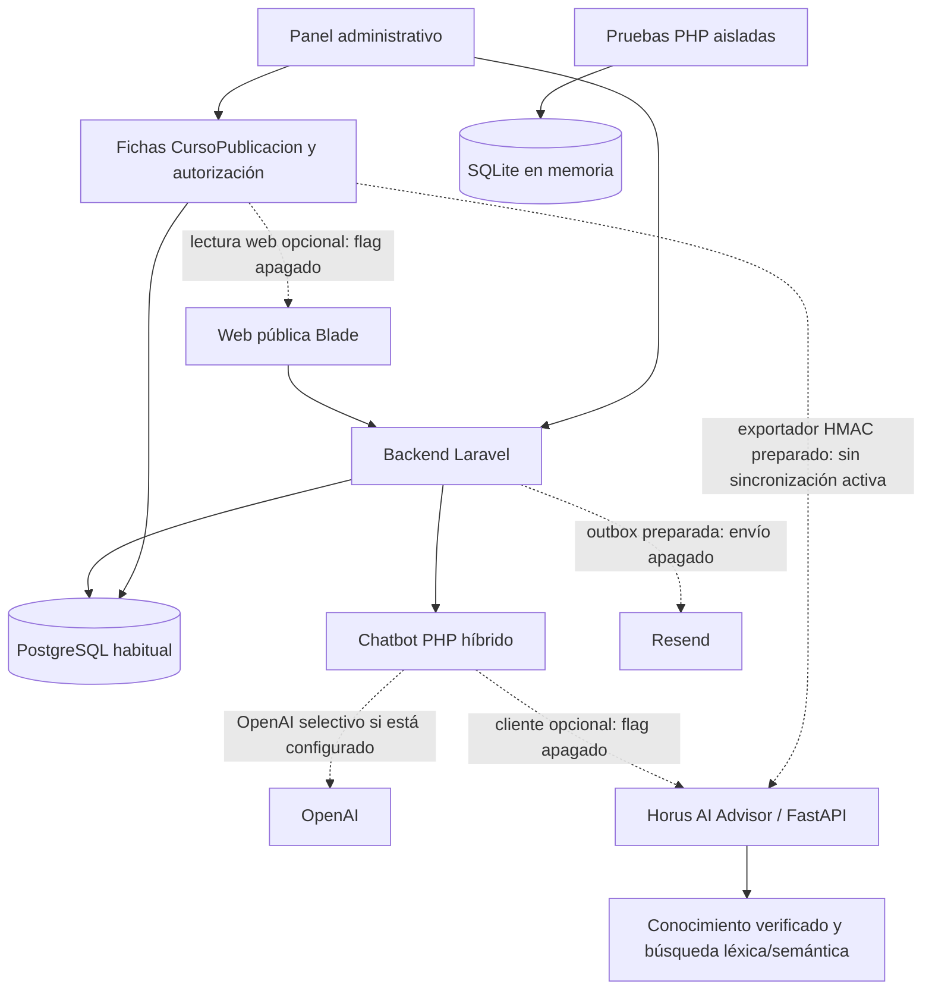

# Horus-System — Contexto técnico del proyecto

| Control de actualización | Estado examinado |
| --- | --- |
| Última actualización | 29 de octubre de 2026, fecha de Lima |
| Rama / HEAD | `anderson` / `8fc4174790be7d8df38b8858cb8c9825c4e237ea` |
| Último sprint documentado | 17.2; esta tarea agrega únicamente documentación |
| Publicación web / catálogo del chatbot PHP / Advisor | Predeterminados apagados, en configuraciones separadas |
| Resend / verificación de correo | Envío de matrícula apagado por defecto; verificación `false` y transporte `null` |
| PostgreSQL S7 / migraciones reales | Suspendidos; ninguna conexión a bases en esta tarea |
| Última validación funcional documentada | Sprint 17.2: 951 pruebas PHP, 6030 aserciones; no se repitieron al redactar este archivo |

**Naturaleza del documento:** contexto operativo sustentado en código, locks, pruebas, Git local e informes existentes. No es autorización para ejecutar procedimientos. [AGENTS.md](AGENTS.md) conserva la prioridad normativa; [CLAUDE.md](CLAUDE.md) contiene los contratos y comandos. Una implementación disponible no acredita activación, aplicación de migraciones ni despliegue.

No se leyeron secretos de `.env`, no se inspeccionaron procesos/servicios ni se consultaron bases para redactar este contexto. Los estados operativos de infraestructura que siguen son observaciones históricas identificadas, no una nueva comprobación en vivo. Los valores dependientes del entorno deben verificarse dentro de una tarea autorizada.

## Índice

1. [Identificación del proyecto](#identificacion)
2. [Stack tecnológico](#stack)
3. [Arquitectura general](#arquitectura)
4. [Estructura del repositorio](#estructura)
5. [Módulos del sistema](#modulos)
6. [Historial de sprints y fases](#historial)
7. [Estado de Git](#git)
8. [Estado de bases de datos](#bases)
9. [Migraciones importantes](#migraciones)
10. [Chatbot PHP](#chatbot-php)
11. [Horus AI Advisor](#advisor)
12. [Integración Laravel–FastAPI](#integracion)
13. [Publicación administrativa y web](#publicacion)
14. [Servicios y cotizaciones](#comercial)
15. [Seguridad y reglas innegociables](#seguridad)
16. [Calidad y pruebas](#calidad)
17. [Pendientes y roadmap](#roadmap)
18. [LEER ANTES DE COMENZAR CUALQUIER TAREA](#guia-agentes)

## 1. Identificación del proyecto

**Horus-System**, para **Horus Group SRL**, reúne una web institucional y un sistema administrativo académico. Su propósito es gestionar estudiantes, cursos, matrículas y cupos, organizar operaciones internas y ofrecer orientación pública con información autorizada. El panel utiliza usuarios administrativos con roles; estudiantes y visitantes no reciben acceso al panel por registrarse.

Usuarios y fronteras: visitantes de la web, cuentas registradas/autenticadas y personal con roles `admin`, `coordinador` o `secretaria`. Los permisos efectivos controlan cada acción; pertenecer al personal no concede todos los permisos. No hay un portal estudiantil completo acreditado por la sola existencia del registro.

Principios: monolito Laravel con validación HTTP y autorización en servidor; transacciones para operaciones relacionadas; protección de cupos; separación entre datos administrativos y fichas públicas; IA opcional con respuestas locales y abstención; servicios externos desactivables; preservación del diseño y del trabajo concurrente. Docentes, Sesiones y Certificados están **excluidos como módulos del negocio**: no desarrollarlos ni reintroducirlos. Que existan textos institucionales sobre certificación no implica un módulo de certificados.

## 2. Stack tecnológico

Las versiones de locks describen dependencias fijadas, no una certificación de producción. Solo PHP y Python se consultaron mediante `--version`; no se arrancó Laravel, Python ni PostgreSQL.

| Componente | Versión/fuente verificada | Responsabilidad |
| --- | --- | --- |
| Laravel / Blade | `12.70.1`, `composer.lock`; requisito `^12.0` | HTTP, ORM, validación, vistas y jobs |
| PHP | CLI local `8.4.26`; requisito del proyecto `^8.2` | Backend principal; no confundir mínimo admitido con versión local |
| PostgreSQL | `18.6` en el acta histórica de Fase A; sin consulta nueva | Base habitual y copia de ensayo |
| SQLite Testing | `:memory:` en `phpunit.xml`; versión del motor no medida aquí | Regresión aislada; no equivalencia plena con PostgreSQL |
| Alpine.js / Tailwind CSS | `3.17.5` / `3.4.19`, `package-lock.json` | Interacción y estilos; fuentes protegidas |
| Vite | `8.3.5`, `package-lock.json` | Compilación de recursos |
| PHPUnit / Larastan / Pint | `11.5.57` / `3.13.2` / `1.32.1`, `composer.lock` | Tests, análisis PHP nivel 6 y formato acotado |
| Spatie Permission | `6.25.0`, `composer.lock` | Roles y permisos |
| Python | CLI local `3.13.0`; proyecto admite `>=3.12,<3.14` | Servicio de IA independiente |
| FastAPI / Pydantic / Uvicorn | `0.162.0` / `2.14.1` / `0.54.0`, locks Python | API, esquemas estrictos y servidor ASGI |
| Sentence Transformers / PyTorch CPU | `5.7.0` / `2.15.0+cpu`, lock semántico | Inferencia semántica opcional |
| Modelo semántico | `sentence-transformers/paraphrase-multilingual-MiniLM-L12-v2` | Modelo preentrenado; no entrenamiento desde cero |

Dependencias adicionales: JWT con `firebase/php-jwt`, PDF con Dompdf, Excel con PhpSpreadsheet y transporte Resend. Consultar [composer.json](composer.json), [composer.lock](composer.lock), [package.json](package.json), [package-lock.json](package-lock.json), [pyproject.toml](chatbot-python/pyproject.toml), [lock básico](chatbot-python/requirements.lock) y [lock semántico](chatbot-python/requirements-semantic.lock). No instalar ni actualizar dependencias solo para alinear este documento.

## 3. Arquitectura general

Las líneas discontinuas representan caminos opcionales o pendientes; el diagrama no acredita procesos funcionando. La web usa sesión/CSRF. La API de autenticación utiliza JWT. El servicio Python no accede a la base administrativa; no administra matrículas, usuarios ni cotizaciones. El catálogo editorial es una proyección pública separada, no un volcado de `cursos`.

Entradas reales: [rutas web](routes/web.php), [rutas API](routes/api.php) y [bootstrap](bootstrap/app.php). No crear rutas equivalentes a las existentes antes de inspeccionarlas.

## 4. Estructura del repositorio

| Ubicación | Responsabilidad |
| --- | --- |
| `app/Http/Controllers/`, `app/Http/Requests/`, `app/Http/Middleware/` | Contratos HTTP, autorización y validación |
| `app/Models/`, `app/Services/`, `app/Support/` | Dominio, operaciones y utilidades; guardas de pruebas en `app/Support/Testing/` |
| `app/Console/`, `app/Jobs/`, `app/Observers/` | Comandos y captura/despacho de avisos de matrícula |
| `routes/`, `config/`, `bootstrap/` | Entradas, configuración y arranque; no leer/imprimir secretos del entorno |
| `database/migrations/`, `database/seeders/`, `database/factories/` | Esquema, permisos iniciales y datos ficticios de pruebas |
| `resources/views/`, `resources/css/`, `resources/js/` | Frontend Blade/Alpine/Tailwind protegido |
| `public/assets/` | Activos institucionales versionados; preservar identidad visual |
| `tests/Feature/`, `tests/Unit/`, `tests/PostgresIntegrity/` | Regresión funcional, unidades y perfil PostgreSQL explícito |
| `tests/frontend/`, `tests/browser/`, `tests/Support/` | Pruebas JavaScript `.mjs`, smokes y fixtures locales |
| `scripts/` | Herramientas acotadas; `pgsql-test.php` exige perfil aislado |
| `docs/` | Informes por sprint y evidencia histórica |
| `chatbot-python/` | Proyecto Python independiente, actualmente sin seguimiento Git |
| `storage/`, `bootstrap/cache/`, `public/build/`, `public/hot` | Datos/artefactos locales; no incorporar logs, caches, sesiones ni compilados a Git |

El backend Laravel está en la raíz, no dentro de otro backend anidado. `vendor/`, `node_modules/`, entornos virtuales y modelos descargados son dependencias locales. El antiguo `legacy-html-node/` solo figura en el historial; no se debe reactivar como un segundo backend.

## 5. Módulos del sistema

«Implementado» significa que existen código, rutas y cobertura relacionada; no confirma disponibilidad contra la base real ni validación completa de todos los recorridos de negocio. El grupo `/admin` exige autenticación y rol de personal. Matriz autoritativa: [RolesAndPermissionsSeeder](database/seeders/RolesAndPermissionsSeeder.php); middleware por acción en cada controlador.

| Módulo / estado del código | Componentes y rutas relevantes | Permisos / cobertura / límites |
| --- | --- | --- |
| Autenticación y usuarios — implementado; verificación preparada y apagada | [Auth web](app/Http/Controllers/Admin/AuthController.php), [Auth API](app/Http/Controllers/Api/AuthController.php), [usuarios](app/Http/Controllers/Admin/UserController.php); `/login`, `/register`, recuperación, `/api/auth/register`, `/login`, `/me`, `/logout` bajo el prefijo `/api/auth`; `/admin/usuarios` | `usuarios.*`; roles no se aceptan del registro público. Pruebas `AdminAuthenticationTest`, `AuthHardeningTest`, `AuthEmailNormalizationTest`, `ApiJwtRoundTripTest`, Sprint 12–14. JWT revocable con `jwt_version`; sesiones de BD revocables; no inventar cierre global de sesiones `array` |
| Roles y permisos — implementado | [RoleController](app/Http/Controllers/Admin/RoleController.php), [AdminProtection](app/Services/AdminProtection.php); `/admin/roles` | `roles.*`, `usuarios.asignar-roles`; `AdminProtectionTest`, `AdminAuthorizationTest`. Protege último admin, rol admin y permisos críticos; nuevos permisos requieren migración, no solo seeder |
| Estudiantes — implementado | [Estudiante](app/Models/Estudiante.php), [controlador](app/Http/Controllers/Admin/EstudianteController.php); CRUD `/admin/estudiantes`, PATCH de restauración | `estudiantes.ver/crear/editar/eliminar/restaurar`; `AdminEstudianteTest`, pruebas de matrículas y filtros. Datos privados, borrado lógico; no exportarlos al conocimiento público |
| Cursos administrativos — implementado | [Curso](app/Models/Curso.php), [controlador](app/Http/Controllers/Admin/CursoController.php); CRUD `/admin/cursos`, PATCH de restauración | `cursos.ver/crear/editar/eliminar/restaurar`; `AdminCursoTest`. Estado activo no autoriza publicación ni demuestra cupos disponibles para inscripción pública |
| Matrículas — implementado, condicionado al esquema real | [MatriculaController](app/Http/Controllers/Admin/MatriculaController.php), [Matricula](app/Models/Matricula.php); CRUD `/admin/matriculas`, PATCH anular/restaurar, GET `/admin/matriculas/exportar/csv` | `matriculas.ver/crear/editar/anular/restaurar/exportar/eliminar`; `AdminMatriculaTest`, `MatriculaOperationsTest`, `MatriculaIntegrityConstraintsTest`, `MatriculaSensitivePermissionsTest`. No eliminar historial ni alterar excepciones de operaciones históricas |
| Cupos — implementado dentro de matrículas | Bloqueo y relectura en operaciones de matrícula; índice parcial y restricciones de `000013` | Mismos permisos de la operación, sin endpoint paralelo. Adquisiciones vigentes exigen estudiante/curso elegibles, no duplicado y cupo. `lockForUpdate` no se mide con SQLite; pruebas PostgreSQL pendientes |
| Publicación editorial — backend/editor/web preparados, consumo apagado | [CursoPublicacion](app/Models/CursoPublicacion.php), [controlador editorial](app/Http/Controllers/Admin/CursoPublicacionController.php), [catálogo](app/Services/CatalogoPublicoCursos.php); GET/PUT/DELETE `/admin/cursos/{curso}/publicacion`, GET `/educacion/cursos` | `cursos.publicar`; `CursoPublicacionTest`, `Sprint17PublicacionTest`, `EditorPublicacionPanelTest`, `CatalogoWebCursosTest`. Editor conectado al panel; fichas solo con autorización separada; depende de `000021` |
| Reportes — implementado | [ReportController](app/Http/Controllers/Admin/ReportController.php), [MatriculasExcelExport](app/Services/MatriculasExcelExport.php); GET `/admin/reportes`, POST `/admin/reportes/exportar/excel` y `/pdf` | `reportes.ver`, `reportes.exportar.excel/pdf`; `AdminReportConsistencyTest`, `ReportExcelExportTest`, `ReportExcelScalabilityTest`. Filtros coherentes, PDF por lote y temporales; XLSX no tiene memoria constante |
| Aprobaciones internas — implementado como flujo genérico | [AprobacionInterna](app/Models/AprobacionInterna.php), [controlador](app/Http/Controllers/Admin/AprobacionController.php); GET/POST/PUT/DELETE `/admin/aprobaciones` | `aprobaciones.ver/gestionar`; cobertura de autorización, filtros, atomicidad y `AprobacionesRespaldoPermissionsMigrationTest`. Estados pendiente/aprobado/rechazado; no sustituye autorización editorial ni constituye aprobación de presupuestos |
| Respaldo — exportación administrativa implementada | [RespaldoController](app/Http/Controllers/Admin/RespaldoController.php); GET `/admin/respaldo`, `/admin/respaldo/exportar` | `respaldo.ver/exportar`; `SecretsAndExportsTest`, `AdminAuthorizationTest`, migración de permisos. ZIP de CSV seleccionados con minimización: **no** backup integral ni herramienta de restauración; backup recuperable requiere procedimiento PostgreSQL autorizado |
| Procesos / atención comercial — parcial, sin CRM acreditado | [ProcesoInterno](app/Models/ProcesoInterno.php), [ProcesoController](app/Http/Controllers/Admin/ProcesoController.php), notificaciones internas; `/admin/procesos`, `/admin/notificaciones`, PATCH de lectura | `procesos.ver/gestionar`; `AdminAuthorizationTest`, `AdminListFilterInputTest`, `AdminNotificacionTest`. Tareas internas con responsable/estado/prioridad; no enlazadas a un expediente comercial completo. Permisos `seguimientos.*` existen, sin CRUD de seguimiento dedicado en las rutas actuales |
| Cotizaciones — sin módulo específico implementado | Orientación por contacto/chat; no modelo, migración, controlador ni rutas propios de cotización encontrados | Sin permisos de cotización específicos acreditados ni pruebas de un flujo completo. No equiparar proceso genérico o texto del chatbot con presupuesto, cálculo, aceptación o envío |
| Chatbot PHP — implementado y conservado | [AsistenteVirtualService](app/Services/AsistenteVirtualService.php), [ChatWidgetController](app/Http/Controllers/ChatWidgetController.php); POST `/chat/mensaje`, GET `/admin/asistente`, POST `/admin/asistente/mensaje` | Público con sesión/CSRF/límites; panel `asistente.ver`. `AsistenteVirtualTest`, `ChatbotHybridTest`, pruebas frontend. El permiso `asistente.entrenar` no acredita entrenamiento implementado |
| Horus AI Advisor — independiente; cliente Laravel preparado y apagado | [API Python](chatbot-python/app/api/routes.py), [cliente Laravel](app/Services/HorusAdvisorClient.php) | Token de servicio, no permisos de panel. Tests Python y `HorusAdvisorTest`/`AdvisorCatalogoTest`; sin sincronización operativa de fichas ni acceso a cotizaciones privadas |

Apoyos existentes: [auditoría](app/Http/Controllers/Admin/AuditoriaController.php), [configuración](app/Http/Controllers/Admin/ConfiguracionController.php), dashboard y búsqueda con permisos. Las notificaciones internas no son correos Resend. Las aprobaciones genéricas no permiten publicar un curso omitiendo `cursos.publicar`.

## 6. Historial de sprints y fases

Resultados **históricos documentados**, no nuevas ejecuciones ni garantía acumulativa en producción. Algunas etapas se consolidaron después en Git; el orden de commits no equivale al de diseño. No hay informes independientes completos de Sprint 01 y 02: se enlaza la consolidación real, sin inventar documentos.

| Etapa | Resultado técnico y frontera conservada | Evidencia / resultado histórico |
| --- | --- | --- |
| 01 | Preselección de matrícula desde ficha de estudiante/curso; conserva autorizaciones | [Consolidación 01–07](docs/consolidacion-sprints-01-07.md), commit `4fda959`; sin cifra independiente atribuida |
| 02 | Coherencia de filtros, PDF por lote y alcance de exportación; agrupado con 03 | [Consolidación 01–07](docs/consolidacion-sprints-01-07.md), commit conjunto `f9ba081`; no separar cifras por suposición |
| 03 | Excel por lotes, celdas/temporales y reducción de memoria; corrige la idea de que `lazy()` basta | [Sprint 03](docs/sprint-03-backend-excel.md): 466 / 2316; memoria sigue dependiendo del libro |
| 04 | Chatbot híbrido local primero, FAQ y OpenAI selectivo; seguridad de enlaces/cliente | [Sprint 04](docs/sprint-04-chatbot-hibrido.md): 513 / 2499; 7 pruebas JS; sin llamadas reales acreditadas |
| 05 | Outbox transaccional para bienvenida de matrícula, cifrado, idempotencia y colas | [Sprint 05](docs/sprint-05-resend-matriculas.md): 537 / 2647; envío apagado |
| 06 | Robustez de operaciones, transacciones y regresiones | [Sprint 06](docs/sprint-06-robustez-backend.md): 557 / 2818 |
| 07 | Matriz de operaciones vigentes/históricas; corrige rechazo anticipado de cupos | [Sprint 07](docs/sprint-07-consistencia-matriculas.md): 617 / 3491 |
| 08 | Reglas completas de matrícula, elegibilidad, cupos y orden de bloqueo | [Sprint 08](docs/sprint-08-reglas-matriculas.md): 667 / 3925; concurrencia PostgreSQL pendiente |
| 09 | Ficha editorial separada, permiso, publicación/retiro, lectura pública autorizada | [Sprint 09](docs/sprint-09-publicacion-cursos.md): 702 / 4231; consumo dinámico apagado |
| 10 | Endurece captura/despacho Resend, recuperación de reservas y fallos | [Sprint 10](docs/sprint-10-preparacion-resend.md): 724 / 4445; sin activar transporte |
| 11 | Reduce consultas e hidratación innecesaria con mediciones | [Sprint 11](docs/sprint-11-rendimiento-backend.md): 729 / 4496; no extrapolar benchmarks |
| 12 | Recuperación de cuenta, seguridad y atomicidad de escrituras | [Sprint 12](docs/sprint-12-seguridad-robustez-backend.md): 756 / 4647; nivel 6 todavía pendiente entonces |
| 13 | Contratos de registro/normalización y tipos para Larastan 6 | [Sprint 13](docs/sprint-13-registro-larastan.md): 765 / 4761; registro no concede privilegios |
| 14 | Registro pendiente/verificación preparados, correcciones de sesión/recuperación | [Sprint 14](docs/sprint-14-verificacion-registro.md): 793 / 5024; flag y mailer apagados |
| 15 | Diagnóstico de integración real, esquema/permisos pendientes y plan supervisado | [Sprint 15](docs/sprint-15-preparacion-integracion.md); plan no equivale a autorización |
| 15-B | Retiene avisos anteriores a activación y agrega permisos faltantes con migración | [Sprint 15 §8](docs/sprint-15-preparacion-integracion.md): 809 / 5166; `held` no se libera al encender envío |
| Fase A PostgreSQL | Backup/restauración verificados y seis migraciones ensayadas sobre copia; habitual intacta | [Sprint 15 §10](docs/sprint-15-preparacion-integracion.md); no acredita Fase B ni concurrencia |
| PostgreSQL S1–S7 | Aprovisionamiento aislado; S3 reconciliado, S7 incompleto | [Procedimiento](docs/postgresql-l2.2-b-provisioning.md), [cierre S3](docs/postgresql-l2.2-b2-s3-cierre.md), [L2.3](docs/postgresql-l2.3-testing.md); detalle en §8 |
| Advisor fase 1 | FastAPI, conocimiento local, búsqueda y contratos; proyecto separado | [README Python](chatbot-python/README.md); no hay acta de fase 1 independiente en `docs/` |
| Advisor sprint/fase 2 | Léxico + semántico, contexto, recomendaciones explicables y evaluación sintética | [README Python](chatbot-python/README.md): reporta 144 básicas + 11 semánticas; no repetidas aquí |
| 16 | Cliente Laravel, exportador HMAC, minimización y fallback PHP | [Sprint 16](docs/sprint-16-horus-ai-advisor.md): 882 / 5531; Advisor apagado, ingestión activa pendiente |
| 17 | Endurece editor/retiros idempotentes, revisión opcional y contrato `paraWeb()` | [Sprint 17](docs/sprint-17-publicacion-cursos.md): 918 / 5765; catálogo web apagado |
| 17.1 | Acceso desde Panel → Cursos y formularios con revisión conservada frente a conflictos | [Sprint 17.1](docs/sprint-17-1-editor-panel.md): 931 / 5873; visual 390/768/1440 |
| 17.2 | Conecta ruta pública al controlador, fichas condicionales y fallos controlados sin rediseño | [Sprint 17.2](docs/sprint-17-2-catalogo-web.md): 951 / 6030; flag sigue apagado |

Complementos: [consolidación 10–14](docs/consolidacion-sprints-10-14.md), [restauración visual](docs/restauracion-web-publica.md). La restauración del diseño y las excepciones de 17.1/17.2 fueron autorizaciones acotadas; no autorizan nuevos cambios visuales.

## 7. Estado actual de Git

Instantánea **antes de esta tarea documental**: rama `anderson`, HEAD arriba indicado, upstream `origin/anderson`. `git rev-list --left-right --count HEAD...origin/anderson` devolvió `0 0`: ningún commit local por delante o detrás de la referencia remota **almacenada localmente**. No hubo `fetch`; no se afirma igualdad con el servidor remoto en tiempo real.

- Índice vacío. 24 archivos versionados modificados y 20 entradas sin seguimiento agrupadas; «sin commit» no significa «commits pendientes».
- Dos stashes preservados: `stash@{0}` (`52e2f29`) y `stash@{1}` (`d69d6ca`). No se aplicaron ni modificaron.
- Trabajo previo especialmente sensible: todo `chatbot-python/`, los tres servicios Advisor y su configuración/pruebas, catálogo editorial, controlador y vistas del editor, conexión pública de 17.2 y ajustes/documentación del perfil PostgreSQL.
- Entre los archivos ya modificados estaba `CLAUDE.md`; esta tarea solo inserta una referencia, conservando su contenido previo. Se agrega `PROJECT_CONTEXT.md` y se añade una instrucción mínima a `AGENTS.md`.
- Se inventariaron por SHA-256 583 archivos versionados o sin seguimiento no ignorados. No se utilizaron ni listaron contenidos de archivos ignorados sensibles.

Los sprints 16–17.2 y el proyecto Python existen en el árbol de trabajo; no se encuentran íntegramente en HEAD. Una sesión nueva debe inspeccionar el árbol, no reconstruirlo desde Git ni limpiar archivos sin seguimiento. No hay autorización de commit/push en esta tarea.

## 8. Estado de bases de datos

No se abrió ninguna conexión para este documento. La fuente operativa más reciente es el informe correspondiente, con fecha histórica. No ejecutar ni siquiera diagnósticos SQL por deducir permiso de esta tabla.

| Entorno | Última evidencia documentada | Restricciones y pendientes |
| --- | --- | --- |
| Habitual `horus_group`, puerto 5432 | Fase A, 28/10: PostgreSQL 18.6, datos reales de desarrollo; origen preservado sin escrituras, 15 migraciones registradas | Las seis migraciones de la Fase A seguían sin aplicar al origen; `000022` suspendida. No usar para tests ni migraciones sin autorización específica. No se afirma que este estado siga idéntico hoy |
| Ensayo `horus_group_ensayo`, puerto 5432 | Fase A, 28/10: copia restaurada de backup y seis migraciones aplicadas; esquema/permisos y datos comparados, sin fichas ni avisos generados | Contiene datos reales copiados: **no es desechable ni base para pruebas destructivas**. Se conserva con el respaldo; no eliminar, truncar ni reutilizar sin permiso |
| Testing, puerto 55432 | L2.3, 28/10: clúster aislado aprovisionado; servicio Manual/Stopped, sin respuesta en el puerto; S7 no completo | Recuperación de credencial del runner y cierre del aprovisionador pendientes. S7 sigue suspendido; no arrancar, reintentar, rehacer ni revertir automáticamente |
| SQLite `:memory:` | `phpunit.xml`; suite de Sprint 17.2 aprobada | Solo datos ficticios, sesión/caché `array`, cola `sync`, correo `array`; no prueba DDL, colación, locks ni concurrencia PostgreSQL |

### Fase A y migraciones en la copia

[Sprint 15 §10](docs/sprint-15-preparacion-integracion.md) acredita backup verificable, restauración con transacción, comparación de metadatos/huellas y aplicación individual de `000012`, `000013`, `000020`, `000021`, `000023`, `000024` en la copia. Ninguna produjo fichas ni envíos. `000022` quedó pendiente. La Fase B sobre la habitual no está acreditada como ejecutada. La ubicación privada del backup y sus contenidos no se reproducen aquí.

Riesgos operativos históricos: la cuenta de aplicación observada tenía privilegios excesivos y la instancia habitual escuchaba fuera de loopback; el backup contenía datos personales y no estaba cifrado, aunque tenía protección de permisos. Son hallazgos registrados, no mediciones nuevas ni autorización para cambiar cuentas, red o archivos.

### PostgreSQL Testing S1–S7

| Etapa | Propósito / evidencia disponible |
| --- | --- |
| S1 | Directorios y ACL; procedimiento registra incidentes y reconciliación. Completada según acta posterior |
| S2 | Servicio y cuenta dedicada, con ACL; completada según acta de cierre S3 |
| S3 | `initdb`; falso positivo de locale reconciliado. Cierre documental, sin presentar la lectura física como prueba SQL completa |
| S4 | Configuración de loopback, puerto 55432, SCRAM y HBA; L2.3 la inspeccionó posteriormente |
| S5 | Hubo arranque previo que permitió validación SQL de S6/S7; L2.3 encontró servicio detenido. No se rehízo la etapa |
| S6 | Roles restringidos, bases `horus_l2_test` / `horus_l2_restore_test` y marcador independiente, recogidos por L2.3 |
| S7 | Validación administrativa correcta, fallo al autenticar runner, `S7Complete=false`; aprovisionador aún habilitado. No es una aceptación final |

El último informe atribuye el punto de parada a una credencial de runner que no coincide. Propone recuperación acotada, pero ninguna propuesta sustituye autorización. No repetir S1–S7 ni alterar DPAPI, HBA, ACL o evidencias para «arreglar» una suite.

Guardarraíles: [PostgresTestGuard](app/Support/Testing/PostgresTestGuard.php), [configuración aislada](config/pgsql-testing-database.php), [runner](scripts/pgsql-test.php), [phpunit.pgsql.xml](phpunit.pgsql.xml), [L2.2-A](docs/postgresql-l2.2-a.md) y [L2.3](docs/postgresql-l2.3-testing.md). Exigen perfil explícito, consentimiento independiente, IP/puerto/base/runner de lista fija y sonda de identidad/privilegios/marcador antes de habilitar escrituras. Rechazan habitual, ensayo, conexiones alternativas y configuraciones inseguras. La preparación de esas guardas no acredita su ejecución destructiva contra PostgreSQL.

## 9. Migraciones importantes

Estado operativo conocido: las seis filas distintas de `000022` se ensayaron en PostgreSQL **solo en la copia de Fase A**; en la habitual seguían pendientes según esa misma acta. Las suites SQLite posteriores no modifican esa situación. No se consultó `migrations` ahora.

| Migración real | Propósito y dependencias | Estado / precaución |
| --- | --- | --- |
| [000012](database/migrations/2026_10_27_000012_add_matriculas_exportar_eliminar_permissions.php) | Agrega `matriculas.exportar/eliminar`, solo admin; depende de Spatie/roles existentes | Aditiva; no resincroniza la matriz completa |
| [000013](database/migrations/2026_10_27_000013_add_matriculas_integrity_constraints.php) | Índice parcial único de matrícula vigente y tres CHECK de cupos/importes; requiere cursos/matrículas y datos compatibles | Preflight debe abortar ante inconsistencias; CHECK se agrega en PostgreSQL, no se simula su DDL con SQLite |
| [000020](database/migrations/2026_10_28_000020_create_matricula_notifications_table.php) | Outbox de avisos con FK a matrículas, unicidad de matrícula/clave de entrega | No genera avisos retroactivos; el observer necesita esta tabla incluso con envío apagado |
| [000021](database/migrations/2026_10_28_000021_create_curso_publicaciones_table.php) | Fichas, FK a cursos/usuarios, permiso `cursos.publicar` para admin | No crea/publica fichas automáticamente. `--pretend` presentó una limitación al necesitar el ID del permiso; no confundir con migración real fallida |
| [000022](database/migrations/2026_10_28_000022_create_registros_pendientes_table.php) | Registros pendientes y soporte de verificación | **Suspendida** en la habitual y excluida de Fase A. Solo aparece aplicada en esquemas SQLite de pruebas; cualquier uso en Testing real necesita autorización de ese perfil |
| [000023](database/migrations/2026_10_28_000023_hold_matricula_notifications_backlog.php) | Pasa avisos previos `pending` sin intentos a `held`; depende de **000020** | No libera avisos ni reenvía; `down()` no revierte la retención |
| [000024](database/migrations/2026_10_28_000024_add_aprobaciones_respaldo_permissions.php) | Cuatro permisos de Aprobaciones/Respaldo; depende de Spatie | Aditiva y conserva asignaciones. Ver/gestionar según rol; exportar respaldo solo admin |

No ejecutar `migrate` general: arrastraría `000022`. Un plan futuro debe revisar destinos y dependencias, backup, ventana y autorizaciones por separado. No se incluye aquí una receta ejecutable. Documentación: [preparación y ensayo](docs/sprint-15-preparacion-integracion.md), [integridad](docs/postgresql-l2.2-c-integridad.md).

Consecuencia funcional documentada cuando falta `000020`: el alta de matrícula puede fallar y revertirse al capturar el aviso, aunque el transporte esté apagado. Cuando faltan permisos de `000024`, Aprobaciones/Respaldo pueden responder 403. No resolverlo relajando permisos ni activando servicios; verificar el esquema solo cuando se autorice.

## 10. Chatbot PHP existente

El motor [AsistenteVirtualService](app/Services/AsistenteVirtualService.php) utiliza FAQ/intenciones, reconocimiento local y conocimiento institucional de [ChatKnowledge](app/Support/ChatKnowledge.php) y [ChatIntentMatcher](app/Support/ChatIntentMatcher.php). Conserva el contrato público `respuesta`, `intent`, `fuente`. Los diagnósticos y datos del panel no deben convertirse en conocimiento público.

Resuelve localmente cuando hay evidencia; OpenAI es selectivo y requiere configuración. No inventar precios, disponibilidad, fechas, políticas o condiciones. [Sprint 04](docs/sprint-04-chatbot-hibrido.md) describe fuentes, métricas y abstención. La integración nueva no elimina este motor: es el flujo normal con Advisor apagado y el fallback cuando la consulta opcional no produce una respuesta válida.

Ruta pública POST `/chat/mensaje`: sesión, CSRF, throttle 30/minuto, mensaje hasta 2000 caracteres y `session_id` hasta 64. Configuración [chatbot.php](config/chatbot.php): ventana de duplicados 60 s, contexto 900 s, presupuesto OpenAI por minuto/sesión y límites de contexto/respuesta. Los metadatos de conversación no autorizan transmitir registros completos ni datos personales a otros servicios.

El catálogo del chatbot (`chatbot.public_catalog_enabled=false`) es distinto del catálogo web. Su lector heredado `vigentes()` conserva su contrato; `paraWeb()` añade comprobación de procedencia editorial vigente. No intercambiar estos métodos ni activar flags para hacer pasar pruebas.

## 11. Horus AI Advisor

Proyecto independiente en [chatbot-python/README.md](chatbot-python/README.md), versión declarada `0.1.0`. API FastAPI local predeterminada `127.0.0.1:8001`, conocimiento JSON verificado, búsqueda léxica y búsqueda semántica opcional en CPU. Modelo multilingüe preentrenado: inferencia y embeddings, **sin entrenamiento desde cero**.

Capacidades implementadas: comprensión de preguntas en español, contexto reciente limitado, cambio de tema, recomendaciones con razones/evidencia/fuentes, aclaración y abstención; orientación académica, servicios y preparación informativa de una solicitud de cotización. No calcula ni consulta presupuestos privados, estudiantes, matrículas o inventarios reales.

### Endpoints y contratos

Fuente: [routes.py](chatbot-python/app/api/routes.py), [esquemas chat](chatbot-python/app/schemas/chat.py), [configuración](chatbot-python/app/core/config.py) y [seguridad](chatbot-python/app/core/security.py).

| Método y ruta | Acceso / significado |
| --- | --- |
| GET `/health` | Público, estado mínimo; no acredita preparación para responder |
| GET `/ready` | Público; estados de conocimiento, semántica, autenticación y catálogo. Revisar cuerpo, no solo HTTP 200 |
| GET `/api/v1/info` | Token; versión, capacidades, búsqueda y límites |
| POST `/api/v1/chat` | Token; `message`, historial y sesión opcionales según esquema; respuesta estructurada con fuentes/recomendaciones |
| POST `/api/v1/recommend` | Token; solicitud estructurada de orientación según Pydantic; no crea inscripción ni cotización |
| POST `/api/v1/catalog/validate` | Token; validación **en seco** de estructura/firma/privacidad; no carga ni persiste el catálogo |

Las rutas privadas exigen `X-Horus-Service-Token`, secreto de al menos 32 caracteres configurado en servidor. No publicar valores ni moverlo al navegador. Los esquemas rechazan campos extra. Predeterminados: mensaje 2000 caracteres, historial máximo 10 elementos, cuerpo normal 32 KiB, validación de catálogo hasta 1 MiB, concurrencia 4 y timeout interno 5 s. Son configurables dentro de los límites de los esquemas; no equivalen al presupuesto más corto de Laravel.

Catálogo firmado: [schemas/catalog.py](chatbot-python/app/schemas/catalog.py) y [services/catalog.py](chatbot-python/app/services/catalog.py). Versión `1.0`, origen `horus-laravel`, ID de versión, generación/caducidad, hasta 500 ítems con identidad estable, estado y campos públicos; campos extra prohibidos. El contrato admite estados como `vigente`, `no_publicado` y `retirado`; no todos son recomendables. Revisa el enum completo antes de generar nuevos estados.

Hay carga opcional desde archivo al **arranque**, mediante `catalog_path`; no hay endpoint de ingestión/recarga activa. La transformación de registros y caducidad se evalúa con el instante de carga y el estado del catálogo queda asociado al conocimiento cargado. La documentación Python describe caducidad y Laravel futuro en términos más amplios: no acredita invalidación dinámica durante un proceso largo. Además, Python usa fecha UTC para esa transformación y el editor usa Lima; requiere conciliación antes de una sincronización operativa.

### Evaluaciones y memoria

El README reporta 144 pruebas básicas y 11 semánticas, 195 consultas y 12 conversaciones **sintéticas**, comportamiento híbrido en test de 84,4 % y robustez de 160 solicitudes con ocho simultáneas. Son informes locales, no una repetición en esta tarea ni evaluación independiente con usuarios reales. El propio informe reconoce una corrección descubierta en test que hace optimista parte de esa cifra. La ausencia de invenciones reportada en ese corpus no garantiza ausencia en producción.

Memoria reportada: modo léxico alrededor de 50 MB de conjunto de trabajo; híbrido con pico aproximado de 1,0–1,1 GB y 1,85–1,9 GB privados. No confundir métricas ni reutilizar la estimación antigua de 228 MB. No se cargó el modelo ni se midió memoria aquí. El coste justifica timeout corto, fallback y activación gradual.

## 12. Integración Laravel–FastAPI

El [Sprint 16](docs/sprint-16-horus-ai-advisor.md) incorporó [HorusAdvisorClient](app/Services/HorusAdvisorClient.php), [ExportadorCatalogoAdvisor](app/Services/ExportadorCatalogoAdvisor.php), [FirmaCatalogoAdvisor](app/Services/FirmaCatalogoAdvisor.php) y [configuración](config/horus-advisor.php). `horus-advisor.enabled=false` literal: con flag apagado no exige Python ni genera solicitudes al servicio.

- El cliente usa HTTP Laravel; solo permite URL HTTP de IP literal `127.0.0.1` y puerto válido, sin DNS, redirecciones ni destinos externos. Desactiva proxy/cookies y no aplica reintentos automáticos.
- Conexión predeterminada 0,4 s; presupuesto total compartido `/ready` + chat de 2,5 s, acotado a 3 s. Respuesta hasta 64 KiB y validación estructural/fuentes antes de adaptarla.
- Solo se consulta en el contexto público previsto, para intenciones admitidas. Laravel construye preguntas fijas por tema: **no envía el mensaje libre original, historial, sesión ni registros privados**. La capacidad conversacional Python no implica que Laravel ya la utilice.
- Red caída, timeout, autorización fallida, errores HTTP, JSON inválido, vacío o contrato incompatible producen fallback PHP, sin error técnico al visitante ni duplicación innecesaria de OpenAI o acciones comerciales.
- Por seguridad de invalidación, el cliente actual acepta orientación solo cuando `/ready` indica catálogo `none`; rechaza también catálogos cargados, obsoletos o fallidos. No elimina esta barrera para probar la exportación.

El exportador exige actor con `cursos.publicar` y ficha vigente con autor que conserve permiso. Construye un snapshot en memoria; no publica ni transmite por sí mismo. Máximo 500 ítems/1 MiB; falla antes de exportar parcialmente un catálogo excesivo. Usa campos públicos permitidos y filtros adicionales de privacidad; nunca estudiantes, matrículas, clientes o cotizaciones.

Firma exacta: HMAC-SHA256 sobre UTF-8, JSON compacto, claves de objetos ordenadas recursivamente, Unicode y barras sin escapes innecesarios, listas en orden. Campos firmados: `schema_version`, `catalog_version`, `source_system`, `generated_at`, `expires_at`, `items`; `signature` queda fuera del payload y tiene prefijo `hmac-sha256:`. Clave externa, mínima de 32 caracteres; nunca hardcodear valores. El snapshot Laravel dura como máximo cinco minutos y se acorta al límite de vigencia local, aunque el esquema Python admita hasta 90 días.

**Pendiente:** distribución, carga efectiva, renovación, reconciliación de fecha/zona y retirada/invalidez segura en el motor activo. Un TTL firmado no invalida por sí solo registros ya materializados al arranque. `/catalog/validate` devuelve validación, no sincronización. No hay catálogo sincronizado en producción ni autorización para activar Advisor.

## 13. Publicación administrativa y web

Secuencia de reutilización: Sprint 09 crea base editorial; 17 refuerza backend y lectura; 17.1 conecta el editor al panel; 17.2 conecta la página pública condicional. No crear un segundo editor ni copiar automáticamente datos administrativos.

Acceso Panel → Cursos: acción de publicación visible con `cursos.publicar`, comprobado también en servidor. Admin dispone de ese permiso por defecto; coordinador/secretaría necesitan concesión explícita y mantienen los requisitos del grupo administrativo. GET/DELETE admiten curso eliminado para consultar/retirar; PUT no publica cursos eliminados o inactivos.

El GET editorial entrega ETag fuerte. PUT/DELETE aceptan precondición `If-Match`; los formularios envían `_revision`. Revisión desactualizada: JSON/cabecera recibe 412; formulario recibe error de validación con borrador y revisión antigua conservados y acción explícita «Cargar versión actual». No se sobrescribe silenciosamente ni se actualiza el token para reenviar sin revisar. Formatos ambiguos/invalidos se rechazan. Clientes antiguos **sin** precondición siguen admitidos por compatibilidad: no afirmar protección obligatoria universal. Publicar/retirar repetidamente no duplica cambios ni auditoría cuando es la misma operación.

[CatalogoPublicoCursos::paraWeb()](app/Services/CatalogoPublicoCursos.php) devuelve `version`, `habilitado`, `total`, `cursos`. Proyecta siete campos: título, resumen, modalidad, horario, texto de inscripción y fechas de vigencia. Exige publicación explícita, autorización existente/no futura, autor actualmente autorizado, curso activo no eliminado y fechas vigentes inclusivas en Lima. Retiro/caducidad se releen por petición; no hay snapshot web retenido.

`catalogo-publico.enabled=false` conserva el contenido original y evita consultar esquema/catálogo. Encendido solo en pruebas aisladas: [controlador público](app/Http/Controllers/CursosPublicosController.php) y [vista](resources/views/pages/educacion/cursos.blade.php) añaden «CURSOS PUBLICADOS» después de las tarjetas de modalidades originales, con sus mismas clases. No son cursos estáticos duplicados. No inventa imágenes, precios, duración, cupos ni certificados. `inscripcion` es texto escapado, no enlace ni autorización de matrícula; la consulta usa `/contactos`.

Vacío: aviso sin cursos inventados. Esquema incompleto o `QueryException`: contenido estático y HTTP 200 controlado, con código técnico seguro en logs, sin SQL/credenciales/datos. Fichas heredadas inválidas se omiten. La presentación se limita a 50, con total/rango/orden visibles; el servicio aún obtiene todos los resultados válidos en una consulta, por lo que falta paginación SQL para gran volumen. Sin N+1 en la regresión medida. Respuesta `no-store, private`.

Requiere `000021` en el destino y revisión independiente del contenido antes de activar. No hay prueba de publicación real ni activación por detectar tablas. Referencias: [Sprint 09](docs/sprint-09-publicacion-cursos.md), [17](docs/sprint-17-publicacion-cursos.md), [17.1](docs/sprint-17-1-editor-panel.md), [17.2](docs/sprint-17-2-catalogo-web.md).

## 14. Servicios y cotizaciones

Servicios tecnológicos públicos reales: cableado estructurado, cámaras de seguridad, soporte y mantenimiento, en las rutas `/tecnologias/cableado-estructurado`, `/tecnologias/camaras-seguridad`, `/tecnologias/soporte-mantenimiento`. Son vistas fijas en [pages/tecnologias](resources/views/pages/tecnologias), con contenido/imágenes existentes. Asesoramiento y capacitaciones también son páginas públicas, no módulos editoriales completos.

No se encontró modelo/migración/CRUD editorial de servicios ni integración panel→web equivalente a cursos. Un Sprint 18 deberá acordar campos, estados, autorización, almacenamiento de imágenes y compatibilidad con el diseño antes de construirlo. No convertir las páginas fijas automáticamente en registros.

Atención actual: contacto público, orientación del chatbot, tareas internas (`ProcesoInterno`), aprobaciones y notificaciones genéricas. La presencia de permisos `seguimientos.*` no demuestra un centro de consultas/seguimiento implementado. El formulario visible de contacto tampoco acredita un backend de leads: las rutas actuales no exponen un POST dedicado de recepción comercial.

No se encontró módulo específico de cotizaciones. Un Sprint 19 propuesto deberá separar solicitud pública, gestión privada, estados/aceptación, importes, permisos, auditoría e idempotencia; definir efectos secundarios y tratamiento de resultados inciertos antes de envíos/reintentos. No hay fechas aprobadas ni autorización de implementación en este documento.

Contenido público autorizado y datos privados comerciales tienen ciclos de vida diferentes. No publicar clientes, documentos, presupuestos internos o precios calculados en catálogos ni enviarlos a Python. Advisor puede orientar sobre cómo solicitar una cotización sin acceder al expediente.

## 15. Seguridad y reglas innegociables

Fuente normativa: [AGENTS.md](AGENTS.md), contratos de [CLAUDE.md](CLAUDE.md), [seguridad L1.1](docs/seguridad-l1.1.md). Este resumen no sustituye ni amplía sus reglas.

- Backend por defecto. Preservar frontend, diseño, página principal y contenido fijo; excepciones necesitan autorización específica y no son precedentes para otro sprint.
- No tocar bases reales, ensayo ni S7 por inferencia. No ejecutar migraciones generales, limpiezas de datos, aprovisionamiento ni recuperaciones automáticas.
- No modificar `.env`, credenciales, perfiles locales protegidos ni salvaguardas. No exponer secretos, conversaciones o datos personales en código, logs, documentación o navegador.
- No activar Resend, verificación de correo, catálogo dinámico o Advisor para resolver pruebas. No enviar correos ni llamadas reales a OpenAI sin autorización concreta.
- No reanudar S7 ni alterar sus puertos/nombres/ACL/HBA/marcador. Las propuestas de infraestructura son planes, no permisos.
- Preservar cambios sin commit, Python, índice, commits y stashes. No usar limpiezas masivas ni descartar trabajo ajeno.
- No commit, push, merge, rebase, tag o despliegue sin autorización específica. No modificar stashes.
- No reintroducir Docentes, Sesiones o Certificados. No ampliar permisos por conveniencia; permisos nuevos requieren constante del seeder y migración propia.
- Bloquear y releer dentro de transacción las operaciones de cupos/permisos sensibles. Conservar el orden cursos → estudiantes → matrícula y las excepciones históricas documentadas.

### Discrepancias documentales conocidas

`CLAUDE.md` todavía dice que el controlador público no está enrutado y que solo existe la lectura `vigentes()`; el código actual y Sprint 17.2 confirman ruta conectada y `paraWeb()`, con ambos catálogos apagados por separado. La prohibición general de enrutar/modificar contenido no se elimina: hubo una autorización concreta y limitada para 17.2. Esta tarea solo añade enlace al contexto en esa guía, sin reescribir sus reglas previas.

El comentario de `config/catalogo-publico.php` describe la preparación anterior, y el README Python aún presenta la integración Laravel como futura. En Laravel ya existe cliente opcional, pero sigue apagado y sin sincronización operativa. Las afirmaciones de caducidad en ese README deben contrastarse con la carga al arranque. Los encabezados antiguos de L2.2-A/B/S3 describen etapas anteriores; L2.3 aporta la observación posterior de S7. Señalar la discrepancia antes de una tarea cuyo alcance dependa de resolverla; no interpretar este contexto como autorización para sobrepasar las reglas.

## 16. Estado de calidad y pruebas

**Último resultado funcional comprobable documentado: Sprint 17.2.** No se ejecutó una nueva suite para esta tarea exclusivamente documental.

| Comprobación histórica | Resultado / límite |
| --- | --- |
| PHP completo, SQLite `:memory:` | 951 aprobadas, 6030 aserciones |
| Selección editorial/web/editor/exportador | 127 aprobadas, 923 aserciones |
| Larastan nivel 6 | Sin errores |
| Pint acotado / `git diff --check` | Aprobados; Pint global tiene formato preexistente ajeno |
| Vite build / pruebas frontend | Aprobado / siete aprobadas |
| Smoke visual de catálogo | 15 casos: cinco estados a 390/768/1440; sin solicitudes externas ni excepciones JS |
| Python | README reporta 144 básicas + 11 semánticas; no ejecutadas por este documento |
| PostgreSQL | Ensayo DDL en copia histórico; suite de concurrencia/perfil aislado pendiente de recuperación y autorización |

Comandos de referencia para tareas futuras autorizadas: `php artisan test --compact --filter=Clase`, suite `php artisan test --compact`, `php vendor/bin/phpstan analyse --no-progress`, Pint sobre archivos propios, `npm test`, `npm run build`, `git diff --check`. [phpunit.xml](phpunit.xml) fija aislamiento SQLite; no usar el perfil PostgreSQL de forma implícita. No ejecutar comandos de setup/dev que generen claves o migren.

Los smokes locales tienen destinos distintos: leer cabecera y fixture antes de ejecutarlos. [Editor](tests/browser/editor-panel-smoke.mjs) usa `127.0.0.1:8771`; [catálogo](tests/browser/catalogo-web-smoke.mjs), `127.0.0.1:8772`. Reconstruyen datos ficticios en SQLite por petición y no prueban persistencia/contención PostgreSQL. No dirigirlos a un servidor cotidiano con datos reales. No declarar validación visual solo por build ni éxito de proveedor por HTTP simulado.

Limitaciones: métricas sintéticas no garantizan experiencia real; SQLite no valida locks/DDL/colación PostgreSQL; HTTP falso no demuestra entrega de correo, disponibilidad de OpenAI/FastAPI ni despliegue. `accepted` en avisos no es confirmación de entrega al destinatario; estados inciertos no permiten reenviar indiscriminadamente.

## 17. Pendientes y roadmap

Orden propuesto por el propietario para organizar futuras tareas; **no autoriza su ejecución ni asigna fechas**. Decisiones ya vigentes: preservar diseño y PHP, separar publicación/datos privados, mantener activaciones apagadas, `000022` y S7 suspendidos, no modificar módulos excluidos.

| Prioridad propuesta | Dependencia antes de ejecutar |
| --- | --- |
| 1. Consolidar contexto y continuidad | Este documento; mantener solo secciones afectadas cuando esté incluido en el alcance |
| 2. PostgreSQL Testing real | Autorización de recuperación acotada, credencial/identidad, cierre S7 y guardas; no repetir aprovisionamiento completo |
| 3. Migraciones controladas | Autorizar base/ventana/backup/archivos específicos; no activar verificación ni aplicar `000022` a habitual |
| 4. Activación editorial en entorno autorizado | Revisar `000021`, permiso/autores, fichas reales, retiros/caducidad, logs y rollback operativo del flag |
| 5. Sprint 18, administración de servicios | Definir contrato editorial y permisos; aprobar cambios mínimos de panel/web que resulten necesarios |
| 6. Sprint 19, cotizaciones y flujo comercial | Diseñar frontera pública/privada, autorización, auditoría, estados, idempotencia y efectos secundarios |
| 7. Distribución/invalidez del catálogo Python | Resolver carga/recarga, retirada, expiración en caliente y zona horaria; no basta validar HMAC |
| 8. Validación independiente del chatbot | Corpus separado, usuarios/casos reales autorizados, privacidad, calidad y consumo de recursos |
| 9. Integración funcional gradual de Advisor | Revisar contrato Python vigente, seguridad, timeout/fallback y observabilidad antes de activar |
| 10. Despliegue y operación | Autorizaciones separadas, privilegios mínimos, backup recuperable, workers/scheduler y control de activaciones |

Deuda adicional acotada: paginación de lectura web para catálogos grandes, imágenes/campos editoriales enriquecidos si se aprueban, actualización de referencias históricas contradictorias y límites de memoria de Excel/semántica. No convertir esta lista en una reimplementación general.

## 18. LEER ANTES DE COMENZAR CUALQUIER TAREA

1. Leer [AGENTS.md](AGENTS.md): alcance y prohibiciones vigentes. La instrucción concreta del propietario define qué trabajo está autorizado.
2. Leer [CLAUDE.md](CLAUDE.md) para contratos técnicos, comandos y validación; preservar sus restricciones aunque una descripción histórica esté desactualizada.
3. Leer este contexto, empezando por la fecha, rama, HEAD y activaciones. No asumir que su instantánea siga siendo exacta.
4. Consultar el informe específico del módulo y contrastarlo con rutas, controlador, request, servicios/modelos y pruebas. No utilizar memoria conversacional como única evidencia.
5. Revisar Git, índice y cambios existentes antes de editar. Inventariar qué pertenece a trabajos anteriores; no tocar stashes ni hacer limpieza.
6. Identificar alcance, entornos y restricciones. Ante discrepancias que cambien el alcance, informarlas y consultar; un plan documental no autoriza escrituras.
7. Reutilizar lo ya implementado. No crear otro editor, cliente, exportador, chatbot, ruta o módulo por no haberlo localizado.
8. Ejecutar solo las comprobaciones adecuadas a la tarea. Diferenciar evidencia histórica de nueva y SQLite/fixtures de PostgreSQL/proveedores reales.
9. Preservar trabajo previo y datos; informar archivos propios, resultados, límites y pendientes. No activar flags ni relajar guardas para conseguir un resultado verde.
10. Al cerrar un sprint, actualizar únicamente las secciones afectadas de este contexto **si está incluido en el alcance autorizado**, con fecha/HEAD, fuente y nivel de evidencia. No reescribirlo entero ni instalar automatizaciones, agentes residentes o procesos de mantenimiento.

Este archivo se mantiene como documentación del repositorio. Su creación no modifica la memoria externa de Codex ni autoriza guardar información fuera del alcance del proyecto.
