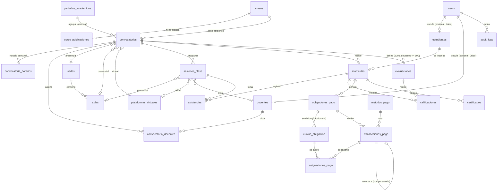

# 01 · ERD de Horus Academic

> **Fase 1 (16/11/2026) · solo diseño.** Nada de este documento se ha migrado ni ejecutado. Las entidades marcadas
> «existente» se verificaron contra `apps/api/database/migrations/` (hasta `2026_11_15_000060`); las marcadas «nueva» son
> propuestas. Convención: español, tablas en plural, sin renombrar tablas existentes (decisión del propietario, punto 6).

## 1. Equivalencias con el modelo de referencia

| Referencia (prompt maestro) | Entidad en Horus | Estado |
| --- | --- | --- |
| users, roles, permissions, user_roles, role_has_permissions | `users` + tablas de Spatie (`roles`, `permissions`, `model_has_roles`, `role_has_permissions`) | Existente; sin cambios |
| students | `estudiantes` | Existente; **+ `user_id`** (nullable, único) |
| courses | `cursos` (+ `curso_publicaciones`) | Existente |
| course_offerings (edición) | `convocatorias` | Existente; en la UI se muestra como «Edición» |
| offering schedule | `convocatoria_horarios` | Existente (horario semanal; no es una sesión) |
| enrollments | `matriculas` | Existente (`convocatoria_id`, `nota_final`, `resultado`) |
| evaluations / grades | `evaluaciones` / `calificaciones` | Existente |
| audit_logs | `audit_logs` | Existente |
| instructors, offering_instructors | `docentes`, `convocatoria_docentes` | **Nuevas** (hoy `docente` es texto libre en el horario) |
| academic_periods | `periodos_academicos` | **Nueva** |
| campuses, classrooms, virtual_platforms | `sedes`, `aulas`, `plataformas_virtuales` | **Nuevas** (hoy `lugar` es texto libre) |
| class_sessions | `sesiones_clase` | **Nueva** |
| attendances | `asistencias` | **Nueva** |
| payment_accounts | `obligaciones_pago` (+ `cuotas_obligacion`) | **Nuevas** |
| payment_transactions | `transacciones_pago` | **Nueva** |
| payment_allocations | `asignaciones_pago` | **Nueva** |
| payment_methods | `metodos_pago` | **Nueva** |
| certificates | `certificados` | **Nueva** |

No se crean tablas duplicadas: `calificaciones`, `evaluaciones`, `matriculas`, `convocatorias` y `audit_logs` se reutilizan.

## 2. Diagrama

## 3. Decisiones de modelado

1. **Curso → Edición → Sesión → Matrícula.** `convocatorias` es la edición. No se renombra la tabla; el contrato público
   (`/academico/convocatorias`) se conserva y la UI muestra «Ediciones». Un alias de rutas (`/academico/ediciones`) queda
   como decisión pendiente (ver README §Decisiones pendientes).
2. **Vínculo estudiante–usuario:** `estudiantes.user_id` nullable con índice único (un usuario, un expediente). Sin
   endpoints de estudiante hasta que se autorice el portal.
3. **Infraestructura por edición, no por curso.** `convocatorias` recibe `sede_id`, `aula_id`, `plataforma_virtual_id`
   (nullable). La coherencia con `modalidad` se impone con `CHECK … NOT VALID` en PostgreSQL (filas heredadas no se
   invalidan, pero cualquier edición posterior las obliga a normalizarse) y con disparadores equivalentes en SQLite, igual
   que las migraciones `000030` (reclamaciones) y `000032` (que crean disparadores SQLite equivalentes); las `000039`, `000041` y `000056` validan solo en PostgreSQL y dejan la regla al servicio en SQLite. Ver [04](04-normalizacion-infraestructura-docentes.md).
4. **Matrícula sin edición:** hoy `matriculas.convocatoria_id` es nullable (matrículas heredadas por curso). Se conserva;
   asistencia, certificado y obligación de pago exigen edición (la heredada debe asignarse a una antes). Ver
   [08](08-plan-migraciones.md) §Matrículas heredadas.
5. **Finanzas como libro mayor inmutable.** `matriculas.monto_pagado` pasa a ser un valor **derivado** (caché mantenida en
   la misma transacción que escribe el libro). Ver [05](05-diseno-financiero.md).
6. **Soft deletes solo donde ya hay justificación funcional:** `docentes` (historial de ediciones). `sedes`, `aulas`,
   `plataformas_virtuales` y `periodos_academicos` se **desactivan** (`estado`), no se borran; el libro financiero y los
   certificados **nunca** se borran ni se actualizan.
7. **Claves foráneas `RESTRICT`,** como en `convocatorias`/`evaluaciones`/`calificaciones`: nada se borra en cascada.
8. **Identificadores públicos:** las entidades expuestas por la API usan `identificador` (UUID), como `convocatorias` y
   `evaluaciones`; el `id` numérico no sale de la API de las tablas nuevas.
